# RYFT platform — agent fleet

How Claude Code is used on `plattform/` as a small platform team: a lead, specialists who build, independent
reviewers, an SRE and a debugger. This page is the overview only. **The fleet definition lives locally on the
maintainer's machine and is not part of this repository**: the agent files, the shared conventions skill, the
settings and the hook scripts sit in an untracked `.claude/` directory. What the agents must follow is tracked
here: `CLAUDE.md`, `docs/DECISIONS.md`, `docs/ARCHITECTURE.md`, `docs/API.md` and `docs/OPERATIONS.md`. The iOS
app has its own fleet and its own repository; the two meet only through `docs/API.md` (here) and
`docs/API_REQUESTS.md` (in the app repository).

## Org chart

```mermaid
flowchart TB
    user([Tim · product owner · applies Terraform])
    lead[platform-lead<br/>plan · delegate · integrate · PR · command list]
    subgraph design [Design]
        arch[platform-architect<br/>design notes · DECISIONS]
        api[api-contract-owner<br/>docs/API.md · Swift mirror]
    end
    subgraph build [Build]
        be[backend-engineer<br/>api · ingest · notify · events]
        sci[scoring-scientist<br/>scores · insights · model version]
        db[database-engineer<br/>migrations · grants · RLS]
        ops[gitops-engineer<br/>deploy/ · Argo CD · CI · promote]
        infra[infra-engineer<br/>Terraform, prepared not applied]
        web[web-engineer<br/>web/ · ryftapp.de · legal]
        test[test-engineer]
    end
    subgraph verify [Verify · read-only]
        rev[code-reviewer]
        sec[security-privacy-reviewer]
    end
    sre[sre<br/>metrics · alerts · SLOs · runbooks]
    dbg[debugger<br/>root causes · CI · incidents]
    user --> lead
    lead --> arch & api
    lead --> be & sci & db & ops & infra & web & test
    lead --> rev & sec & sre & dbg
    infra -. plan/apply commands .-> user
```



## Roster

| Agent | Real-team role | Writes | Model | Typical trigger |
| --- | --- | --- | --- | --- |
| `platform-lead` | Tech lead | glue | session's | any brief spanning > 1 specialist |
| `platform-architect` | Staff engineer | `docs/work`, `DECISIONS.md` | opus | new service/event/table family, repo layout, failure modes |
| `api-contract-owner` | API owner | `docs/API.md` | sonnet | app request, shape/code/header change |
| `backend-engineer` | Go engineer | `backend/` (not scoring, not migrations) | session's | handlers, store, events, notify, admin |
| `scoring-scientist` | Data scientist | `internal/scoring`, `insights`, `behavior`, `SCORING.md` | opus | anything that moves a number |
| `database-engineer` | DBA | migrations, grants, RLS | sonnet | schema, slow query, retention |
| `gitops-engineer` | Deployment engineer | `deploy/`, workflows, promote | sonnet | manifests, Argo CD, CI, images |
| `infra-engineer` | Cloud/IaC engineer | `infra/` (never applies) | sonnet | Terraform, DNS, add-ons, Vault |
| `web-engineer` | Frontend engineer | `web/` | sonnet | site, legal pages, AASA |
| `test-engineer` | QA engineer | tests | sonnet | every behaviour change |
| `code-reviewer` | Senior reviewer | — | opus | every PR |
| `security-privacy-reviewer` | AppSec / DPO | — | opus | auth, data, logs, secrets, network, processors |
| `sre` | SRE | alerts, dashboards, runbooks | sonnet | runtime/metrics/rollout changes, "is prod OK?" |
| `debugger` | On-call | minimal fixes | sonnet | red CI, failed sync, crash loop, request-ID errors |

Adapted from agents in [lecole/claude-code-agents](https://github.com/lecole/claude-code-agents)
(MIT © Seth Hobson) — `golang-pro`, `backend-architect`, `architect-review`, `cloud-architect`,
`kubernetes-architect`, `deployment-engineer`, `terraform-specialist`, `database-architect`, `database-optimizer`,
`database-admin`, `observability-engineer`, `incident-responder`, `security-auditor`, `backend-security-coder`,
`test-automator`, `tdd-orchestrator`, `code-reviewer`, `debugger`, `error-detective`, `devops-troubleshooter`,
`frontend-developer` — rewritten for RYFT's stack and rules.

## Workflow

1. **Plan** (lead) → `docs/work/<date>-<slug>/plan.md` with criteria, owners, rollback, user steps.
2. **Design / contract first** (architect, api-contract-owner) when structure or the API changes.
3. **Build** (one writer per file set; test-engineer in parallel once interfaces are agreed).
4. **Verify in parallel** (code-reviewer always; security-privacy-reviewer and sre by trigger).
5. **Ship**: PR → CI green → merge → promote PR → Argo CD. Terraform: the user runs the printed commands.
6. **Close**: STATUS, DECISIONS, OPERATIONS; one "Needs you" list.

Other flows: **App request** → api-contract-owner → implementer → review → PR, then tell the app session the
changelog date. **Incident** → debugger + sre (read-only), prepared mitigations for the user, postmortem in
STATUS. **Scoring change** → scoring-scientist (version bump, changelog, rescore plan) → code-reviewer → PR → the
user runs the rescore.

## Running it

```bash
cd plattform && claude --agent platform-lead
```
Then paste the brief or the roadmap milestone. `/agents` lists and edits the fleet (local definitions only).

## Guard rails (enforced locally)

These are configured in the local, untracked `.claude/settings.json` and `.claude/hooks/`; the repository's own
checks (CI, `.githooks`) do not depend on them.

- `pre-tool-guard.sh` (PreToolUse on Read/Edit/Write/Bash) blocks: reading or writing `terraform.tfvars`,
  `*.tfstate`, `.terraform/`, `.env`, `secrets.yaml`; edits to generated `overlays/vault-namespaces/**` and RabbitMQ
  topology outputs; writes into `../app`; new text with a denylisted brand name (except the brand check's own
  files); `terraform apply|destroy|import|state …`; break-glass make targets; `helm install|upgrade`; mutating
  `kubectl` against the production context (local clusters are fine).
- `post-edit-format.sh`: `gofmt` on Go, `terraform fmt` on HCL.
- `settings.json`: no force-push or push to `main`, no `--no-verify`, no admin merges, no secrets/variables or
  branch-protection changes from an agent; merges, workflow dispatches, repo edits, tags, `terraform plan` and
  `argocd app sync` always ask.
