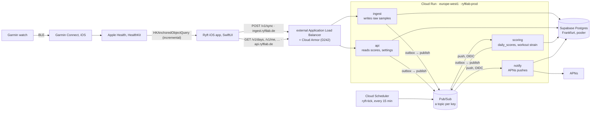

# RYFT — architecture

RYFT: a watch or ring (during development, a Garmin) feeds Apple Health, an iOS
app ships that data to Go microservices on Google Cloud Run, and the services turn it into
daily **Readiness**, **Recovery**, **Strain** and **Sleep** scores the app renders. The
HTTP contract with the app is [`API.md`](API.md). What runs where: [Where it runs](#where-it-runs)
(GCP since D216; a `D<n>` is an entry in [`DECISIONS.md`](DECISIONS.md)).



Pub/Sub also pushes the tick to every service's `POST /internal/tick` (Events below).

## Why HealthKit and not the Garmin API

Garmin's Connect Developer Program (Health/Activity APIs) is approval-only, aimed at
businesses, and stopped accepting new applications in 2026. Garmin Connect already
writes heart rate, resting HR, HRV, respiratory rate, SpO2, sleep (with stages on
current firmware), workouts, steps and active energy to Apple Health, so reading
HealthKit gets the same signals with a stable, documented API and no credentials on
the server. It also makes the platform watch-agnostic.

Garmin-only metrics (Body Battery, Training Readiness, HRV *status*) do not reach
HealthKit. If you ever want them, add a `garmin-sync` service that uses the
unofficial Connect client (`garth` / `python-garminconnect` style) and writes into
the same `samples` table with new `type` values — nothing else changes.

## Services

| Service   | Port | Responsibility | Talks to |
| --- | --- | --- | --- |
| `ingest`  | 8080 | `POST /v1/sync`: validate, idempotent upsert of samples / sleep / workouts, publish `ingested` with the local days touched (through its outbox) | Postgres, Pub/Sub |
| `scoring` | 8080 (push, tick, health) | Take `ingested` and `session.completed` from Pub/Sub's pushes (`/push/<key>`); recompute touched days oldest-first, including the day's strength sessions and the workouts carrying their load; on each tick (every 15 min) recompute yesterday + today; publish `scored` (today's first recovery), `session.scored` and `refresh` (a sync's days scored) | Postgres, Pub/Sub |
| `api`     | 8080 | `GET /v1/me`, `PATCH /v1/me`, `GET /v1/days`, `GET /v1/days/{day}`, `GET /v1/sleep`, `GET /v1/workouts[/{id}]`, `GET /v1/trends`, `GET /v1/insights`, `POST /v1/recompute`, Train (`/v1/exercises`, `/v1/plans`, `/v1/sessions`), the journal (`/v1/behaviors`, `/v1/journal/{day}`, `/v1/behaviors/impact`), `GET /v1/config`, `GET /v1/model`, consent and invite (`/v1/me/consent`, `/v1/me/invite`), `POST /v1/feedback`, push registration and preferences — see [`API.md`](API.md); the operator's `/v1/admin/` flags, invites, feedback and users | Postgres, Pub/Sub |
| `notify`  | 8080 (push, tick, health) | Take `scored`, `session.scored` and `refresh` from Pub/Sub's pushes; send APNs pushes; on each tick the no-data check | Postgres, Pub/Sub, APNs |

All four are one Go module (`backend/`), one Dockerfile (`--build-arg SERVICE=…`), and
share `internal/` packages. A fifth binary, `migrate`, is the only thing that changes the
schema: it runs once per deploy as the schema owner (the Cloud Run job `migrate`, which
`deploy.yml` runs before any service rolls, or a one-shot compose service), applies each
migration in a transaction under a transaction-level advisory lock (safe behind Supabase's
pooler), and sets the services' role passwords. The
services connect as least-privilege roles (below) and wait at start-up until the schema
has every migration they were built with.
Each serves `/health/live` and `/health/ready` (and `/healthz`, `/readyz` for compose) on
one port, HTTP/1.1 and h2c (D220). On Cloud Run nothing reads the app's own metrics: Cloud
Monitoring reads what Cloud Run and Pub/Sub measure and two log-based counters (D236), and the
OTLP push (D224) is dormant; locally `/metrics` stays on 9090 — metric catalogue and
dashboard in [`OBSERVABILITY.md`](OBSERVABILITY.md).

**Lifecycle.** All four services start and stop through `internal/app`: their `main` hands
`app.Main` a `Spec` (settings, and a `Build` that returns the routes, push handlers and tick
steps), and app does the rest in one order. The settings (OTLP's included) are read before
anything connects (D78); then the transport (its one network call is the first fetch of
Google's JWKS, at most 10 s), then **the HTTP port, before the pool** (D220): `/health/live`
answers at once, which is Cloud Run's startup and liveness probe, the ready paths answer 503
until the start is done, other requests wait up to 5 s for it, and a tick that comes before
the pool is open sets `ryft_db_up` 0 and pushes the metrics. Then the pool (it retries until
the role logs in and the schema is current; on Cloud Run a refused login holds the instance
up instead, and a tick retries the login at most every 5 minutes, D221), the outbox and
`Build`, and the start gate opens. One signal handler: on SIGTERM, or when any task fails or
panics, the ready paths answer `draining`, HTTP drains (3 s for api and ingest, 2 s for
scoring and notify, then the handlers' contexts are cancelled so their connections come
back), the metrics push (2 s), and the pool closes (1 s), each step bounded and logged
(`shutdown step`), all inside Cloud Run's 10 s (the watchdog fires at 9 s). A task that panics
is recovered, counted (`ryft_goroutine_panics_total`) and ends the service with exit 2; an
HTTP port that will not bind ends it with exit 1. Tick steps log and swallow a transient
error. D168–D173, D220.

**Auth and users.** Multi-user, with Supabase as identity provider and database
([`SUPABASE.md`](SUPABASE.md)). The app signs in with Apple through Supabase and sends
the Supabase access token as the bearer; `internal/auth` verifies it against the
project's JWKS (ES256/RS256, issuer, audience, role, expiry) and puts the principal in
the request context. `store.EnsureUser` then loads the user row — creating it on the
first request, refreshing email/name/provider at most every five minutes — and every
handler reads the user and timezone from the context; there is no global user. `401`
means "this token is not acceptable" (the app refreshes once, then signs out), `503`
means "could not check right now" (JWKS or database unreachable), so an outage never
signs anyone out. `AUTH_MODE=apikey` (shared key, `<key>:<uuid>` to act as any user) is
for compose only and refuses to start without `ALLOW_INSECURE_APIKEY_AUTH=true`; on Cloud
Run `config` refuses it outright (D222). The scoring service needs no auth; its events carry
the `user_id`, and its 15-minute pass covers every user with a device synced in the
last 48 hours, each in their own timezone.

**Account deletion.** `DELETE /v1/me` (api) erases the user's rows in one transaction
and leaves a tombstone (`deleted_users`), then deletes the Supabase auth user with the
project's secret key, which only api holds. A per-user advisory lock serialises the
deletion against `EnsureUser`'s writes, and the user row is locked first, so syncs in
flight finish before the delete and later ones fail. Tokens of a deleted account get
`401`. api's tick step `account reconcile` (every 15 minutes) retries failed
Supabase deletions and erases accounts that reappeared, e.g. after a restore.

**Remote config.** `feature_flags` holds one row per flag (`enabled`, `rollout_pct`,
`allow_user_ids`); `GET /v1/config` evaluates all of them for the caller with the pure
`internal/flags` (D69). The operator changes flags through `/v1/admin/flags` with
`ADMIN_API_KEY`, a bearer of its own, not a user token (`OPERATIONS.md` → Feature flags).
Account deletion removes the id from every `allow_user_ids` (0038 cleaned the lists of earlier deletions).

**Push (notify).** The app registers its APNs token per install
(`POST /v1/devices/{id}/push`, table `push_tokens`) and its preferences
(`PATCH /v1/me/notifications`, columns on `users`). scoring announces two moments:
`scored` when today first gets a recovery after a night with sleep, and
`session.scored` once a completed session's day is scored, plus `refresh` once a
sync's days are scored (a silent push, at most one per account every 5 minutes, D92). notify consumes all three,
loads what the message needs as `ryft_notify`, checks the category and quiet hours,
claims `(user, day, category)` in `notifications_sent` and sends one APNs request per
device (`internal/apns`, token-based, HTTP/2), with localisation keys the app resolves.
A 15-minute timer sends the no-data reminder. Without an APNs key it counts instead of
sending. Rules: D70–D73, payloads: `API.md` → Push notifications.

**Request path.** `internal/httpx` holds the chain; the services differ in how much of it they
use. api and ingest wrap their mux outermost first in **Instrument** (a server-generated
request ID in `X-Request-ID`, the log context and error bodies; one access-log line; the
HTTP metrics labelled by route pattern) → **Recover** (a panic becomes a JSON `500`, counted
and logged with its stack) → **SecurityHeaders** (`no-store`, `nosniff`, no framing, no
referrer, HSTS) → mux. scoring and notify serve only health and metrics and wrap their mux
in **Recover** alone. Behind the chain, `/v1/*` goes through **auth** (verify the token →
per-user token-bucket rate limit → `EnsureUser`) → **Timeout** (15 s in api, 50 s for
ingest's sync, as a context deadline the database calls honour; running out answers `503`) →
the route. The gates sit in different places: api's invite gate is a middleware between auth
and Timeout that lets the routes `API.md` names through, and ingest checks the invite and the
consent gate inside the sync handler, before it reads the body (D87, D129). Three routes
differ: `DELETE /v1/me` skips the user lookup and
the invite gate and has its own deadline, so a retry after a failed Supabase call still
reaches the handler (D39); the training import has its own 50 s deadline (D129); and
`/v1/admin/` is behind its own chain, not auth, and is audited (D88): CORS for `ADMIN_WEB_ORIGINS`
only, a per-address limit, then `ADMIN_API_KEY` or an allow-listed operator's Supabase token
with a TOTP of the last 12 hours (`OPERATIONS.md` → Beta → Admin sign-in). Bodies are read with a
size limit (64 KiB, 256 KiB for a Train session or plan, 32 MiB for sync; over → `413`), and unexpected errors answer a
generic `500` with the request ID while the details go to the log. Logs are JSON with
`request_id`, `user_id` and `route` on every line of a request (`internal/logx`).

**Events.** Google Cloud Pub/Sub (D218), which replaced RabbitMQ (D97) with the move to
GCP serverless (D216). `internal/events` is the transport-neutral interface (`events.Bus`),
`internal/events/pubsub` the transport (REST publish, the push and tick handlers, the
topology; standard library only), `internal/eventbus` builds it from the configuration.
Five events, one topic each: `ingested` (`{user_id, days[], reason, request_id}`;
`request_id`: the request that caused it, for log correlation) and `session.completed`
(`{user_id, session_id, day, request_id}`, handled like an ingest of that day) are pushed
to scoring, ordered by `user_id`; `scored` (`{user_id, day, request_id}`), `session.scored`
(`{user_id, session_id, day, request_id}`) and `refresh` (`{user_id, day, request_id}`) to
notify (D71). `reason: "recompute"` with two days means an inclusive range. Every event is
first a row of the publisher's **outbox** in Postgres, in the transaction of the write it
announces where that matters (a sync's days, a session's completion). The request that
wrote it publishes it right after the commit, and the tick's sweep sends what that missed
(D101, D219): a Pub/Sub outage delays events, it loses none. Pub/Sub pushes each event to
the consumer's `POST /push/<key>` with a Google OIDC token that `internal/auth` checks; a
204 acks, anything else is retried, and after 20 attempts it is dead-lettered to
`ryft-dlq-scoring`/`ryft-dlq-notify` and held 14 days (OPERATIONS → GCP → Dead letters and
the outbox). notify's quiet hours wait as outbox rows with a not-before time and come back
through `ryft-notify-wait`. Delivery is at least once and every handler idempotent (D100).
Each service may publish only to its own topics (ingest `ryft-ingested`, api that and
`ryft-session-completed`, scoring its three, notify `ryft-notify-wait`; D99). No service
runs a timer: Cloud Scheduler's `ryft-tick` publishes every 15 minutes, and each service's
`POST /internal/tick` runs its periodic steps within a budget (the outbox sweep, scoring's
pass, notify's stale check, api's deletion reconcile and invite email purge). The topology
is Go (`internal/events/pubsub/topology.go`); `go run ./cmd/pubsub-topology` generates
Terraform's `infra/gcp/pubsub.auto.tfvars.json` and the emulator's
`deploy/pubsub-emulator/init.sh`. Design: [`MESSAGING_DESIGN.md`](MESSAGING_DESIGN.md). If
Pub/Sub is down, the services keep serving, the outbox keeps the events, and the next tick
catches up.

## Package map

Every Go package of `backend/`, what it owns, what it imports and how it is tested. The table is
generated by `scripts/pkgmap.sh` from `go list` (CI's `lint` job and `make pkgmap-check` fail when it
is stale), so change a package's `doc.go` and re-run the script instead of editing the rows. The
import rules between packages are `backend/internal/arch_test.go`.

<!-- pkgmap:begin: generated by scripts/pkgmap.sh, do not edit -->

| Package | Owns | Depends on | Tested by |
| --- | --- | --- | --- |
| `cmd/api` | api serves the app-facing /v1 API (scores, workouts, settings, Train, journal, consent, push, account deletion) and the operator's /v1/admin. | app, appattest, apple, auth, behavior, config, db, eventbus, events, events/outbox, flags, gate, httpx, insights, metrics, model, notify, ratelimit, scoring, sealed, store, train | 39 files (Postgres) |
| `cmd/ingest` | ingest serves POST /v1/sync, the HealthKit upload, and the one-off fold-workouts subcommand. | app, auth, config, db, eventbus, events, events/outbox, gate, httpx, metrics, model, ratelimit, store | 9 files (Postgres) |
| `cmd/migrate` | migrate applies the migrations as the schema owner, loads the built-in exercises and plans, and sets the service roles' passwords where they changed. | db, httpx, smoke | none |
| `cmd/notify` | notify wires internal/notify to its push routes and the 15-minute tick. | apns, app, config, eventbus, events, logx, notify, store | 1 file |
| `cmd/pubsub-topology` | pubsub-topology writes the Pub/Sub topology (internal/events/pubsub) as Terraform's variables and as the emulator's init script. | events/pubsub | 1 file |
| `cmd/scoring` | scoring scores the pushed ingest events and runs the 15-minute tick that keeps today and yesterday fresh. | app, config, db, eventbus, events, httpx, logx, metrics, model, scoring, store | 3 files (Postgres) |
| `internal/apns` | sends one APNs request per device token with token-based authentication: an ES256 JWT from the team's .p8 key over HTTP/2 (net/http negotiates it). | apple | 1 file |
| `internal/app` | owns a service's lifecycle: it opens the pool and the transport, serves the push, tick and health routes, pushes the metrics, and stops in reverse. | auth, config, db, eventbus, events, events/outbox, httpx, metrics, ratelimit | 7 files |
| `internal/appattest` | verifies Apple App Attest attestations and assertions and mints and checks the HMAC app tokens. | none | 6 files |
| `internal/appattest/appattesttest` | builds App Attest test vectors: a generated CA chain, attestations and assertions in CBOR, signed with real P-256 keys. | none | via cmd/api, cmd/ingest, appattest, config, gate |
| `internal/apple` | talks to Sign in with Apple's REST API: it exchanges the authorization code for a refresh token and revokes that token on deletion. | logx | 2 files |
| `internal/auth` | owns bearer checks (Supabase JWT or a dev key on /v1, Google OIDC on pushes and ticks), the per-user limit hook and the Supabase admin client. | config, httpx, logx, metrics, model | 6 files |
| `internal/behavior` | owns the journal's arithmetic: the fixed ids of the built-in behaviors, what an entry may hold, and how a behavior changes the morning after. | model, train | 1 file |
| `internal/config` | owns the services' environment configuration: what each variable means, its default and which combinations are refused. | appattest | 4 files |
| `internal/db` | owns the Postgres pool, the embedded migrations, the service roles' passwords, the built-in seeds and the services' wait for the schema. | behavior, metrics, model, retry, train | 19 files (Postgres) |
| `internal/eventbus` | owns building a service's Pub/Sub transport from its configuration: the Bus, the push verifier, the push and tick handlers and the wait sender. | auth, config, events, events/pubsub | 1 file |
| `internal/events` | owns the five trigger events the services exchange, their encoding, and what a handler's error means. | logx, metrics, model | 1 file |
| `internal/events/outbox` | owns the outbox table's rows and the relay that moves them to the broker, so an event is never lost between a database write and a publish. | events, httpx, metrics | 1 file (Postgres) |
| `internal/events/pubsub` | owns events.Bus on Pub/Sub over REST, the push and tick handlers, and the topology that Terraform's and the emulator's files are written from. | auth, config, events, httpx, metrics | 5 files (Pub/Sub emulator) |
| `internal/flags` | evaluates remote-config feature flags for one user (GET /v1/config): flags and a user id in, booleans out. | model | 1 file |
| `internal/gate` | owns the decision and the answer of the beta invite gate, the consent gate and the App Attest token check, for a caller already authenticated. | appattest, auth, config, httpx, metrics, model | 3 files |
| `internal/httpx` | owns the HTTP plumbing every service shares: error shape, JSON I/O with size and NUL rules, the middleware chain, the server, health, the logger. | logx, metrics | 8 files |
| `internal/insights` | turns recent scored days into the short cards on the Insights screen, one rule at a time. | model | 1 file |
| `internal/logx` | owns the services' JSON logging: one logger per service, with the request's identity added to every line. | none | 2 files |
| `internal/logx/logcheck` | owns the test-side half of "no health values in logs": it checks captured log lines against the keys each message may carry. | none | 1 file |
| `internal/metrics` | owns every Prometheus metric the services export, declared in one place, and serves them on /metrics or pushes them by OTLP. | none | 1 file |
| `internal/model` | owns the wire types of docs/API.md, the event payloads the services exchange, and the error code constants. | none | 5 files |
| `internal/notify` | decides what RYFT pushes, to whom and when. | apns, events, logx, metrics, model, scoring/workoutdup, store | 6 files |
| `internal/ratelimit` | owns the in-memory token bucket per user and the platform's per-request-class limits. | none | 2 files |
| `internal/retry` | owns start-up retry with backoff and jitter for dependencies that may not be up yet. | none | 1 file |
| `internal/scoring` | owns the Recovery, Strain, Sleep and Readiness model and the Engine that applies it to stored data and writes the daily rows. | config, events, metrics, model, scoring/workoutdup, store, train | 25 files (Postgres) |
| `internal/scoring/workoutdup` | owns the two rules that make one activity one workout: the same-source fold and the cross-source duplicate mark. | model | 1 file |
| `internal/sealed` | encrypts the few secrets the platform stores (Apple refresh tokens) with AES-256-GCM. | none | 1 file |
| `internal/smoke` | owns the Go end-to-end smoke against a running stack. | model | 1 file |
| `internal/store` | owns every SQL statement against the domain tables; the services reach Postgres only through its methods (db owns the schema, outbox its table). | behavior, events, events/outbox, logx, metrics, model, scoring/workoutdup, train | 25 files (Postgres) |
| `internal/testsupport` | holds the helpers the Postgres-backed tests of several packages share. | none | via cmd/api, cmd/ingest, db, events/outbox, store |
| `internal/train` | holds the pure rules of the Train feature that are not scoring. | model | 2 files |

Owns is the first sentence of the package's `doc.go`; Depends on lists the direct imports of this module
(`internal/` left out). Tested by is the number of the package's own test files, with the services the
tests need (they skip without `RYFT_TEST_POSTGRES_URL` or `RYFT_TEST_PUBSUB_EMULATOR_HOST`), else the packages
whose tests import it. `make smoke` and the golden fixtures are not attributed to a package;
`cmd/pubsub-topology`'s outputs are checked by `make topology-check` (CI's `topology` job).

<!-- pkgmap:end -->

## Data model (Postgres)

- `users` — `id` = Supabase user ID; `name`, `email`, `provider` from the token; `tz` (the local day boundary), `max_hr` (for heart-rate reserve) with `max_hr_source` (`default`, `estimated` from `birth_year`, `manual`), `sleep_base_min` with `sleep_base_source` (`default`, `learned`, `manual`), `sleep_base_manual` and the weekly estimate `sleep_base_learned_min` / `_at` (scoring may write only these baseline columns); `last_seen_at`, `recompute_requested_at`.
- `deleted_users` — tombstones (UUID only) of deleted accounts.
- `devices` — one row per user and app install (`(user_id, id)`), `last_sync_at`, the `app_version` and `os_version` the app last sent.
- `consents` — every grant and withdrawal of consent to health-data processing, with the policy and app version (D78); `beta_invite_codes` — invite codes with their uses (D79), optionally bound to an email, revoked not deleted, created by an actor (migration 0033, D159); `beta_invite_uses` — which account redeemed which code (deleted with the account; D159); `users.beta_access_at` / `beta_invite_code`.
- `feedback` — reports from the app with versions, request ids and diagnostics; `resolved_at` is set by the operator (D83). Deleted with the account.
- `score_queue` — the days a sync queued for scoring, and when scoring finished each (`GET /v1/me/sync` → `pending_days`, the sync-to-score latency; D91). `users.resync_requested_at`: the operator's request for a full re-sync.
- **Training import** (0028, D125-D133): `sessions.origin` (`app` | `import`, closed) and `import_source` (set exactly for imports); `session_sets.assist_kg` (0-200, stored, no score reads it yet); `users.import_lease_until` (one import per user at a time, an expiring lease on the database's clock). `ryft_api` also writes `score_queue` now (it queues an import's days), `ryft_notify` reads `sessions.origin`. Each import item is its own transaction (D131).
- `admin_audit` — every authorized admin call: route, status, request id, key fingerprint, target user, details (D88). Append-only, no foreign key on the user.
- `devices.last_sync_summary` (what the last sync carried) and `push_tokens.last_success_at` (the last delivered push) feed the admin user view (D89).
- `user_sources` — per user, HealthKit source name and kind (`hr`, `steps`, `sleep`, …): the bundle id and the latest record's time. Ingest keeps it on every sync; `User.sources` and the `no-heart-rate-source` card read it (D82).
- `samples(user_id, type, start_at, end_at, value, unit, source)` — the raw time series. `type` is a closed vocabulary: `heart_rate, hrv_sdnn, resting_hr, respiratory_rate, spo2, vo2max, active_energy, steps`. Unique on `(user, type, start, end, source)` → re-uploads are no-ops.
- `sleep_segments` — HealthKit sleep analysis as-is: `inbed, asleep, core, deep, rem, awake`.
- `workouts` — one row per user and HKWorkout (`(user_id, id)`, `id` = HK UUID), with `strain`, `trimp` and `zone_minutes` filled by scoring.
- `daily_scores(user_id, day)` — the product: readiness + state, recovery, strain, baselines and `baseline_days` with its two counts `baseline_hrv_days` / `baseline_rhr_days` and `calibrating_reason` (0027), sleep performance / need / actual / debt, overnight HRV, RHR, respiratory rate, SpO2, daily `steps` and `active_kcal` (migration 0008), `muscular_trimp`, `strength_min`, `volume_kg` (0011), `calibrating`, and a `details` JSONB with the breakdown the UI can show.
- **Journal** (0016, D74–D77): `behaviors` (built-ins with `user_id NULL` and fixed ids from the seeds, custom rows per user), `user_behaviors(user_id, behavior_id)` (the user's choice over `default_on`), `journal_days(user_id, day)` (a saved day) and `journal_entries(user_id, day, behavior_id)` with `value_bool` and `value_num`. The impact on the morning after is computed on request (`internal/behavior`), not stored.
- `feature_flags(key)` — remote config (0014): `enabled`, `rollout_pct`, `allow_user_ids`.
- `push_tokens(user_id, device_id)` — the app's APNs token per install (unique), `env`, `locale` (0015); `notifications_sent(user_id, day, category)` — what notify sent, claimed before sending. `users.notify_categories` (off switches), `quiet_from` / `quiet_to`.
- **App Attest** (0037, D245, D247): `app_attest_keys(user_id, key_id)` — per account and app install the attested key: `key_id` (32 bytes), `public_key` (65-byte uncompressed P-256), `environment` (`production` only), `counter` (the last assertion's, a uint32), `attested_at`, `last_used_at`; at most 10 per account (the eleventh evicts the least recently used), deleted 90 days after the last use. `app_attest_challenges(user_id, hash)` — the open challenges as SHA-256 of the challenge, never in clear, 5 minutes, at most 5 per account, single use (`DELETE … RETURNING`). Only `ryft_api` sees them. Both go with the account (`DELETE /v1/me`, and the foreign keys cascade); a merge deletes the merged account's, never moves them; the app's export does not include them (device credentials, like push tokens). No token is stored.
- **Train** (migrations 0011–0012, D58–D63): `exercises` and `plans` (built-ins with `user_id NULL` from the seeds, custom rows per user), `plan_days`, `plan_exercises`, `plan_enrollments` (one active per user), `sessions` → `session_exercises` → `session_sets` keyed by `(user_id, id)` with client-generated ids, `personal_records(user_id, exercise_id, kind)`. `workouts.muscular_load` / `session_id` say which workout carries a session's load.

**Database roles** (migration 0009; `internal/db/roles_test.go` pins the matrix):

| Role | May |
| --- | --- |
| `ryft_ingest` | read/insert/update `users`, `devices`, `samples`, `sleep_segments`, `workouts`; read `deleted_users.id` only |
| `ryft_scoring` | read the raw tables, exercises and sessions; insert/update `daily_scores`; update only `strain`, `trimp`, `zone_minutes`, `muscular_load`, `session_id` of `workouts`, and create and delete only its own (`ryft-session`); update only the load columns of `sessions` |
| `ryft_api` | read everything; insert/update/delete `users`; delete the user's rows (account deletion); insert/update `deleted_users`; all of `apple_tokens`, which no other role can read; all of the Train tables, the journal tables, `feature_flags` and `push_tokens`; read and delete `notifications_sent`; all of `app_attest_keys` and read/insert/delete `app_attest_challenges`, which no other role can read (0037) |
| `ryft_notify` | read a user's `id`, `tz` and notification settings only; read and delete `push_tokens`; all of `notifications_sent`; read `devices.last_sync_at`, `samples` (user, type, start), the morning's score columns, a session's title, status and load, `personal_records` and exercise names (migration 0015) |

None of them may create, alter or drop anything, or truncate. Every new table must grant
the roles what they need in the same migration, and the grants test must be extended.

A "day" is a local calendar day in `users.tz`. The night that *ends* on day D belongs to
D (sleep ending between D-1 20:00 and D 13:00), so the morning's recovery and the
day's strain line up.

## Scoring (`internal/scoring/algorithms.go`, unit-tested)

**Sources.** Before anything is computed, overlapping HealthKit sources are reduced to
one: per hour for heart rate, steps and active energy, and per night for sleep. See
[`SCORING.md`](SCORING.md).

**Baselines.** Each overnight signal is compared to the last 30 scored days before it.
HRV is compared in log space (it is log-normally distributed). With fewer than 7
days the row is flagged `calibrating` and a population SD is used instead of yours;
`calibrating_reason` says whether more nights end it (`short_history`) or a signal is
missing (`no_hrv`, `no_rhr`; [`SCORING.md`](SCORING.md#calibrating-and-its-reason)).
The HRV (geometric mean) and resting-HR baselines each day was scored against are
stored on its row (`hrv_baseline_ms`, `rhr_baseline`; migration 0005), so trends and
insights compare against exactly what recovery used. Since the baselines (and sleep
debt, consistency, yesterday's strain) are read from the stored rows before a day, a
day can be scored before its history (a backfill that arrives newest first, a late
HRV sample, a range replayed out of order). So when scoring a day writes a new row or
changes what later days are computed from (`store.historyInputs`), scoring re-scores
the next 30 scored days after it in the same pass, oldest first, never past today,
each day once (`Engine.ComputeDays`); a re-score that changes nothing stops there,
except on a retried event, whose earlier attempt may have written the change and
failed before the days after (`events.Redelivered`). The 15-minute pass re-scores
about 50 days a pass (the days their re-score reaches included) whose `baseline_days`
(or one of its two counts, `baseline_hrv_days` / `baseline_rhr_days`) is below what
their stored history now holds, or whose baseline is missing although the history has
the nights (`Engine.RescoreBehind`): two consumers at once, rows from before this
existed. It compares counts, not values.

**Trends.** `GET /v1/trends` reads one `daily_scores` column over a 7/30/90-day window
(metric → column is a whitelist in `store.Trend`) plus, for HRV and resting HR, the
latest stored baseline. No extra tables or rollups: 90 rows per request.

**Recovery (1–100).** Sub-scores map a z-score through `100 / (1 + e^(-1.2 z))`
(z=0 → 50, +1 → 77, −1 → 23). Weights: HRV 0.45, resting HR 0.25 (lower is better),
sleep performance 0.25, respiratory rate 0.05 (higher is worse — the illness tell).
Missing signals drop out and the weights renormalise. Bands: ≥67 green, 34–66 yellow,
<34 red.

**Readiness (1–100) and state.** The Today screen's headline:
`round(0.6 · recovery + 0.4 · sleep performance)`, minus an overreach penalty when
yesterday's strain was above 14 on a recovery below 50 — 0 points at strain 14
ramping linearly to 10 at strain 21. Without a night of sleep, readiness is
recovery alone (the weights renormalise); without recovery it is `null`. `state` is
the word under the greeting: `balanced` ≥ 67, `strained` 34–66, `depleted` < 34,
`calibrating` while fewer than 7 nights of baseline exist or there is no readiness.
Both are stored on `daily_scores` (migration 0002); the penalty is in
`details.readiness_penalty`.

**Strain (0–21).** Heart-rate reserve `HRR = (HR − RHR) / (maxHR − RHR)` per sample,
integrated over time (gaps > 5 min credit nothing — the watch was off). Intensity
`i = max(0, HRR − 0.25) / 0.75` so sitting earns nothing; TRIMP per minute is
Banister's `i · 0.64 · e^(1.92 i)`; score `21 · (1 − e^(−TRIMP/80))`. Calibration:
sitting all day ≈ 0, an hour's brisk walk ≈ 2, a 60-min run at 75 % HRR ≈ 14, a
two-hour race effort ≈ 20. Each workout gets its own strain over its window; if a
workout has no HR samples the average HR × duration is used.

**Strain detail.** Integration also yields minutes in five HRR zones (50–60, 60–70,
70–80, 80–90, ≥ 90 %). Scoring stores zones + TRIMP on each workout row and on the
day (`zone_minutes` jsonb, `trimp`, `hr_min`; migration 0004), so
`GET /v1/workouts/{id}` only has to load the heart-rate samples in the window and
down-sample them to ≤ 600 points (LTTB, `scoring.DownsampleHR`). A workout is scored on
the samples of its own window, so one that runs past midnight counts in full on the
day it started; the day's strain counts only that day's samples.

**Sleep.** `need = base + min(60, 3 · yesterday's strain) + min(60, 0.3 · debt) −
yesterday's naps (≤ 90)`, each term stored on `daily_scores`, where debt is the shortfall
over the last 7 nights with 0.7/day decay. `performance = actual / need`, capped at 100.
If a source records only `inbed` (old firmware), 90 % of it counts as asleep. The night
is the longest block of sleep in its window; other blocks ending from 10:00, and sleep
ending 13:00–20:00, are naps. `base` is learned weekly from good nights unless the user
set it. Details, quality and consistency: [`SCORING.md`](SCORING.md) → Sleep.

**Sleep screen.** Scoring stores the night's typed totals on `daily_scores`
(`sleep_start`, `sleep_end`, `in_bed_min`, `deep_min`, `light_min` = HealthKit core,
`rem_min`, `awake_min`, `sleep_has_stages`; migration 0003). The api assembles the
views on read with pure functions in `internal/scoring/sleep.go`: efficiency =
asleep / in bed, stage percentages (deep/light/rem sum to exactly 100 by largest
remainder, awake is a share of time in bed), quality = 0.6 · performance + 0.2 ·
efficiency + 0.2 · restorative (stored by scoring) with labels good ≥ 80 / fair ≥ 60 /
poor, and the hypnogram from the night's raw `sleep_segments` without its naps.
`GET /v1/sleep/plan` turns tonight's need into bedtimes. `GET /v1/sleep` averages the stored nights of a 7- or 30-day window.

**Insights.** `internal/insights` is a list of pure rules, each
`func(History) *model.Insight`, over a contiguous 30-day calendar ending today (days
without a score are empty, so "consecutive nights" means calendar nights). Shared
helpers handle the fiddly parts: `Latest` (today, or yesterday before today's sync),
`Streak` (consecutive days ending at the latest day with data). Thresholds sit together
at the top of `rules.go`. The api computes the cards on read and caches them in memory
for 5 minutes per local day; with several api instances each keeps its own cache.

Everything above is a starting point with sensible constants; the tests in
`algorithms_test.go` pin the calibration so you can change a formula and see what moved.

## Sync protocol (iOS)

1. First launch: HealthKit authorisation for the read types; `enableBackgroundDelivery`
   (hourly) and observer queries on sleep, workouts and HRV.
2. `SyncService.syncNow()` walks every type with an `HKAnchoredObjectQuery`, pages of
   20 000 samples. The first page per type is bounded to the last 90 days. Each page is
   uploaded, **then** its anchor is persisted — a crash mid-sync just re-sends one page,
   and the backend's unique constraints make that harmless.
3. Triggers: app becomes active, pull-to-refresh, HealthKit background delivery,
   `BGAppRefreshTask` (every ≥2 h when iOS allows), Settings → Sync now.
4. "Full re-sync" wipes anchors and re-uploads the window; "Apply & recompute" PATCHes
   `max_hr` / sleep base and queues a 90-day recompute.

## Where it runs

Google Cloud, project `ryftlab-prod`, region europe-west1 (D216, D217; the design is
[`work/2026-11-14-gcp/design.md`](work/2026-11-14-gcp/design.md)). Supabase stays in Frankfurt and
the site has a project of its own. Terraform: [`infra/gcp`](../infra/gcp/README.md), the user's to apply.

| Piece | On GCP | Defined in | Decisions |
| --- | --- | --- | --- |
| api, ingest | Cloud Run services, min 0, max 3 and 2 instances, ingress `internal-and-cloud-load-balancing` (only the load balancer reaches them) | `deploy/run/api.yaml`, `ingest.yaml` | D217, D220, D242 |
| scoring, notify | Cloud Run services, min 0, max 1 instance each, ingress `internal`, invoked only by `ryft-push` | `deploy/run/scoring.yaml`, `notify.yaml` | D17, D218 |
| migrate | a Cloud Run job, one task, no retry; `deploy.yml` runs it before any service rolls | `deploy/run/migrate.yaml` | D221, D223 |
| Events | Pub/Sub: a topic per key, push with OIDC, a dead-letter topic per consumer, messages stored in europe-west1 | `internal/events/pubsub/topology.go` → `infra/gcp/pubsub.auto.tfvars.json` | D218 |
| Timers | one Cloud Scheduler job, `ryft-tick`, every 15 minutes | `infra/gcp/scheduler.tf` | D219 |
| Secrets | Secret Manager, one service account per service, versions pinned by number | containers `infra/gcp/secrets.tf`, pins `deploy/run` | D222 |
| Edge | a global external Application Load Balancer on one IPv4 address, Cloud Armor, TLS 1.2 or later | `infra/gcp/edge.tf`, `gates.auto.tfvars` | D242 |
| DNS | Cloud DNS zone `ryftlab.de`: mail (Microsoft 365), CAA, `api.` and `ingest.`, the site's records | `infra/gcp/dns.tf`, `site.tf` | D213, D214, D242 |
| Logs, metrics, alerts | Cloud Logging and Cloud Monitoring only | `infra/gcp/logging.tf`, `monitoring.tf`, `alerts.tf` | D224, D236, D237 |
| Data | Supabase Postgres and Auth (Frankfurt): the services on the transaction pooler, migrate on the session pooler | `deploy/run/config.env` | D221, D228 |
| Images | Artifact Registry `ryft`, by digest | `infra/gcp/registry.tf` | D223 |
| The site | `web/`'s static export on Firebase Hosting, project `ryftlab-site` | `web/`, `deploy.yml` | D107, D230, D233 |

**Runtime.** Request-based CPU: an instance has CPU only while a request runs, so nothing runs
between requests. There is no ticker, no consumer loop and no relay goroutine: every periodic
step is a tick step (D219), every event a push (D218), and the outbox relays inline after the
commit (Events above). Each service listens on 8080 with h2c, so a 32 MiB sync is HTTP/2 end to
end; the startup and liveness probes read `/health/live` (D220). `max-instances` bounds the cost
(D226), the pooler's clients ([`SUPABASE.md`](SUPABASE.md) → Connections) and scoring's order: one
instance, one message in flight per user (D17 as amended by D218). The limits are design §3,
pinned by `scripts/check_cloudrun.py`.

**The edge** (D242, phase `live`). `api.ryftlab.de` and `ingest.ryftlab.de` are A records at the
load balancer's address. A URL map by host sends each to its service's serverless NEG; any other
host is a 301 to `https://ryftlab.de/`. Cloud Armor runs six WAF rule sets in preview and one
enforced rate rule per address (300 requests per 10 s, then `429`; a ban for 600 s after 6,000
over the limit in 300 s). Behind it, api and ingest still limit per address themselves (D240,
`XFF_TRUSTED_HOPS=2`) and per user (D53). The Cloud Run domain mappings stay as the way back until
the phase `locked`.

**Logs, metrics, alerts** (D236). Logs are stdout JSON in Cloud Logging, kept in the bucket
`ryft-logs` (europe-west1, 14 days; the `_Default` sink off; D224), with no IP address in any line
(D222), and without Cloud Run's request log of api and ingest below 5xx (D242). Cloud Monitoring
reads what Cloud Run and Pub/Sub measure, two log-based counters (`ryft_ticks`, `ryft_errors`) and
uptime checks, and shows the dashboard "RYFT · Overview"; five alert policies: uptime, api's or
ingest's 5xx share, a missing tick, dead letters held, an event older than 15 minutes. Details:
[`OBSERVABILITY.md`](OBSERVABILITY.md).

**Data.** Postgres is the source of truth and Supabase the identity provider
([`SUPABASE.md`](SUPABASE.md)). There is no other store: Pub/Sub holds a trigger at most 7 days (a
dead letter 14), and nothing in an event is a health value (D218). Backups are Supabase's; the
restore drill is D239's.

**The site** (D233). ryftlab.de is the static Next.js export of `web/` (pages, the legal texts,
the AASA, the operator's `/admin`), English only (D230), on Firebase Hosting in the project
`ryftlab-site` without billing; `www` redirects. It holds no secret. `deploy.yml` ships it while
`SITE_DEPLOY` is `on` and checks ryftlab.de live.

<a id="namespaces-and-trust"></a>

## Identities and trust

Every workload is its own identity, with credentials usable only for what that workload does.
No credential is shared, and none is broader than its user (design §5).

| Identity | May |
| --- | --- |
| `ryft-api`, `ryft-ingest`, `ryft-scoring`, `ryft-notify` (runtime service accounts) | read the pinned versions of its own secrets (`secretAccessor` on each secret, never project-wide); publish to its own topics only (Events above, D99); log in to Postgres as its own role |
| `ryft-migrate` | read the owner's password and the four role passwords, which it sets in Postgres; the only schema owner |
| `ryft-push` | invoke the four services' push and tick paths: Pub/Sub signs every push and tick as it, and it is the only invoker of scoring and notify (D218) |
| `ryft-deployer` | `deploy.yml` through Workload Identity Federation (environment `deploy`, `main` only, no key): `run.developer` on the four services and the job, `serviceAccountUser` on the five runtime accounts, `artifactregistry.writer` on `ryft`; never an IAM or admin role (D223) |
| `hcp-terraform-plan`, `hcp-terraform-apply` | HCP Terraform's dynamic credentials, each usable only in its run phase (D223) |

- **Secrets** (D222): Secret Manager. Each secret is readable only by the accounts that need it:
  `db-password-<svc>` by that service and migrate, `db-password-owner` by migrate,
  `supabase-secret-key`, `admin-api-key`, `apple-key-p8`, `data-key` and `posthog-project-key` by
  api, `apns-key-p8` by notify (`infra/gcp/secrets.tf`). The user adds the values (`gcloud secrets
  versions add`, `OPERATIONS.md` → GCP → 5); they never pass through Terraform state, a terminal or
  argv. `deploy/run` pins each by version number, never `latest`; a role password moves with
  `scripts/rotate_db_password.sh`.
- **Data:** each service connects as its own Postgres role (Database roles above), with
  `verify-full` against Supabase's CA and no password in the URL. Only migrate holds the owner.
- **Ingress:** api and ingest are public (`allUsers` as invoker) but take requests from the load
  balancer only, and check every `/v1` bearer themselves (Auth and users above). scoring and notify
  have ingress `internal` and IAM as their gates, with the OIDC check on every `/push/*` and
  `/internal/*` as the backstop.
- **Configuration:** on Cloud Run (`K_SERVICE` or `CLOUD_RUN_JOB` set) `config` refuses the API-key
  mode, insecure pushes and the emulator; `scripts/check_cloudrun.py` refuses those names in
  `deploy/run` (D218, D222).
- **Logs:** no request or response body, health value, email, token or IP address in any line
  (D222; `OPERATIONS.md` → Data protection).

Not covered (yet): egress is unrestricted, the project has no organisation and so no organisation
policy, images are not signed (no Binary Authorization, D222), a push token is not bound to its
body (D100 makes a replay harmless, D218), and there is no per-user row-level security inside
the services' own roles. The services scope every query by user themselves.

## Deployment

Git is the only way to production (D223). `.github/workflows/deploy.yml` deploys `main` once
`ci.yml`'s `ci-ok` is green on the commit: it signs in as `ryft-deployer` through Workload
Identity Federation, builds and scans the five images and pushes them by digest, renders
`deploy/run` with `scripts/cloudrun_render.py` from `deploy/run/config.env` (values in git, no
repository variables) and the digests, runs the job `migrate` and stops if it fails, then rolls
scoring, notify, ingest and api, and runs `make smoke-prod`. A rollback is `gcloud run services
update-traffic` to the previous revision; the next deploy sends all traffic to the newest again.
`GCP_DEPLOY` switches the workflow on, `DEPLOY_HOLD_SERVICES` holds the services, `SITE_DEPLOY`
the site (D233). `scripts/check_cloudrun.py` (`make cloudrun-check`, CI's `manifests` job) pins
what a template may hold: the limits, ingress, account, port, probes, env and secret pins.

```text
push to main ─► ci.yml: checks ─► ci-ok ─► deploy.yml (environment deploy, WIF, main's tip only)
                                             ├─ five images: build, scan, push by digest (Artifact Registry)
                                             ├─ render deploy/run from config.env and the digests
                                             ├─ job migrate (stop on failure)
                                             ├─ scoring → notify → ingest → api (all traffic to the new revision)
                                             ├─ make smoke-prod
                                             └─ site (SITE_DEPLOY on): web/ → Firebase Hosting, ryftlab.de checked live
```

One owner per object: CI owns the revisions and the job, Terraform (`infra/gcp`, HCP Terraform org
`ryft-lab`, workspace `ryft-gcp`) everything else: IAM, the secret containers, the Pub/Sub
topology, the Scheduler job, Artifact Registry, the WIF pool, the domain mappings, DNS, the log
bucket, Cloud Monitoring and the edge. The user applies it; nothing else does. Its gates
(`infra/gcp/gates.auto.tfvars`: `serve`, `public_invokers`, `edge`) move by reviewed one-line PRs.
Not in Terraform: the budget (D226), HCP Terraform's own pool and accounts, the notification
channels.

Step by step, including restore: [`OPERATIONS.md`](OPERATIONS.md) → GCP.

## What to build next (in rough order of payoff)

1. **HealthKit source de-duplication.** Samples and sleep from several sources (iPhone +
   Garmin) are summed as-is; pick one source per type and night (HealthKit's own
   priority order) before scoring. Prerequisite for the next item.
2. **Calories and steps on the Strain screen** (`active_energy`, `steps` are ingested but
   not aggregated yet).
3. **Strain-vs-recovery "sweet spot"**: a recommended strain target for the day from
   today's recovery.
4. **Multi-user**: per-device API keys mapped to `user_id`, so others can join.
5. **Journal** (the behaviour-impact feature): a `journal` table + correlation against
   next-day recovery, surfaced as more insight rules.
6. **Garmin-only metrics** via an optional `garmin-sync` service.
