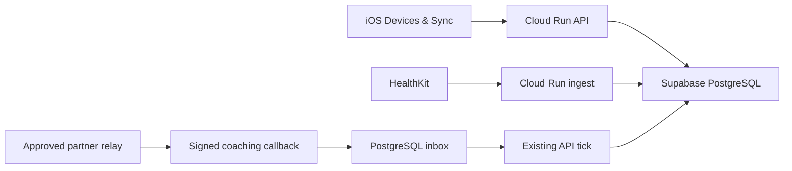

# Direct wearable connections in production

Platform release scope is the account-linking foundation, coaching ingestion and the provider catalog.
The API uses Supabase sessions and the existing beta, consent and App Attest gates. OAuth state
and single-use completion tickets are bound to the signed-in account. Partner grants are encrypted
by the Platform. The Swift client only receives the authorization URL and a completion ticket.

## Production preflight

- Project `ryftlab-prod`, region `europe-west1`, registry `ryft`. The hosts are
  `https://api.ryftlab.de` and `https://ingest.ryftlab.de` through the existing edge.
- The preceding API revision was `api-00041-wl5`, digest
  `sha256:00bef1378137e6ad5bda371e336b087f4fac5b698fb7ffd0d94a5ed01c52dacc`.
  The ingest, scoring and notify revisions were `ingest-00041-mb4`, `scoring-00041-c8k` and `notify-00041-5b5`.
- Supabase reported a completed physical backup on 2026-11-24 at 02:38 UTC. Restore to a separate project if recovery is needed.
  The regular deploy workflow runs pending 0042 and 0047 before rolling containers. [Supabase backup documentation](https://supabase.com/docs/guides/platform/backups)
- The existing `ingest-inbox-received` subscription is active with `ryft-dlq-ingest` as its dead-letter topic.
  The read-only Terraform plan had an in-place notices metric update and an alert-policy addition.
  The dark release can use the existing resources while those monitoring changes wait.

## Partner onboarding

| Provider | Manual onboarding | Evidence required before activation |
| --- | --- | --- |
| Garmin | Request Connect Developer Program access for Activity and the specific Health API feeds. Confirm production Push/Ping tier, approved OAuth redirect, quotas, retention, and display requirements. | Obtain the approved client ID and secret plus the partner-only OAuth, refresh, deregistration and push-authentication contract. Verify the identity mapping and the permitted feeds on an approved test account. |
| Suunto | Register an app in Suunto API Zone, obtain the Developer API subscription and arrange production partner access. Configure the approved redirect and workout notifications. | Obtain the client ID, client secret, subscription key, and the production notification authentication and retention terms. Test exchange, refresh, FIT retrieval and grant removal with an approved account. |

The public Garmin documentation describes Activity JSON and FIT and distinguishes Push from
Ping/Pull. The Suunto public documentation covers authorization code exchange, a subscription
key and workout notifications. Neither source establishes this project's account approval or
confirms the production webhook proof for RYFT. [Garmin Activity API](https://developer.garmin.com/gc-developer-program/enterprise/activity-api/) · [Suunto setup](https://apizone.suunto.com/how-to-start) · [Suunto webhooks](https://apizone.suunto.com/faq)

The Connections registry in this release can serve only its local test adapter. Garmin and Suunto
therefore report `partner_onboarding`. The following callback URLs describe the deployed routes
for later partner configuration.

| Purpose | Garmin | Suunto |
| --- | --- | --- |
| Platform OAuth redirect | `https://api.ryftlab.de/v1/connect/garmin/callback` | `https://api.ryftlab.de/v1/connect/suunto/callback` |
| App completion | `ryft://connect/garmin` | `ryft://connect/suunto` |
| Native ingest hook | `https://ingest.ryftlab.de/connect/garmin/push` | `https://ingest.ryftlab.de/connect/suunto/push` |
| Authenticated coaching relay | `https://api.ryftlab.de/v1/webhooks/garmin` | `https://api.ryftlab.de/v1/webhooks/suunto` |

The relay's HMAC header authenticates a RYFT connector and is independent of provider-native
authentication. The API derives the fetch host from operator configuration. Partner records map
to server-provisioned accounts with current consent. Requests repeat safely through a unique
delivery key and retain only a replay marker after successful processing. Ordinary HealthKit
sync continues to use its existing endpoint and anchor. Coaching chooses measured cycling work
where available and reconciles the same session across partner FIT, JSON, and HealthKit.

For Garmin, the existing Secret Manager container is `connect-garmin-client-secret` and has no
configured version. Proposed Suunto entries are `connect-suunto-client-secret` and
`connect-suunto-subscription-key`. Create them when approved credentials are available. Relay keys
go into separately pinned Secret Manager entries for `COACHING_GARMIN_WEBHOOK_SECRET`,
`COACHING_SUUNTO_WEBHOOK_SECRET`, and `COACHING_PARTNER_FETCH_TOKEN`. The Platform's existing
`DATA_ENCRYPTION_KEY` protects connection grants.

Keep the provider registry, provider rollout flags and coaching relay secret references disabled
until the partner tests and privacy review pass. Review data minimization, retention, withdrawal,
disconnection and deletion against the signed provider contract and RYFT's current privacy policy.
[GDPR text](https://eur-lex.europa.eu/eli/reg/2016/679/oj/eng)

## Verification and rollback

The main workflow applies migrations and runs `make smoke-prod` against the authenticated smoke
account. Its catalog check verifies that Garmin and Suunto are represented. Check readiness on
both service domains and confirm all partner hooks return 404 while dark. Inspect Cloud Logging
for error and retry counts without logging payloads, provider identifiers, or credentials.

Use **Deploy, roll back, rotate** in [the operations runbook](../../OPERATIONS.md) to pin the
preceding revisions together if the release causes a regression. Leave the additive migrations
in place. Stop new provider links through the account rollout flag. Deactivate an active webhook
through its deployment configuration and coordinate paused delivery with the provider.
