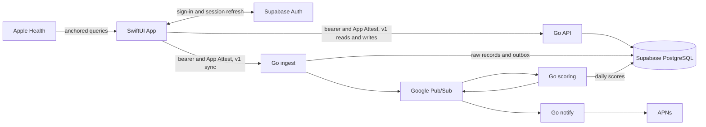
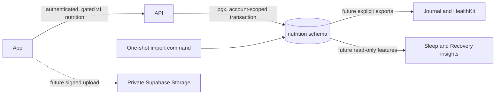

# Current RYFT architecture

This describes the two active local checkouts inspected on 2026-11-24. The workspace root is a coordination folder. `app/` and `plattform/` each have their own Git metadata and pipelines. The dated `.broken-*` directories are recovery copies. The Platform checkout includes work in progress on `connect/scoring`, so checkout features and deployed features can differ.

## App

- `app/Ryft/App/RyftApp.swift` and `AppState.swift` compose the SwiftUI lifecycle and observable read state. `Auth/AuthService.swift` wraps supabase-swift for Apple and email sign-in, restoration and refresh. `Networking/APIClient.swift` routes sync to the ingest host and other v1 requests to the API host, using `URLSession`, a bearer, App Attest and status-aware retries. Configuration comes from xcconfig and `App/PlatformConfig.swift`.
- `Health/HealthKitManager.swift` reads quantities, workouts and sleep in anchored pages. `Sync/SyncService.swift` uploads pages before persisting per-account anchors. Background delivery and `Sync/ScheduledWork.swift` drive refresh. HealthKit sample intervals carry explicit timestamps. The App sends the profile timezone through `/v1/me` and uses calendar day keys for views.
- `AppState.swift` reads from the response cache on launch. Train has a separate SwiftData store and persisted offline queue. `Features/Journal/JournalStore.swift` owns journal state. The Today, Sleep, Strain and Insights screens consume the Platform scoring contract. The checked-out Swift sources have no dietary HealthKit pipeline, Nutrition screen, product barcode capture or meal photo picker.
- The Xcode project pins supabase-swift. Swift Testing and XCUITest run through App workflows. The App uses Platform `docs/API.md` fixtures for wire mirroring. See `app/README.md` and `app/docs/CI.md`.

## Platform

- One Go module builds `cmd/api`, `cmd/ingest`, `cmd/scoring`, `cmd/notify` and `cmd/migrate`. `internal/app` supplies lifecycle and connection pooling. `cmd/api/main.go` uses `net/http` route patterns and `/v1`, with address throttling, verified Supabase JWTs, per-user limits, user resolution, App Attest, beta admission and request deadlines. `internal/auth` validates JWKS, issuer, audience and role. The JWT subject maps to `public.users.id` through `store.EnsureUser`. Local Compose uses explicit insecure API-key auth.
- `internal/store` executes pgx SQL directly. The schema owner runs numbered embedded SQL through `internal/db.Migrate`. Runtime connections use restricted service roles through Supavisor, with transaction pooling in production. The Supabase Data API is disabled by the documented setup. Existing user isolation primarily combines role grants, RLS and repository predicates. `store.DeleteUser` clears application data and tombstones the user before Supabase deletion. See `docs/SUPABASE.md` and migration 0007.
- `cmd/ingest` writes health samples, sleep and workouts. `internal/events/outbox` publishes committed changes to Pub/Sub. `cmd/scoring` updates daily snapshots, trends and workout/session outputs. `internal/scoring`, `internal/insights` and `internal/behavior` contain calculation rules. `cmd/api/journal.go` and migration 0016 implement the journal. `cmd/api/days.go` exposes daily results and `cmd/api/main.go` handles profile changes. Direct provider links in migration 0042 and `internal/connect` add a separate OAuth and push flow.
- Local Compose uses PostgreSQL 17 and a Pub/Sub emulator. GitHub Actions validate Go, script checks and manifests, and promote services to Cloud Run via `deploy/run/`. `infra/gcp` contains Terraform for the edge, IAM, Pub/Sub, Scheduler and monitoring. `web/` is the Firebase-hosted Next.js static site. Private assets have no existing meal-photo integration. Cloud Run uses managed request telemetry and structured logs, with local Prometheus and an optional OTLP path. See `docs/ARCHITECTURE.md`, `docs/OPERATIONS.md` and `docs/OBSERVABILITY.md`.

## Integration points and dependencies

Reuse API middleware, account UUIDs, migrations, PostgreSQL, health consent and feature flags. Stored meal local days use the timezone captured with each meal. Check hosted extension placement, transaction-pooler behavior, licensing, privacy terms and feature exposure before enabling the flag. The brief authorizes local implementation and test data. A production Supabase project change, a hosted transfer and full dataset imports require approval. The existing hosted project is the assumed target for structured data. An independently operated Supabase instance would require a separate infrastructure decision.
