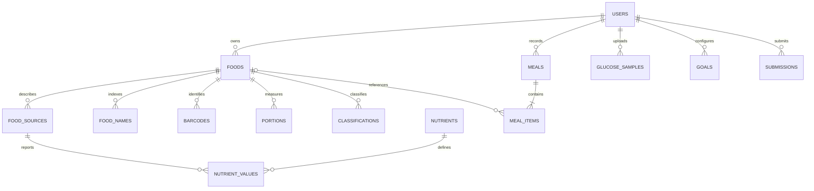

# Database design

The dedicated schema distinguishes shared catalog, owner-private rows and import operations. Nutrients are canonical and use explicit units. Values retain source and reference basis in grams, milliliters or servings. Multiple sources and reference bases can coexist. A meal stores the selected food name, brand, quantity, resolved measures, nutrient amounts and source evidence with the calculation version. Partial aggregates report the known subtotal and coverage. On-demand daily aggregation follows the account and indexed local-date range. The captured IANA zone and local date stay with the meal.

`pg_trgm` and built-in full-text search support catalog lookup. Unicode normalization is performed by the writer and query code. `pgvector` is reserved for a measured retrieval gap with versioned embeddings. Runtime account scope lives in a single transaction. Foreign keys delete Nutrition records with the account. Import and operational privileges are outside the App and runtime API role.

The scoped search function uses a fixed search path and parameterized SQL. It applies the same visible-food predicate while allowing PostgreSQL to use trigram and full-text indexes. The function plans against the actual query terms. The runtime role has no direct grant on the extension schema.

Migration 0044 adds the account-owned CGM table and a quality profile snapshot on meal items. The daily read evaluates the current calorie goal, meal snapshots and measured glucose within one repeatable-read transaction.
