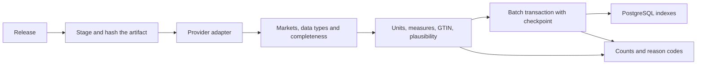

# Food ingestion

The [standalone Python ETL](../../../scripts/etl/README.md) handles scheduled OFF Parquet and USDA CSV imports. This page documents the Go command for controlled imports of staged artifacts.



## Local commands

From `plattform/backend`, use a migrated disposable database for writes. The binary uses `NUTRITION_IMPORT_DATABASE_URL` only for `-write` and `-stats`. Use a direct connection or session pooler under the schema-owner account for a controlled import run. Keep its credential separate from the API role and App. Local fixtures are synthetic.

```sh
go run ./cmd/migrate
psql "$DATABASE_URL" -v ON_ERROR_STOP=1 -f internal/nutrition/testdata/seed.sql
(cd internal/nutrition/importer/testdata/usda && zip /tmp/ryft-usda-fixture.zip *.csv)
go run ./cmd/nutrition-import -provider usda -version fixture-1 \
  -input /tmp/ryft-usda-fixture.zip -limit 10 -batch 2
go run ./cmd/nutrition-import -provider off -version fixture-1 \
  -input internal/nutrition/importer/testdata/off.jsonl -markets DE,AT,CH -limit 5 -batch 2
go run ./cmd/nutrition-import -provider off -version fixture-1 \
  -input internal/nutrition/importer/testdata/off.jsonl -markets DE,AT,CH -limit 5 -batch 2 -write
go run ./cmd/nutrition-import -stats
```

For `cmd/migrate`, use the existing local environment and role-password setup from [Platform README](../../../README.md) and [Supabase operations](../../SUPABASE.md). The seed is a manual development fixture. It provides English and German names, aliases, one portion, and illustrative nutrients.

Every import defaults to dry-run with a 200-input-record cap. `-limit` counts input food rows, including filtered rows. `-batch` sets the commit size and USDA parsing chunk, capped at 2,000. `-min-completeness` filters on a percentage of known energy, protein, carbohydrates, fat and fiber. `-energy-tolerance` changes the relative threshold for a 4-4-9 plausibility warning. Fiber, rounding, polyols, alcohol and differences in carbohydrate conventions can explain deviations. Output is JSON. Reason codes have aggregate counts. Quarantined inputs stay in the staged file for operator review. Rows with usable data and field-level warnings can still enter the catalog with their quality flag.

Use an immutable staged file and a unique release label. `-sha256` optionally compares a local artifact to a known digest. `-url` requires HTTPS on a provider host and a pinned digest. `-max-download-mib` defaults to 64. The download is staged temporarily and deleted on exit. Keep an approved staged file externally if a download must be resumed. Use explicit authorization for full dataset acquisition and write runs against hosted environments.

Pass `-resume <job UUID>` with the same release, artifact and selection flags when a write is interrupted. Database batches and checkpoint updates share a transaction. The CLI retries serialization failures, deadlocks and lock timeouts up to twice. A crashed job can resume from its last committed offset. A cap or filter change requires a new job. A repeated run of the same artifact can revisit every row safely. Source payloads are keyed by provider and external ID. The first versioned record wins on contradictory duplicates of the same release, and older upstream timestamps are quarantined. Review the reported reasons before promoting an import. The job reports parsed counts and persistence outcomes separately. The single import advisory lock serializes competing batch writes, and an optimistic checkpoint prevents two workers from committing the same portion of a job.

## Provider details

- USDA Foundation, SR Legacy and FNDDS CSV archives use `food.csv`, `nutrient.csv` and `food_nutrient.csv`. Portions use `food_portion.csv` and optional `measure_unit.csv`. ZIP members are opened as streams without filesystem extraction. The bounded food-chunk join rereads relevant child CSVs for each chunk, so larger approved imports benefit from larger batches. Benchmark FNDDS separately before scheduling it. Nutrient IDs preserve the source's reported units and convert equivalent mass units. Carbohydrate by difference stays `carbohydrates_total`, and DFE stays separate from folic acid. Energy follows the documented Atwater selections. [USDA CSV field dictionary](https://fdc.nal.usda.gov/portal-data/external/dataDictionary), [Foundation Foods documentation](https://fdc.nal.usda.gov/Foundation_Foods_Documentation/)
- Open Food Facts supports the published JSONL product shape, plain or gzip. It filters by country tags before materializing products. It uses documented localized fields, normalized barcode text, serving units and selected nutrient keys. Each line is capped at 2 MiB. Known volumetric ambiguity in the overloaded 100g field leaves that profile unknown. Serving-labeled values use the serving basis exclusively. Product records sharing a normalized GTIN remain separate. The Python ETL reads the provider's projected Parquet dataset. [OFF product schema](https://openfoodfacts.github.io/documentation/docs/Product-Opener/schemas/schemas/product/), [OFF export documentation](https://openfoodfacts.github.io/robotoff/explanations/interactions-product-opener/), [OFF Parquet dataset](https://huggingface.co/datasets/openfoodfacts/product-database)
- PostgreSQL uses indexed rows during the import. The writer bundles a batch in one transaction, with set-based name and nutrient array writes per food. No provider calls or importer credentials are used in API requests. The catalog excludes shared foods explicitly deactivated by an operator. Replacing source data leaves saved snapshots intact.

Run `go test ./internal/nutrition/...` for adapters and calculation rules. Use the existing throwaway-DB convention, `RYFT_TEST_POSTGRES_URL=… go test ./internal/db ./internal/store ./cmd/api -run 'TestNutrition|TestMigrate'`, for migrations, transactional imports, indexed queries and tenant isolation. Full regression tests use `go test ./...`. See [release and validation roadmap](07-implementation-roadmap.md) for sample size and performance evidence.
