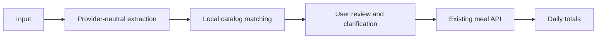

# Food recognition design

A single review workflow accepts search, barcode, photo capture/import, text and labels. Every input can yield an owner-private draft containing its input method, consumption instant, timezone, meal type, asset reference, candidate items and review state. The App chooses catalog IDs and edits quantities. The existing meal API then performs deterministic calculations. If a product is unknown, a user can create a private custom record using values they have reviewed.

Future provider interfaces accept one of image, text or normalized OCR text. Their result has ingredient labels, optional quantity/unit, assumptions, alternatives and clarification prompts. Keep recognition, catalog matching and portion-estimation confidence separate. A matching interface accepts a normalized ingredient label and context and returns candidate IDs, match confidence and the factors behind that score. The server computes nutrient values from the chosen catalog record or reviewed manual values. The recognition provider handles extraction and never supplies authoritative nutrients.

| Future route | Proposed behavior |
| --- | --- |
| POST `/v1/nutrition/recognition/image` | Start a job from an authorized meal-photo asset |
| POST `/v1/nutrition/recognition/text` | Parse a user-supplied meal description or recipe |
| POST `/v1/nutrition/recognition/label` | Extract label candidates with units and reference basis |
| GET `/v1/nutrition/recognition/{id}` | Read private job state and candidates |
| POST `/v1/nutrition/recognition/{id}/confirm` | Confirm a corrected draft and use existing idempotent meal persistence |

Treat label text, recipes and external payloads as data. Use structured inputs and schemas, restrict extraction context and tool access, and validate all provider output server-side. Ignore embedded instructions, retain only the owner's minimal necessary input, and keep unrelated RYFT health data outside the request. Route OCR to the smallest suitable model, cap dimensions, bytes, retries and spend, and enforce per-user quotas before provider requests. Store confidence telemetry in aggregate without raw images or descriptions. Model-versioned caches require a privacy and deletion review. Stale, failed and ambiguous jobs should return a reviewable result or an actionable failure.
