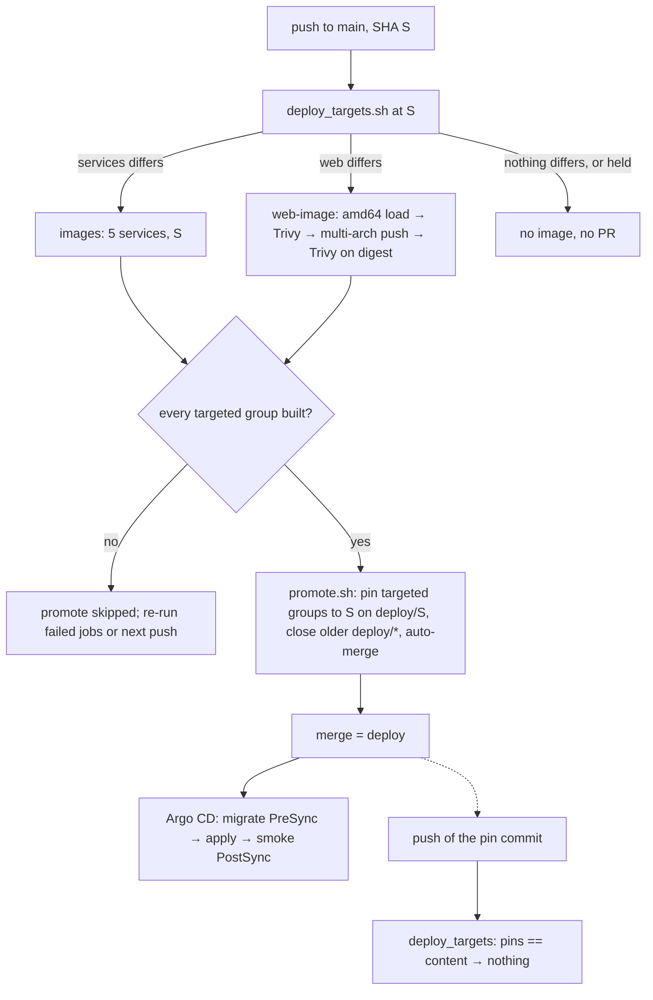

# ryft-web → `plattform/web`: CI, image and promote — design (2026-10-21)

Ticket C of `plan.md` (`ci: web checks and image in this repository, one promote`), brief
`CLAUDE_FOLLOWUP_WEB_MONOREPO.md` §3–4. The monorepo itself is the user's decision; this note covers how
it builds, gates, pins and rolls back, and proposes D107. Author: platform-architect.

**Constraints:** one operator; three t3.large nodes (amd64); the repository is public, so Actions minutes
cost nothing and every image is public; git is the only path to `ryft-prod-euc1` (D94–D96); GDPR: the
privacy policy users consent to is a ConfigMap value here and a page in `web/`.

**State checked (read-only, 2026-10-21):** required checks on `main` are `test`, `lint`, `manifests`,
`smoke` (classic protection, app 15368 = GitHub Actions, `strict: false`, no rulesets). Squash merges use
`COMMIT_OR_PR_TITLE` / `COMMIT_MESSAGES`. `ghcr.io/timkrebs/ryft/web` has the tags `latest`, `abfbe26`,
`f437747`, and **`latest` and `f437747` are the same digest** (`sha256:6cc264f2…`). The image's labels come
from `docker/metadata-action`, not from the Dockerfile (its description and licence differ from the
Dockerfile's). `backend/` is unchanged since the services pin `0fd4256`.

## Summary: where this differs from the plan

1. **Rollback by revert is undone by the next promote** (this bug exists today, for the services). The
   promote compares `backend/` at HEAD with the pinned commit. After `git revert` of a pin, the pin is
   older and the code is still on main, so the push of the revert builds and pins the bad code again
   within about 15 minutes (auto-merge). Reproduced with the current `promote.sh` and the test's fake `gh`:
   good pin → bad change pinned → `git revert` of that pin → promote opens `deploy: images <revert>`
   with auto-merge, pinning the bad code. For web it is worse: the rollback pin `f437747` is not in this
   history, so every push re-pins web. **Fix: a hold marker in the overlay** that promote respects (Q5).
   The plan's line "rollback = revert the deploy merge → f437747" does not hold without it.
2. **Make one aggregate check required (`ci-ok`) plus `pr-title`, not eight names.** If the `changes`
   job fails, every job that needs it is *skipped*, and skipped counts as success, so the PR could merge
   with nothing checked. A gate that needs everything and fails on `failure`/`cancelled` closes that gap
   and also covers the Terraform matrix.
3. **Use path filters only on pull requests. A push to main runs every check.** On push events,
   `dorny/paths-filter` compares with the previous commit ("changed in this push"). That answers a
   different question than the pin-based build decision, so web could be built at B with web's checks
   skipped at B.
4. **Run `push` on `main` only.** Today every branch push runs CI unfiltered. With filtered PR runs, the
   same head SHA would get two check runs with the same name (one from the push run, one skipped from the
   PR run). It also stops feature-branch images (amends D18).
5. **`cancel-in-progress` only for PRs. Promote uses `!cancelled()`, not `always()`.** Promote's
   condition must be "every targeted group built". A job skipped because one of its needs failed reports
   `skipped`, not `failure`.
6. **The PR-title regex must accept any area.** ryft-web's closed list rejects most platform titles
   (`infra/vault:`, `events:`, `ops:`, `scoring:` …). Also, the squash setting `COMMIT_OR_PR_TITLE` makes a
   single-commit PR land under its *commit* subject, so a title rule alone does not control main. The
   job must also check the PR's commits, or the user switches the setting to `PR_TITLE`.
7. **`SUPPORT_EMAIL` unset ships silently.** The site builds green and `/support` and `/beta` show a
   `TODO(user)` marker with no mailto, and the promote auto-merges it. The image job must fail when the
   variable is empty.
8. **The policy check belongs in `manifests`**, with a filter that is the union of the policy pages and
   the ConfigMaps. Separately, I found an existing bug: a ConfigMap-only change of
   `PRIVACY_POLICY_VERSION` does not roll api/ingest, so pods mix versions (finding F1, its own ticket).
9. **Never delete `latest` from the package.** It *is* the `f437747` version, the rollback point. Disable
   ryft-web's workflow before its last README commit, or that commit pushes a new image and moves
   `latest`. Freeze ryft-web at A, not at the end.
10. **The first platform-built site deploys at C's merge**, not at "the first web change". The web pin is
    unknown, so the group counts as different. GHCR access and `SUPPORT_EMAIL` must be in place before C
    merges (the plan already orders it so).
11. Smaller items: build the scan image with `provenance: false, sbom: false` (attestations cannot be
    `load`ed); set the GHA cache to `scope=web`; run the Node stage on `$BUILDPLATFORM`; drop the unused
    `id-token`/`attestations` permissions; take the tag as `HEAD` cut to 7 characters, not
    `rev-parse --short=7` (which grows on ambiguity); SHA-pin every action in the one workflow that holds
    the App key; add actionlint to CI.

---

## Q1 — Build trigger on main and the promote

**Recommendation: yes, compare each group with its *running* pin, with five corrections.**

Groups, defined once:

| Group | Images | Source | Pin read from `overlays/eks` |
| --- | --- | --- | --- |
| `services` | ingest, scoring, api, notify, migrate | `backend/` | all five `newTag`s (must agree) |
| `web` | web | `web/` | web's `newTag` |

A group is **targeted** on a push to main when, in this order:
1. it is held (`# hold: <group> …` in the overlay) → **not** targeted, with a warning;
2. its pins disagree (services only) → targeted;
3. its pin is not a commit here (`git rev-parse -q --verify "$pin^{commit}"` fails: `f437747`, or any
   ryft-web SHA after the filter-repo rewrite) → targeted;
4. `git diff --quiet "$pin" HEAD -- <source>` → not targeted, else targeted.

The diff compares trees, not ancestry, so a hand pin to a non-ancestor commit is also handled
correctly. An accidental match of a ryft-web short SHA with a platform object is about 1e-5 and accepted.

**Why the running pin and not "changed in this push":** GitHub keeps at most one *pending* run per
concurrency group. A newer push replaces the pending one even without `cancel-in-progress`, so with
three quick pushes the middle one never runs. Also, promote closes older deploy PRs as superseded. In
both cases a change seen only in its own push would be lost. The running pin is the state Argo CD
applies, so "differs from it" is exactly "not deployed yet". The race in which a deploy PR merges while a
newer run is in flight heals itself: the next push compares with the newly merged pin.

**Failure it prevents:** a web change on main is never deployed because its run was cancelled or its
deploy PR was closed by a backend-only promote.

**Options considered:**
- *(a) One SHA for everything:* pin all six images to HEAD whenever `backend/` or `web/` differs. This
  gives the simplest promote and one tag to read. Rejected: a typo fix on the site would restart api,
  ingest, scoring and notify (consumers reconnect, and the HPA metrics gap of D105), both images would be
  built on every push, and a web rollback would drag the services along.
- *(b) Build both groups on every main push and pin only those that differ.* This is not simpler: the
  same computation is needed for the pin, and it adds an arm64 web build to every push.
- *(c) Per group against the running pin, the lead's proposal.* **Chosen.**

**Corrections:**
1. **Checks on push are unfiltered** (see Q2). The build jobs need the checks of the same commit,
   whatever a path filter would have said.
2. **All or nothing:** promote runs only when every targeted group's image job **succeeded**. If services
   fail and web succeeds, nothing is pinned. Re-running the failed jobs re-runs promote, and the next push
   catches up anyway. This avoids a deploy PR whose body and pins disagree with what was built.
3. **The tag:** `sha=$(git rev-parse HEAD | cut -c1-7)`, the same as metadata-action's
   `type=sha,format=short` (`GITHUB_SHA[:7]`). `rev-parse --short=7` returns eight characters when seven
   are ambiguous. `pin_images.sh` would then reject it and the deploy would stop.
4. **Hold** (Q5). Without it, the pin-diff re-promotes every rollback.
5. **`workflow_dispatch` with `force: services|web|all`** (optional, cheap). It rebuilds a group whose
   source did not change, for example after `SUPPORT_EMAIL` changes (a build arg, not a file).

**Where it lives:** `scripts/deploy_targets.sh`, with the group table in one place (`case` statements,
bash 3.2-safe for macOS). It reads the overlay at HEAD and prints GitHub-output lines:

```
services=false
services_pin=0fd4256
web=true
web_pin=f437747
web_why=pin not in this history
```

The `changes` job runs it on push (`>> "$GITHUB_OUTPUT"`). `promote.sh` calls it itself, so the script
stays runnable locally and in `promote_test.sh`. Both read the same tree (the checkout of `github.sha`),
so they agree. If they ever did not, `check_registry.sh` fails before any branch is pushed (fail closed).
`pin_images.sh` takes the groups to move (`pin_images.sh <sha> <group>... [file]`). The PR body lists
each group: `web: f437747 → abc1234 (pin not in this history)`, the commits per source directory
(`git log --no-merges old..sha -- web`), and `services: unchanged at 0fd4256`. Promote closes **every**
open `deploy/*` PR (the `deploy/web-*` exception goes). Each new PR pins a superset of what any older one
pinned, because main is linear.



## Q2 — Required checks with path filtering

**Recommendation: confirmed in outline (one workflow, a `changes` job, job-level `if:`), with three
changes: an aggregate gate, filters on PRs only, and push on main only.**

**The gate (`ci-ok`) as the required check of `ci.yml`:**
```yaml
  ci-ok:
    if: ${{ !cancelled() }}
    needs: [changes, test, lint, smoke, manifests, terraform, web-checks, web-e2e, secrets]
    runs-on: ubuntu-latest
    steps:
      - env: { RESULTS: "${{ join(needs.*.result, ' ') }}" }
        run: |
          echo "$RESULTS"
          case " $RESULTS " in *" failure "*|*" cancelled "*) exit 1 ;; esac
```
- **Failure it prevents:** if `changes` fails (an API error, or the missing `pull-requests: read` that
  dorny needs on PRs while the workflow grants only `contents: read`), every dependant is skipped and
  every per-job required check is green. The gate is red instead.
- It also solves the matrix naming problem: `needs.terraform.result` aggregates the legs, so Terraform is
  enforced (new: it is not required today). A new job does not need a settings change, only an entry in
  `needs:`. To make a forgotten entry impossible, the gate can compare its `needs` with the job list of
  `ci.yml` (about ten lines of Python, optional).
- `!cancelled()`, not `always()`: a run cancelled by a newer one does not report a green gate.
- Required on `main` afterwards: **`ci-ok` and `pr-title`**. The old four may stay in the list during
  the switch; on filtered PRs they report skipped, which is harmless.

**Your gotchas, confirmed or corrected:**
- *Skipped needs skip dependants:* yes. For promote, use `!cancelled()` (with `always()` a cancelled main
  run would still start promote), and spell out per group "targeted ⇒ `success`". A job skipped because
  its own need *failed* reports `skipped`, so "no `failure`" is not enough:
  ```yaml
  promote:
    needs: [changes, images, web-image]
    if: >-
      !cancelled() && github.event_name == 'push' && github.ref == 'refs/heads/main'
      && vars.RYFT_DEPLOY_APP_CLIENT_ID != '' && needs.changes.result == 'success'
      && (needs.changes.outputs.services == 'true' || needs.changes.outputs.web == 'true')
      && (needs.changes.outputs.services != 'true' || needs.images.result == 'success')
      && (needs.changes.outputs.web != 'true' || needs.web-image.result == 'success')
  ```
- *Matrix skipped by `if:` reports an unexpanded name:* yes; the gate makes it moot.
- *Not on your list:*
  - On push, dorny compares with `github.event.before`, so do not filter checks on push.
  - `push` on feature branches duplicates check names on the PR head SHA, so restrict `push` to `main`.
  - `cancel-in-progress: ${{ github.event_name == 'pull_request' }}`, as ryft-web had it. Today a main
    run is cancelled in progress, promote included: that leaves an orphan `deploy/<sha>` branch or a PR
    without auto-merge, and throws away image builds. Pending main runs are still replaced; the pin-diff
    covers that case.

**Check jobs:** `if: github.event_name == 'push' || needs.changes.outputs.<filter> == 'true'`.
**Image jobs:** `if: github.event_name == 'push' && github.ref == 'refs/heads/main' &&
needs.changes.outputs.<services|web> == 'true'`, where those two outputs come from `deploy_targets.sh`.
`images` needs `[changes, test, lint, manifests, smoke]`; `web-image` needs `[changes, web-checks,
web-e2e, manifests]` (manifests carries the policy check). Neither waits for `secrets`. A leak is fixed
by rotating the secret, a false positive must not block a hotfix, and the PR gate already stops a leak
from merging.

**Filters (pull requests only; `.github/workflows/ci.yml` is in every one, so a workflow change runs
everything):**

| Filter | Jobs | Paths |
| --- | --- | --- |
| `go` | `test`, `lint` | `backend/**`, `.golangci.yml` |
| `smoke` | `smoke` (also `make test-scripts`: promote and pin tests) | `backend/**`, `scripts/**`, `docker-compose.yml`, `Makefile`, `deploy/rabbitmq/dev/**` |
| `manifests` | `manifests` (+ actionlint, + the policy check) | `deploy/**`, `infra/vault/**` (golden files), `scripts/**`, `Makefile`, `.github/**`, `web/content/legal/**`, `web/scripts/check-policy-version.mjs`, `web/scripts/lib/policy.mjs` |
| `terraform` | `terraform` (matrix) | `infra/**` |
| `web` | `web-checks`, `web-e2e` | `web/**`, `docs/SCORING.md` (the science page's model check), and any other platform file a web test reads after B (the AASA test still points at `deploy/k8s/base/web/site/…`, gone since D106: B drops or retargets it) |
| none | `secrets` (gitleaks over the PR's commits), `ci-ok` | always |

App drift (tokens, `AppRoute`, licences in `timkrebs/ryft-app`) can't be path-filtered here. It still
surfaces on every web PR and on every main push, because main runs everything. An optional weekly
`schedule` run (checks only, no images or promote; guard those on `push`) catches it without a change,
and can do the full-history gitleaks scan with the reviewed allowlist. In that allowlist, list the
historical findings **by commit**, not by path, so a new secret in the same file still fails.

**PR title: its own workflow `pr.yml`, job `pr-title`, on `opened, edited, synchronize, reopened`.**
- *Why not in ci.yml:* `edited` would re-run the whole CI on every title edit. If you guarded jobs with
  `action != 'edited'` instead, the edit run would create a *skipped* check run with the same name on the
  same SHA, and that can replace a red `test` with a green one.
- *What it checks:* the title against
  `^[a-z][a-z0-9-]*(/[a-z0-9-]+)*(\([a-z0-9-]+\))?: \S.{2,}$`, and the denylisted brand in the title and in
  every commit message of `base.sha..head.sha`. That uses `node web/scripts/check-brand.mjs --message`,
  which needs Node built-ins only, so no `npm ci`.
- *ryft-web's area list:* `deploy: images abc1234` passes the regex above. ryft-web's closed list accepts
  62 of this repo's 160 commit subjects; the generic pattern accepts 143 (the other 17 predate the
  convention). The list rejects `ops`, `events`, `scoring`, `infra/vault`, `infra/aws/kubernetes`, …
- *Settings:* with `squash_merge_commit_title=COMMIT_OR_PR_TITLE`, a one-commit PR lands under its commit
  subject, and `COMMIT_MESSAGES` puts every commit message into main. So either keep the commit-message
  check (above) or have the user set `PR_TITLE` (command below). I recommend both.
- *Hardening (optional):* read the denylist from the base branch
  (`git show origin/main:web/config/brand-denylist.json`), so a PR cannot weaken the check it is judged by.

## Q3 — Where the privacy policy version check runs

**Recommendation: in `manifests`, strict, with the `manifests` filter as the union above.**
`node web/scripts/check-policy-version.mjs --strict` imports only Node built-ins. It needs
`actions/setup-node` with `web/.nvmrc` and no cache; it takes seconds.

- *Why there:* `manifests` already owns the question "is what the cluster will run coherent"
  (kubeconform, Argo CD apps, the registry check). It is required (via the gate), and it is the job a
  ConfigMap-only PR always triggers. `web-image` needs `manifests`, so a mismatch also cannot reach an
  image build on main. Drop the warning-only run from `web-checks`; `npm run lint` locally can keep it.
- *Failure it prevents:* a PR that moves only `PRIVACY_POLICY_VERSION` merges, and consent is recorded
  against a version that has no page. Also the opposite case: a new page whose version is never switched,
  so nobody is asked to consent again.
- Extend it slightly (B or C): require the ConfigMap's version as **both**
  `web/content/legal/en/privacy/<v>.mdx` and `…/de/privacy/<v>.mdx` (it reads `en` only today). Optionally
  also compare `docker-compose.yml` (a third copy, used locally only). The Go default in
  `internal/config` is a fourth copy, only used when the variable is unset.

**F1 (an existing bug, outside C, its own ticket):** `PRIVACY_POLICY_VERSION` is in the plain ConfigMap
`ryft-config`, read through `envFrom` and never hashed. Changing it rolls no pod. Pods started later (an
HPA scale-up, a drain, the next services deploy) get the new value while the old pods keep the old one.
api then answers `422 policy_version must be the current one` on some pods and accepts on others, and an
ingest pod with the old value refuses users who consented to the new one (`403 consent_required`). Fix:
make a change roll api and ingest, using the `events.yaml` precedent (the value in each Deployment's env,
D102) or a `configMapGenerator` with a hash. The check must then read wherever the value lives.

**Consequence once F1 is fixed:** in one PR the version switches about 3 minutes after the merge (a
manifest), while the page arrives with the web image 15–20 minutes later (or never, if the web build
fails). Anyone consenting in that window consents to a text that is not published yet. That window is
the user's call. Option: keep strict equality (the brief's rule) and accept it, or make the check
directional: fail when the platform's version has no page; warn when the site has a newer page. Then
the text can ship first and the version in a second PR. With directional checking, a forgotten switch
is only a warning, so I would keep equality and write the window into OPERATIONS → "A new policy text"
(merge, watch the web deploy, then announce).

## Q4 — The image

**Recommendation:**
- Tag: the first 7 characters of this repository's SHA; never `latest`.
- Platforms and attestations: linux/amd64 + arm64, `provenance: mode=max`, `sbom: true`.
- Order: Trivy before push, then Trivy on the pushed digest, all in **one** job.

1. `docker/metadata-action` (SHA-pinned) with only `type=sha,format=short,prefix=`. Set
   `org.opencontainers.image.licenses=NOASSERTION` under `labels:` if you want the Dockerfile's value:
   metadata-action overwrites it with the repository's (empty) licence.
2. Guard: `test -n "$NEXT_PUBLIC_SUPPORT_EMAIL" || { echo "::error::SUPPORT_EMAIL is not set"; exit 1; }`.
3. Build `linux/amd64` with `load: true`, **`provenance: false, sbom: false`** (attestations turn the
   result into an index, which the docker exporter refuses), `cache-from/to: type=gha,scope=web`.
4. Trivy (`aquasec/trivy` by digest, as ryft-web does; not the `trivy-action`), `--severity CRITICAL
   --ignore-unfixed --exit-code 1`. amd64 is what runs: the nodes are t3.large.
5. Build both platforms with `push: true`, provenance and SBOM, from the same builder. The amd64 layers
   are cache hits in that builder, so the pushed amd64 manifest is the one scanned. A rebuild in another
   job would not guarantee that: fonts are fetched during the build, and the GHA cache evicts.
6. Trivy again on `ghcr.io/timkrebs/ryft/web@<digest>`, `--platform linux/amd64`, about 30 s. Nothing that
   failed the scan is pushed, and nothing is pinned that was not scanned as pushed. An image that was
   pushed but not pinned is inert: nothing deploys it, and there is no `latest`.

Also:
- Make the Dockerfile's build stage `FROM --platform=$BUILDPLATFORM node…`. The static export does not
  depend on the architecture, so the arm64 leg does not run `npm ci` / `next build` under QEMU (minutes
  saved, and identical content on both architectures).
- Use the same `scope=web` in `web-e2e`'s build.
- Job permissions: `contents: read, packages: write` only. ryft-web's `id-token: write` and
  `attestations: write` are unused: BuildKit's provenance is unsigned and needs neither. Signed GitHub
  attestations are a later option.
- Provenance `mode=max` records the build args in a public attestation. They are public values here;
  never pass a secret as a build arg.

**GHCR: what the user changes.** The package was created by ryft-web's workflow, so it is linked to
ryft-web, and only ryft-web's `GITHUB_TOKEN` can write.
- **Package settings** → https://github.com/users/timkrebs/packages/container/ryft%2Fweb/settings →
  **Manage Actions access** → **Add repository** → `timkrebs/ryft-platform` → role **Write**. This is UI
  only, there is no API for it.
- Visibility stays public. No PAT, no change to ryft-platform's permissions. The job's
  `permissions: packages: write` is already the pattern of `images`.
- After the first platform push succeeds, remove `timkrebs/ryft-web` from the same list, so only one
  repository writes the package.
- *Failure it prevents:* the first `web-image` run on main fails with `403 denied: permission_denied:
  write_package` after a green scan.

**The Dockerfile label `org.opencontainers.image.source`:**
- It **grants nothing**. Push rights come only from Manage Actions access.
- In CI it is overwritten anyway by metadata-action's label (on `f437747`, `source=…/ryft-web` came from
  metadata-action). Here it will say ryft-platform without any Dockerfile change.
- It matters for local builds (`make web-image`), and for linking a *new* package on its first push (not
  the case). B changes it to ryft-platform so local and CI images agree.
- Re-linking the package page to ryft-platform is cosmetic. Do not rely on a push re-linking it.

## Q5 — Failure modes across the cutover, and rollback

| Step | What can break | Seen by | Recovery |
| --- | --- | --- | --- |
| A (import) | Squash instead of merge commit loses the history | `git log --follow web/package.json` | `git revert -m 1`, redo. Merge with `gh pr merge --merge --subject "web: import ryft-web with history"` |
| A | ryft-web changes after the import clone (two sources) | divergence | **Freeze ryft-web at A**: `gh workflow disable ci -R timkrebs/ryft-web`, no merges there; archive any time after A (reversible with `gh repo unarchive`) |
| A, B | Nothing deploys: the old CI ignores `web/`, `web/.github/workflows` is inert in a subdirectory, `backend/` unchanged | — | revert |
| C merged, `SUPPORT_EMAIL` unset | Without a guard: green build, `/support` and `/beta` ship a `TODO(user)` marker and no mailto, the deploy PR auto-merges | nobody (the gap) | **Guard in `web-image`** → job fails, nothing pinned; `gh variable set …`, then re-run failed jobs (or `workflow_dispatch force=web`) |
| C merged, no GHCR access | `web-image` 403 on push after Trivy; no tag created; promote skipped (web targeted, not built). The site stays on `f437747` | failed run on main (mail to the operator) | grant Write, **Re-run failed jobs** (re-runs `web-image`, then `promote`) |
| C merged, branch protection not yet switched | web-only PRs are protected by four checks that are all *skipped* → mergeable with red web checks | — | switch protection **right before** merging C, once C's PR has reported `ci-ok` and `pr-title` |
| First platform-built site | It differs from `f437747` (lockfile, #10's texts, now `$BUILDPLATFORM`) | live URL check, `make smoke-prod` | web rollback below |
| Any web deploy | It shares the `ryft-platform` Argo app: migrate PreSync and smoke PostSync run on every web pin; a failing migrate (e.g. a Supabase lockout) blocks web deploys **and rollbacks** | `ArgoSyncFailed` | as for services (OPERATIONS → A failed sync). Later option: a separate `ryft-web` Argo application (wave 3), if this ever holds a web fix |
| Retirement | ryft-web's README commit triggers its CI, which pushes a new image and moves `latest` | package tags | disable its workflow first (or `[skip ci]` in the message) |
| Package clean-up | Deleting `latest` deletes the `f437747` version (same digest), the rollback point | — | never delete it; untag is not possible on GHCR |
| Trivy DB fetch fails | `web-image` fails | failed run | re-run. Optionally a second `--db-repository public.ecr.aws/aquasecurity/trivy-db` |
| App drift in ryft-app | `web-checks` red on a web PR or main push; a legal fix waits for a tokens PR | failed check | `make web-tokens` PR (as in ryft-web) |

**Rollback with independent groups: the hold.** A comment line in `deploy/k8s/overlays/eks/kustomization.yaml`
(Argo CD and kustomize ignore it):
```yaml
images:
  # hold: web 2026-10-23 broken AASA, fix in #57
  - name: ghcr.io/timkrebs/ryft/web
    newTag: "f437747"
```
- `deploy_targets.sh` reports a held group as not targeted. Every promote run prints a
  `::warning::web held (…), N commits under web/ not deployed`, which is the visible signal that a hold
  was forgotten.
- **Web-only rollback, when the bad deploy PR moved only web:**
  `git revert --no-commit <deploy merge>`, add the hold line, commit as `deploy: roll back web to
  <old>`, then a PR (or an admin push, D96). Argo rolls web; the services are untouched.
- **When the bad deploy PR moved both groups and only web is bad:** do not revert the whole merge. Set
  web's `newTag` to its previous value (`git show <deploy merge>^:deploy/k8s/overlays/eks/kustomization.yaml`)
  and add the hold, in one PR.
- **Back to the ryft-web build:** `newTag: "f437747"`. It exists, and `manifests` checks it.
- **Release the hold:** fix on main (or revert the code), then a PR that deletes the hold line. Its
  merge push targets web and deploys main's head.
- **Without the hold:** the push of the rollback commit builds web at HEAD and opens a deploy PR that
  merges itself in about 15 minutes. The same is true **today** for the services (D95/D96). The runbook's
  rollback drill (STATUS, still open) would have found it.

**Migration and rollback of C itself:** C changes CI and scripts only. Rolling it back means reverting
C. After that, the web pin stays where the last deploy put it: a platform SHA keeps serving, and a later
web change would then have no image path until C returns.

## Acceptance criteria for C (added or changed)

**Workflow**
- One `ci.yml`. `push` only on `main` (+ `workflow_dispatch`), `pull_request` unchanged.
  `concurrency.cancel-in-progress: ${{ github.event_name == 'pull_request' }}`.
- `changes`: on PRs, dorny/paths-filter (SHA-pinned, job `permissions: { contents: read, pull-requests:
  read }`) with the filters in Q2. On push, everything true for the checks, plus `services`/`web` from
  `scripts/deploy_targets.sh`.
- `ci-ok` gate as in Q2. **Negative test:** a throwaway PR with one failing web unit test shows `ci-ok`
  red, and a throwaway PR whose `changes` step exits 1 shows `ci-ok` red. Close both.
- On C's own PR every check runs (the workflow changed). A backend-only and a web-only test PR show the
  other side skipped and `ci-ok` green. A PR changing only `deploy/k8s/base/api/configmap.yaml` and
  `…/ingest/configmap.yaml` to an unpublished version fails `manifests`. A PR that changes only
  `docs/SCORING.md`'s `ModelVersion` runs `web-checks`.
- `pr.yml`/`pr-title`: `infra/aws/kubernetes: x`, `deploy: images abc1234` and `web: x` pass; `Fix stuff`
  fails; the denylisted brand in the title or in any PR commit message fails. Shown with fixtures in a
  script test, not with the brand's name in a commit.
- actionlint runs in `manifests` (`.github/**` in its filter). Every action is pinned by SHA with a
  version comment.

**Image**
- `web-image` only on push to main when targeted.
- It fails before building when `vars.SUPPORT_EMAIL` is empty, and checks that `out/support/index.html`
  contains `mailto:`.
- amd64 load + Trivy before any push; multi-arch push with provenance + SBOM; Trivy on the pushed
  digest. Tags: exactly one, `${GITHUB_SHA::7}`.
- Permissions `contents: read, packages: write`.

**Promote** (`scripts/tests/promote_test.sh`, `pin_images_test.sh`, a new `deploy_targets_test.sh`)
- The plan's cases, kept: web only, both, superseded-not-lost, docs-only, pin commit, unknown web pin.
- **Hold:** a revert of a web pin with `# hold: web` → no web target, a warning, and no PR. The same
  revert *without* the hold → web targeted (pins the documented behaviour). Removing the hold → web
  pinned to HEAD.
- Service pins that disagree → services targeted, all five moved.
- All five service pins equal and `backend/` unchanged, but web differs → only web moves; the services'
  lines are byte-identical.
- Every open `deploy/*` PR is closed, including `deploy/web-*`; non-deploy PRs are untouched.
- If `CHECK_REGISTRY` fails for a targeted group, the script exits non-zero **before** creating or
  pushing a branch.
- The PR body lists each group with old → new and its own commit list.
- The tag is `git rev-parse HEAD | cut -c1-7`, also when `--short=7` would return eight characters
  (simulate with a fake `git` or a prefix collision fixture).

**Settings and comments**
- The overlay's web comment says "this repository's SHA, like the others (D107); a rollback may pin an
  older ryft-web SHA such as f437747". The `pin_images.sh` header no longer says web is left alone.
- `.github/dependabot.yml`: `npm` and `docker` for `/web`, `github-actions` for `/` (+ optionally `gomod`
  and `docker` for `/backend`).
- `web/.github/**` deleted; `web/.githooks` handled in B.

## What the user runs (print, do not run)

Before merging C:
```bash
gh variable set SUPPORT_EMAIL -R timkrebs/ryft-platform --body support@ryftapp.de
# GHCR: https://github.com/users/timkrebs/packages/container/ryft%2Fweb/settings
#   → Manage Actions access → Add repository → timkrebs/ryft-platform → Write
gh api -X PATCH repos/timkrebs/ryft-platform \
  -f squash_merge_commit_title=PR_TITLE -f squash_merge_commit_message=COMMIT_MESSAGES   # optional (Q2)
```
When C's PR has reported `ci-ok` and `pr-title`, and right before merging it:
```bash
gh api -X PATCH repos/timkrebs/ryft-platform/branches/main/protection/required_status_checks --input - <<'JSON'
{"strict": false, "checks": [{"context": "ci-ok", "app_id": 15368}, {"context": "pr-title", "app_id": 15368}]}
JSON
```
At A (freeze), then any time after:
```bash
gh workflow disable ci -R timkrebs/ryft-web
# last commit in ryft-web: README "Moved to timkrebs/ryft-platform/web"
gh repo archive timkrebs/ryft-web --yes
# after the first platform-built web image is live: remove ryft-web from the package's Manage Actions access
```

## Docs to update (ticket D)

- **OPERATIONS → Deploy and roll back:** groups, rollback with a hold, the web-only variant, releasing a
  hold.
- **OPERATIONS → Apex site:** the site lives in `web/`; release = merge; the pin is this repository's SHA;
  `f437747` as rollback point; never delete `latest`.
- **OPERATIONS → A new policy text:** the same PR, the strict check, the deploy window; F1 until it is
  fixed.
- **ARCHITECTURE:** the repository layout.
- **STATUS:** the move, SHAs, the app-session list.
- **DECISIONS:** D107. Mark *(Superseded by D107.)* on D106's "Who pins web"; *(Per image group since
  D107.)* on D96's "No deploy without a backend change"; *(Needs a hold since D107.)* on D95's "Rollback
  is `git revert`"; *(Only pushes to main since D107.)* on D18's "Every push gets a short-SHA tag".
- **Separate tickets:** F1 (version change rolls api/ingest); the rollback drill, now including a hold.

---

## D107 (ready to paste)

Assumes recommendations 1–6 and the hold are taken; drop the matching sentences otherwise.

```markdown
## D107 — The site lives here as `web/`; one CI, one promote per image group (supersedes D106's "Who pins web")

- **Why (the user's call, 2026-10-21):** the site's legal texts and AASA belong to the platform's
  releases (a privacy policy version is a ConfigMap here and a page there; the AASA follows the app's
  routes), and two repositories meant two CIs, a cross-repository promote and a version check that could
  only warn. Here a change to both sides is one PR, checked by one CI and deployed by one promote.
- **History kept:** a fresh clone of ryft-web rewritten with `git filter-repo --to-subdirectory-filter
  web`, merged with `--allow-unrelated-histories --no-ff` and landed as a merge commit (a squash would
  have dropped it); `git log --follow web/<file>` reaches into ryft-web. The rewrite gives every imported
  commit a new SHA: ryft-web's SHAs and image tags (`abfbe26`, `f437747`) are not in this history.
- **One CI, path filters on pull requests only:** a `changes` job picks the checks a PR needs (Go,
  smoke, manifests, Terraform, web); the others are skipped. The required check of `ci.yml` is `ci-ok`,
  which needs every check, `changes` included, and fails on any failure or cancellation, so a skip never
  stands in for a failure and the Terraform matrix needs no name of its own. A push to main runs every
  check; only main gets pushes and images. The title rule (`area: what changed`, any area; the
  denylisted brand neither in the title nor in the PR's commit messages) is its own workflow,
  `pr-title`, because it must re-run when a title is edited. gitleaks checks every PR's commits.
- **Two image groups, pinned against what runs:** services (ingest, scoring, api, notify, migrate, from
  `backend/`) and web (from `web/`). On a push to main a group is built when its directory differs
  from its pin in `overlays/eks`; a pin that is no commit of this history, or service pins that
  disagree, count as different. `promote` pins every built group to that commit in one "deploy: images
  <sha>" PR and closes any older `deploy/*` PR; it runs only when every group it needs was built.
  Comparing with the running pin, not the previous commit, keeps a change whose run was cancelled or
  whose deploy PR was superseded. `scripts/deploy_targets.sh` decides, for the build jobs and for
  `promote.sh`.
- **Rollback per group, with a hold:** revert the pin, or set one group's `newTag` back, and add `#
  hold: <group> <reason>` to `overlays/eks` in the same commit. Without it the next push builds and
  pins the rolled-back code again (true for the services since D96, unnoticed). A PR that removes the
  hold deploys main's head for that group; while a held group differs, every promote run says so.
- **The web image:** `ghcr.io/timkrebs/ryft/web:<the first seven characters of this repository's
  SHA>`, the same public package, linux/amd64 and arm64, provenance and an SBOM, never `latest`. One
  job builds amd64 into the runner, scans it with Trivy (critical, fixed) and only then pushes both
  architectures from the same builder; Trivy scans the pushed digest again before promote may pin it.
  The build stops when `SUPPORT_EMAIL` is unset: it is baked into the HTML, and empty would publish a
  TODO marker on `/support`. The package grants this repository Write ("Manage Actions access"),
  ryft-web none.
- **The privacy policy check fails instead of warning:** `web/scripts/check-policy-version.mjs
  --strict` runs in `manifests` whenever a privacy page, the check or the api/ingest ConfigMaps change,
  so the version and its page go into the same PR, and a PR that moves only `PRIVACY_POLICY_VERSION`
  fails.
- **ryft-web is archived,** frozen at the import (its workflow disabled, so its last README commit
  pushes no image). Its images stay: `f437747`, the same package version as its `latest` (so `latest`
  is never deleted), is the rollback point for the first site built here.
- **Superseded or amended:** D106's "Who pins web" (no `deploy/web-*` branches, no exception in
  `promote.sh`); D96's "No deploy without a backend change" now holds per group; D95's rollback by
  revert needs the hold; D18's "Every push gets a short-SHA tag" now means every push to main.
```
