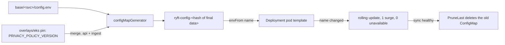

# F1: configuration that rolls the pods, and a policy version that goes into force with its page

Ticket C of `plan.md`, design by platform-architect, 2026-10-22, on `main` = `b306a96`. This is a proposal
for the lead. Build: gitops-engineer, backend-engineer and web-engineer (the policy reader has to move).

## 1. Problem

`PRIVACY_POLICY_VERSION` lives in the plain ConfigMap `ryft-config` of `ryft-api` and `ryft-ingest`
(`deploy/k8s/base/{api,ingest}/configmap.yaml`). The pods read it once at start through `envFrom`. If the
ConfigMap changes, no pod rolls. Pods started later (an HPA scale-up, a drain, the next image deploy) get
the new value, and the others keep the old one. As a result, api answers `422` to a consent on some pods
and accepts it on others, and an ingest pod with the old value refuses users who consented to the new one.
Consent is recorded against this version (D78), so the mismatch is a data-protection defect. Today the
runbook works around it with a manual `rollout restart` that the user runs.

A second defect appears as soon as the first is fixed. A policy PR changes the version and the page
together (D107: strict equality). The ConfigMap is a manifest, so Argo CD applies it about 3 minutes after
the merge. The page only goes live with the web image, 25–40 minutes later, after the build, Trivy and
the deploy PR. The app links `PRIVACY_POLICY_URL` = `https://ryftapp.de/privacy`, which is the site's
**newest** page (`web/src/lib/legal.ts`, `../app/.../HealthPermissionView.swift`). The app also asks every
user whose consent differs from `GET /v1/config` to consent again on their next app open. If pods rolled
on the ConfigMap alone, every active tester in that window would consent to version X while reading the
text of version X-1. Today the manual restart "once the page is live" is what prevents this. The AC
"OPERATIONS loses the interim restart" would remove that protection unless something replaces it.
`docs/work/2026-10-21-web-monorepo/design.md` already predicted this window and left it as the user's call.

Also: `internal/config` falls back to `"2026-10-20"` when the variable is unset. That is a fourth copy of
the version, and no check reads it.

## 2. Constraints

- Three t3.large nodes, one operator, GDPR Art. 9 data. Git is the only path to production: Argo CD
  (`ryft-platform`: automated, prune, self-heal, `ServerSideApply`, `PruneLast`, PreSync migrate,
  PostSync smoke, retry 2), and CI promote PRs (D96/D107).
- A deploy branch may change **only** `deploy/k8s/overlays/eks/kustomization.yaml`. `promote.sh` refuses
  any other file (`stray`).
- `deploy_targets.sh --check` fails on any line where `#` is followed by `hold` that does not parse. It
  also checks the `ghcr.io/timkrebs/ryft/*` entries, and nothing else.
- The privacy versions list is append-only (`check_privacy_versions.sh`). A policy PR therefore cannot be
  reverted as a whole through CI.
- Boring and already in the stack: kustomize, Argo CD, the existing scripts. No new add-on.

## 3. What I verified (kustomize v5.8.1, `kubectl kustomize`, copies in the scratchpad; nothing in the repo)

| Experiment | Result |
| --- | --- |
| `kustomize.config.k8s.io/needs-hash: "true"` on the plain YAML ConfigMap | **Ignored** (annotation kept, no hash). Only the internal `internal.config.kubernetes.io/needsHashSuffix` works, which is undocumented. |
| `configMapGenerator` with `behavior: merge` over the plain YAML ConfigMap | No hash. A hash requires the ConfigMap itself to be generated. |
| `replacements` copying `data.PRIVACY_POLICY_VERSION` into a pod-template annotation | Works, but the value comes out as `"2026-10-20T00:00:00Z"` (retyped as a YAML timestamp). An overlay patch of the ConfigMap is **not** seen: the ConfigMap says `2026-11-01`, the annotation still says `2026-10-20`, and nothing rolls. |
| `configMapGenerator` (`envs: [config.env]`) in `base/{api,ingest,scoring,notify}` | `ryft-config-<hash>`. Each Deployment points at **its own namespace's** hash (tested with different content per namespace). migrate's plain `ryft-config` and its Job are untouched. |
| A patch or `behavior: merge` generator in an overlay (by the original name `ryft-config` + namespace) | Matches the generated ConfigMap. The **hash is computed after the overlay**, and the Deployments follow. The local-postgres `AUTH_MODE` patches still match. |
| kustomize env-file parsing | `A=1 # x` → `'1 # x'`, `B="2026-10-20"` → `'"2026-10-20"'`, `E= x ` → `' x '`. Inline comments, quotes and spaces become part of the value. |
| Full prototype (generators, EKS in-force pin, web PDB) through every overlay and kubeconform as in `make k8s-validate` | 248 resources, all valid. |
| Roll prototype | Moving the EKS in-force pin rolls exactly `ryft-api/api` and `ryft-ingest/ingest`. Moving only the base version rolls nothing on EKS, but rolls `services/api`. Changing scoring's `LOG_LEVEL` rolls only `ryft-scoring/scoring`. |

Other facts that shape the choice:
- `cmd/scoring/main.go` and `cmd/scoring/rescore.go` call `config.LoadBeta()` (for `CONSENT_ENFORCE`). The
  scoring ConfigMap has **no** `PRIVACY_POLICY_VERSION` and no `AUTH_MODE`. If the version check sits in
  `LoadBeta()`, scoring crash-loops on EKS.
- Nobody reads the version except api (`/v1/config`, `POST /v1/me/consent`, sync status) and ingest (the
  sync gate). The smokes (`smoke.sh`, `check_api.py`, `internal/smoke`, `smoke_prod.sh`,
  `check_accounts.py`) all read it from `GET /v1/config`. None hard-codes it.
- In api and ingest, `LoadBeta()` runs **after** `db.Open` and `eventbus.Open`, which retry for minutes, so
  a config error surfaces late.
- The history shows the bug class is real. D102 had to move broker settings into Deployment env
  (`overlays/eks/events.yaml`) "because a change rolls the pods". `LOG_LEVEL` and `APNS_TOPIC` have the
  same problem today.

## 4. How a change rolls the pods: options

| | (a) `replacements` into an annotation | (b) hashed `configMapGenerator` | (c) env in each Deployment | (d) other |
| --- | --- | --- | --- | --- |
| What rolls | Only on a version change made in base | Any key of the service's config, wherever it is changed (base or overlay) | The keys moved into env | (d1) internal needs-hash: like (b) on undocumented internals. (d2) Reloader: a new add-on (Terraform/Helm, the user's). (d3) re-read a mounted file: code in two services, each pod switches on its own timer |
| Overlay changes | **Blind** (tested): an EKS-only pin would never roll | Seen (hash after the overlay) | Seen (pod template) | |
| Argo prune | Nothing new | The old `ryft-config-<old>` is pruned once the sync is healthy (`PruneLast`) | Nothing new | |
| Rollback by `git revert` | Works | Works: old content → old name, recreated or still there | Works | |
| `kubectl rollout undo` | Pods get the *current* ConfigMap | Old RS may point at a pruned ConfigMap (`CreateContainerConfigError`). Not a supported path: self-heal reverts it and D95 says revert | Works | |
| PreSync migrate / PostSync smoke | Untouched | Untouched if migrate's stays plain (it must: the hook runs before the sync creates a new name) | Untouched | |
| Policy reader (`policy.mjs`) | Unchanged | Must read `config.env` | Must read `deployment.yaml` | |
| Surprises | Date retyped to a timestamp | Env-file rules (no quotes, no inline comments) | Two places for config of one service | |

Mixed versions during a rolling update are the same for (a)–(c). Pods surge by one, none is unavailable,
and a 2-replica Deployment is fully replaced in about 1–2 minutes. Old pods serve the old value until they
are replaced.

**Choice: (b), for the four Deployment ConfigMaps (api, ingest, scoring, notify); migrate's stays plain.**
It fixes the whole class, including keys nobody thinks of as risky (`LOG_LEVEL`, `AMQP_*`, `APNS_TOPIC`).
It is plain kustomize that Argo CD already renders. It is the only option that also rolls when an overlay
changes a value, and the next section depends on that. Its one new behaviour is pruning, and `PruneLast`
already makes pruning safe: nothing is pruned before the new pods are healthy.

## 5. When the version goes into force: options

| | Window where the in-force version and the page at `/privacy` differ | Steps for a policy change |
| --- | --- | --- |
| (i) Accept: version flips with the manifest | 25–40 min, every re-consenting tester (version X shown with the text of X-1), forever if the web build fails | 1 PR |
| (ii) Manual: an EKS pin moved by a second PR after the web deploy | 0 in the harmful direction (CI enforces page first). Reverse window (new sign-ups see X, consent to X-1) for as long as the human takes | 2 PRs + waiting |
| (iii) **promote moves the EKS pin with web's pin** | One sync: web, api and ingest roll together (~1–2 min) | 1 PR |

**Choice: (iii).** `overlays/eks/kustomization.yaml` gets a pin for the version **in force**, next to the
image pins:

```yaml
# The privacy policy version in force on EKS (D78, D<n>): the base's version (deploy/k8s/base/{api,ingest}/
# config.env) once the web image that carries its page is pinned above. promote moves it whenever it pins
# web; scripts/check_policy_in_force.sh fails when the pinned web commit lacks its page.
configMapGenerator:
  - { name: ryft-config, namespace: ryft-api, behavior: merge, literals: [PRIVACY_POLICY_VERSION=2026-10-20] }
  - { name: ryft-config, namespace: ryft-ingest, behavior: merge, literals: [PRIVACY_POLICY_VERSION=2026-10-20] }
```

- **Base = published.** The version is the site's newest page, and it is used by `docker-compose.yml` and
  local-postgres. The web strict check keeps its meaning: base == last entry of `privacy-versions.json` ==
  newest page in en and de; compose agrees.
- **Overlay = in force on EKS.** `pin_images.sh … web` sets it to the base version at the commit it pins.
  That is HEAD, where the strict check has already proved the pages exist. The deploy PR still changes only
  the kustomization file. Its body adds "privacy policy in force: A → B".
- **A hold on web holds the policy too.** A failed web build or Trivy run does the same. The old version
  stays in force with the old site, which is consistent. `scripts/check_policy_in_force.sh` (`manifests`)
  renders `overlays/eks` and fails when: api and ingest disagree; the value is not a `YYYY-MM-DD` date
  (quotes); it is not listed in `privacy-versions.json`; or web's pinned commit lacks
  `web/content/legal/{en,de}/privacy/<v>.mdx`. A web pin that is not a commit of this history (`f437747`,
  from ryft-web) passes only if `<v>` is the first listed version, because that image carries `2026-10-20`
  only.
- The first deploy PR after the merge leaves the pin at `2026-10-20` (no change).

### Flows

```mermaid
sequenceDiagram
  participant A as Author
  participant M as main
  participant CI as ci (manifests, web-image, promote)
  participant D as deploy PR (App)
  participant Argo as Argo CD ryft-platform
  A->>M: PR: pages en/de, list += X, base config.env X, compose X (strict check green)
  M->>Argo: sync: EKS renders X-1 (overlay pin), same hash: nothing rolls
  M->>CI: web/ differs from its pin: build, Trivy, push web:<sha>
  CI->>D: pin web → <sha> and in-force X (one file); check_policy_in_force: page X in <sha>
  D->>M: auto-merge
  M->>Argo: PreSync migrate, then: ConfigMaps ryft-config-<new> (api, ingest), web, api, ingest roll together
  Argo->>Argo: healthy → PruneLast removes ryft-config-<old> → PostSync smoke (consent via api, sync via ingest)
```



## 6. Failure modes

| Failure | Observed by | Recovery |
| --- | --- | --- |
| New ReplicaSet crash-loops (a key the pinned image refuses, a quoted value) | Pods `CrashLoopBackOff`. Deployment Progressing → Degraded after 600 s, `ArgoSyncFailed` / `ArgoAppDegraded`. The PostSync smoke does not run | Old pods keep serving with their old ConfigMap: a failed sync never reaches the prune. `git revert` (old name kept or recreated). |
| Old ConfigMap pruned while old pods run | Cannot happen before the sync is healthy (`PruneLast`). A running container never re-reads env | n/a. Watch it once on the first sync (§9). |
| `kubectl rollout undo` / scaling an old RS | `CreateContainerConfigError` | Not a rollback path here (self-heal reverts it anyway). Revert in git. |
| Revert of a config change | Pods roll back | Normal path. |
| Revert of a **policy** PR | `manifests` fails (append-only list) | Forward fix: a new version, or set the EKS pin back (the in-force check guards it). |
| Mixed versions during the roll (≤ ~2 min) | `ryft_consents_total{action="stale"}`, `ryft_gate_refusals_total{code="consent_required"}` bump | Self-healing. The app re-reads `/v1/config`. The PostSync smoke proves api and ingest agree afterwards. |
| Web held, or web build red, after a policy PR | promote prints "web held", B's deploy watch (group targeted without a PR) | Published ≠ in force, consistent for users. Fix the build or release the hold. |
| promote writes a wrong pin (bug) | `check_policy_in_force.sh` fails the deploy PR, so no auto-merge | Fix, re-run promote. |
| Web rolled back past a policy version | The in-force check fails the rollback PR until the pin goes back too | Set both. Testers who consented to the newer version consent again (`consent_required` rises). |
| Break-glass `make k8s-apply-eks` | `kubectl -n ryft-api get cm` shows older `ryft-config-*` | No prune there. Harmless, delete by hand later. Argo does not track them. |
| Env-file traps | Web reader rejects a malformed version line. The in-force check rejects a non-date. Go refuses to start | Fix the line. The conversion AC compares every data value with today's. |
| First sync after merging C | Four Deployments roll once (rename), with the images already pinned. scoring's single pod restarts | Events wait in RabbitMQ / the outbox. Smoke after. |
| Old images with new manifests, or the reverse (C's manifests land before its images, any revert) | | The version is set in every layout, so no combination crash-loops. |

## 7. The policy check (question 2)

Under (b), `deploy/k8s/base/{api,ingest}/configmap.yaml` disappears, so `platformPolicyVersion()` would
report "not found" and `--strict` turns `manifests` red. The reader must change **in the same PR**:

- `web/scripts/lib/policy.mjs`: `platformPolicyVersion(repoRoot)` reads
  `deploy/k8s/base/${s}/config.env`. The new reader `versionFromEnvFile(text)`, replacing
  `versionFromConfigMap`, accepts exactly `^PRIVACY_POLICY_VERSION=(\d{4}-\d{2}-\d{2})$`, multiline, and
  ignores comment lines. A line that starts with `PRIVACY_POLICY_VERSION` and does not match (quotes,
  spaces, inline comment) is a **problem** that names the file. Kustomize would ship those characters as
  part of the value. The `docker-compose.yml` comparison stays as it is (YAML).
- `web/tests/policy.test.ts`: the `repo()` fixture writes `config.env`. Add cases for a quoted, a spaced and
  an inline-commented line (each a problem) and a commented-out line (ignored). The existing cases keep
  their meaning.
- `web/scripts/check-policy-version.mjs`: header comment and success message name `config.env`.
- The web check stays about **published**. The in-force side is `scripts/check_policy_in_force.sh`
  (gitops), because it needs git and the rendered overlay.

## 8. The Go default (question 3)

- **The "local mode" switch** that exists is `AUTH_MODE=apikey` + `ALLOW_INSECURE_APIKEY_AUTH=true`
  (`LoadAuth`, "local development only"). There is no `RYFT_ENV`. I do **not** key the policy to it: every
  local path already sets the version (compose's `*env` anchor for ingest, scoring and api; local-postgres
  through base). An apikey exception would keep a hard-coded date that goes stale unseen, and it would tie
  privacy config to the auth mode. Decision: **required in every mode, for api and ingest.** (STATUS said
  "outside local mode". This is stricter, and relaxing it is a two-line `if`.)
- `config.LoadBeta()`: no default for `PRIVACY_POLICY_VERSION`. The value is trimmed. Empty when unset (no
  error, so scoring and `scoring rescore` keep working: they read only the modes). When set, it must parse
  as `time.Parse("2006-01-02", v)`, otherwise `PRIVACY_POLICY_VERSION must be a date (YYYY-MM-DD), got
  "<v>"`. This replaces the 32-character check. No date literal stays in `config.go`.
- New `func (b Beta) RequirePolicy() error`, called by api and ingest only:
  `PRIVACY_POLICY_VERSION is required: api and ingest record and enforce consent against it (D78); set the
  published version (deploy/k8s/base/<service>/config.env, docker-compose.yml)`.
- `cmd/api/main.go`, `cmd/ingest/main.go`: `LoadBeta` + `RequirePolicy` move up to right after `LoadAuth`,
  before `db.Open` / `eventbus.Open`. A missing version exits 1 within a second with
  `{"level":"ERROR","msg":"beta config","err":"PRIVACY_POLICY_VERSION is required: …"}`. Today it would be
  minutes later, behind DB retries. scoring may move its `LoadBeta` up too (consistency, optional).
- In production, a pod without the variable is a new ReplicaSet in `CrashLoopBackOff`. The old pods stay
  (0 unavailable) and Argo goes Degraded. That cannot happen with these manifests in any old/new
  combination (§6).
- No `docs/API.md` change: the field and its format are unchanged.

## 9. Web PodDisruptionBudget (question 4)

`deploy/k8s/base/web/pdb.yaml`, added to `base/web/kustomization.yaml`:

```yaml
# One of the two site pods at a time through node drains and node group updates. Pods that are not ready
# protect nothing and may always be evicted, so a broken site never blocks a drain.
apiVersion: policy/v1
kind: PodDisruptionBudget
metadata:
  name: web
spec:
  maxUnavailable: 1
  unhealthyPodEvictionPolicy: AlwaysAllow
  selector:
    matchLabels: { app: web }
```

- **`maxUnavailable: 1` rather than `minAvailable: 1`.** At 2 replicas they are the same. web has a fixed
  `replicas: 2` and no HPA, and the property we want is "one at a time" at any replica count (the RabbitMQ
  PDB's form). `minAvailable: 1` at 3 replicas would allow 2 at once. api and ingest keep `minAvailable: 1`
  (HPA 2–4, "one pod stays"); no change there.
- **Three nodes:** spread is `ScheduleAnyway`, so both pods can land on one node after a drain. A later
  drain of that node then evicts them one after the other and waits seconds for nginx to be ready
  elsewhere. EKS managed node group updates respect PDBs (15-minute timeout per node), which is not an
  issue here. web is not in local-postgres, so the single-node drain caveat in OPERATIONS does not apply.
- **Argo CD:** same kind and fields as api's and ingest's PDBs in the same application, which have never
  failed a sync. The rolling update keeps 0 unavailable, so the budget is never short during a deploy. A
  budget that cannot be met only happens together with an already unhealthy web Deployment.

## 10. Migration and rollback

1. Merge C (after B, per the plan; C's branch merges `main` in). Argo's sync of the merge renames four
   ConfigMaps. api, ingest, scoring and notify roll once with the pinned images (`a9685b5`: same values,
   same behaviour), `PruneLast` deletes the four plain `ryft-config`, and the smoke runs.
2. CI on that merge: `backend/` and `web/` changed, so promote pins both. The in-force pin stays
   `2026-10-20`. The auto-merge rolls the services again (new images, fail-fast) and web.
3. Verify, read-only:
   ```bash
   for n in api ingest scoring notify; do kubectl -n ryft-$n get cm -o name; done      # only ryft-config-<hash>
   kubectl -n ryft-api get deploy api -o jsonpath='{.spec.template.spec.containers[0].envFrom}'; echo
   for s in api ingest; do kubectl -n ryft-$s logs -l app=$s --tail=-1 --since=30m | grep '"msg":"beta"'; done
   make smoke-prod
   ```
**Rollback:** revert C's merge. The plain ConfigMaps come back, the Deployments roll, and the hashed ones are
pruned. If the new images are the problem, use the usual services rollback with a hold. No schema change, no
down-migration.

## 11. Test strategy

- `scripts/tests/config_rolls_test.sh` (new; the AC test). It copies `deploy/k8s` to a temp directory,
  renders, mutates and renders again, then compares the Deployment documents per namespace/name (python3,
  no PyYAML, as in the prototype):
  1. EKS in-force pin changed → exactly `ryft-api/api` and `ryft-ingest/ingest` differ, in their
     `configMapRef` name. Every other Deployment and both Jobs are byte-identical.
  2. Only the base version changed → no EKS Deployment differs. `services/api` and `services/ingest` do.
  3. `LOG_LEVEL` in `base/scoring/config.env` → only `ryft-scoring/scoring` differs.
  4. The four Deployments reference `^ryft-config-[a-z0-9]{10}$`, and migrate's Job references plain
     `ryft-config` (fails if someone turns a generator back into a plain ConfigMap).
  It runs in `make k8s-validate` (the `manifests` job, which every `deploy/**` PR triggers) and in
  `make test-scripts`.
- `scripts/tests/check_policy_in_force_test.sh`: a throwaway repository (like `lib.sh`). Pass on a
  consistent state. Fail when api and ingest differ, on a quoted value, on an unlisted version, and when
  the pinned web commit lacks the en or the de page. A non-history pin passes only with the first listed
  version.
- `pin_images_test.sh` / `promote_test.sh` / `deploy_targets_test.sh`: pinning web moves the in-force
  lines to base's version, pinning services leaves them byte-for-byte, base api ≠ ingest is an error, the
  deploy branch changes one file, and the PR body has the policy line. (`lib.sh` `new_repo` needs base
  `config.env` files.)
- `backend/internal/config/config_test.go` (table tests), `go vet`, `go test ./...`, `make smoke`,
  `make smoke-hook`.
- `web/tests/policy.test.ts`, `make web-test`, `node web/scripts/check-policy-version.mjs --strict`.
- Recommended, not required: one kind run with Argo CD (as for D95). Change a value and watch
  `kubectl get cm -w` (the old ConfigMap must outlive the rollout). Then make the new RS crash-loop and
  check that the sync fails without pruning.

## 12. Docs to update

`docs/OPERATIONS.md`:
- Beta → Consent: "config.env of api and ingest, in force per `overlays/eks`".
- **A new policy text**: one PR; no restart; it goes into force with the web deploy; how to check.
- Deploy and roll back: rolling web back past a policy version.
- Scaling and disruptions: the web PDB.
- Apex site → Verify: add `privacy/<in-force version>`.
- Self-hosted: an old plain `ryft-config` stays behind after `make k8s-apply-local`.

Other docs:
- `docs/OBSERVABILITY.md:257`: `LOG_LEVEL` lives in `config.env`.
- `.github/workflows/ci.yml` comments (lines ~189, ~202) and the new step.
- `deploy/k8s/overlays/eks/kustomization.yaml`: the comment on the `events.yaml` patch.
- `web/CLAUDE.md:29`, `web/README.md:14,66,93`.
- STATUS and DECISIONS go through the lead in ticket G.

## 13. Tickets (question 5)

All three land in **one** PR `deploy: configuration rolls the pods, the policy goes into force with its page`.
The web reader must move together with the ConfigMap, or `manifests` is red.

### C-G: gitops-engineer

Files:
- `deploy/k8s/base/{api,ingest,scoring,notify}/configmap.yaml` (delete) →
  `deploy/k8s/base/{api,ingest,scoring,notify}/config.env` (new) + `configMapGenerator` in each
  `kustomization.yaml`.
- `deploy/k8s/base/migrate/kustomization.yaml`: a comment saying why its ConfigMap stays plain.
- `deploy/k8s/base/web/pdb.yaml` (new) + `base/web/kustomization.yaml`.
- `deploy/k8s/overlays/eks/kustomization.yaml`: the in-force block, and the `events.yaml` comment.
- `scripts/pin_images.sh`, `scripts/promote.sh`, `scripts/check_policy_in_force.sh` (new).
- `scripts/tests/{config_rolls_test.sh,check_policy_in_force_test.sh}` (new),
  `scripts/tests/{pin_images_test.sh,promote_test.sh,lib.sh}`.
- `Makefile` (`k8s-validate` runs `config_rolls_test.sh`), `.github/workflows/ci.yml` (`manifests`: the
  in-force check after the strict web check).
- `docs/OPERATIONS.md`, `docs/OBSERVABILITY.md`.

Acceptance criteria:
1. In `kubectl kustomize deploy/k8s/overlays/eks`, api, ingest, scoring and notify use
   `ryft-config-<hash>`. Every data key and value equals today's: diff the data maps of main's render and
   the branch's. Watch for `PORT`, `APNS_TOPIC` without its inline comment, and no quotes. migrate keeps
   plain `ryft-config`.
2. `config.env` files hold bare `KEY=value` lines and full-line comments only.
3. `config_rolls_test.sh` proves the four properties in §11 and runs in `make k8s-validate` and
   `make test-scripts`.
4. `check_policy_in_force.sh` passes on the branch and fails in each case of §11. Its comment and messages
   contain no `#` followed by `hold` (`deploy_targets.sh --check` stays green).
5. `pin_images.sh <sha> web` sets both in-force lines to base's version, `… services` leaves them untouched,
   and api ≠ ingest in base exits non-zero. The deploy PR body shows the move. The deploy branch still
   changes only the kustomization file.
6. PDB `web` in `ryft-web`: `maxUnavailable: 1`, `unhealthyPodEvictionPolicy: AlwaysAllow`.
7. `make k8s-validate`, `make test-scripts` and `actionlint` are green.
8. OPERATIONS → "A new policy text" has no restart and says the version goes into force with the web
   deploy, plus the rollback note. Exact verify commands as in §10 are included.

### C-B: backend-engineer

Files: `backend/internal/config/config.go`, `backend/internal/config/config_test.go`,
`backend/cmd/api/main.go`, `backend/cmd/ingest/main.go` (optionally `backend/cmd/scoring/main.go`: only the
order).

Acceptance criteria:
1. No date literal in `config.go`. `LoadBeta` behaves as in §8 (unset → `""` without error; trimmed;
   otherwise a valid `YYYY-MM-DD` with the exact error text).
2. `Beta.RequirePolicy()` returns the exact error text of §8. api and ingest call it right after
   `LoadAuth`, before any network connection. scoring does not call it.
3. Tests cover: unset; valid; `" 2026-11-02 "`; `2026-13-01`; `2026-1-2`; `"2026-11-02"` with quotes;
   `2026-11-02 # x`; `latest`; 40 characters; and `RequirePolicy` on empty and set. `TestLoadBetaModes`
   still passes unchanged.
4. `go vet ./... && go test ./...`, `make smoke`, `make smoke-hook` are green.
   `docker compose run --rm --no-deps -e PRIVACY_POLICY_VERSION= api` (and `ingest`) exits 1 within seconds
   with the message.
5. No `docs/API.md` change.

### C-W: web-engineer

Files: `web/scripts/lib/policy.mjs`, `web/tests/policy.test.ts`, `web/scripts/check-policy-version.mjs`,
`web/CLAUDE.md`, `web/README.md`.

Acceptance criteria:
1. The reader behaves as in §7: `config.env`, a strict line shape, a malformed version line is a problem
   naming the file, and comments are ignored.
2. The compose comparison and every existing rule are unchanged.
3. New tests for quoted, spaced, inline-commented and commented-out lines.
4. `node web/scripts/check-policy-version.mjs --strict` from the repository root passes on the branch, and
   `make web-test` is green. Commits go through the hooks (`make hooks`).

## 14. DECISIONS entry (ready to paste; the lead numbers it)

```markdown
## D<n> — A service's configuration rolls its pods; the privacy policy goes into force with its page (amends D78, D107)

- **Why (F1, 2026-10-22):** api, ingest, scoring and notify read the plain ConfigMap `ryft-config`
  through `envFrom`, so an edit rolled no pod. After a new `PRIVACY_POLICY_VERSION`, api answered `422` on
  some pods and ingest refused consented users on others, until the user restarted both by hand. Consent
  is recorded against that version (D78). Fixing only that would have opened a second gap: the version
  would switch about three minutes after the merge, but the page 25–40 minutes later with the web image,
  and the app links `/privacy`, the newest page.
- **Hashed ConfigMaps:** each of the four generates `ryft-config-<hash>` from
  `deploy/k8s/base/<service>/config.env` (`configMapGenerator`). Any edit, in base or an overlay, changes
  the name, so the Deployment rolls with the image that is pinned. migrate's stays plain: its PreSync hook
  runs before the sync creates a new name. `config.env` holds bare `KEY=value` lines (kustomize keeps
  quotes, spaces and inline comments in the value). Argo CD prunes the old ConfigMap only after a healthy
  sync (`PruneLast`), so a failed rollout keeps it for the old pods. A revert recreates the old name;
  `kubectl rollout undo` is no rollback here.
- **The version in force on EKS** is a pin in `overlays/eks/kustomization.yaml` next to web's image: two
  merge generators set `PRIVACY_POLICY_VERSION` for api and ingest. The base value is the published one
  (the site's newest page, the local stacks). Whenever promote pins web, it sets the pin to the base's
  version at that commit, so page and version go live in one sync. While web is held or its build fails,
  the old version stays in force with the old site. `scripts/check_policy_in_force.sh` (`manifests`) fails
  when the pinned web commit lacks the in-force version's page in English or German, so rolling web back
  past a policy version takes the version back too.
- **Not chosen:** kustomize `replacements` into a pod-template annotation (it turned `2026-10-20` into
  `2026-10-20T00:00:00Z`, and it does not see an overlay's change, so the EKS pin would never roll); the
  version in each Deployment's env as in `events.yaml` (fixes one key, and the check moves anyway);
  kustomize's internal hash annotation (undocumented); Reloader (an add-on for what a generator already
  does).
- **The mixed window** is one rolling update, a minute or two: old pods serve the old version until they
  are replaced (`ryft_consents_total{action="stale"}`, `consent_required` refusals), and the app recovers
  on its next request. The PostSync smoke consents through api and syncs through ingest, so after every
  sync it proves the two agree.
- **No default in Go:** api and ingest refuse to start without `PRIVACY_POLICY_VERSION` in every auth
  mode, and before they connect to anything. Every local stack sets it, and the hard-coded date was a
  fourth copy nothing checked. The value must be a `YYYY-MM-DD` date. scoring does not read it (any
  version counts there, D78).
- **web gets a PodDisruptionBudget,** `maxUnavailable: 1` with `unhealthyPodEvictionPolicy: AlwaysAllow`:
  one of its two pods at a time through drains and node group updates.
- **Amended:** D78's "a new text ships with a deploy" now means the web deploy that carries its page.
  D107's two known gaps are closed, and its policy check reads `config.env`. D102's `events.yaml` stays
  until no pre-R4 image can be deployed, but configuration no longer needs that pattern to roll.
```

## 15. Needs the user, open points

1. **Approve §5 (iii):** a new policy text goes into force automatically with the web deploy: one PR, no
   restart, no second PR. This changes the procedure in OPERATIONS → "A new policy text" and closes the
   window the earlier design left to the user. If declined, the fallback is (ii): the same in-force pin
   and check, moved by a hand-made PR after the web deploy.
2. **For information:** the Go check applies in every mode, not only outside local mode (§8).
3. **Already known, still open:** both `2026-10-20` privacy pages are `status: draft`. The strict check
   warns that users are asked to consent to a draft. That is the user's legal call, not part of C.
4. Approve the merge, and watch the first sync (§10: four services roll once, the plain ConfigMaps are
   pruned after health). No Terraform and no kubectl are needed. On a local-postgres cluster an old plain
   `ryft-config` can be deleted by hand.
5. **Optional for B (deploy watch):** flag "published policy not in force for more than N hours" (web held
   or stuck after a policy PR).
6. **Deferred:** a `ryft_privacy_policy_info{service,version}` gauge with a mismatch alert (Argo health and
   the smoke already cover the failure modes), a PostSync probe of `web/privacy/<version>` (the static
   check covers it), and a versioned `PRIVACY_POLICY_URL` (no longer needed for correctness; still the
   user's call for an exact audit link).
