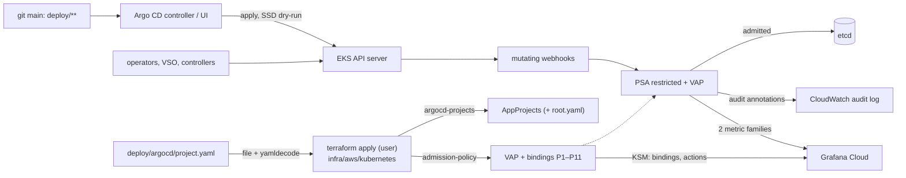

# Admission policy for `ryft-prod-euc1`: design (2026-10-23, revision 3)

Ticket T12. Author: platform-architect. Status: **decided 2026-10-23** (the user's answers under
"Decisions"; D120). Nothing here is built or applied yet.

**Read for this note:**
- `infra/aws`: EKS `kubernetes_version = "1.36"`; the eks module ships the `audit`, `api` and
  `authenticator` logs to CloudWatch.
- `infra/aws/kubernetes`: the add-on releases, `argocd.tf`, the local chart `cluster-issuers`, and helm
  provider `~> 3.3`.
- `infra/vault/namespaces.tf`.
- The renders of `deploy/{k8s,argocd,rabbitmq}`.
- D44–D46, D51, D94–D98, D103, D105 and D115.
- The #31 and #38 reviews.

**Revisions:**
- **Revision 2** answered the security review of `327efe0`: B1 (P7 last, with a carve-out), B2
  (Terraform-owned AppProjects), P9–P11, the claims table, binding signals and the exit checklist.
- **Revision 3** answers the re-verify:
  - P10 matches only requests that set or change `operation`;
  - the broker's `rollout restart` (D98) is exempt;
  - CI installs Argo CD's CRDs;
  - claims (a), (f) and the new (m);
  - T12-f is applied alone, before the policies;
  - the broker's egress narrowing is its own PR with a canary;
  - the Pause note for a Terraform-owned `root.yaml`.

## Recommendation

1. **PSA stays the pod-security mechanism.** Pod Security Admission (PSA) `restricted` already holds on
   every `ryft-*` namespace, `rabbitmq-system` and `argocd`. What's missing is protection of those
   labels.
2. **Built-in ValidatingAdmissionPolicy (VAP) covers everything PSA can't express.** VAP rules are CEL
   expressions. VAP is GA since 1.30, and EKS runs 1.36. The design has eleven policies, P1–P11.
   - No Kyverno or Gatekeeper.
   - No pods to run, and no webhook that can be down.
3. **Terraform owns the policies, and the AppProjects if you agree.** Both come from
   `infra/aws/kubernetes`:
   - one local chart holds the policies;
   - a second renders `deploy/argocd/project.yaml`;
   - P7 receives the same decoded file as its constant.

   One file, one owner, no hand apply.
4. **Rollout order:**
   - Argo CD's RBAC is narrowed first, in its own apply.
   - Then Warn+Audit until an exercise checklist and 7 days pass.
   - Then Deny in four steps, by blast radius:
     1. the small config apps;
     2. what Argo applies;
     3. what controllers create at runtime;
     4. Argo CD's own objects.

   A CI job and a repeatable kind run test every render against the same chart first.
5. **Break-glass is yours alone.** `kubectl patch` or `delete` a binding. That always works, because
   bindings are exempt from admission. Terraform restores it, and a kube-state-metrics (KSM) alert
   reports any binding left off.

## Problem

D115 holds a small set of render invariants in CI. Two gaps remain.

**What CI can't express.** This is OPERATIONS' "Not checked" list, plus #38's re-verify items 3–9:
- privileged pods and host access;
- PSA labels and Namespace objects;
- images per namespace and command overrides;
- NetworkPolicy shapes;
- the VSO objects;
- the operators project's cluster power;
- `project.yaml` itself.

#38 also left four lows:
- **L1:** `.` path segments;
- **L2:** an unbound `root.yaml` path;
- **L3:** an operators path that includes workload paths;
- **L4:** a map-valued CRD `name` that crashes `renderpolicy.py` (it fails closed).

**What never passes CI at all,** because it is written in the cluster:
- Argo CD's public UI (D103);
- the operators;
- VSO;
- a break-glass apply;
- today's hand apply of `project.yaml`.

**Constraints:**
- Three t3.large nodes, short of CPU (D94, D97).
- One operator.
- CLAUDE.md: add-ons are Helm releases in `infra/aws/kubernetes`; Argo CD manages workloads only;
  nothing has two owners.
- GDPR and secrets: messages never carry object values. No `messageExpression` built from them, and
  only Secret *keys* are named.

## 1. Mechanism

| | PSA labels | ValidatingAdmissionPolicy | Kyverno / Gatekeeper |
| --- | --- | --- | --- |
| Runs in | the API server | the API server | 4–6 pods |
| Node cost | none | none | ~0.4 CPU and 0.5–1 GiB requested at chart defaults, plus pod slots |
| When down | – | – | `Fail`: refuses every write it matches. `Ignore`: admits silently |
| Expresses | privileged, host namespaces, hostPath, capabilities, seccomp, volume types | any check of one object (and its old version) against constants, its namespace and the requester | that, plus mutation, background scans, signatures, external data |

**Choice: PSA as it is, plus VAP.**
- No availability dependency, and no node cost.
- Every rule checks one object.
- CI and production apply the same `helm template` bytes.
- Boring, built-in technology.

**What VAP can't do, and how this design copes:**
- **Cross-object checks:** fixed name→path maps; "a default-deny exists" stays in CI.
- **It judges writes only:** Argo's server-side diff (SSD, D95) dry-run-applies objects on refresh.
  `ryft-root` has no SSD.
- **No signatures.**

**Alternatives.** Kyverno or Gatekeeper add mutation, background reports and signatures. They also add
a webhook whose outage either blocks every deploy or admits everything, plus CRDs, certificates and an
add-on to upgrade, on nodes with no spare CPU. Revisit them once signed images are required (Kyverno's
`verifyImages` or the sigstore policy-controller, scoped to `ryft-*`). PSA alone doesn't see images,
commands, NetworkPolicies, VSO or Argo objects.

**Claims this design rests on:**

| # | Claim | Status | Checked in |
| --- | --- | --- | --- |
| a | the API server runs no admission policy on policy or binding objects (no lockout; no self-protection) | verified (source) | kind fixture: a policy written to match bindings never fires |
| b | webhook configurations are not exempt, so P6 sees them | plausible | kind |
| c | CONNECT on `pods/exec` can be matched (P8) | plausible | kind |
| d | dry-run requests carry the `validation_failure` audit annotation | plausible | kind |
| e | `apiserver_validating_admission_policy_check_total` counts clean passes | doubtful. Not used for liveness; claim m instead | – |
| f | with SSD, a denial shows as a comparison error on the whole app (`ArgoAppOutOfSync`, not `ArgoSyncFailed`) | plausible | kind |
| g | P7's whole-`spec` equality against a JSON-literal constant type-checks on the AppProject schema | plausible. Fallback: one equality per top-level key | kind |
| h | narrowed controller RBAC, with `escalate`/`bind` limited by `resourceNames`, can still create the operators' roles | plausible | kind |
| i | `resource.respectRBAC: strict` keeps the controller's cache working without cluster-wide Secrets | plausible | kind |
| j | helm provider `~> 3.3` offers `take_ownership` | plausible. Fallback: metadata labels (§5) | `terraform validate` |
| k | what `argocd-server` writes as `operation.sync.revision` for a plain sync (`""`, `main` or the SHA) | unknown | kind |
| l | the broker's 443 egress only reaches the API server inside the VPC | plausible | production: T12-k's canary |
| m | KSM custom-resource-state can export `ValidatingAdmissionPolicyBinding` (name, `validationActions`, labels), given `rbac.extraRules` for list/watch on `admissionregistration.k8s.io` `validatingadmissionpolicybindings` | plausible | kind |

### Ownership

**Policies and bindings.**
- **The chart.** The local chart `infra/aws/kubernetes/charts/admission-policy` is installed by
  `helm_release.admission_policy` (new `admission.tf`, in `kube-system`).
- **The values file.** Production values sit in a committed `infra/aws/kubernetes/admission-values.yaml`,
  which Terraform reads and CI's `helm template` uses. It holds:
  - the Vault address;
  - the Argo service-account names;
  - the action per binding (`audit` | `deny`);
  - an `enabled` flag for each of the two new releases, false until Phase 1.

  A step change is a reviewed PR plus your apply.
- **The address test.** A test compares the address with the generated
  `deploy/k8s/overlays/vault-namespaces/*/vault.yaml`. No tfvars are involved.
- **Literals, not params.** Values become literals in each policy's `variables`; there are no param
  objects.

**AppProjects (B2). Recommended: Terraform owns them.** This is your decision, and it amends D95.
- **Today:** Argo doesn't manage `project.yaml`. `root.yaml` syncs only `apps/`, and the file is
  applied by hand, against OPERATIONS' "Nobody runs `kubectl apply` against production".
- **Recommended:** `infra/aws/kubernetes` reads `deploy/argocd/project.yaml` (`file()`, split per
  document, `yamldecode`, empty documents dropped). It also reads `root.yaml` (recommended).
  - A local chart `argocd-projects` renders them. Its release lives in `argocd` and runs after
    `helm_release.argocd` and `helm_release.admission_policy`.
  - The same decoded value becomes P7's constant.
  - CI keeps reading the same file.
  - A project change reaches the cluster with your next `terraform apply`. An application commit can't
    widen a project, as D95 intends.
- **Adoption, once:** `take_ownership` (claim j), or Helm's ownership metadata that you add first
  (metadata only; §5).
- **Pause note:** with `root.yaml` Terraform-owned, a `terraform apply` while the root is paused resumes
  it, because Helm restores `syncPolicy`. Don't apply `infra/aws/kubernetes` during a pause, or expect
  the resume.
- **Minimal alternative:** keep the hand apply. P7 then refuses AppProject writes from any
  `system:serviceaccount:argocd:*` and checks only generic invariants:
  - our repository;
  - no `*`, and no admission-policy kinds in any whitelist;
  - no `roles`;
  - `default` empty.

  There is no copy. OPERATIONS:208 needs the exception.

**PSA labels** stay with each namespace's owner, and P1 guards them:

| Namespace | Owner | Level |
| --- | --- | --- |
| `ryft-{api,ingest,scoring,notify,migrate,smoke,rabbitmq}` | `infra/vault` | `restricted` (enforce, warn, audit) |
| `ryft-web` | git: Argo, `ryft` | `restricted` |
| `rabbitmq-system` | git: Argo, `ryft-operators` | `restricted` |
| `argocd` | `infra/aws/kubernetes` | `restricted` |
| `monitoring` | `infra/vault` | `privileged` (D51), accepted |
| `cert-manager`, `external-dns`, `vault-secrets-operator-system` | Helm, unlabelled | warn+audit `restricted`, then enforce (T12-j) |
| `amazon-cloudwatch`, `kube-system`, `default` | Helm / EKS | unchanged |

**Who can change the policies:**
- Bindings and policies are exempt from admission (a), so RBAC guards them.
- No Argo project whitelists them, and P7 keeps it that way.
- T12-f narrows Argo CD's chart-default ClusterRoles before anything else is applied:
  - the controller may write only the two webhook-configuration resources of
    `admissionregistration.k8s.io`;
  - the server may write nothing there;
  - neither gets `secrets` get, `pods/exec` or `pods/ephemeralcontainers`;
  - ApplicationSet is off.
- The workloads hold no token (P2).
- The operators' roles can't grant `admissionregistration.k8s.io` (P6).



## 2. Rule set

**Terms:**
- **R:** `ryft-*`, matched by a matchCondition on `request.namespace` (namespaced objects) or
  `request.name` (Namespaces).
- **OPS:** `rabbitmq-system`.
- **Argo:** `system:serviceaccount:argocd:argocd-application-controller` and `…:argocd-server`.

**Common to every policy:**
- `failurePolicy: Fail`.
- Value-free messages.
- A matchCondition skips an UPDATE when `oldObject.metadata.deletionTimestamp` is set and the spec (or
  `data`) is unchanged, so finalizer removal (VSO's, for example) passes.
- Pod rules walk `containers` and `initContainers`, never `ephemeralContainers`.
- C/U/D means CREATE/UPDATE/DELETE. DELETE is matched only where stated.

**P1 `ryft-namespaces`** (C, U; D for Argo)
- R, `rabbitmq-system` and `argocd` carry PSA `enforce`, `warn` and `audit` set to `restricted`, and no
  `*-version` label other than `latest`. Any writer, `infra/vault` included.
- Argo may write only `ryft-web` and `rabbitmq-system`, and may delete no Namespace.
- `monitoring` is outside by name.

**P2 `ryft-workloads`** (C, U)
- **Scope:** Pod, Deployment, StatefulSet, DaemonSet, ReplicaSet, Job and CronJob in R and OPS.
- **Bindings:** `templates` (everything but Pod) and `pods`.
- **Images:**
  - `ryft-<svc>` runs only `ghcr.io/timkrebs/ryft/<svc>:<7 hex>`;
  - `ryft-smoke` runs the migrate image;
  - `ryft-rabbitmq` runs only `docker.io/library/rabbitmq:<tag>@sha256:<64 hex>`;
  - OPS runs only `ghcr.io/rabbitmq/{cluster-operator,messaging-topology-operator}:<semver>`, with
    `command: [/manager]` only;
  - no `image` volumes anywhere.
- **In R:**
  - no `command`; exec probes and lifecycle hooks count as commands;
  - `args` empty except `[smoke]` on the migrate image in `ryft-smoke`;
  - `automountServiceAccountToken: false`;
  - no projected `serviceAccountToken` source;
  - no volume, `env` or `envFrom` reference to Secret `vault-auth-token`;
  - on Pods, no `kube-api-access-*` volume.
- **The broker's exemption** covers commands, the operator's exec probes and its `preStop` hook, and
  the token. It applies to exactly three things:
  - the StatefulSet `rabbitmq-server` written by the Cluster Operator's service account;
  - Pods whose controller owner is that StatefulSet;
  - an UPDATE of that StatefulSet, by any writer, whose only change is
    `spec.template.metadata.annotations["kubectl.kubernetes.io/restartedAt"]`. That is D98's fallback
    `kubectl -n ryft-rabbitmq rollout restart statefulset rabbitmq-server` (OPERATIONS → RabbitMQ).

  The runbook stays. A restart changes nothing about what runs, and the StatefulSet replaces the pods
  one at a time, waiting for each to be ready. That is safer than deleting them by hand.

**P3 `ryft-netpol`** (C, U; D for `default-deny`)
- `default-deny` stays `podSelector: {}` with Ingress+Egress and no rules. It can't be deleted unless its
  namespace is terminating.
- Every other rule has `ports`, every port entry has `port`, and there is a peer.
- `namespaceSelector` is only `matchLabels: {kubernetes.io/metadata.name: <one>}`.
- `ipBlock` is limited to two shapes:
  - the VPC CIDR, for ingress on 9090/15692, and for `ryft-rabbitmq`'s egress on 443 (narrowed by T12-k;
    claim l);
  - `0.0.0.0/0` for egress on 443/5432, with the five private ranges excepted.
- `endPort` only in `ryft-rabbitmq`.
- `rabbitmq-system` has no NetworkPolicy. It is outside R; a default-deny there is a follow-up.

**P4 `ryft-vso`** (C, U; all namespaces, any writer)
- Keys are allowlisted per kind, CRD-defaulted fields included.
- **VaultConnection:** `address` is the value; `skipTLSVerify` false; no `caCertSecretRef` or `headers`.
- **VaultAuth:** `kubernetes` method and mount, audiences `[vault]`, a local
  `vaultConnectionRef: vault`, no `allowedNamespaces`.
- **VaultStaticSecret:**
  - a local `vaultAuthRef`, `kv`, `kv-v2`;
  - destination `ryft-secrets` or `amqp-user-<name>`;
  - `excludeRaw: true`, no `templates` or `transformationRefs`.
- Other `secrets.hashicorp.com` kinds are refused.

**P5 `ryft-auth-env`** (C, U; ConfigMap, Secret and the P2 kinds in R; any writer)
- No ConfigMap or Secret key `API_KEY`, `ALLOW_INSECURE_APIKEY_AUTH` or `USER_ID`.
- `AUTH_MODE` only in ConfigMaps, and only `supabase`.
- In `env`: the same names are refused; `AUTH_MODE` must be the literal `supabase`; no `valueFrom`; no
  `envFrom[].prefix`.
- This catches a Vault key that VSO syncs.

**P6 `ryft-operators-cluster`** (C, U; Argo)
- **CRDs:** `rabbitmq.com` only, without a conversion webhook.
- **ClusterRoles:**
  - named `rabbitmq-cluster-*` or `messaging-topology-*`;
  - no `*`, no `escalate`, `bind` or `impersonate`, no `aggregationRule`, no
    `rbac.authorization.k8s.io/aggregate-to-*` label;
  - no grant on `admissionregistration.k8s.io`, `apiextensions.k8s.io`, `argoproj.io`,
    `secrets.hashicorp.com`, cluster RBAC, nodes or `serviceaccounts/token`;
  - no non-resource URL except `/metrics`.
- **ClusterRoleBindings:** only to those roles, and only for the two operator service accounts in OPS.
- **Webhook configurations:**
  - exactly `cluster-operator-{mutating,validating}-webhook-configuration` and
    `messaging-topology-{mutating,validating}-webhook-configuration`;
  - services in OPS, never a `url`;
  - rules on `rabbitmq.com` only.
- **Namespaced RBAC:** only in OPS, `roleRef.kind: Role`, with RoleBinding subjects only the two
  operator service accounts.

**P7 `ryft-argocd`** (C, U, D; namespace `argocd`, any writer)
- **Carve-out:** the application controller's UPDATEs with `object.spec == oldObject.spec` (its status
  and operation writes) are skipped.
- **AppProjects:**
  - the whole `spec` equals the decoded `project.yaml` (B2, claim g);
  - DELETE of `default` is refused from every writer;
  - DELETE of the others is refused from `system:serviceaccount:argocd:*`.
- **Applications:**
  - an allowlist of `spec` keys;
  - a fixed map from name to project, path and destination:

    | Application | Path |
    | --- | --- |
    | `ryft-root` | `deploy/argocd/apps` |
    | `ryft-platform` | `deploy/k8s/overlays/eks` |
    | `broker-rabbitmq` | `deploy/rabbitmq` |
    | `rabbitmq-operators` | `deploy/rabbitmq/operators` |
    | `vault-<x>` | `deploy/k8s/overlays/vault-namespaces/<x>`, destination `ryft-<x>` |

  - our repository, `targetRevision: main`, one `source`;
  - no `sources`, `sourceHydrator`, `destination.name`, `kustomize`, `helm`, `plugin` or `directory`;
  - `syncPolicy` free;
  - no ApplicationSet.
- **Secrets:** argocd-server may not write Secrets labelled `argocd.argoproj.io/secret-type`.

**P8 `ryft-operator-reach`** (C, U, CONNECT; the two operator service accounts)
- The Cluster Operator writes, in `ryft-rabbitmq` only:
  - Secrets, StatefulSets, Services, ConfigMaps, PVCs, ServiceAccounts, Roles and RoleBindings;
  - Pod UPDATEs;
  - `pods/exec` (claim c).
- The Topology Operator writes Secrets only there.
- Their reads: T12-g.

**P9 `ryft-traefik`** (C, U in R)
- Key allowlists include the CRD-defaulted keys.
- Middleware `spec` only `rateLimit`, `redirectRegex` or `headers`.
- ServersTransport only `rootCAs` and `serverName`, never `insecureSkipVerify`.
- An Ingress's `router.middlewares` names only middlewares of its own namespace.

**P10 `ryft-argocd-operation`** (C, U on Applications)
- **Matched only when a request sets or changes the top-level `operation`:**
  `has(object.operation) && (oldObject == null || !has(oldObject.operation) || object.operation != oldObject.operation)`.
  `status.operationState` is never looked at.
- **So these pass unjudged,** because they carry the in-flight operation unchanged or none:
  - the controller's status writes;
  - argocd-server's terminate-op (OPERATIONS → Deploy, D95);
  - pause and hard-refresh;
  - the controller clearing a finished operation.
- **Rules for a new or changed operation:**
  - from any writer, no `operation.sync.manifests`, `.source` or `.sources`. This refuses `--local` and
    `argocd app rollback`, which carries the history entry's source;
  - from argocd-server, `operation.sync.revision` must be `""`, `main` or
    `oldObject.status.sync.revision` (claim k).
- **Open until k is verified:** `argocd app sync --revision <sha>` after a pause. While auto-sync is on,
  Argo itself refuses other revisions. RYFT rolls back by revert and hold (D95, D107).

**P11 `ryft-broker`** (C, U)
- **RabbitmqCluster in `ryft-rabbitmq`:** `spec.image` matches the broker pattern, and `override` holds
  only today's pod-template annotations.
- **Shovel, Federation and SchemaReplication are refused cluster-wide** (recommended), from every writer:
  they move messages off the cluster.

**Where each item lands:**

| Item | Held by |
| --- | --- |
| privileged pods, host access | PSA `restricted` (enforced today); P1 keeps the labels |
| PSA labels, Namespace objects | P1 |
| images per namespace; command overrides | P2, P11 (the broker's exact digest: git review) |
| workloads without `metadata.namespace` | judged in the namespace they land in (Argo's destination) |
| NetworkPolicy shapes | P3; "a default-deny exists" stays CI-only |
| VSO objects | P4, plus P5 for what VSO writes |
| the operators project's cluster power | P6, P8; their reads: T12-g |
| `project.yaml` read from the PR | P7 with B2: the cluster compares against the same file |
| L1, L2 | P7's fixed map, plus CI (T12-c) |
| L3 | Argo's project (`rabbitmq-system` only), plus P2 and P6 in OPS; CI: accepted |
| L4 | CI-only: a typed finding (T12-c) |

**Accepted:**
- the operators' cluster-wide reads, until T12-g;
- operator images by tag;
- no image signatures;
- `monitoring` privileged (D51);
- `kube-system` unlabelled;
- `rabbitmq-system` without NetworkPolicies;
- `argocd app sync --revision <sha>` after a pause, until claim k is verified.

## 3. Rollout

**Phase 0, nothing in production:**
- The code of T12-a, -b (if you choose B2), -c, -d, -e and -f is merged. a and b come with
  `enabled: false`.
- The `admission` job is green on main.
- The kind e2e (T12-d) has passed with the narrowed RBAC, covering claims a–d and f–m.

**Step 0, T12-f alone:**
- Apply the narrowed Argo CD RBAC in its own `terraform apply`. It changes only `helm_release.argocd`,
  because both new releases are disabled.
- Watch one full deploy: promote PR, sync, both hooks.
- Only then go on.

**Before Phase 1:** exclude `ryft-*` from D51's SDK injector (T12-h, your `make monitoring-apply`).

**Phase 1, Warn+Audit.**
- **Start:** a reviewed PR sets `enabled: true` in `admission-values.yaml`; then your apply.
- **End:** after 7 days, *and* once each of these has run in Audit with no unexplained finding:
  1. a deploy of each group, with both hooks;
  2. a broker reconcile (a RabbitmqCluster change through git);
  3. the broker restart from D98 (`rollout restart`);
  4. a node drain or a node-group AMI update;
  5. a VSO key change;
  6. an `infra/vault` apply;
  7. an Argo CD pause, resume and manual sync;
  8. an `argocd app terminate-op` on a small app's manual sync;
  9. a project change (the B2 adoption counts; `ryft-root` has no SSD);
  10. a k8s-monitoring upgrade.
- **Where findings show up:**
  - the API server audit log in CloudWatch (`/aws/eks/ryft-prod-euc1/cluster`): the annotations
    `validation.policy.admission.k8s.io/validation_failure` and
    `pod-security.kubernetes.io/audit-violations`. The query in §5 splits dry runs from real writes;
  - the two metric families;
  - `kubectl` warnings. Argo CD is no channel for warnings.

**Phase 2, Deny+Audit, by blast radius.** At least one deploy of each group runs between steps.
T12-k (the broker's egress) lands before Step B.

| Step | Policies | Why here |
| --- | --- | --- |
| A | P4, P6, P11 | each blocks one small app (`vault-<svc>`, `rabbitmq-operators`, `broker-rabbitmq`) |
| B | P1, P2 `templates`, P3, P5, P9 | what Argo applies: a denial blocks `ryft-platform` deploys, not running pods |
| C | P2 `pods`, P8 | runtime: Pods for rollouts, scale-ups and drains, and the broker's reconcile; critical alert |
| D | P7, P10 | Argo CD's own objects, last |

### Signals (T12-e)

**Denials and audits.**
- The API server's `/metrics` is scraped per endpoint (each address of `default/kubernetes`).
- Only `apiserver_validating_admission_policy_check_total` and `pod_security_evaluations_total` are
  kept.
- The scrape is configured in `deploy/monitoring/k8s-monitoring.yaml` (your `make monitoring-apply`).
- Alerts:
  - `AdmissionPolicyViolation` (warning, Audit);
  - `AdmissionPolicyDenied` (warning);
  - `AdmissionPodDenied` (critical, P2 `pods`);
  - `AdmissionPolicyError` (critical).

**Binding state** (claim m).
- KSM custom-resource-state exports each binding with its `validationActions` and the chart's
  intended-action label. That needs `rbac.extraRules` for list/watch on
  `validatingadmissionpolicybindings`.
- Alerts:
  - `AdmissionBindingMissing` (critical);
  - `AdmissionBindingDrift` (actions differ from the label for 2 h: a patch or a forgotten break-glass).

**Also:**
- A Terraform `check` block in `admission.tf` warns on every plan.
- With SSD, a denial shows as `ArgoAppOutOfSync` (claim f). The admission alerts are the fast signal.

### Testing: a CI job and a repeatable kind run

**CI job `admission`, required in `ci-ok` when it runs.**
- **When it runs:** on PRs touching `deploy/**`, the chart or the values file, and on push to main. It
  skips a promote PR whose diff is limited to what promote writes (`newTag`, the
  `PRIVACY_POLICY_VERSION` literals, hold lines).
- **Steps:**
  1. Start a kind node at 1.36, pinned by digest, with checksummed binaries.
  2. Install the CRDs:
     - VSO, cert-manager and Traefik, at the pinned chart versions;
     - **Argo CD's** (Application, AppProject, ApplicationSet, from argo-cd chart 10.10.5), without
       which the root render and the projects can't be dry-run and P7 and P10 would go untested;
     - the vendored RabbitMQ CRDs.
  3. Create the namespaces with `infra/vault`'s labels, plus `ryft-web`, `rabbitmq-system` and `argocd`.
  4. Install the chart with the committed values, in Deny.
  5. Run every render with `--dry-run=server` as Argo's controller service account (bound to
     cluster-admin in kind).
  6. Run the projects and `root.yaml` through the same decode the Terraform code uses.
- **Fixtures:**
  - one negative fixture per rule, P10's terminate-op and status-write passes included;
  - a large-Pod fixture for CEL cost.
- **Checks:** `status.typeChecking` is empty, and `Chart.yaml` is bumped whenever a template changes.

**Kind e2e** (`scripts/admission_e2e.sh` plus a manual `workflow_dispatch`). It runs before Step 0 and
on every operator, argo-cd chart or EKS minor upgrade:
- the argo-cd chart with T12-f's RBAC;
- the operators and the broker on three workers;
- a real sync of every app, a hook run, a terminate-op, the broker's `rollout restart` and a node drain;
- verification of claims a–d and f–m.

### Break-glass (you only, the cluster admin)

1. **Fast path:** `kubectl patch validatingadmissionpolicybinding <name> … ["Warn","Audit"]`, or
   `kubectl delete` it. This always works (a). For an Argo-synced object, pause Argo CD first.
2. **Restore, or plan ahead:**
   `terraform apply -target=helm_release.admission_policy [-var=admission_break_glass=true]`.
   - A release left `pending-upgrade`: `helm -n kube-system history` and `rollback admission-policy`,
     then apply again.
   - Helm doesn't see a patch. `AdmissionBindingDrift` and the `check` block do; restore with
     `-replace`.
3. **Node debugging:** `kubectl debug node/<node> -n default` needs no break-glass, because the pod lands
   outside R.

## 4. Interactions

**Argo CD:**
- **A dry-run denial under SSD** turns the whole app `OutOfSync` with a comparison error (f), and that
  app deploys nothing until it's fixed. A denial during a sync fails that sync. Objects that passed in
  the same wave are applied.
- **Hooks:**
  - A refused PreSync fails the sync before anything is applied.
  - A refused PostSync leaves the release in without the smoke.
  - A Pod refused under an admitted Job (only possible after mutation) shows `FailedCreate`, and the hook
    times out: 900 s for migrate, 300 s for smoke.
- **Operations:**
  - `terminate-op`, pause (`--sync-policy none`), resume and hard-refresh keep working: P10 doesn't match
    them, and P7 leaves `syncPolicy` free.
  - P7 refuses `--kustomize-image`, `--repo` and `--path`.
  - P10 refuses `--local` and `rollback`, and `--revision` once claim k is verified.
- **Prune:** removing `default-deny` or the `ryft-web` Namespace from git fails the sync instead of
  deleting them.

**RabbitMQ operators:**
- **Their Deployments** pass P2 (image, `/manager`) and PSA.
- **The broker's StatefulSet `rabbitmq-server` and its Pods** carry the digest image. The commands, exec
  hooks and token are exempt only for that writer and owner, and for a `restartedAt`-only UPDATE. The
  broker's other objects stay in `ryft-rabbitmq` (P8) and carry no auth keys (P5).
- **An operator upgrade that renames an object or adds an image** needs the chart first.

**VSO:**
- A forbidden key from Vault is refused. The `VaultStaticSecret` goes Degraded, and the old Secret
  stays.
- Finalizer removals pass.
- Restarts are template updates under P2.

**Failure modes:**

| Failure | Blast radius under Deny | Seen as | Recovery |
| --- | --- | --- | --- |
| P4 refuses | one `vault-<svc>` app and that namespace's Secret refresh; the root's later waves when it syncs | `ArgoAppOutOfSync`, VaultStaticSecret Degraded, `AdmissionPolicyDenied` | fix git, Vault or the chart |
| P6 / P11 refuse | `rabbitmq-operators` / `broker-rabbitmq` (topology changes wait) | `ArgoAppOutOfSync` | chart first for upgrades |
| P1, P2 `templates`, P3, P5, P9 refuse | all of `ryft-platform` (every service and web deploy) or the broker app; P1 also an `infra/vault` apply | `ArgoAppOutOfSync`, a Terraform error | fix git or the chart; break-glass if a fix must ship |
| P2 `pods` / P8 refuse | new Pods: rollouts, HPA scale-ups, drains, the broker's reconcile. Capacity can drop | `AdmissionPodDenied` (critical), `FailedCreate`, `ReconcileSuccess=False` | break-glass at once, then fix |
| P7 refuses | Argo spec writes: root sync, UI edits. Status and auto-sync go on (carve-out) | the root's sync fails | break-glass, fix the chart |
| P10 refuses or errors | only requests that start a new operation: manual syncs and the controller's auto-sync and retries. Status writes, terminate-op, pause and refresh are never matched | apps stop syncing → `ArgoAppOutOfSync` | break-glass; terminate-op still works |
| a CEL error under `Fail` | everything that policy matches (rows above) | `AdmissionPolicyError` | break-glass; Audit and kind catch it first |
| a new mutating webhook changes RYFT pods | as P2 `pods` | as P2 `pods` | exclude R from it, or chart first |
| a binding patched, deleted or left in break-glass | that policy is off | `AdmissionBindingMissing` / `Drift`, the `check` block | `terraform apply -replace=helm_release.admission_policy` |
| an EKS minor changes CEL behaviour | any | the kind e2e at the target minor | run it before the upgrade |

## 5. Work breakdown

| Ticket | Owner | What | Order |
| --- | --- | --- | --- |
| T12-c | gitops-engineer | **`project.yaml` whitelists:** 23 kinds for `ryft`, 7 for `ryft-operators`. **`check_argocd.py`:** every rendered kind must be allowed by its project; L1, L2 and L4. Docs. | 1 |
| T12-f | infra-engineer | **Argo CD RBAC:** controller and server `clusterRoleRules`, `resource.respectRBAC: strict`, ApplicationSet off, `escalate`/`bind` by `resourceNames`. | 1. Applied alone at Step 0, after the kind e2e; one full deploy watched before a and b |
| T12-h | sre | **SDK injector:** exclude R in `deploy/monitoring/k8s-monitoring.yaml` (you apply). | 1, before Phase 1 |
| T12-a | infra-engineer | **The `admission-policy` chart** (P1–P11), `admission.tf` and the values file (`enabled: false`). Tests: Audit by default; break-glass gives Warn+Audit; never Deny with Warn; the Vault address matches the generated `vault.yaml`. The `check` block. | 2 |
| T12-b | infra-engineer | **B2, if chosen:** the `argocd-projects` chart from `project.yaml` (+ `root.yaml`), the same value into P7, `take_ownership` (`enabled: false`). Amends D95. | 2, after a |
| T12-d | gitops-engineer | **The CI job `admission`** (with Argo CD's CRDs), the kind e2e script and workflow, the fixtures. | 3, after a (and b) |
| T12-e | sre | **Signals:** the API-server scrape with a keep-list, KSM custom-resource-state with `rbac.extraRules` (both in `deploy/monitoring`), the alerts with promtool tests, the runbook and the query. | 3, after a |
| T12-k | gitops-engineer | **The broker's 443 egress** narrowed to the VPC CIDR in `deploy/rabbitmq/cluster/networkpolicy.yaml`, in its own PR so it can be reverted alone; your canary afterwards (§5 commands). | any time before Step B |
| T12-i | user | **Applies:** Step 0 (T12-f), T12-h, Phase 1 (`enabled: true`), the checklist, the T12-k canary, Steps A–D. | 4 |
| T12-g | gitops-engineer | **Recommended:** namespace-scope **both** operators. Both hold cluster-wide `secrets` get/list (`DATA_ENCRYPTION_KEY`, database URLs, `ADMIN_API_KEY`), and admission can't see reads. Needs your D97 consent. | after consent, before Step C |
| T12-j | infra-engineer | **PSA warn+audit, then enforce,** on the three add-on namespaces. | after Step D |

**Commands for the user.** No agent runs these.

```bash
# 0. Read-only: what mutates pods today
kubectl get mutatingwebhookconfigurations \
  -o custom-columns='NAME:.metadata.name,NAMESPACES:.webhooks[*].namespaceSelector,OBJECTS:.webhooks[*].objectSelector'

# 1. Step 0, T12-f alone (kind e2e passed; admission-values.yaml has enabled: false for both new releases)
terraform -chdir=infra/aws/kubernetes plan -out=argocd-rbac.tfplan       # only helm_release.argocd changes
terraform -chdir=infra/aws/kubernetes apply argocd-rbac.tfplan
#    then watch one full deploy (promote PR → sync → PreSync migrate → PostSync smoke) before going on
kubectl -n argocd get applications

# 2. Before Phase 1: the SDK injector excluded, the scrape and KSM config (T12-h, T12-e)
make monitoring-apply

# 3. Phase 1: a reviewed PR sets enabled: true (policies in Warn+Audit, AppProjects adopted; T12-a, b)
#    Only if the helm provider lacks take_ownership: Helm's ownership metadata (metadata only)
kubectl -n argocd label appproject ryft-root ryft ryft-operators default app.kubernetes.io/managed-by=Helm
kubectl -n argocd annotate appproject ryft-root ryft ryft-operators default \
  meta.helm.sh/release-name=argocd-projects meta.helm.sh/release-namespace=argocd
kubectl -n argocd label application ryft-root app.kubernetes.io/managed-by=Helm      # if root.yaml joins (T12-b)
kubectl -n argocd annotate application ryft-root \
  meta.helm.sh/release-name=argocd-projects meta.helm.sh/release-namespace=argocd
terraform -chdir=infra/aws/kubernetes plan -out=admission.tfplan
terraform -chdir=infra/aws/kubernetes apply admission.tfplan
kubectl get validatingadmissionpolicybindings -o custom-columns='NAME:.metadata.name,ACTIONS:.spec.validationActions'
for a in $(argocd app list -o name); do argocd app get "$a" --hard-refresh >/dev/null; done

#    Daily in Phase 1 (confirm the field names once in the console)
aws logs start-query --region eu-central-1 --log-group-name /aws/eks/ryft-prod-euc1/cluster \
  --start-time $(( $(date +%s) - 86400 )) --end-time "$(date +%s)" \
  --query-string 'filter @logStream like /kube-apiserver-audit/
    | filter ispresent(`annotations.validation.policy.admission.k8s.io/validation_failure`) or ispresent(`annotations.pod-security.kubernetes.io/audit-violations`)
    | fields strcontains(requestURI, "dryRun") as dryRun
    | stats count(*) as evaluations, count_distinct(objectRef.name) as objects by dryRun, user.username, objectRef.namespace, objectRef.resource'
aws logs get-query-results --region eu-central-1 --query-id <queryId>

#    Checklist items 3 and 8 (the D98 restart; a terminate-op on a small app's manual sync)
kubectl -n ryft-rabbitmq rollout restart statefulset rabbitmq-server
kubectl -n ryft-rabbitmq rollout status statefulset rabbitmq-server
argocd app sync vault-smoke --async && argocd app terminate-op vault-smoke

# 4. The T12-k canary, after its PR merged and broker-rabbitmq synced (before Step B)
kubectl -n ryft-rabbitmq delete pod rabbitmq-server-2
kubectl -n ryft-rabbitmq get rabbitmqcluster rabbitmq      # ALLREPLICASREADY True again; else revert that PR alone

# 5. Steps A–D: a reviewed PR changes admission-values.yaml, then
terraform -chdir=infra/aws/kubernetes plan -out=admission.tfplan
terraform -chdir=infra/aws/kubernetes apply admission.tfplan

# Break-glass (you only). The fast path first:
kubectl patch validatingadmissionpolicybinding ryft-workloads-pods --type=merge -p '{"spec":{"validationActions":["Warn","Audit"]}}'
#   restore (Helm doesn't see the patch):
terraform -chdir=infra/aws/kubernetes apply -target=helm_release.admission_policy -replace=helm_release.admission_policy
#   planned, through Terraform:
terraform -chdir=infra/aws/kubernetes apply -target=helm_release.admission_policy -var='admission_break_glass=true'
#   a release stuck in pending-upgrade:
helm -n kube-system history admission-policy && helm -n kube-system rollback admission-policy <last deployed revision>
```

**Docs to update.** They come with the tickets; the lead writes the D-entry.
- `OPERATIONS.md`:
  - line 208, "Nobody runs `kubectl apply`…": true once B2 is in. Under the minimal alternative it needs
    "except `project.yaml`/`root.yaml`, by the user".
  - The EKS table step 8 and the cutover step 4 become Terraform.
  - **Pause:** with `root.yaml` Terraform-owned, an `infra/aws/kubernetes` apply resumes a paused root.
  - "Not checked" becomes "Held at admission".
  - What a refused object looks like.
  - Break-glass.
  - The RabbitMQ restart line stays as it is (exempt).
  - Upgrading: the kind e2e first, the chart before the operators.
  - Adding a service: no chart change unless it needs a new kind.
- `ARCHITECTURE.md`: "Not covered".
- `OBSERVABILITY.md`: the alerts, the keep-list, the KSM series.
- `DECISIONS.md`: the entry below; pointers from D95 and D115.
- `STATUS.md`.
- `infra/aws/README.md`.
- `CLAUDE.md` (yours): admission policies and AppProjects are Terraform's, and `project.yaml` reaches the
  cluster with your apply.

## Decisions (the user, 2026-10-23)

1. **B2: Terraform owns the AppProjects** (and `root.yaml`), rendered from `deploy/argocd/project.yaml`
   and `root.yaml`; P7 compares against the same decoded value. Amends D95 (no hand apply; an apply
   during a pause resumes the root). T12-b is in scope.
2. **T12-g: yes**, both RabbitMQ operators are namespace-scoped (D97 consent given).
3. **`admission` is required in `ci-ok`.**
4. **The SDK injector excludes `ryft-*`** (T12-h; the user applies the monitoring values).
5. **Break-glass:** the user patches or deletes a binding (always possible); Terraform restores; the
   drift alert and the `check` block catch one left behind. No separate IAM role.

## DECISIONS entry (D120, in DECISIONS.md)

```markdown
## D<n> — Admission: Pod Security labels plus ValidatingAdmissionPolicy, owned by Terraform (amends D95)

- **Why:** D115's CI checks hold a small set of render invariants. Pod security, images per namespace,
  commands, NetworkPolicy and Traefik shapes, the VSO objects, the operators' cluster power and the
  Argo CD objects are not checked, and whatever is written in the cluster (Argo CD's public UI, the
  operators, VSO, a break-glass apply, the hand-applied projects) never passes CI.
- **Decision:** Pod Security Admission stays the pod-security mechanism (`restricted` on every `ryft-*`
  namespace, `rabbitmq-system` and `argocd`; `monitoring` privileged, D51). Eleven
  ValidatingAdmissionPolicies (GA since 1.30; EKS 1.36) cover the rest. No Kyverno or Gatekeeper: pods
  on CPU-bound nodes and a webhook that blocks or fails open, for features not needed yet.
- **Owner:** the chart `infra/aws/kubernetes/charts/admission-policy` with a committed values file, in a
  `helm_release` the user applies. The AppProjects (and `root.yaml`) are rendered by Terraform from
  `deploy/argocd/project.yaml` and `root.yaml`, the same decoded value P7 compares against: one file,
  one owner, no hand apply (amends D95's "applied by hand"; an apply during a pause resumes the root).
  Bindings are exempt from admission, so RBAC guards them: Argo CD's ClusterRoles are narrowed first,
  in an apply of their own.
- **Rollout:** Warn+Audit until an exercise checklist and 7 days pass, then Deny+Audit in four steps by
  blast radius (small config apps; what Argo applies; runtime Pods and the operators; Argo CD's own
  objects last). P7 skips the controller's status writes; P10 judges only requests that set or change
  an operation, so terminate-op, pause and refresh always work. Signals: the audit log in CloudWatch,
  two API server metric families, and KSM series of each binding's actions.
- **Testing:** CI job `admission` (required): kind at EKS's minor with Argo CD's CRDs, the chart, every
  render as a server-side dry run under Argo CD's identity, one refused fixture per rule; a kind e2e
  with Argo CD, the operators and the broker before production and on every upgrade.
- **Break-glass:** the user only: patch or delete a binding (always possible), restored by Terraform;
  drift alerts and a `check` block catch one left behind.
- **Accepted:** operator images by tag; no image signatures; cross-object invariants in CI only; until
  both operators are namespace-scoped (T12-g, D97 consent), their cluster-wide Secret reads; and, until
  it is verified what argocd-server writes as a sync's revision, `argocd app sync --revision <sha>`
  after a pause (rollback and `--local` are refused).
- **Consequences:** a change to `project.yaml` reaches the cluster with the user's apply. A new
  Argo-made namespace, a new mutating webhook on RYFT pods, a Vault address change, or an operator
  upgrade that renames an object or adds an image needs the chart first. A new service doesn't (images
  and app paths are patterns).
```
