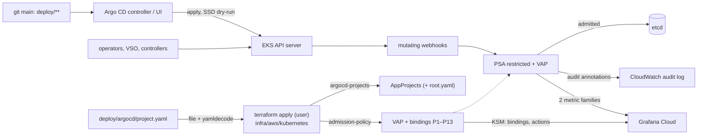

# Admission policy for `ryft-prod-euc1`: design (2026-10-23, revision 3)

Ticket T12. Author: platform-architect. Status: **decided 2026-10-23** (the user's answers under
"Decisions"; D120). Nothing here is built or applied yet.

**Read for this note:**
- `infra/aws`: EKS `kubernetes_version = "1.36"`; the eks module ships the `audit`, `api` and
  `authenticator` logs to CloudWatch.
- `infra/aws/kubernetes`: the add-on releases, `argocd.tf`, the local chart `cluster-issuers`, and helm
  provider `~> 3.3`.
- `infra/vault/namespaces.tf`.
- The renders of `deploy/{k8s,argocd,rabbitmq}`.
- D44–D46, D51, D94–D98, D103, D105 and D115.
- The #31 and #38 reviews.

**Revisions:**
- **Revision 2** answered the security review of `327efe0`: B1 (P7 last, with a carve-out), B2
  (Terraform-owned AppProjects), P9–P11, the claims table, binding signals and the exit checklist.
- **Revision 3** answers the re-verify:
  - P10 matches only requests that set or change `operation`;
  - the broker's `rollout restart` (D98) is exempt;
  - CI installs Argo CD's CRDs;
  - claims (a), (f) and the new (m);
  - T12-f is applied alone, before the policies;
  - the broker's egress narrowing is its own PR with a canary;
  - the Pause note for a Terraform-owned `root.yaml`.

## Recommendation

1. **PSA stays the pod-security mechanism.** Pod Security Admission (PSA) `restricted` already holds on
   every `ryft-*` namespace, `rabbitmq-system` and `argocd`. What's missing is protection of those
   labels.
2. **Built-in ValidatingAdmissionPolicy (VAP) covers everything PSA can't express.** VAP rules are CEL
   expressions. VAP is GA since 1.30, and EKS runs 1.36. The design has thirteen policies, P1–P13 (P12, `ryft-argo-scope`, was added on
   2026-11-04: see `p12-argo-scope.md`; P13, `ryft-vault-trust`, with the namespace `vault`, D195).
   - No Kyverno or Gatekeeper.
   - No pods to run, and no webhook that can be down.
3. **Terraform owns the policies, and the AppProjects if you agree.** Both come from
   `infra/aws/kubernetes`:
   - one local chart holds the policies;
   - a second renders `deploy/argocd/project.yaml`;
   - P7 receives the same decoded file as its constant.

   One file, one owner, no hand apply.
4. **Rollout order:**
   - Argo CD's RBAC is narrowed first, in its own apply.
   - Then Warn+Audit until an exercise checklist and 7 days pass.
   - Then Deny in four steps, by blast radius:
     1. the small config apps;
     2. what Argo applies;
     3. what controllers create at runtime;
     4. Argo CD's own objects.

   A CI job and a repeatable kind run test every render against the same chart first.
5. **Break-glass is yours alone.** `kubectl patch` or `delete` a binding. That always works, because
   bindings are exempt from admission. Terraform restores it, and a kube-state-metrics (KSM) alert
   reports any binding left off.

## Problem

D115 holds a small set of render invariants in CI. Two gaps remain.

**What CI can't express.** This is OPERATIONS' "Not checked" list, plus #38's re-verify items 3–9:
- privileged pods and host access;
- PSA labels and Namespace objects;
- images per namespace and command overrides;
- NetworkPolicy shapes;
- the VSO objects;
- the operators project's cluster power;
- `project.yaml` itself.

#38 also left four lows:
- **L1:** `.` path segments;
- **L2:** an unbound `root.yaml` path;
- **L3:** an operators path that includes workload paths;
- **L4:** a map-valued CRD `name` that crashes `renderpolicy.py` (it fails closed).

**What never passes CI at all,** because it is written in the cluster:
- Argo CD's public UI (D103);
- the operators;
- VSO;
- a break-glass apply;
- today's hand apply of `project.yaml`.

**Constraints:**
- Three t3.large nodes, short of CPU (D94, D97).
- One operator.
- CLAUDE.md: add-ons are Helm releases in `infra/aws/kubernetes`; Argo CD manages workloads only;
  nothing has two owners.
- GDPR and secrets: messages never carry object values. No `messageExpression` built from them, and
  only Secret *keys* are named.

## 1. Mechanism

| | PSA labels | ValidatingAdmissionPolicy | Kyverno / Gatekeeper |
| --- | --- | --- | --- |
| Runs in | the API server | the API server | 4–6 pods |
| Node cost | none | none | ~0.4 CPU and 0.5–1 GiB requested at chart defaults, plus pod slots |
| When down | – | – | `Fail`: refuses every write it matches. `Ignore`: admits silently |
| Expresses | privileged, host namespaces, hostPath, capabilities, seccomp, volume types | any check of one object (and its old version) against constants, its namespace and the requester | that, plus mutation, background scans, signatures, external data |

**Choice: PSA as it is, plus VAP.**
- No availability dependency, and no node cost.
- Every rule checks one object.
- CI and production apply the same `helm template` bytes.
- Boring, built-in technology.

**What VAP can't do, and how this design copes:**
- **Cross-object checks:** fixed name→path maps; "a default-deny exists" stays in CI.
- **It judges writes only:** Argo's server-side diff (SSD, D95) dry-run-applies objects on refresh.
  `ryft-root` has no SSD.
- **No signatures.**

**Alternatives.** Kyverno or Gatekeeper add mutation, background reports and signatures. They also add
a webhook whose outage either blocks every deploy or admits everything, plus CRDs, certificates and an
add-on to upgrade, on nodes with no spare CPU. Revisit them once signed images are required (Kyverno's
`verifyImages` or the sigstore policy-controller, scoped to `ryft-*`). PSA alone doesn't see images,
commands, NetworkPolicies, VSO or Argo objects.

**Claims this design rests on:**

| # | Claim | Status | Checked in |
| --- | --- | --- | --- |
| a | the API server runs no admission policy on policy or binding objects (no lockout; no self-protection) | **verified** in kind 1.36.4 (T12-d): a Deny policy matching both kinds, proven live by refusing a canary ConfigMap, refused neither a further policy and binding nor their deletion | kind fixture: a policy written to match bindings never fires |
| b | webhook configurations are not exempt, so P6 sees them | **verified** (kind): P6 refused a webhook configuration written as Argo's controller | kind |
| c | CONNECT on `pods/exec` can be matched (P8) | **verified** (kind): refused outside `ryft-rabbitmq`, admitted for the Cluster Operator inside it | kind |
| d | dry-run requests carry the `validation_failure` audit annotation | **verified** (kind, audit level Metadata): on the dry-run and on the real request, told apart by `dryRun=All` in `requestURI` | kind |
| e | `apiserver_validating_admission_policy_check_total` counts clean passes | **false** (T12-e review): only checks that found something are counted, so a quiet policy has no series. Liveness is the scrape's `up` | code review |
| f | with SSD, a denial shows as a comparison error on the whole app (`ArgoAppOutOfSync`, not `ArgoSyncFailed`) | not tried (D151) | kind |
| g | P7's whole-`spec` equality against a JSON-literal constant type-checks on the AppProject schema | **verified** (kind): `status.typeChecking` empty, the committed project passes, a widened one is refused | kind |
| h | narrowed controller RBAC, with `escalate`/`bind` limited by `resourceNames`, can still create the operators' roles | **verified** (kind) for the first version, including the negative test: without the policies the controller rewrote `rabbitmq-cluster-operator-role` and bound itself to it; with P6 in Deny both steps were refused. **Superseded:** the review showed that version was escalation-equivalent (three ClusterRoles in both lists), so the controller now holds the permissions of the operators' remaining ClusterRoles itself and has **no `escalate` on any ClusterRole** and `bind` on one name only (`messaging-topology-metrics-auth-role`, which Argo CD's all-objects dry-run needs on a fresh cluster: the first CI run of this round failed without it); `escalate`/`bind` stay on the four operator Roles by name, which match in every namespace. To be verified again: the ClusterRole rewrite is refused by RBAC alone (`claim-h-clusterrole`); a Role of an operator name in `kube-system` is written and bound without the policies (`claim-h-open`) and refused with P6 in Deny (`claim-h-guarded`) | kind, with a negative test (§3, Kind e2e) |
| i | `resource.respectRBAC: strict` keeps the controller's cache working without cluster-wide Secrets | **verified, after one added rule** (D151, amended): the controller must also get, list and watch `applications.argoproj.io` cluster-wide. Without it the kind run still passed, because under strict the cache asks a self-subject access review for namespace `*` per kind and **silently drops** a kind it may not list (the chart's Role in `argocd` does not count); the root then catches up only at its periodic reconcile (about 3 minutes; Progressing for about 6 minutes in the run), a deleted child Application is not pruned, a hand edit of a child is seen late. The rule is in #47 now; `claim-i-list` checks `can-i list <kind> -A` for the kinds of the apps | kind |
| j | helm provider `~> 3.3` offers `take_ownership` | plausible. Fallback: metadata labels (§5). Not tried (D151) | `terraform validate` |
| k | what `argocd-server` writes as `operation.sync.revision` for a plain sync (`""`, `main` or the SHA) | **answered** (kind, argo-cd chart 10.10.5): the full commit SHA of the revision the Application was compared with, which is `status.sync.revision`; P10's third alternative admits it, and `--revision <another sha>` is refused (D151) | kind |
| l | the broker's 443 egress only reaches the API server inside the VPC | plausible. Not tried (D151) | production: T12-k's canary |
| m | KSM custom-resource-state can export `ValidatingAdmissionPolicyBinding` (name, `validationActions`, labels), given `rbac.extraRules` for list/watch on `admissionregistration.k8s.io` `validatingadmissionpolicybindings` | **false** (T12-e review): custom-resource-state resolves kinds from CRDs only and skips built-in ones. Instead kube-state-metrics' native collector `validatingadmissionpolicybindings` (v2.20+, the chart adds the RBAC): `kube_validatingadmissionpolicybinding_info{validatingadmissionpolicybinding,policy_name}` and `_validation_action{validatingadmissionpolicybinding,action}` (1 per live action). It exports no labels, so the committed action is a recording rule generated from `admission-values.yaml` Kind run 41988993599 (P12 branch): `claim-m` still DISPROVED with kube-state-metrics 8.6.0 (v2.20.0, "no matching CRD found for configured GVK"), and `claim-m-native` **PASS**: the native collector exports 13 `kube_validatingadmissionpolicybinding_info` series for the 13 `ryft-*` bindings and each one's live action, which is what `AdmissionBindingMissing` (< 13) and the other binding alerts read. No other source (manifest tail, exporter of its own) is needed; they remain the fallback if the collector ever goes | kind: the metrics exist with these names (T12-d's kind run confirmed the custom-resource-state result, D151) |
| n | Argo CD's controller and server write only the allowlist of P12: sync, hooks, terminate-op, manual sync, a restart of the components and a chart upgrade show no P12 finding | **PASS** (kind full, run 41988993599: no `ryft-argo-scope` line through the first sync in Audit, and none through the syncs, hooks, terminate-op, the restart and the chart upgrade in Deny) | kind full (Audit, then Deny), then Phase 1's 7 days in production |
| o | `selfsubjectaccessreviews` reach validating admission (P12 would refuse them if it saw them: rule 5 had an entry, now removed) | **DISPROVED** (kind runs 41982428417 and 41988993599): neither the controller's nor argocd-server's review was refused by P12: kube-apiserver exempts the six review kinds from policies and webhooks (exclusion list, since 1.30; upstream source). P12's rule 5 has no entry for them (the entry and its 4 harness cases were dead code and are removed); the full mode keeps `claim-o-canary`, which fails if P12 ever refuses a review | the `kubectl auth can-i` answers of the full mode (the canary), not the audit log |
| p | argocd-server writes `argocd-secret` only when `server.secretkey` is absent; a restart with the key present writes nothing | **PASS** (kind full, run 41988993599: restart under Deny, `argocd-secret`'s resourceVersion unchanged, no finding) | kind full: restart under Deny, `argocd-secret`'s resourceVersion unchanged, no finding; manual fixture |

### Ownership

**Policies and bindings.**
- **The chart.** The local chart `infra/aws/kubernetes/charts/admission-policy` is installed by
  `helm_release.admission_policy` (new `admission.tf`, in `kube-system`).
- **The values file.** Production values sit in a committed `infra/aws/kubernetes/admission-values.yaml`,
  which Terraform reads and CI's `helm template` uses. It holds:
  - the Vault address;
  - the Argo service-account names;
  - the action per binding (`audit` | `deny`);
  - an `enabled` flag for each of the two new releases, false until Phase 1.

  A step change is a reviewed PR plus your apply.
- **The address test.** A test compares the address with the generated
  `deploy/k8s/overlays/vault-namespaces/*/vault.yaml`. No tfvars are involved.
- **Literals, not params.** Values become literals in each policy's `variables`; there are no param
  objects.

**AppProjects (B2). Recommended: Terraform owns them.** This is your decision, and it amends D95.
- **Today:** Argo doesn't manage `project.yaml`. `root.yaml` syncs only `apps/`, and the file is
  applied by hand, against OPERATIONS' "Nobody runs `kubectl apply` against production".
- **Recommended:** `infra/aws/kubernetes` reads `deploy/argocd/project.yaml` (`file()`, split per
  document, `yamldecode`, empty documents dropped). It also reads `root.yaml` (recommended).
  - A local chart `argocd-projects` renders them. Its release lives in `argocd` and runs after
    `helm_release.argocd` and `helm_release.admission_policy`.
  - The same decoded value becomes P7's constant.
  - CI keeps reading the same file.
  - A project change reaches the cluster with your next `terraform apply`. An application commit can't
    widen a project, as D95 intends.
- **Adoption, once:** `take_ownership` (claim j), or Helm's ownership metadata that you add first
  (metadata only; §5).
- **Pause note:** with `root.yaml` Terraform-owned, a `terraform apply` while the root is paused resumes
  it, because Helm restores `syncPolicy`. Don't apply `infra/aws/kubernetes` during a pause, or expect
  the resume.
- **Minimal alternative:** keep the hand apply. P7 then refuses AppProject writes from any
  `system:serviceaccount:argocd:*` and checks only generic invariants:
  - our repository;
  - no `*`, and no admission-policy kinds in any whitelist;
  - no `roles`;
  - `default` empty.

  There is no copy. OPERATIONS:208 needs the exception.

**PSA labels** stay with each namespace's owner, and P1 guards them:

| Namespace | Owner | Level |
| --- | --- | --- |
| `ryft-{api,ingest,scoring,notify,migrate,smoke,rabbitmq}` | `infra/vault` | `restricted` (enforce, warn, audit) |
| `ryft-web` | git: Argo, `ryft` | `restricted` |
| `rabbitmq-system` | git: Argo, `ryft-operators` | `restricted` |
| `argocd` | `infra/aws/kubernetes` | `restricted` |
| `monitoring` | `infra/vault` | `privileged` (D51), accepted |
| `cert-manager`, `external-dns`, `vault-secrets-operator-system` | Helm, unlabelled | warn+audit `restricted`, then enforce (T12-j) |
| `amazon-cloudwatch`, `kube-system`, `default` | Helm / EKS | unchanged |

**Who can change the policies:**
- Bindings and policies are exempt from admission (a), so RBAC guards them.
- No Argo project whitelists them, and P7 keeps it that way.
- T12-f narrows Argo CD's chart-default ClusterRoles before anything else is applied:
  - the controller may write only the two webhook-configuration resources of
    `admissionregistration.k8s.io`;
  - the server may write nothing cluster-wide, and nothing there;
  - neither gets `secrets` get, `pods/exec`, `pods/ephemeralcontainers` or `impersonate`;
  - the controller holds no `escalate` on a ClusterRole, and `bind` on one name only (it holds the
    operators' ClusterRoles' permissions itself);
  - ApplicationSet is off.
- The workloads hold no token (P2).
- The operators' roles can't grant `admissionregistration.k8s.io` (P6).
- **Limit of T12-f (what is true after #47 alone).** T12-f narrows what the Argo CD identities can
  *grant themselves through RBAC*. It does not make a compromised Argo CD harmless, and the sentence
  "Argo CD cannot switch off or bypass the admission layer" is **not true until P6 and P12 are both in Deny and #47 is applied**.
  - **Closed by #47 (RBAC alone):** adding VAP/VAPB write to a ClusterRole and binding it. T12-f's first
    version had `escalate`/`bind` on three operator ClusterRoles and was escalation-equivalent to
    cluster-admin; the controller now holds those ClusterRoles' permissions (token and access reviews,
    `/metrics` get) and has no `escalate` on any ClusterRole, and `bind` only on
    `messaging-topology-metrics-auth-role`, which it cannot extend.
  - **Open until P6 is in Deny:** `escalate` and `bind` on the four operator **Roles** are in a
    ClusterRole, and `resourceNames` match in every namespace. The controller can write a Role of that
    name in `kube-system` or `argocd` with Secrets and `pods/exec`, and bind itself. P6 admits Roles only
    in `rabbitmq-system` and the four named ones in `ryft-rabbitmq`.
  - **Also closed only by P6 in Deny:** (a) webhook-configuration `create` cannot be limited by name (the
    first sync needs it): a configuration with a `url` would receive every matched object, Secrets and
    Pods included, and could mutate Pods; P6 admits the four names, served from `rabbitmq-system`, on
    `rabbitmq.com` only. (b) CRD `create` cannot be limited by name either (#47 limits `update` and
    `patch` to the operators' 14 CRDs); P6 admits CRDs of `rabbitmq.com` without a conversion webhook.
  - **Open until P6 and P12 are both in Deny (design gap, not a regression; the chart's `*` allowed all of it):** the controller
    writes ConfigMaps, Deployments, Jobs, Services and ServiceAccounts in **every** namespace, and
    no policy matches Argo CD's writes outside `ryft-*` and `rabbitmq-system` (P2: only those; P3, P5, P9:
    `ryft-*`; P7: Argo CD's own kinds and Secrets in `argocd`). A stolen controller token can
    - write `kube-system/aws-auth`: the cluster runs authentication mode `API_AND_CONFIG_MAP`, so an IAM
      principal mapped to `system:masters` is cluster-admin without a Pod, and cluster-admin deletes the
      bindings (claim a). Only P6 and P12 in Deny, or EKS authentication mode `API`, closes it;
    - deploy into `cert-manager` as its ServiceAccount (Secrets cluster-wide, Route53 through Pod Identity:
      a DNS-01 certificate for `api.ryftapp.de`), into `kube-system` as a controller-manager
      ServiceAccount, or patch `argocd-cm`, `argocd-rbac-cm` and the `argocd-server` Deployment.
    The controller's ConfigMap write cannot be narrowed by namespace in a ClusterRole; the options are
    per-namespace RoleBindings (a separate decision) or P6 and P12 in Deny (P12, "argo-scope": Argo CD's identities write
    namespaced objects only in `ryft-*` and `rabbitmq-system`, in `argocd` only `argoproj.io` objects
    and Events, cluster-scoped objects only of the whitelisted kinds). P12 judges names only; it is built in #121, not here.
  - **Not changed by #47:** the chart hard-codes the server's Role in `argocd` (create, update, patch,
    delete on all Secrets, ConfigMaps, AppProjects, ApplicationSets). P7 refuses only Secrets labelled
    `secret-type`, so a leaked token of the public UI can rewrite `argocd-secret`, `argocd-cm` and
    `argocd-rbac-cm` today.
  - **RBAC objects that outlive a stolen controller token (P6 and P12 in Deny close the create and update route, not the rest).** The controller
    creates, updates, patches and deletes ClusterRoles, ClusterRoleBindings, Roles and RoleBindings with no
    `resourceNames` (a fresh cluster needs `create`). Kubernetes' escalation check bounds what a written
    role may hold (a subset of the controller's rights), not who it is bound to: with a stolen token one
    writes a ClusterRole of that subset (ConfigMaps, Deployments, Jobs in every namespace) and binds it to
    `system:serviceaccounts` or `system:authenticated` (`system:unauthenticated` is probably not effective
    on EKS 1.36, where anonymous requests are, as far as known, admitted to the health endpoints only: not
    verified); the grant outlives the token. A second route needs no binding write: a ClusterRole labelled
    `rbac.authorization.k8s.io/aggregate-to-edit|admin|view` adds its rules (a subset of the controller's)
    to roles already bound to others (an `aggregationRule` of its own would need `escalate`, which stays
    closed). `delete` of any binding or ClusterRole is open too, and P6 matches only CREATE and UPDATE of the
    operators' objects. Evaluated: `update`/`patch`/`delete` limited by `resourceNames` to the operators' 12
    RBAC objects (create stays open). That narrows the rewrite and the delete but not a created ClusterRole
    and binding of another name, and showing it safe needs the `full` kind run (the operators' sync with escalate, bind
    and server-side apply of existing objects), which a pull request does not run. Not applied in #47: a
    scoping choice (the PR stays a draft until a full-mode run anyway), and the narrowing does not close the
    route; its own change, with that run. The create and update route closes with P6 and P12 together in Deny (P6 limits ClusterRole and
    binding subjects and rules to the operators' names; P12 alone does not close it). Still open then: the
    aggregation-label route, `delete` of RBAC objects, prune by name.
  - **Sync impersonation stays off:** If `application.sync.impersonation.enabled` were ever turned on, all controller writes would move to other usernames and P12 (which judges names) would match nothing: the guard keeps refusing it (it is not an allowed `configs.cm` key, `configs.params` key or `controller` value, and `tests/addons.tftest.hcl` pins that).
  - argocd-server cannot add RBAC (no write on RBAC kinds).
  - **Beside the rules (guards added with #47):** `modules/argocd-values-guard`, a precondition of
    `helm_release.argocd`: `extraObjects` kinds with their one apiVersion, no `{{` anywhere in the values
    and the values ASCII only with no control character or escape, except newlines in the health Lua entries
    (the chart renders many values with `tpl`, and a line break in an allowed value, U+2028, U+2029 and U+0085
    included, starts another YAML document), `exec.enabled` false, `respectRBAC` strict, no `controller.roleRules`, `createClusterRoles` not false,
    no `configs.rbac`/anonymous login/disabled auth, a key allowlist two levels deep plus the keys of a few
    maps. The release takes the guard's output as its values (`values_yaml`), and a postcondition requires
    exactly that (no `set*`, no second document, no postrender); it is a plan-time check only while the
    release's inputs are known then, so no computed value may enter the release's values or `set*`. The kind
    run adds `argo-bindings`, `argo-extra-objects` and `argo-inventory` (the whole render counted by kind and
    namespace against an expected table), and `argo-tf-bindings` (a tripwire). A ClusterRoleBinding to
    `cluster-admin` shipped as an extra object, or written in Terraform, passes every check on the two
    ClusterRoles' rules. Not covered: the values of other allowed keys (reviewed), the content of an object of an expected kind, and a change to the
    guard together with its tests, which only review catches.
- **Structural options (future D97/D120 decisions, for you; not implemented).** (1) Move the operators'
  ClusterRoles, ClusterRoleBindings and Roles out of Argo CD, into Terraform with the add-ons: Argo CD
  then needs no `escalate` and no `bind` at all. (2) Keep Argo CD as it is but move the `escalate`/`bind`
  rule into namespaced Roles in `rabbitmq-system` and `ryft-rabbitmq` (`extraObjects` of the Argo CD
  release), so a Role of those names in `kube-system` is out of reach by RBAC alone; the price is that
  the namespaces must exist before the Helm release (Terraform would own two namespaces that Argo's
  `namespace.yaml` owns today).



## 2. Rule set

**Terms:**
- **R:** `ryft-*`, matched by a matchCondition on `request.namespace` (namespaced objects) or
  `request.name` (Namespaces).
- **OPS:** `rabbitmq-system`.
- **Argo:** `system:serviceaccount:argocd:argocd-application-controller` and `…:argocd-server`.

**Common to every policy:**
- `failurePolicy: Fail`.
- Value-free messages.
- A matchCondition skips an UPDATE when `oldObject.metadata.deletionTimestamp` is set and the spec (or
  `data`) is unchanged, so finalizer removal (VSO's, for example) passes.
- Pod rules walk `containers` and `initContainers`. `ephemeralContainers` get only the image rule and a
  token rule (no mount of a token volume, no `vault-auth-token`): P2 also matches `pods/ephemeralcontainers`
  (UPDATE), so a debug image in a `ryft-*` namespace is refused by design. A Pod UPDATE is judged on images
  only (command, args, probes, volumes and automount are immutable on a Pod).
- C/U/D means CREATE/UPDATE/DELETE. DELETE is matched only where stated.

**P1 `ryft-namespaces`** (C, U; D for Argo)
- R, `rabbitmq-system` and `argocd` carry PSA `enforce`, `warn` and `audit` set to `restricted`, and no
  `*-version` label other than `latest`. Any writer, `infra/vault` included.
- Argo may write only `ryft-web` and `rabbitmq-system`, and may delete no Namespace.
- `monitoring` is outside by name.

**P2 `ryft-workloads`** (C, U)
- **Scope:** Pod, Deployment, StatefulSet, DaemonSet, ReplicaSet, Job and CronJob in R and OPS.
- **Bindings:** `templates` (everything but Pod) and `pods`.
- **Images:**
  - `ryft-<svc>` runs only `ghcr.io/timkrebs/ryft/<svc>:<7 hex>`;
  - `ryft-smoke` runs the migrate image;
  - `ryft-rabbitmq` runs only `docker.io/library/rabbitmq:<tag>@sha256:<64 hex>`;
  - OPS runs only `ghcr.io/rabbitmq/{cluster-operator,messaging-topology-operator}:<semver>`, with
    `command: [/manager]` only;
  - no `image` volumes anywhere.
- **In R:**
  - no `command`; exec probes and lifecycle hooks count as commands;
  - `args` empty except `[smoke]` on the migrate image in `ryft-smoke`;
  - `automountServiceAccountToken: false`;
  - no projected `serviceAccountToken` source;
  - no volume, `env` or `envFrom` reference to Secret `vault-auth-token`;
  - on Pods, no `kube-api-access-*` volume.
- **The broker's exemption** covers commands, the operator's exec probes and its `preStop` hook, and
  the token. It applies to exactly three things:
  - the StatefulSet `rabbitmq-server` written by the Cluster Operator's service account;
  - Pods whose controller owner is that StatefulSet;
  - an UPDATE of that StatefulSet, by any writer, whose only change is
    `spec.template.metadata.annotations["kubectl.kubernetes.io/restartedAt"]`. That is D98's fallback
    `kubectl -n ryft-rabbitmq rollout restart statefulset rabbitmq-server` (OPERATIONS → RabbitMQ).

  The runbook stays. A restart changes nothing about what runs, and the StatefulSet replaces the pods
  one at a time, waiting for each to be ready. That is safer than deleting them by hand.

**P3 `ryft-netpol`** (C, U; D for `default-deny`)
- `default-deny` stays `podSelector: {}` with Ingress+Egress and no rules. It can't be deleted unless its
  namespace is terminating.
- Every other rule has `ports`, every port entry has `port`, and there is a peer.
- `namespaceSelector` is only `matchLabels: {kubernetes.io/metadata.name: <one>}`.
- `ipBlock` is limited to two shapes:
  - the VPC CIDR, for ingress on 9090/15692, and for `ryft-rabbitmq`'s egress on 443 (narrowed by T12-k;
    claim l);
  - `0.0.0.0/0` for egress on 443/5432, with the five private ranges excepted.
- `endPort` only in `ryft-rabbitmq`.
- `rabbitmq-system` has no NetworkPolicy. It is outside R; a default-deny there is a follow-up.

**P4 `ryft-vso`** (C, U; all namespaces, any writer)
- Keys are allowlisted per kind, CRD-defaulted fields included.
- **VaultConnection:** `address` is the value; `skipTLSVerify` false; no `caCertSecretRef` or `headers`.
- **VaultAuth:** `kubernetes` method and mount, audiences `[vault]`, a local
  `vaultConnectionRef: vault`, no `allowedNamespaces`.
- **VaultStaticSecret:**
  - a local `vaultAuthRef`, `kv`, `kv-v2`;
  - destination `ryft-secrets` or `amqp-user-<name>`;
  - `excludeRaw: true`, no `templates` or `transformationRefs`.
- Other `secrets.hashicorp.com` kinds are refused.

**P5 `ryft-auth-env`** (C, U; ConfigMap, Secret and the P2 kinds in R; any writer)
- No ConfigMap or Secret key `API_KEY`, `ALLOW_INSECURE_APIKEY_AUTH` or `USER_ID`.
- `AUTH_MODE` only in ConfigMaps, and only `supabase`.
- In `env`: the same names are refused; `AUTH_MODE` must be the literal `supabase`; no `valueFrom`; no
  `envFrom[].prefix`.
- This catches a Vault key that VSO syncs.

**P6 `ryft-operators-cluster`** (C, U; Argo)
- **CRDs:** `rabbitmq.com` only, without a conversion webhook.
- **ClusterRoles:**
  - named `rabbitmq-cluster-*` or `messaging-topology-*`;
  - no `*`, no `escalate`, `bind` or `impersonate`, no `aggregationRule`, no
    `rbac.authorization.k8s.io/aggregate-to-*` label;
  - no grant on `admissionregistration.k8s.io`, `apiextensions.k8s.io`, `argoproj.io`,
    `secrets.hashicorp.com`, cluster RBAC, nodes or `serviceaccounts/token`;
  - no non-resource URL except `/metrics`.
- **ClusterRoleBindings:** only to those roles, and only for the two operator service accounts in OPS.
- **Webhook configurations:**
  - exactly `cluster-operator-{mutating,validating}-webhook-configuration` and
    `messaging-topology-{mutating,validating}-webhook-configuration`;
  - services in OPS, never a `url`;
  - rules on `rabbitmq.com` only.
- **Namespaced RBAC:** only in OPS, `roleRef.kind: Role`, with RoleBinding subjects only the two
  operator service accounts. With T12-g, exactly four more objects in `ryft-rabbitmq`:
  `rabbitmq-cluster-operator-role` / `-rolebinding` and `messaging-topology-manager-role` /
  `-rolebinding` (VAP sees the writer, not the Argo project, so the chart names them). Every
  rule of a Role or ClusterRole is checked against an allowlist of the (group, resource) pairs
  the vendored roles use (a `*` prefix, `*/token`, `pods/attach`, ephemeral containers, CSR
  approval never pass; `pods/exec` only in a `rabbitmq-cluster-*` role). A ClusterRole grants
  no Secrets, no `pods/exec` and no Pod write, so the operators' cluster-wide Secret reads
  (S11) cannot come back through git. After Step A, reverting T12-g by git therefore needs the
  user's break-glass. The Cluster Operator itself (P8) may write only the broker's
  `rabbitmq-peer-discovery` Role and `rabbitmq-server` RoleBinding there.

**P7 `ryft-argocd`** (C, U, D; namespace `argocd`, any writer)
- **Carve-out:** the application controller's UPDATEs with `object.spec == oldObject.spec` (its status
  and operation writes) are skipped.
- **AppProjects:**
  - the whole `spec` equals the decoded `project.yaml` (B2, claim g);
  - DELETE of `default` is refused from every writer;
  - DELETE of the others is refused from `system:serviceaccount:argocd:*`.
- **Applications:**
  - an allowlist of `spec` keys;
  - a fixed map from name to project, path and destination:

    | Application | Path |
    | --- | --- |
    | `ryft-root` | `deploy/argocd/apps` |
    | `ryft-platform` | `deploy/k8s/overlays/eks` |
    | `broker-rabbitmq` | `deploy/rabbitmq` |
    | `rabbitmq-operators` | `deploy/rabbitmq/operators` |
    | `vault-<x>` | `deploy/k8s/overlays/vault-namespaces/<x>`, destination `ryft-<x>` |

  - our repository, `targetRevision: main`, one `source`;
  - no `sources`, `sourceHydrator`, `destination.name`, `kustomize`, `helm`, `plugin` or `directory`;
  - `syncPolicy` free;
  - no ApplicationSet.
- **Secrets:** argocd-server may not write Secrets labelled `argocd.argoproj.io/secret-type`.

**P8 `ryft-operator-reach`** (C, U, CONNECT; the two operator service accounts)
- The Cluster Operator writes, in `ryft-rabbitmq` only:
  - Secrets, StatefulSets, Services, ConfigMaps, PVCs, ServiceAccounts, Roles and RoleBindings;
  - Pod UPDATEs;
  - `pods/exec` (claim c).
- The Topology Operator writes Secrets only there.
- Their reads: T12-g.

**P9 `ryft-traefik`** (C, U in R)
- Key allowlists include the CRD-defaulted keys.
- Middleware `spec` only `rateLimit`, `redirectRegex` or `headers`.
- ServersTransport only `rootCAs` and `serverName`, never `insecureSkipVerify`.
- An Ingress's `router.middlewares` names only middlewares of its own namespace.

**P10 `ryft-argocd-operation`** (C, U on Applications)
- **Matched only when a request sets or changes the top-level `operation`:**
  `has(object.operation) && (oldObject == null || !has(oldObject.operation) || object.operation != oldObject.operation)`.
  `status.operationState` is never looked at.
- **So these pass unjudged,** because they carry the in-flight operation unchanged or none:
  - the controller's status writes;
  - argocd-server's terminate-op (OPERATIONS → Deploy, D95);
  - pause and hard-refresh;
  - the controller clearing a finished operation.
- **Rules for a new or changed operation:**
  - from any writer, no `operation.sync.manifests`, and no `.source` or `.sources` other than a copy of
    the Application's own `spec.source` / `spec.sources`. The controller's automated sync carries
    exactly that copy (found by the kind run, chart 0.2.2, D151), so the original rule, any `source`,
    refused Argo CD's own auto-sync. This still refuses `--local`. It no longer refuses
    `argocd app rollback` by itself: a history entry whose source equals the spec's passes this rule,
    and the revision rule below is what refuses the rollback, **for argocd-server only**;
  - from argocd-server, `operation.sync.revision` must be `""`, `main` or
    `oldObject.status.sync.revision`. Claim k, answered: a plain sync writes the full SHA of the
    revision the Application was compared with, i.e. `status.sync.revision`, so the third alternative is
    the one that admits it.
- **"No foreign source" rests on P7, not on P10.** A request that changes `spec.source` and the
  operation together carries a source equal to its own new spec, which this rule admits. P7 pins the
  Application's whole `spec` (our repository, `main`, the fixed path), so the guard is P7. P7 must
  therefore not go to break-glass on the assumption that P10 blocks `--repo`, `--path` or a changed
  source (P7 refuses `--repo` and `--path` itself; see Operations below).
- **Closed by claim k:** `argocd app sync --revision <sha>` after a pause is refused for any SHA other
  than the synced one, through argocd-server. While auto-sync is on, Argo itself refuses other
  revisions. RYFT rolls back by revert and hold (D95, D107).

**P11 `ryft-broker`** (C, U)
- **RabbitmqCluster in `ryft-rabbitmq`:** `spec.image` matches the broker pattern, and `override` holds
  only today's pod-template annotations.
- **`spec.secretBackend` is an allowlist** (chart 0.2.3, D151): the only key is `externalSecret`, and
  that only as the Cluster Operator's defaulting webhook writes it into every RabbitmqCluster
  (`{"externalSecret": {"name": ""}}`, found by the kind run). A Vault block next to it, a named
  external secret, another field and any key a later CRD version adds are refused.
- **Shovel, Federation and SchemaReplication are refused cluster-wide** (recommended), from every writer:
  they move messages off the cluster.

**The namespace `vault` (Vault CE, chart 0.5.0)**
- **Bindings of its own:** P1, P2 (templates and pods) and P3 each have a second binding,
  `<name>-vault`, with `namespaceSelector` In `[vault]`; the general bindings carry NotIn `[vault]`.
  One policy, two stagings: the vault bindings sit in step A and go to deny before the Vault
  bootstrap (the plan's gate: P12, P13 and the vault branches of P1–P3 in Deny), independently of
  the `ryft-*` steps B and C and of P3's broker guard. P4 and P13 need no split: P4 has nothing in
  `vault`, P13 has a binding of its own and judges cluster-scoped kinds (ClusterIssuers, CSRs), which
  a namespaceSelector never excludes.
- **P1:** `vault` is in scope like `rabbitmq-system` and `argocd`: the PSA labels stay `restricted`.
- **P2:** in `vault` only `images.vault` (the release's exact digest) and `images.awsCli` (the
  snapshot CronJob, empty until that image is pinned, so the CronJob is refused until then). The
  chart guard holds both to one literal reference with a full digest (`^`, `[.]` for a dot,
  `@sha256:<64 hex>$`; no alternation, group, repetition or escape). **P2 judges images only in
  `vault`:** the ryft-* command, args and token rules do not apply, so the Vault image running
  `/bin/sh` under any service account is admitted. That boundary is RBAC (only Terraform writes
  in `vault`) and P12 (Argo CD writes nothing there). The Vault image is refused in ryft-*.
- **P3:** no ingress ipBlock in `vault`. Egress ipBlocks: the public shape on 443 only (no 5432), the
  VPC CIDR on 443 (the API server, for the token review) and the Pod Identity agent
  `169.254.170.23/32` on 80.
- **P4, during the cutover:** P4 admits the union of the two shapes infra/vault generates, field by
  field: an address from `vaultAddresses`, `caCertSecretRef` absent or `vault-ca`, a Vault namespace
  absent or under `admin/ryft/`, the mount `kv` or `kv-<service>` (the namespace without `ryft-`).
  **The pairing is not enforced:** HCP's address with `vault-ca`, the in-cluster address without a
  CA, or a mix of shapes in one namespace pass admission and fail closed later (TLS or login). The
  reserved names (`operator`, `root`, `admin`, `terraform`, `default`, `vault-snapshot`, as infra/vault
  refuses them as services) are never a service: `ryft-operator` may not read `kv-operator` (the demo
  password). The decommission empties `vso.kvMount` and `vso.vaultNamespacePrefix` and leaves one
  address; then only the in-cluster fields pass (the harness judges that render too).

**P13 `ryft-vault-trust`** (step A; C, U on cert-manager `certificates`, `certificaterequests`,
`certificaterequests/status`, `issuers`, `clusterissuers`, and C on `certificatesigningrequests`)
- **Matched:** a Certificate or CertificateRequest naming `ryft-vault` (whatever kind or group), a
  Certificate whose `secretName` is `vault-ca`, `vault-tls` or `ryft-vault-ca` (whatever issuer),
  every Issuer and ClusterIssuer, and a Kubernetes CSR whose `signerName` starts with
  `clusterissuers.cert-manager.io/ryft-vault`.
- **What the issuer signs:** `issuerRef` is the ClusterIssuer of `cert-manager.io`, and only two
  Certificates: `vault/vault-tls` (keys allowlisted, `secretName` its name, DNS names, IPs and usages
  a subset of the committed lists, never `isCA`) and `<namespace>/vault-ca` (keys allowlisted,
  `secretName` its name, `commonName: vso.<namespace>`, **no SAN-bearing key**: no `dnsNames`,
  `ipAddresses`, `uris` or `emailAddresses`). The invariant that keeps a `vault-ca` leaf from serving
  as Vault is "no SAN" (Go never matches a host name against the commonName), not its usages: usages
  without `server auth` mean no EKU at all, which Go accepts for any purpose. The `caUsages` guard is
  defence in depth. An Ingress annotated with `ryft-vault` is refused by these rules (ingress-shim's
  Certificate has another name), not by the CertificateRequest rule.
- **The reverse:** the Secret `vault-ca` (any namespace) and `vault/vault-tls` only from a Certificate
  of `ryft-vault`; the root Secret `ryft-vault-ca` only from the Certificate
  `cert-manager/ryft-vault-ca` of the ClusterIssuer `ryft-vault-bootstrap`.
- **Issuers:** only the ClusterIssuer `ryft-vault` signs with `ca.secretName: ryft-vault-ca`, and it is
  exactly that (`spec` holds `ca`, `ca` holds `secretName`); `ryft-vault-bootstrap` is exactly
  `selfSigned: {}`. **Argo CD's identities write only Issuers that are exactly `selfSigned: {}`** (the
  operators' webhook issuers in `rabbitmq-system`) and no ClusterIssuer: an Issuer of type `vault`,
  `venafi` or `acme` names a server and a Secret of its namespace (`auth.tokenSecretRef: ryft-secrets`),
  and cert-manager sends that Secret's value to the server. This stays P13's with P12 (D206): P12
  judges where, not what, and admits an Issuer in the namespaces of `argoScope.namespaces`; for a
  ClusterIssuer and in `vault` both refuse (harmless: two messages for one write).
- **Requests:** a CertificateRequest for `ryft-vault`, and a write of its status (approval, the
  signed certificate), only as `system:serviceaccount:cert-manager:cert-manager`. That rule is exactly
  as strong as "nothing else runs as that service account" (its token, an exec into the controller).
  A Kubernetes CSR for a `ryft-vault*` signer is refused from everyone (cert-manager's CSR
  controllers are off; turned on, they would bypass the CertificateRequest rule).
- **Not held by P13:** a Secret `ryft-vault-ca`, `vault-ca` or `vault-tls` written directly (RBAC:
  only Terraform and cert-manager write Secrets there), and Argo CD writing a well-shaped Certificate
  in `vault` (P12).

**P12 `ryft-argo-scope`** (C, U, D, CONNECT; every service account of `argocd`; full design in
`p12-argo-scope.md`)
- **Matched by the username prefix** `system:serviceaccount:argocd:`, on every resource and subresource
  in every namespace. No groups, no `userInfo.extra`, no field manager.
- **Where the writers may write** (content stays P1–P11's and P13's):
  - the controller: any resource in the explicit namespace list `argoScope.namespaces` (the apps'
    namespaces, no `ryft-` prefix); in `argocd` only Applications and events (events: create and update,
    never delete); cluster-scoped only the Namespaces `ryft-web` and `rabbitmq-system` (no delete), CRDs
    `*.rabbitmq.com` (no delete), the operators' prefixed ClusterRoles and bindings, their four webhook
    configurations (access reviews are exempt from policies and webhooks by kube-apiserver's exclusion list since 1.30, claim o);
  - argocd-server: in `argocd` only Applications and events (events: create only), plus the first
    `server.secretkey` of `argocd-secret` (an UPDATE that adds that key and changes nothing else but
    resourceVersion, managedFields and generation);
  - the chart's `argocd-redis-secret-init`: CREATE of Secret `argocd-redis`;
  - any other `argocd` service account: nothing. No subresource and no CONNECT, whoever the account.
- **No AppProject write** from any Argo CD identity (B2: Terraform's). No finalizer carve-out.
- **Never `vault` or `cert-manager`** (nor `argocd` beyond Applications and events, nor `kube-system`) in
  `argoScope.namespaces` or `namespaceObjects`: the chart fails the render and `admission.tf` the plan
  (D206). P12 has one binding for every namespace (no `-vault` twin); in `vault` it refuses every Argo CD write.
- Step B, Warn+Audit in Phase 1 with the others. `admission_policy` depends on the argocd release.
- **Deny gate (chart `fail` and `admission.tf` preconditions):** `argo-scope: deny` needs `operators-cluster`,
  `namespaces` and `workloads-templates` in deny (P12 judges names, not what a ClusterRole or binding grants;
  the RBAC route is closed when P6 and P12 are both in Deny), and a narrowed controller ClusterRole rendered
  by `argocd.tf` (#47 merged and applied; with the chart's wildcard role the controller can patch the
  binding and impersonate). The full kind mode must pass on a tree containing #47, `argo-rbac` and `claim-i`
  not skipped, and `kubectl auth can-i patch|delete validatingadmissionpolicybindings` and `impersonate users`
  as the controller must answer no (OPERATIONS → P12).
- **Sync impersonation** (`application.sync.impersonation.enabled: true`) would make Argo CD apply as the
  AppProjects' service accounts and P12 would match nothing. It stays off; turning it on is a new decision.
- **Not covered, named plainly:** in-scope writes with cluster-wide effect, which all 18 bindings admit:
  an Ingress for `api.ryftapp.de` with a Traefik `router.priority` annotation in `ryft-smoke`, a Middleware with a `redirectRegex` on `api.ryftapp.de`, or a Service with `externalIPs` in `ryft-web` (CVE-2020-8554). Follow-up T12-l6 (not built): P9 pins Ingress hosts per namespace, refuses Traefik router
  annotations except `router.middlewares`, pins a `redirectRegex` replacement to the service's own hosts;
  a new Service rule (ClusterIP only, no `externalIPs`, no `ExternalName`) for Argo-written Services.
  Also: P7 and P10 are in Deny only at Step D, so between Step B and Step D a stolen server token (a minted
  UI session) can still write Application content (repo, destination, revision); P12 only confines it to
  Applications and events in `argocd`.

**Where each item lands:**

| Item | Held by |
| --- | --- |
| privileged pods, host access | PSA `restricted` (enforced today); P1 keeps the labels |
| PSA labels, Namespace objects | P1 |
| images per namespace; command overrides | P2, P11 (the broker's exact digest: git review) |
| workloads without `metadata.namespace` | judged in the namespace they land in (Argo's destination) |
| NetworkPolicy shapes | P3; "a default-deny exists" stays CI-only |
| VSO objects | P4, plus P5 for what VSO writes |
| the operators project's cluster power | P6, P8; their reads: T12-g |
| `project.yaml` read from the PR | P7 with B2: the cluster compares against the same file |
| L1, L2 | P7's fixed map, plus CI (T12-c) |
| L3 | Argo's project (`rabbitmq-system`, and `ryft-rabbitmq` for the four T12-g objects), plus P2 and P6 in OPS and in those four names; CI: accepted |
| L4 | CI-only: a typed finding (T12-c) |

**Accepted:**
- the operators' cluster-wide reads, until T12-g;
- operator images by tag;
- no image signatures;
- `monitoring` privileged (D51);
- `kube-system` unlabelled;
- `rabbitmq-system` without NetworkPolicies;
- `argocd app sync --revision <sha>` after a pause, until claim k is verified.

## 3. Rollout

**Phase 0, nothing in production:**
- The code of T12-a, -b (if you choose B2), -c, -d, -e and -f is merged. a and b come with
  `enabled: false`.
- The `admission` job is green on main.
- The kind e2e (T12-d) has passed with the narrowed RBAC, covering claims a–d and f–m.

**Step 0, T12-f alone:**
- Apply the narrowed Argo CD RBAC in its own `terraform apply`. It changes only `helm_release.argocd`,
  because both new releases are disabled.
- Watch one full deploy: promote PR, sync, both hooks.
- Only then go on.

**Before Phase 1:** exclude `ryft-*` from D51's SDK injector (T12-h, your `make monitoring-apply`).

**Phase 1, Warn+Audit.**
- **Start:** a reviewed PR sets `enabled: true` in `admission-values.yaml`; then your apply.
- **End:** after 7 days, *and* once each of these has run in Audit with no unexplained finding:
  1. a deploy of each group, with both hooks;
  2. a broker reconcile (a RabbitmqCluster change through git);
  3. the broker restart from D98 (`rollout restart`);
  4. a node drain or a node-group AMI update;
  5. a VSO key change;
  6. an `infra/vault` apply;
  7. an Argo CD pause, resume and manual sync;
  8. an `argocd app terminate-op` on a small app's manual sync;
  9. a project change (the B2 adoption counts; `ryft-root` has no SSD);
  10. a k8s-monitoring upgrade;
  11. a restart of `argocd-server` and the application controller
      (`kubectl -n argocd rollout restart deployment/argocd-server statefulset/argocd-application-controller`):
      no `ryft-argo-scope` finding (P12, claims n and p);
  12. an apply of `helm_release.argocd` (any planned change of its values or chart version): no
      `ryft-argo-scope` finding (the `argocd-redis-secret-init` pre-upgrade hook).

  The daily query of §5, filtered on `ryft-argo-scope`: zero lines is P12's exit condition.
- **Where findings show up:**
  - the API server audit log in CloudWatch (`/aws/eks/ryft-prod-euc1/cluster`): the annotations
    `validation.policy.admission.k8s.io/validation_failure` and
    `pod-security.kubernetes.io/audit-violations`. The query in §5 splits dry runs from real writes;
  - the two metric families;
  - `kubectl` warnings. Argo CD is no channel for warnings.

**Phase 2, Deny+Audit, by blast radius.** At least one deploy of each group runs between steps.
T12-k (the broker's egress) lands before Step B.

| Step | Policies | Why here |
| --- | --- | --- |
| A | P4, P6, P11, P13, and the vault bindings of P1, P2 and P3 | each blocks one small app (`vault-<svc>`, `rabbitmq-operators`, `broker-rabbitmq`); P13 and the vault bindings only the Vault add-on (Terraform) and the issuers |
| B | P1, P2 `templates`, P3, P5, P9, P12 | what Argo applies: a denial blocks `ryft-platform` deploys, not running pods. P12's failure reaches every app, but its Audit signal is the clearest of all (any line is a finding); it goes to deny only after the general P6, P1 and P2 bindings |
| C | P2 `pods`, P8 | runtime: Pods for rollouts, scale-ups and drains, and the broker's reconcile; critical alert |
| D | P7, P10 | Argo CD's own objects, last |

### Signals (T12-e)

**Denials and audits.**
- The API server's `/metrics` is scraped per endpoint (each address of `default/kubernetes`).
- Only `apiserver_validating_admission_policy_check_total` and `pod_security_evaluations_total` are
  kept.
- The scrape is configured in `deploy/monitoring/k8s-monitoring.yaml` (your `make monitoring-apply`).
- Alerts:
  - `AdmissionPolicyViolation` (info, Audit: findings repeat on every refresh);
  - `AdmissionPolicyDenied` (warning);
  - `AdmissionPodDenied` (critical: P2 `pods`, P5, P8 and Pod Security enforce, which is live today);
  - `AdmissionPolicyError` (critical when the binding refuses, warning under Warn+Audit);
  - `AdmissionSignalsMissing` and `AdmissionScrapeDown` (warning: the scrapes themselves).

**Binding state** (claim m, as built).
- kube-state-metrics' native collector exports each binding's name and live validation actions.
  The committed action is `ryft:admission_binding_intended`, a recording rule per binding that
  `scripts/admission_intended.sh` generates from `admission-values.yaml`; `make alerts-check`
  fails when the two differ.
- Alerts:
  - `AdmissionBindingMissing` (critical, fewer than 18 `ryft-*` bindings with P12, chart 0.6.0; 17 before it);
  - `AdmissionBindingNotDenying` (warning, 10 min: a deny binding without `Deny` while others deny);
  - `AdmissionBindingDrift` (warning, 2 h: the other mismatches);
  - `AdmissionBreakGlass` (warning, 4 h: no binding has `Deny` although some are committed as deny).

**Also:**
- A Terraform `check` block in `admission.tf` warns on every plan.
- With SSD, a denial shows as `ArgoAppOutOfSync` (claim f). The admission alerts are the fast signal.

### Testing: a CI job and a repeatable kind run

**CI job `admission`, required in `ci-ok` when it runs.**
- **When it runs:** on PRs touching `deploy/**`, the chart or the values file, the scripts of the job
  and the Makefile, and on push to main. It skips a promote PR whose diff is limited to what promote
  writes (`newTag`, the `PRIVACY_POLICY_VERSION` literals, hold lines), **and the push to main that
  merges one**. That last part is a deviation from "every push to main" (D151): the diff of a promote
  merge is the same pins the PR carried, which cannot change what the cluster admits, and a kind run
  per release would cost minutes of each one. A manual run (`workflow_dispatch`) always runs it.
- **Steps:**
  1. Start a kind node at 1.36, pinned by digest, with checksummed binaries (kind, kubectl, helm, yq:
     `scripts/install_*.sh`).
  2. Install the CRDs:
     - VSO, cert-manager and Traefik, at the pinned chart versions;
     - **Argo CD's** (Application, AppProject, ApplicationSet, from argo-cd chart 10.10.5), without
       which the root render and the projects can't be dry-run and P7 and P10 would go untested;
     - the vendored RabbitMQ CRDs.
  3. Create the namespaces with `infra/vault`'s labels, plus `ryft-web`, `rabbitmq-system` and `argocd`.
  4. Install the chart with the committed values (Audit), then in Deny (every binding), each time waiting
     until the API server holds exactly the policies and bindings `helm template` renders and enforces
     a canary fixture.
  5. Run every render with `--dry-run=server` as Argo's controller service account (bound to
     cluster-admin in kind).
  6. Run the projects and `root.yaml` through the same decode the Terraform code uses.
- **Fixtures:**
  - one negative fixture per rule, P10's terminate-op and status-write passes included (generated from
    the CEL harness's cases, plus hand-written ones for UPDATE, DELETE and the objects the CRDs
    would reject);
  - a large-Pod fixture for CEL cost: **harness-only** (`cost:` cases of `admission-celtest`, which
    evaluate the policies with the API server's cost budget); the kind run has none.
- **Checks:** `status.typeChecking` is empty, and `Chart.yaml`'s version goes up whenever a template or
  the chart's `values.yaml` changes (a pull request; `scripts/check_chart_bump.sh`).

**Kind e2e** (`scripts/admission_e2e.sh --mode full` plus a manual `workflow_dispatch`). It runs before
Step 0 and on every operator, argo-cd chart or EKS minor upgrade:
- the argo-cd chart with T12-f's RBAC;
- the operators and the broker (**one node, one replica**, not three workers: D151);
- a real sync of every app, a hook run, a terminate-op, the broker's `rollout restart`;
  **not** a node drain (D151);
- verification of claims a–d, g–i, k and m; **not** f, j, l (D151);
- a **negative test** that pins the sequencing: with T12-f's RBAC and no policies, the controller
  token cannot rewrite a ClusterRole to carry VAP/VAPB write (RBAC refuses it, `claim-h-clusterrole`),
  but the `escalate`-write of a Role named `rabbitmq-cluster-operator-role` in `kube-system` with Secrets
  and `pods/exec`, plus a self-bind, *succeeds*. It must flip to denied once P6 is in Deny;
- `claim-i-list`: `can-i list <kind> -A` as the controller for the kinds of the apps (a kind it may not
  list cluster-wide is dropped silently under strict);
- the `admission` CI job also renders the argo-cd chart (10.10.5) with these values and checks the
  rendered ClusterRoles (no `*`, no `secrets`, no `pods/exec`, no VAP/VAPB, nothing on
  `admissionregistration.k8s.io` for the server), so chart drift is caught.

### Break-glass (you only, the cluster admin)

1. **Fast path:** `kubectl patch validatingadmissionpolicybinding <name> … ["Warn","Audit"]`, or
   `kubectl delete` it. This always works (a). For an Argo-synced object, pause Argo CD first.
2. **Restore, or plan ahead:**
   `terraform apply -target=helm_release.admission_policy [-var=admission_break_glass=true]`.
   - A release left `pending-upgrade`: `helm -n kube-system history` and `rollback admission-policy`,
     then apply again.
   - Helm doesn't see a patch. `AdmissionBindingDrift` and the `check` block do; restore with
     `-replace='helm_release.admission_policy[0]'` (quoted for zsh; the instance key is needed
     because of `count`). A replace uninstalls every policy for a moment.
3. **Node debugging:** `kubectl debug node/<node> -n default` needs no break-glass, because the pod lands
   outside R.

## 4. Interactions

**Argo CD:**
- **A dry-run denial under SSD** turns the whole app `OutOfSync` with a comparison error (f), and that
  app deploys nothing until it's fixed. A denial during a sync fails that sync. Objects that passed in
  the same wave are applied.
- **Hooks:**
  - A refused PreSync fails the sync before anything is applied.
  - A refused PostSync leaves the release in without the smoke.
  - A Pod refused under an admitted Job (only possible after mutation) shows `FailedCreate`, and the hook
    times out: 900 s for migrate, 300 s for smoke.
- **Operations:**
  - `terminate-op`, pause (`--sync-policy none`), resume and hard-refresh keep working: P10 doesn't match
    them, and P7 leaves `syncPolicy` free.
  - P7 refuses `--kustomize-image`, `--repo` and `--path`.
  - P10 refuses `--local`; through argocd-server's revision rule it also refuses `rollback` and `--revision <other sha>` (claim k, answered: D151).
- **Prune:** removing `default-deny` or the `ryft-web` Namespace from git fails the sync instead of
  deleting them.

**RabbitMQ operators:**
- **Their Deployments** pass P2 (image, `/manager`) and PSA.
- **The broker's StatefulSet `rabbitmq-server` and its Pods** carry the digest image. The commands, exec
  hooks and token are exempt only for that writer and owner, and for a `restartedAt`-only UPDATE. The
  broker's other objects stay in `ryft-rabbitmq` (P8) and carry no auth keys (P5).
- **An operator upgrade that renames an object or adds an image** needs the chart first. So does one that
  adds an RBAC resource to a role (the P6 allowlist `operators.allowedResources`; a ClusterRole is read-only
  cluster-wide except for `rabbitmq.com`, events and the review creates), and so does a change of the
  broker's configuration (P11 `additionalPlugins`, `additionalConfigLines`).

**VSO:**
- A forbidden key from Vault is refused. The `VaultStaticSecret` goes Degraded, and the old Secret
  stays.
- Finalizer removals pass.
- Restarts are template updates under P2.

**Failure modes:**

| Failure | Blast radius under Deny | Seen as | Recovery |
| --- | --- | --- | --- |
| P4 refuses | one `vault-<svc>` app and that namespace's Secret refresh; the root's later waves when it syncs | `ArgoAppOutOfSync`, VaultStaticSecret Degraded, `AdmissionPolicyDenied` | fix git, Vault or the chart |
| P6 / P11 refuse | `rabbitmq-operators` / `broker-rabbitmq` (topology changes wait) | `ArgoAppOutOfSync` | chart first for upgrades |
| P13 refuses | a `vault-tls` or `vault-ca` issue or renewal (the old certificate stays valid until it expires), an Issuer Argo CD syncs, a ClusterIssuer Terraform applies | the Certificate not Ready, a Terraform error, `AdmissionPolicyDenied` | fix the Certificate or the chart's `vault.*` values |
| P1, P2 `templates`, P3, P5, P9 refuse | all of `ryft-platform` (every service and web deploy) or the broker app; P1 also an `infra/vault` apply | `ArgoAppOutOfSync`, a Terraform error | fix git or the chart; break-glass if a fix must ship |
| P2 `pods` / P8 refuse | new Pods: rollouts, HPA scale-ups, drains, the broker's reconcile. Capacity can drop | `AdmissionPodDenied` (critical), `FailedCreate`, `ReconcileSuccess=False` | break-glass at once, then fix |
| P7 refuses | Argo spec writes: root sync, UI edits. Status and auto-sync go on (carve-out) | the root's sync fails | break-glass, fix the chart |
| P10 refuses or errors | only requests that start a new operation: manual syncs and the controller's auto-sync and retries. Status writes, terminate-op, pause and refresh are never matched | apps stop syncing → `ArgoAppOutOfSync` | break-glass; terminate-op still works |
| a CEL error under `Fail` | everything that policy matches (rows above) | `AdmissionPolicyError` | break-glass; Audit and kind catch it first |
| a new mutating webhook changes RYFT pods | as P2 `pods` | as P2 `pods` | exclude R from it, or chart first |
| a binding patched, deleted or left in break-glass | that policy is off | `AdmissionBindingMissing` / `Drift`, the `check` block | `terraform apply -replace='helm_release.admission_policy[0]'` (uninstalls every policy for a moment) |
| an EKS minor changes CEL behaviour | any | the kind e2e at the target minor | run it before the upgrade |

## 5. Work breakdown

| Ticket | Owner | What | Order |
| --- | --- | --- | --- |
| T12-c | gitops-engineer | **`project.yaml` whitelists:** 23 kinds for `ryft`, 7 for `ryft-operators`. **`check_argocd.py`:** every rendered kind must be allowed by its project; L1, L2 and L4. Docs. | 1 |
| T12-f | infra-engineer | **Argo CD RBAC:** controller and server `clusterRoleRules`, `resource.respectRBAC: strict`, ApplicationSet off, no `escalate` on any ClusterRole and `bind` on one (the permissions held instead), `escalate`/`bind` on the four operator Roles by name. | 1. Applied alone at Step 0, after the kind e2e; one full deploy watched before a and b |
| T12-h | sre | **SDK injector:** exclude R in `deploy/monitoring/k8s-monitoring.yaml` (you apply). | 1, before Phase 1 |
| T12-a | infra-engineer | **The `admission-policy` chart** (P1–P11), `admission.tf` and the values file (`enabled: false`). Tests: Audit by default; break-glass gives Warn+Audit; never Deny with Warn; the Vault address matches the generated `vault.yaml`. The `check` block. | 2 |
| T12-b | infra-engineer | **B2, if chosen:** the `argocd-projects` chart from `project.yaml` (+ `root.yaml`), the same value into P7, `take_ownership` (`enabled: false`). Amends D95. | 2, after a |
| T12-d | gitops-engineer | **The CI job `admission`** (with Argo CD's CRDs), the kind e2e script and workflow, the fixtures. | 3, after a (and b) |
| T12-e | sre | **Signals:** the API-server scrape with a keep-list, KSM's native binding collector (both in `deploy/monitoring`), the committed-action recording rules, the alerts with promtool tests, the runbook and the query. | 3, after a |
| T12-k | gitops-engineer | **The broker's 443 egress** narrowed to the VPC CIDR in `deploy/rabbitmq/cluster/networkpolicy.yaml`, in its own PR so it can be reverted alone; your canary afterwards (§5 commands). | any time before Step B |
| T12-i | user | **Applies:** Step 0 (T12-f), T12-h, Phase 1 (`enabled: true`), the checklist, the T12-k canary, Steps A–D. | 4 |
| T12-g | gitops-engineer | **Recommended:** namespace-scope **both** operators. Both hold cluster-wide `secrets` get/list (`DATA_ENCRYPTION_KEY`, database URLs, `ADMIN_API_KEY`), and admission can't see reads. Needs your D97 consent. | after consent, **before Step A** (P6 refuses today's vendored ClusterRoles), ideally before Phase 1 ends; in Audit P6 flags those roles on every refresh: expected, not an unexplained finding. `admission.tf` refuses `operators-cluster: deny` while `scoped-rbac.yaml` is missing |
| T12-j | infra-engineer | **PSA warn+audit, then enforce,** on the three add-on namespaces. | after Step D |

**Commands for the user.** No agent runs these.

```bash
# 0. Read-only: what mutates pods today
kubectl get mutatingwebhookconfigurations \
  -o custom-columns='NAME:.metadata.name,NAMESPACES:.webhooks[*].namespaceSelector,OBJECTS:.webhooks[*].objectSelector'

# 1. Step 0, T12-f alone (kind e2e passed; admission-values.yaml has enabled: false for both new releases)
terraform -chdir=infra/aws/kubernetes init                               # the values guard is a new local module
terraform -chdir=infra/aws/kubernetes plan -out=argocd-rbac.tfplan       # only helm_release.argocd changes; anything else, or any error: stop
#    the human view prints the values as (sensitive value); the saved plan holds them in clear: read the rules with
#    `terraform show -json argocd-rbac.tfplan | jq ... | yq ...` (docs/OPERATIONS.md, "Applying the narrowing"); the plan holds the admin hash: never commit it
terraform -chdir=infra/aws/kubernetes apply argocd-rbac.tfplan
#    then watch one full deploy (promote PR → sync → PreSync migrate → PostSync smoke) before going on
kubectl -n argocd get applications

# 2. Before Phase 1: the SDK injector excluded, the scrape and KSM config (T12-h, T12-e)
make monitoring-apply KUBE_CONTEXT=ryft-prod-euc1

# 3. Phase 1: a reviewed PR sets enabled: true (policies in Warn+Audit, AppProjects adopted; T12-a, b)
#    Only if the helm provider lacks take_ownership: Helm's ownership metadata (metadata only)
kubectl -n argocd label appproject ryft-root ryft ryft-operators default app.kubernetes.io/managed-by=Helm
kubectl -n argocd annotate appproject ryft-root ryft ryft-operators default \
  meta.helm.sh/release-name=argocd-projects meta.helm.sh/release-namespace=argocd
kubectl -n argocd label application ryft-root app.kubernetes.io/managed-by=Helm      # if root.yaml joins (T12-b)
kubectl -n argocd annotate application ryft-root \
  meta.helm.sh/release-name=argocd-projects meta.helm.sh/release-namespace=argocd
terraform -chdir=infra/aws/kubernetes plan -out=admission.tfplan
terraform -chdir=infra/aws/kubernetes apply admission.tfplan
kubectl get validatingadmissionpolicybindings -o custom-columns='NAME:.metadata.name,ACTIONS:.spec.validationActions'
for a in $(argocd app list -o name); do argocd app get "$a" --hard-refresh >/dev/null; done

#    Daily in Phase 1 (confirm the field names once in the console)
aws logs start-query --region eu-central-1 --log-group-name /aws/eks/ryft-prod-euc1/cluster \
  --start-time $(( $(date +%s) - 86400 )) --end-time "$(date +%s)" \
  --query-string 'filter @logStream like /kube-apiserver-audit/
    | filter ispresent(`annotations.validation.policy.admission.k8s.io/validation_failure`) or ispresent(`annotations.pod-security.kubernetes.io/audit-violations`)
    | fields strcontains(requestURI, "dryRun") as dryRun
    | stats count(*) as evaluations, count_distinct(objectRef.name) as objects by dryRun, user.username, objectRef.namespace, objectRef.resource'
aws logs get-query-results --region eu-central-1 --query-id <queryId>

#    Checklist items 3 and 8 (the D98 restart; a terminate-op on a small app's manual sync)
kubectl -n ryft-rabbitmq rollout restart statefulset rabbitmq-server
kubectl -n ryft-rabbitmq rollout status statefulset rabbitmq-server
argocd app sync vault-smoke --async && argocd app terminate-op vault-smoke

# 4. The T12-k canary, after its PR merged and broker-rabbitmq synced (before Step B)
kubectl -n ryft-rabbitmq delete pod rabbitmq-server-2
kubectl -n ryft-rabbitmq get rabbitmqcluster rabbitmq      # ALLREPLICASREADY True again; else revert that PR alone

# 5. Steps A–D: a reviewed PR changes admission-values.yaml, then
terraform -chdir=infra/aws/kubernetes plan -out=admission.tfplan
terraform -chdir=infra/aws/kubernetes apply admission.tfplan

# Break-glass (you only). The fast path first:
kubectl patch validatingadmissionpolicybinding ryft-workloads-pods --type=merge -p '{"spec":{"validationActions":["Warn","Audit"]}}'
#   restore (Helm doesn't see the patch):
terraform -chdir=infra/aws/kubernetes apply -target=helm_release.admission_policy -replace='helm_release.admission_policy[0]'
#   planned, through Terraform:
terraform -chdir=infra/aws/kubernetes apply -target=helm_release.admission_policy -var='admission_break_glass=true'
#   a release stuck in pending-upgrade:
helm -n kube-system history admission-policy && helm -n kube-system rollback admission-policy <last deployed revision>
```

**Docs to update.** They come with the tickets; the lead writes the D-entry.
- `OPERATIONS.md`:
  - line 208, "Nobody runs `kubectl apply`…": true once B2 is in. Under the minimal alternative it needs
    "except `project.yaml`/`root.yaml`, by the user".
  - The EKS table step 8 and the cutover step 4 become Terraform.
  - **Pause:** with `root.yaml` Terraform-owned, an `infra/aws/kubernetes` apply resumes a paused root.
  - "Not checked" becomes "Held at admission".
  - What a refused object looks like.
  - Break-glass.
  - The RabbitMQ restart line stays as it is (exempt).
  - Upgrading: the kind e2e first, the chart before the operators.
  - Adding a service: no chart change unless it needs a new kind.
- `ARCHITECTURE.md`: "Not covered".
- `OBSERVABILITY.md`: the alerts, the keep-list, the KSM series.
- `DECISIONS.md`: the entry below; pointers from D95 and D115.
- `STATUS.md`.
- `infra/aws/README.md`.
- `CLAUDE.md` (yours): admission policies and AppProjects are Terraform's, and `project.yaml` reaches the
  cluster with your apply.

## Decisions (the user, 2026-10-23)

1. **B2: Terraform owns the AppProjects** (and `root.yaml`), rendered from `deploy/argocd/project.yaml`
   and `root.yaml`; P7 compares against the same decoded value. Amends D95 (no hand apply; an apply
   during a pause resumes the root). T12-b is in scope.
2. **T12-g: yes**, both RabbitMQ operators are namespace-scoped (D97 consent given).
3. **`admission` is required in `ci-ok`.**
4. **The SDK injector excludes `ryft-*`** (T12-h; the user applies the monitoring values).
5. **Break-glass:** the user patches or deletes a binding (always possible); Terraform restores; the
   drift alert and the `check` block catch one left behind. No separate IAM role.

## DECISIONS entry (D120, in DECISIONS.md)

```markdown
## D<n> — Admission: Pod Security labels plus ValidatingAdmissionPolicy, owned by Terraform (amends D95)

- **Why:** D115's CI checks hold a small set of render invariants. Pod security, images per namespace,
  commands, NetworkPolicy and Traefik shapes, the VSO objects, the operators' cluster power and the
  Argo CD objects are not checked, and whatever is written in the cluster (Argo CD's public UI, the
  operators, VSO, a break-glass apply, the hand-applied projects) never passes CI.
- **Decision:** Pod Security Admission stays the pod-security mechanism (`restricted` on every `ryft-*`
  namespace, `rabbitmq-system` and `argocd`; `monitoring` privileged, D51). Eleven
  ValidatingAdmissionPolicies (GA since 1.30; EKS 1.36) cover the rest. No Kyverno or Gatekeeper: pods
  on CPU-bound nodes and a webhook that blocks or fails open, for features not needed yet.
- **Owner:** the chart `infra/aws/kubernetes/charts/admission-policy` with a committed values file, in a
  `helm_release` the user applies. The AppProjects (and `root.yaml`) are rendered by Terraform from
  `deploy/argocd/project.yaml` and `root.yaml`, the same decoded value P7 compares against: one file,
  one owner, no hand apply (amends D95's "applied by hand"; an apply during a pause resumes the root).
  Bindings are exempt from admission, so RBAC guards them: Argo CD's ClusterRoles are narrowed first,
  in an apply of their own.
- **Rollout:** Warn+Audit until an exercise checklist and 7 days pass, then Deny+Audit in four steps by
  blast radius (small config apps; what Argo applies; runtime Pods and the operators; Argo CD's own
  objects last). P7 skips the controller's status writes; P10 judges only requests that set or change
  an operation, so terminate-op, pause and refresh always work. Signals: the audit log in CloudWatch,
  two API server metric families, and KSM series of each binding's actions.
- **Testing:** CI job `admission` (required): kind at EKS's minor with Argo CD's CRDs, the chart, every
  render as a server-side dry run under Argo CD's identity, one refused fixture per rule; a kind e2e
  with Argo CD, the operators and the broker before production and on every upgrade.
- **Break-glass:** the user only: patch or delete a binding (always possible), restored by Terraform;
  drift alerts and a `check` block catch one left behind.
- **Accepted:** operator images by tag; no image signatures; cross-object invariants in CI only; until
  both operators are namespace-scoped (T12-g, D97 consent), their cluster-wide Secret reads; and, until
  it is verified what argocd-server writes as a sync's revision, `argocd app sync --revision <sha>`
  after a pause (rollback and `--local` are refused).
- **Consequences:** a change to `project.yaml` reaches the cluster with the user's apply. A new
  Argo-made namespace, a new mutating webhook on RYFT pods, a Vault address change, or an operator
  upgrade that renames an object, adds an image or adds an RBAC resource, or a change of the broker's
  configuration (P11), needs the chart first. A new service doesn't (images and app paths are patterns).
```
