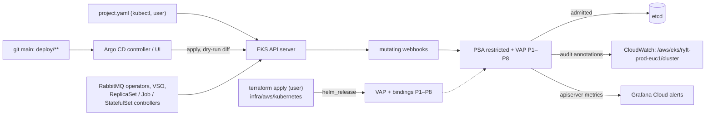

# Admission policy for `ryft-prod-euc1`: design (2026-10-23)

Ticket T12. Author: platform-architect. Status: proposal; nothing here is built or applied.

**Read for this note:**
- `infra/aws`: the EKS control plane runs `kubernetes_version = "1.36"`, and the eks module ships the
  `audit`, `api` and `authenticator` logs to CloudWatch.
- `infra/aws/kubernetes`: the add-on Helm releases, `argocd.tf`, and the local chart `cluster-issuers`.
- `infra/vault/namespaces.tf`.
- The renders of `deploy/{k8s,argocd,rabbitmq}`.
- D44–D46, D51, D94–D97, D103, D105 and D115.
- The #31 and #38 reviews in `docs/work/2026-10-22-followups/review.md`.

## Recommendation

1. **Keep Pod Security Admission (PSA) for pod security.** It already enforces `restricted` on every
   `ryft-*` namespace, `rabbitmq-system` and `argocd`. The levels are fine. What's missing is protection
   for the labels that set them.
2. **Add ValidatingAdmissionPolicy (VAP) for everything PSA can't express.** VAP is the built-in
   admission policy with CEL rules, GA since 1.30, and EKS runs 1.36. This design defines eight
   policies, P1–P8. No Kyverno or Gatekeeper: no pods to run, and no webhook that can be down.
3. **Terraform owns the policies and bindings.** They are a local Helm chart released from
   `infra/aws/kubernetes`, the same pattern as `cluster-issuers`. Argo CD can't reach them: no project
   lists them, and P7 pins the projects themselves.
4. **Production starts in Warn+Audit** for a week and one deploy of each image group. Violations are
   read from the API server audit log and metrics. Deny then follows in two steps. Before any of this,
   a CI job server-side dry-runs every app's render against the same chart on kind.
5. **Break-glass is one Terraform variable** that sets every binding back to Warn+Audit. Only the user,
   the cluster admin, can use it.

## Problem

D115 holds a small set of render invariants in CI. Two gaps remain.

**What CI can't express.** OPERATIONS lists these under "Not checked", and #38's security re-verify
raised them as items 3–9:
- privileged pods and host access;
- PSA labels and Namespace objects;
- images per namespace, and command overrides;
- NetworkPolicy rule shapes;
- the VSO objects;
- the operators project's cluster power;
- `project.yaml` itself.

#38 also left four lows:
- **L1:** `.` path segments aren't normalised, so a second app can sit on one tree;
- **L2:** `root.yaml`'s path isn't bound;
- **L3:** the operators path can include workload paths;
- **L4:** a map-valued CRD `name` crashes `renderpolicy.py`, which then fails closed.

**What never passes CI at all.** Some writes are made inside the cluster:
- Argo CD's public UI. D103: "an Argo CD admin can change projects".
- The operators, which write StatefulSets, Pods, Roles and Secrets.
- VSO, which writes Secrets holding whatever Vault has.
- A break-glass `make k8s-apply-eks`.
- `kubectl apply -f deploy/argocd/project.yaml`.

The API server reads every object last. So admission is the one place where an invariant holds no
matter who wrote the object.

**Constraints:**
- Three t3.large nodes, short of CPU (D94, D97), 35 pods each.
- One operator. Every new part brings upgrades, alerts and a runbook entry.
- CLAUDE.md: add-ons are Helm releases in `infra/aws/kubernetes`, Argo CD manages workloads only, and
  nothing has two owners.
- GDPR and secrets: messages and audit annotations name a field, never its value. EKS audits Secrets at
  metadata level, so no request bodies are logged.

## 1. Mechanism

| | PSA labels | ValidatingAdmissionPolicy | Kyverno / Gatekeeper |
| --- | --- | --- | --- |
| Runs in | the API server | the API server | 4–6 pods |
| Node cost | none | none | ~0.4 CPU, 0.5–1 GiB requested at chart defaults, plus pod slots |
| When down | – | – | `Fail` refuses every write it matches (syncs, operator reconciles); `Ignore` admits silently |
| Expresses | privileged, host namespaces, hostPath, capabilities, seccomp, volume types | any check of one object against constants, its namespace and the requester | that, plus mutation, background scans, signatures, external data |

**The choice is PSA, as it is, plus VAP:**
- **No availability dependency.** VAP has no pod, no certificate and no network hop.
- **Zero node cost.**
- **Every rule below checks one object against constants.** CEL does exactly that.
- **CI and production run the same bytes**, from `helm template` of one chart.
- **Boring technology:** it's built in and GA.

**What VAP can't do, and how this design handles it:**
- **No cross-object checks.** Fixed name→path maps replace "one app per path". "A default-deny exists"
  stays in CI.
- **It judges writes only.** Argo's server-side diff (D95) is a dry-run apply, so a hard refresh
  evaluates every Argo object once.
- **No image signatures.** That stays a later step.

**Alternatives.** Kyverno or Gatekeeper would buy mutation, background reports and signature
verification. The cost is a webhook whose outage either blocks every deploy and operator reconcile or
admits everything, plus CRDs, certificates and one more add-on to upgrade on nodes without spare CPU.
Revisit when signed images are required: Kyverno's `verifyImages` or the sigstore policy-controller,
scoped to `ryft-*`. PSA alone says nothing about images, commands, NetworkPolicies, VSO or Argo
objects. Nothing here needs rewriting, so no MutatingAdmissionPolicy either.

### Ownership

**Policies and bindings:**
- They live in `infra/aws/kubernetes/charts/admission-policy` and are installed by
  `helm_release.admission_policy` (new `admission.tf`, release record in `kube-system`).
- Terraform passes these values:
  - `vpc_cidr` (exists);
  - `vault_address` (new, not secret);
  - `admission_actions`, set to `audit` or `deny` for each policy;
  - `admission_break_glass`.
- The values are written into each policy's `variables` as literals. There are no param objects, which
  means one less object to edit or delete.
- The chart owns nothing else.

**PSA labels** stay with each namespace's owner. P1 guards them.

| Namespace | Owner | Level |
| --- | --- | --- |
| `ryft-{api,ingest,scoring,notify,migrate,smoke,rabbitmq}` | `infra/vault` | `restricted` (enforce, warn, audit) |
| `ryft-web` | git (Argo, project `ryft`) | `restricted` |
| `rabbitmq-system` | git (Argo, project `ryft-operators`) | `restricted` |
| `argocd` | `infra/aws/kubernetes` | `restricted` |
| `monitoring` | `infra/vault` | `privileged` (D51), accepted |
| `cert-manager`, `external-dns`, `vault-secrets-operator-system` | Helm, unlabelled | warn+audit `restricted`, then enforce (T12-f) |
| `amazon-cloudwatch`, `kube-system`, `default` | Helm / EKS, unlabelled | unchanged: Fluent Bit reads `/var/log`; node agents, Traefik and the ALB controller run in `kube-system` |

I considered moving `ryft-web` and `rabbitmq-system` to Terraform. That would need an import and a prune
guard on live namespaces, for nothing P1 doesn't already give.

**AppProjects** stay applied by hand from `project.yaml`. P7 pins them to the chart's copy, so the
cluster no longer trusts a `project.yaml` that a PR carried.

**Who can change the policies:**
- **The API server never runs admission policies on policy and binding objects** (assumption (a), checked
  in kind). No policy can lock out a fix, and no policy can protect itself. Their guard is RBAC plus the
  Argo projects.
- **No Argo project whitelists them.** `ryft-root` and `ryft` list none, and `ryft-operators` lists only
  the two webhook-configuration kinds of that group. P7 refuses any AppProject that would add them or
  `*`, from every writer, Argo's UI included.
- **The workloads** hold no service-account token (P2). The operators' ClusterRoles can't grant
  `admissionregistration.k8s.io` (P6).
- **Residual risk:** the argo-cd chart's default ClusterRoles give the controller every verb and the
  server delete/patch on everything. A compromised Argo CD is cluster admin today and stays so; T12-f
  narrows those roles.



## 2. Rule set

**Scope terms:**
- **R:** the `ryft-*` namespaces, matched on the immutable name as in D44. A new namespace is covered
  without a chart change.
- **OPS:** `rabbitmq-system`.
- **Argo:** requests from `system:serviceaccount:argocd:argocd-application-controller` or
  `…:argocd-server`.

**Common to all eight policies:** `failurePolicy: Fail`, and messages name the field, never the value.

**P1 `ryft-namespaces`**
- **Enforces:**
  - Namespaces named `ryft-*`, `rabbitmq-system` and `argocd` carry PSA `enforce`, `warn` and `audit`
    set to `restricted`, and no `*-version` label other than `latest`.
  - Argo may write only `ryft-web` and `rabbitmq-system`, and may delete no Namespace.
- **Scope:** Namespace writes. The labels rule applies to any writer, `infra/vault` included; the name
  and delete rule applies to Argo.
- **Exemptions:** `monitoring` (outside by name). The `/status` and `/finalize` subresources aren't
  matched.

**P2 `ryft-pods`**
- **Images per namespace:**
  - `ryft-<svc>`: only `ghcr.io/timkrebs/ryft/<svc>:<7 hex>`;
  - `ryft-smoke`: the migrate image;
  - `ryft-rabbitmq`: only `docker.io/library/rabbitmq:<tag>@sha256:<64 hex>`;
  - OPS: only `ghcr.io/rabbitmq/{cluster-operator,messaging-topology-operator}:<semver>`.
- **In R, except `ryft-rabbitmq`:**
  - no `command`;
  - `args` empty, except `[smoke]` on the migrate image in `ryft-smoke`;
  - `automountServiceAccountToken: false`.
- **Scope:** Pod, Deployment, StatefulSet, DaemonSet, ReplicaSet, Job and CronJob writes in R and OPS.
  The same expressions judge templates and Pods.
- **Exemptions:**
  - `ryft-rabbitmq` and OPS get the image rule only. The operator sets the commands there, and the broker
    needs its token for peer discovery.
  - `pods/ephemeralcontainers` isn't matched. Your `kubectl debug` still works, and PSA still applies.

**P3 `ryft-netpol`**
- **`default-deny`:** stays `podSelector: {}` with Ingress+Egress and no rules. It can't be deleted
  unless its namespace is terminating.
- **Every other rule:**
  - has `ports` and a peer;
  - `namespaceSelector` is only `matchLabels: {kubernetes.io/metadata.name: <one>}`;
  - `ipBlock` is either the VPC CIDR (ingress, ports 9090/15692) or `0.0.0.0/0` (egress, 443/5432)
    with the five private ranges excepted;
  - `endPort` only in `ryft-rabbitmq`.
- **Scope:** NetworkPolicy writes and deletes in R.
- **Exemptions:** `ryft-rabbitmq`'s egress on 443 without `except`, as today: peer discovery reaches the
  API server inside the VPC.

**P4 `ryft-vso`**
- **VaultConnection:**
  - `address` equals the HCP address (a value);
  - `skipTLSVerify` is false;
  - no `caCertSecretRef` and no `headers`.
- **VaultAuth:**
  - method and mount `kubernetes`, audiences `[vault]`;
  - a local `vaultConnectionRef: vault`;
  - no `allowedNamespaces`.
- **VaultStaticSecret:**
  - a local `vaultAuthRef`, `kv`, `kv-v2`;
  - destination `ryft-secrets` or `amqp-user-<name>`;
  - `excludeRaw: true`, no `templates` and no `transformationRefs`.
- **Other kinds:** every other `secrets.hashicorp.com` kind is refused.
- **Scope:** all namespaces, any writer.
- **Exemptions:** none. `monitoring`'s generated objects pass.

**P5 `ryft-auth-env`**
- **Enforces:** D115's auth invariant where CI can't see it.
  - No ConfigMap or Secret key `API_KEY`, `ALLOW_INSECURE_APIKEY_AUTH` or `USER_ID`.
  - `AUTH_MODE` appears only in ConfigMaps, and only as `supabase`.
  - In container `env`: the same names are refused, `AUTH_MODE` is the literal `supabase`, there is no
    `valueFrom` for these names, and no `envFrom[].prefix`.
- **Scope:** ConfigMap, Secret and the P2 kinds in R, from any writer. This includes VSO writing a Vault
  key, the STATUS item on `service_secrets`.
- **Exemptions:** none.

**P6 `ryft-operators-cluster`**
- **What Argo may write cluster-wide besides Namespaces:**
  - **CRDs:** group `rabbitmq.com` only, no conversion webhook.
  - **ClusterRoles:** named `rabbitmq-cluster-*` or `messaging-topology-*`.
    - No `*`, no `escalate`, `bind` or `impersonate`, no `aggregationRule`.
    - No grant on `admissionregistration.k8s.io`, `apiextensions.k8s.io`, `argoproj.io`,
      `secrets.hashicorp.com`, cluster RBAC, nodes or `serviceaccounts/token`.
    - No non-resource URL except `/metrics`.
  - **ClusterRoleBindings:** those names, binding only those roles, to only the two operator service
    accounts in OPS.
  - **Webhook configurations:** those names, services in OPS (never a `url`), rules on `rabbitmq.com`
    only.
  - **Namespaced RBAC from Argo:** only in OPS, with `roleRef.kind: Role`.
- **Scope:** Argo's writes of cluster-scoped kinds, Role, RoleBinding and ServiceAccount.
- **Exemptions:** none. An upstream rename needs the chart first.

**P7 `ryft-argocd`**
- **AppProjects:** exactly `ryft-root`, `ryft`, `ryft-operators` and `default`, each equal to the chart's
  copy of `project.yaml`: repos, destinations, both whitelists, no `roles`, no `*`.
- **Applications:** a fixed map from name to project, path and destination:

  | Application | Path |
  | --- | --- |
  | `ryft-root` | `deploy/argocd/apps` |
  | `ryft-platform` | `deploy/k8s/overlays/eks` |
  | `broker-rabbitmq` | `deploy/rabbitmq` |
  | `rabbitmq-operators` | `deploy/rabbitmq/operators` |
  | `vault-<x>` | `deploy/k8s/overlays/vault-namespaces/<x>`, destination `ryft-<x>` |

  - Each uses exactly our repo, `targetRevision: main` and one `source`.
  - No `kustomize`, `helm`, `plugin` or `directory`.
  - `syncPolicy` stays free, so pausing works.
- **No ApplicationSet.**
- **Scope:** namespace `argocd`, any writer: the controller, the UI, and your `kubectl apply`.
- **Exemptions:** none.

**P8 `ryft-operator-reach`**
- **Enforces:**
  - The Cluster Operator writes Secrets, StatefulSets, Services, ConfigMaps, PVCs, ServiceAccounts,
    Roles and RoleBindings, and execs into pods, only in `ryft-rabbitmq`.
  - The Topology Operator writes Secrets only there.
- **Scope:** the two operator service accounts: writes, plus CONNECT on `pods/exec`.
- **Exemptions:** none. Their reads are invisible at admission (accepted).

**Where each item lands**, for the "Not checked" list and the four lows:

| Item | Held by |
| --- | --- |
| privileged pods, host access (`hostNetwork`/`PID`/`IPC`, `hostPath`) | PSA `restricted` (enforced today); P1 keeps the labels |
| PSA labels, Namespace objects | P1 |
| images per namespace; command overrides | P2 (the broker's exact digest: git review, accepted) |
| workloads without `metadata.namespace` | P2, P3 and P5 judge the namespace the object lands in (Argo's destination) |
| NetworkPolicy shapes | P3; "a default-deny exists" stays CI-only (cross-object) |
| VSO objects (address, templates) | P4, plus P5 for what VSO writes |
| the operators project's cluster power | P6 (what Argo may create), P8 (where the operators write). Their cluster-wide reads: accepted (T12-g) |
| `project.yaml` read from the PR | P7: the cluster holds the chart's copy |
| L1 `.` segments | P7's fixed map, plus CI refuses `.` and empty segments (T12-c) |
| L2 `root.yaml`'s path | P7, plus CI binds it (T12-c) |
| L3 operators path includes workload paths | Argo's project (destination `rabbitmq-system` only), plus P2 and P6 in OPS; CI: accepted |
| L4 map-valued CRD `name` | CI-only: a typed finding instead of a traceback (T12-c) |

**Accepted:**
- the Cluster Operator's cluster-wide Secret reads;
- Argo CD's chart-default ClusterRoles, until T12-f;
- operator images by tag, as vendored;
- image signatures;
- `monitoring` stays privileged (D51);
- `kube-system` stays unlabelled.

## 3. Rollout

**Phase 0, no production:**
- T12-a to T12-d are merged.
- The `admission` CI job is green on main.
- The kind checklist below has been run once by hand.

**Phase 1, Warn+Audit in production.** At least 7 days and one deploy each of `services` and `web`.
- **Before you apply,** list the mutating webhooks. P2 judges Pods after mutation, and D51's SDK injector
  may touch RYFT pods.
- **After you apply,** hard-refresh every app.

Where violations show up:
- **The API server audit log** is the source of truth. It records who, what and when.
  - Where: CloudWatch log group `/aws/eks/ryft-prod-euc1/cluster`, streams `kube-apiserver-audit-*`. The
    eks module already turns it on.
  - What to look for: the annotation `validation.policy.admission.k8s.io/validation_failure`, with
    policy, binding and message, and PSA's `pod-security.kubernetes.io/audit-violations`.
- **Metrics:** `apiserver_validating_admission_policy_check_total` and
  `pod_security_evaluations_total` go to Grafana Cloud, which alerts on them (T12-d).
- **Warnings:** `kubectl` prints them, for example on `make k8s-apply-eks` or `kubectl apply -f
  project.yaml`. Argo CD isn't a reliable channel for API warnings, so don't use Warn as the Argo signal.
- **Events:** the policies create none. Under Deny, controllers report `FailedCreate` for refused Pods.

Every finding is fixed in git or in the chart. Nothing is exempted by hand.

**Phase 2, Deny+Audit.** Audit stays on, so the same query keeps working.
- **Step A:** P1, P4, P6 and P7, the config objects. A denial there stalls no deploy.
- **Step B:** P2, P3, P5 and P8, after one more deploy of each group.

### Testing before production: yes, a CI job

**`admission` in CI:**
- **When it runs:** on PRs touching `deploy/**` or the chart, and on push to main. It skips promote PRs
  whose diff is only `newTag` lines, since P2's tag pattern is `renderpolicy.py`'s regex.
- **Cost:** about 3–4 minutes. It joins `ci-ok` when it ran.
- **Steps:**
  1. Start a kind node image at EKS's minor (1.36), pinned by digest. Install binaries checksummed, as
     `install_yq.sh` does.
  2. Install the CRDs of VSO, cert-manager and Traefik at the chart versions in
     `infra/aws/kubernetes/main.tf`, plus the vendored RabbitMQ CRDs.
  3. Create the namespaces with `infra/vault`'s labels.
  4. Apply the chart from `helm template`, in Deny.
  5. Apply every app's render (as `check_argocd.py` renders) with `kubectl apply --dry-run=server
     --as=system:serviceaccount:argocd:argocd-application-controller`. That identity is bound to
     cluster-admin in kind, so only admission can refuse.
  6. Apply `project.yaml`, `root.yaml` and the apps as admin.
  7. Apply one negative fixture per rule. Each must be refused by the named policy.
  8. Check that every policy's `status.typeChecking` is empty.

**By hand, before Phase 1 and on every operator or EKS upgrade:** install the argo-cd chart, the
operators and the broker for real on three kind workers, so the StatefulSet and Pods the operators
create are seen to pass.

**That run also verifies the assumptions this design rests on:**
- (a) policy and binding objects are exempt from admission;
- (b) webhook configurations are not exempt; otherwise P6's webhook part becomes CI-only;
- (c) CONNECT on `pods/exec` is matched; otherwise P8 covers writes only;
- (d) dry-run requests get audit annotations, and the metric has the expected label values;
- (e) what Argo CD shows for a denial, and whether server-side diff shows it before a sync.

### Break-glass

- **Who:** only you, the one EKS cluster admin (the creator access entry). Never an agent. Argo CD and its
  UI can't use it.
- **How:** set `admission_break_glass=true`. Every binding goes to Warn+Audit and is still recorded.
  Make the change, then apply again without the flag.
- **If Terraform is unavailable:** `kubectl patch` the binding. Helm doesn't see the drift, so restore
  it with `-replace`.
- **For an Argo-synced object,** pause Argo CD first (OPERATIONS → Pause). Otherwise self-heal reverts
  your change.
- **`kubectl debug node/…`** runs in `default`, outside every policy, so it needs no break-glass.

## 4. Interactions

**Argo CD sync:**
- **A denied object:**
  - The sync fails. The resource shows the VAP denial, naming the policy and binding with the message,
    in the UI and in `argocd app get`.
  - `ArgoSyncFailed` fires. The sync is retried twice, then waits for the next commit.
  - A sync isn't atomic: objects of the same wave that passed are applied, later waves are not.
  - Running pods are untouched, since admission judges writes only.
- **Server-side diff** is a dry-run apply, so a denial may show as a comparison error before any sync
  (assumption (e)).
- **Hooks:**
  - A refused PreSync migrate Job fails the sync before anything is applied, like a failed migration.
  - A refused PostSync smoke Job leaves the release in without the smoke vouching for it, like a failed
    smoke.
  - Templates and Pods are judged by the same expressions. So a Pod is refused under an admitted Job only
    if a mutating webhook changed it. The Job then shows `FailedCreate`, and the hook fails at its
    deadline: 900 s for migrate, 300 s for smoke.
  - `BeforeHookCreation` deletes aren't matched.
- **What still works and what doesn't:**
  - `argocd app set … --sync-policy none` still pauses.
  - `--kustomize-image`, `--repo` and `--path` are refused: they bypass git.
- **Prune:** removing `default-deny` or the `ryft-web` Namespace from git fails the sync instead of
  deleting them (P3, P1).

**RabbitMQ operators:**
- **Their own Deployments in OPS** match the P2 image pattern and stay PSA `restricted`, as today.
- **What the Cluster Operator makes in `ryft-rabbitmq`:**
  - The StatefulSet `rabbitmq-server` and its Pods. Container and init container both take the
    digest-pinned `spec.image`. Commands and the token are exempt there, and PSA `restricted` holds as
    today.
  - Services, ConfigMaps, PVCs, and the peer-discovery ServiceAccount, Role and RoleBinding.
  - Secrets with no auth keys.
  - All of it passes P2, P5 and P8.
- **Their webhooks** (`Fail`, `rabbitmq.com` only) are unchanged.
- **An upgrade that adds an image or renames a cluster object** needs the chart first (Terraform), then
  the vendored files.

**VSO:**
- **A Secret with a forbidden key** from Vault is refused. The `VaultStaticSecret` goes Degraded,
  `ArgoAppDegraded` fires on `vault-<svc>`, and the old Secret stays.
- **Its restarts** are template updates, judged by P2.

**Not matched:** HPA writes to `deployments/scale`, and evictions.

| Failure | Seen as | Recovery |
| --- | --- | --- |
| a rule refuses a legitimate change | `ArgoSyncFailed` + `AdmissionPolicyDenied`; Argo's message | fix git or the chart; break-glass if urgent |
| a CEL error under `Fail` refuses all it matches | `AdmissionPolicyError`, many denials | break-glass, fix the chart (Audit and kind catch it first) |
| an operator-made object is refused | `ReconcileSuccess=False` → `ArgoAppDegraded`; pods keep running | chart change with the upgrade |
| a mutating webhook adds a foreign image | rollout stuck, `FailedCreate`, hooks time out | exclude `ryft-*` from that webhook (D51's "next step") |
| policies deleted or changed out of band | `AdmissionPolicyIdle` (P7 no longer evaluated; Argo writes Application status every few minutes) | `terraform apply -replace=helm_release.admission_policy` |
| an EKS minor changes CEL behaviour | the kind job at the target minor fails | run kind at the new minor before upgrading |

## 5. Work breakdown

| Ticket | Owner | What | After |
| --- | --- | --- | --- |
| T12-a | infra-engineer | **Chart** `infra/aws/kubernetes/charts/admission-policy`: P1–P8, one VAP and one binding each, `Fail`, value-free messages, `Chart.yaml` bumped on every change. **`admission.tf`:** the release, `vault_address`, `admission_actions` (default `audit` for every policy), `admission_break_glass`. **`terraform test`:** Audit by default; break-glass gives Warn+Audit; Deny never with Warn; chart pinned. Plus the README. No apply. | – |
| T12-b | gitops-engineer | **CI job** `admission` and `make admission-test` (podman kind). One negative fixture per rule; pinned, checksummed tools. Runs the by-hand kind check once, including assumptions (a)–(e). | a |
| T12-c | gitops-engineer | **`project.yaml`:** a `namespaceResourceWhitelist` for `ryft` (the 23 kinds its renders hold) and for `ryft-operators` (7). **`check_argocd.py`:** every rendered kind is permitted by its project; L1, L2, L4. **Docs:** the OPERATIONS and ARCHITECTURE edits (below). | – |
| T12-d | sre | The API server metrics into Grafana Cloud. **Alerts**, with promtool tests: `AdmissionPolicyViolation` (warning), `AdmissionPolicyDenied` (warning), `AdmissionPolicyError` (critical), `AdmissionPolicyIdle` (warning). The runbook lines and the Logs Insights query. Must be live before Phase 1. | a |
| T12-e | user | Phase 1, the audit week, Step A, Step B. | a–d |
| T12-f | infra-engineer | Narrow Argo CD's ClusterRoles (`controller` and `server` `clusterRoleRules`). PSA warn+audit `restricted` on the three add-on namespaces (`kubernetes_labels`), enforce after a clean week. | e |
| T12-g | gitops-engineer | Investigate scoping the Cluster Operator to `ryft-rabbitmq` with a kustomize patch. Needs your OK under D97. | – |

**Commands for the user.** No agent runs these.

```bash
# 0. Read-only, before Phase 1: what mutates pods today (D51's SDK injector)
kubectl get mutatingwebhookconfigurations \
  -o custom-columns='NAME:.metadata.name,NAMESPACES:.webhooks[*].namespaceSelector,OBJECTS:.webhooks[*].objectSelector'

# 1. Phase 1, after T12-a..d are merged
kubectl apply -f deploy/argocd/project.yaml                          # the kind whitelists (T12-c)
#   infra/aws/kubernetes/terraform.tfvars: vault_address = "<the address in the generated vault.yaml files>"
terraform -chdir=infra/aws/kubernetes plan -out=admission.tfplan     # only helm_release.admission_policy is added
terraform -chdir=infra/aws/kubernetes apply admission.tfplan
kubectl get validatingadmissionpolicybindings -o custom-columns='NAME:.metadata.name,ACTIONS:.spec.validationActions'
for a in $(argocd app list -o name); do argocd app get "$a" --hard-refresh >/dev/null; done

#    Daily in Phase 1: what would have been refused (confirm the field names once in the console)
aws logs start-query --region eu-central-1 --log-group-name /aws/eks/ryft-prod-euc1/cluster \
  --start-time $(( $(date +%s) - 86400 )) --end-time "$(date +%s)" \
  --query-string 'filter @logStream like /kube-apiserver-audit/
    | filter ispresent(`annotations.validation.policy.admission.k8s.io/validation_failure`) or ispresent(`annotations.pod-security.kubernetes.io/audit-violations`)
    | stats count(*) by user.username, verb, objectRef.namespace, objectRef.resource, objectRef.name'
aws logs get-query-results --region eu-central-1 --query-id <queryId>

# 2. Step A, then Step B: admission_actions in terraform.tfvars
#    A: { namespaces = "deny", vso = "deny", operators = "deny", argocd = "deny" }   B: every policy "deny"
terraform -chdir=infra/aws/kubernetes plan -out=admission.tfplan
terraform -chdir=infra/aws/kubernetes apply admission.tfplan

# Break-glass (the user only)
terraform -chdir=infra/aws/kubernetes apply -var='admission_break_glass=true'    # every binding Warn+Audit
terraform -chdir=infra/aws/kubernetes apply                                       # afterwards
#   Only if Terraform is unavailable (a few seconds without policies on the restore):
kubectl patch validatingadmissionpolicybinding ryft-pods --type=merge -p '{"spec":{"validationActions":["Warn","Audit"]}}'
terraform -chdir=infra/aws/kubernetes apply -replace=helm_release.admission_policy
```

**Docs to update.** These come with the tickets; the lead writes the D-entry.
- `OPERATIONS.md`:
  - "Not checked" becomes "Held at admission";
  - what a refused apply looks like;
  - break-glass;
  - Upgrading: kind first, and the chart before the operators;
  - Adding a service: no chart change unless it brings a new kind.
- `ARCHITECTURE.md`: "Not covered".
- `OBSERVABILITY.md`: the four alerts.
- `DECISIONS.md`: the entry below, and a pointer from D115's "Not a policy engine".
- `STATUS.md`.
- `infra/aws/README.md`.
- `CLAUDE.md` (yours): one line saying admission policies are Terraform's, and a `project.yaml` change
  needs the chart's copy first.

## Open questions for the user

1. **Does D51's SDK injector mutate pods in `ryft-*`?** Command 0 answers that. I recommend excluding
   `ryft-*` from it; Beyla's eBPF metrics stay. The alternative is naming its image in P2.
2. **Can `vault_address` be a plain variable in `infra/aws/kubernetes`?** It's already in git in the
   generated files. I recommend this over reading `infra/vault`'s output, which would make one root
   depend on the other.
3. **Which break-glass?** I recommend the Terraform flag. The alternative is a separate IAM role with its
   own access entry and a Kubernetes group the policies exempt: a stronger CloudTrail trail, but one more
   IAM object and access entry in `infra/aws`.
4. **Should the `admission` job be required in `ci-ok`?** It adds about 3–4 minutes to PRs that touch
   `deploy/` (not promote PRs).
5. **T12-g patches the vendored operator release (D97).** Do you want it, or do you accept the operator's
   cluster-wide Secret reads?

## Draft DECISIONS entry (unnumbered)

```markdown
## D<n> — Admission: Pod Security labels plus ValidatingAdmissionPolicy, owned by Terraform

- **Why:** D115's CI checks hold a small set of render invariants. Pod security, images per namespace,
  commands, NetworkPolicy shapes, the VSO objects, the operators project's cluster power and the Argo CD
  objects themselves are not checked, and whatever is written in the cluster (Argo CD's public UI, the
  operators, VSO, a break-glass apply) never passes CI.
- **Decision:** Pod Security Admission stays the pod-security mechanism (`restricted` on every `ryft-*`
  namespace, `rabbitmq-system` and `argocd`; `monitoring` privileged, D51). What it can't express is
  eight ValidatingAdmissionPolicies (CEL, GA since 1.30; EKS runs 1.36): namespaces and their PSA
  labels, images and commands per namespace, NetworkPolicy shapes, VSO objects, the auth environment
  (Secrets from Vault included), the operators' cluster objects, Argo CD's projects and applications,
  and where the operators may write. No Kyverno or Gatekeeper: 4–6 pods on CPU-bound nodes and a webhook
  that either blocks every deploy when down or fails open, for features we don't need yet (mutation,
  signatures).
- **Owner:** a local chart `infra/aws/kubernetes/charts/admission-policy` in a `helm_release` (the user
  applies). Argo CD never: no AppProject lists policies or bindings, and a policy pins the projects to
  the chart's copy of `project.yaml`. The API server exempts policy objects from admission, so RBAC is
  their guard; Argo CD's chart-default ClusterRoles are narrowed later.
- **Rollout:** Warn+Audit for a week and a deploy of each group (the API server audit log in CloudWatch
  and the API server metrics in Grafana Cloud), then Deny+Audit in two steps: config objects, then
  workloads. CI job `admission`: kind at EKS's minor, the chart, every app's render as a server-side dry
  run under Argo CD's identity, one refused fixture per rule.
- **Break-glass:** `admission_break_glass` (every binding Warn+Audit), the user only; a `kubectl patch`
  of a binding only when Terraform is unavailable, restored by the next apply.
- **Accepted:** the Cluster Operator's cluster-wide reads, Argo CD's ClusterRoles (until narrowed),
  operator images by tag, no image signatures, cross-object invariants (default-deny exists) in CI only.
- **Consequences:** a change to `project.yaml`, a new Argo-made namespace, or an operator upgrade that
  renames a cluster object or adds an image needs the chart first (Terraform, then git). A new service
  doesn't (images and app paths are patterns).
```
