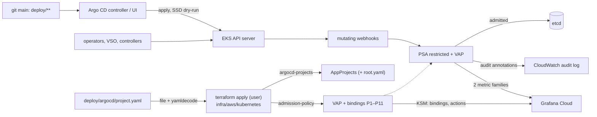

# Admission policy for `ryft-prod-euc1`: design (2026-10-23, revision 2)

Ticket T12. Author: platform-architect. Status: proposal. Nothing here is built or applied.

**Read for this note:**
- `infra/aws`: EKS `kubernetes_version = "1.36"`; the eks module ships the `audit`, `api` and
  `authenticator` logs to CloudWatch.
- `infra/aws/kubernetes`: the add-on releases, `argocd.tf`, the local chart `cluster-issuers`, and the helm
  provider `~> 3.3`.
- `infra/vault/namespaces.tf`.
- The renders of `deploy/{k8s,argocd,rabbitmq}`.
- D44–D46, D51, D94–D97, D103, D105 and D115.
- The #31 and #38 reviews.

**Revision 2** answers the security review of `327efe0`:
- **B1:** P7 moves to the last step and gets a carve-out for the controller's status writes. A blast
  radius per policy, and four deny steps.
- **B2:** Terraform owns the AppProjects, read from the same `project.yaml`, as a user decision. The
  minimal alternative is listed next to it.
- **New policies:** P9 (Traefik), P10 (Argo's `operation` field) and P11 (the broker's own objects).
- **Tighter rules:** the broker's exemptions, token sources, P6 names, operations per policy, and
  allowlists in P4 and P7.
- **Signals:** binding state from kube-state-metrics (KSM), plus a keep-list for the API server metrics.
- **Rollout:** an exit checklist for Phase 1 and a faster break-glass.
- **Tickets:** Argo's RBAC narrowed before Step A. T12-g recommended for both operators.
- **A table of the claims this design rests on,** each marked verified, plausible or doubtful.

## Recommendation

1. **Pod Security Admission (PSA) stays the pod-security mechanism.** `restricted` already holds on every
   `ryft-*` namespace, `rabbitmq-system` and `argocd`. What's missing is protection of those labels.
2. **Built-in ValidatingAdmissionPolicy (VAP) covers everything PSA can't express.** VAP rules are CEL
   expressions; VAP is GA since 1.30, and EKS runs 1.36. This design has eleven policies, P1–P11. No
   Kyverno or Gatekeeper: there are no pods to run and no webhook that can be down.
3. **Terraform owns the policies, and, if you agree, the AppProjects too.** Both come from
   `infra/aws/kubernetes`:
   - one local chart holds the policies;
   - a second renders `deploy/argocd/project.yaml`;
   - P7 receives the same decoded file as its constant.

   One file, one owner, no hand apply.
4. **Production runs Warn+Audit first, then Deny in four steps ordered by blast radius:**
   - the small config apps;
   - what Argo applies;
   - what controllers create at runtime;
   - Argo CD's own objects, last.

   Phase 1 ends after an exercise checklist plus 7 days. A CI job and a repeatable kind run test every
   app's render against the same chart before production does.
5. **Break-glass is yours alone.** The fast path: `kubectl patch` or `delete` a binding. That always
   works, because bindings are exempt from admission. Terraform then restores the binding, and a KSM
   alert reports any binding left off.

## Problem

D115 holds a small set of render invariants in CI. Two gaps remain.

**What CI can't express.** These are OPERATIONS' "Not checked" list and #38's re-verify items 3–9:
- privileged pods and host access;
- PSA labels and Namespace objects;
- images per namespace and command overrides;
- NetworkPolicy shapes;
- the VSO objects;
- the operators project's cluster power;
- `project.yaml` itself.

#38's four lows:
- **L1:** `.` path segments;
- **L2:** an unbound `root.yaml` path;
- **L3:** an operators path that includes workload paths;
- **L4:** a map-valued CRD `name` that crashes `renderpolicy.py` (it fails closed).

**What never passes CI at all,** because it is written in the cluster:
- Argo CD's public UI (D103);
- the operators;
- VSO;
- a break-glass apply;
- today's hand apply of `project.yaml`.

**Constraints:**
- Three t3.large nodes, short of CPU (D94, D97).
- One operator.
- CLAUDE.md: add-ons are Helm releases in `infra/aws/kubernetes`, Argo CD manages workloads only, and
  nothing has two owners.
- GDPR and secrets: messages never carry object values (no `messageExpression` built from them; Secret
  *keys* only).

## 1. Mechanism

| | PSA labels | ValidatingAdmissionPolicy | Kyverno / Gatekeeper |
| --- | --- | --- | --- |
| Runs in | the API server | the API server | 4–6 pods |
| Node cost | none | none | ~0.4 CPU, 0.5–1 GiB requested at chart defaults, pod slots |
| When down | – | – | `Fail`: refuses every write it matches. `Ignore`: admits silently |
| Expresses | privileged, host namespaces, hostPath, capabilities, seccomp, volume types | any check of one object (and its old version) against constants, its namespace and the requester | that, plus mutation, background scans, signatures, external data |

**Choice: PSA as it is, plus VAP.**
- No availability dependency and no node cost.
- Every rule is a check of one object.
- CI and production apply the same `helm template` bytes.
- It is boring, built-in technology.

**What VAP can't do, and how the design copes:**
- **Cross-object checks:** fixed name→path maps; "a default-deny exists" stays in CI.
- **Writes only:** Argo's server-side diff (SSD, D95) dry-run-applies objects on refresh. That exposes
  them, though `ryft-root` has no SSD.
- **Signatures:** not covered.

**Alternatives.** Kyverno or Gatekeeper add mutation, background reports and signature verification. In
return they bring a webhook whose outage blocks every deploy or admits everything, plus CRDs,
certificates and an add-on to upgrade, on nodes with no spare CPU. Revisit once signed images are
required: Kyverno's `verifyImages` or the sigstore policy-controller, scoped to `ryft-*`. PSA alone
doesn't see images, commands, NetworkPolicies, VSO or Argo objects.

**Claims this design rests on:**

| # | Claim | Status | Checked in |
| --- | --- | --- | --- |
| a | the API server runs no admission policy on policy or binding objects (no lockout; no self-protection) | verified (review) | – |
| b | webhook configurations are not exempt, so P6 sees them | plausible | kind |
| c | CONNECT on `pods/exec` can be matched (P8) | plausible | kind |
| d | dry-run requests carry the `validation_failure` audit annotation | plausible | kind |
| e | `apiserver_validating_admission_policy_check_total` counts clean passes | doubtful. Not used for liveness; KSM instead (§3) | – |
| f | with SSD, a denial shows as a comparison error on the whole app (`ArgoAppOutOfSync`, not `ArgoSyncFailed`) | per the review | kind |
| g | P7's whole-`spec` equality against a JSON-literal constant type-checks on the AppProject schema | plausible. Fallback: one equality per top-level key | kind |
| h | narrowed controller RBAC with `escalate`/`bind` limited by `resourceNames` can still create the operators' roles | plausible | kind |
| i | `resource.respectRBAC: strict` keeps the controller's cache working without cluster-wide Secrets | plausible | kind |
| j | the helm provider `~> 3.3` offers `take_ownership` | plausible. Fallback: metadata labels (§5) | `terraform validate` |
| k | what `argocd-server` writes as `operation.sync.revision` for a plain sync (`""`, `main` or the SHA) | unknown | kind |
| l | the broker's 443 egress only reaches the API server inside the VPC | plausible | production: roll one broker pod after the change |

### Ownership

**Policies and bindings.** They live in the local chart `infra/aws/kubernetes/charts/admission-policy`,
installed by `helm_release.admission_policy` (new `admission.tf`, in `kube-system`).
- **Production values** sit in a committed file, `infra/aws/kubernetes/admission-values.yaml`, which
  Terraform reads and CI's `helm template` uses. It holds:
  - the Vault address;
  - the Argo service-account names;
  - the action per binding (`audit` | `deny`).

  A step change is a reviewed PR plus your apply.
- **The `vault_address` test.** A test compares it with the generated
  `deploy/k8s/overlays/vault-namespaces/*/vault.yaml`; there are no tfvars.
- **`vpc_cidr`** comes from the existing variable.
- **Constants, not params.** Values become literals in each policy's `variables`; there are no param
  objects.

**AppProjects (B2). Recommended: Terraform owns them, a user decision that amends D95.** Today Argo
doesn't manage `project.yaml`: `root.yaml` syncs only `apps/`, and `ryft-root` whitelists only
Application. The file is applied by hand, against OPERATIONS' "Nobody runs `kubectl apply` against
production". A chart copy for P7 would give the projects two definitions.
- **One decoded value, two consumers.** `infra/aws/kubernetes` reads `deploy/argocd/project.yaml`: it
  calls `file()`, splits the documents, runs `yamldecode` and drops the empty ones. A local chart
  `argocd-projects` (release in `argocd`, after `helm_release.argocd` and `helm_release.admission_policy`)
  renders the AppProjects. Recommended: `root.yaml` too. The same decoded value becomes P7's constant.
- **One file, one owner, no hand apply.** CI keeps reading the same file. A project change merges in
  git and reaches the cluster with your next `terraform apply`. That keeps D95's intent: an application
  commit can't widen a project.
- **Adoption, once.** Use `take_ownership` on the new release (claim j). Otherwise you label and
  annotate the four projects and `ryft-root` with Helm's ownership metadata first. That touches metadata
  only (§5).
- **Minimal alternative.** Keep the hand apply. Then P7 refuses AppProject writes from any
  `system:serviceaccount:argocd:*` and checks only generic invariants:
  - our repository as the only source;
  - no `*`, and none of the admission policy kinds in a whitelist;
  - no `roles`;
  - `default` empty.

  There is no copy. The cost: the projects' exact content is guarded by review only, and OPERATIONS:208
  needs the stated exception.

**PSA labels** stay with each namespace's owner. P1 guards them.

| Namespace | Owner | Level |
| --- | --- | --- |
| `ryft-{api,ingest,scoring,notify,migrate,smoke,rabbitmq}` | `infra/vault` | `restricted` (enforce, warn, audit) |
| `ryft-web` | git: Argo, `ryft` | `restricted` |
| `rabbitmq-system` | git: Argo, `ryft-operators` | `restricted` |
| `argocd` | `infra/aws/kubernetes` | `restricted` |
| `monitoring` | `infra/vault` | `privileged` (D51), accepted |
| `cert-manager`, `external-dns`, `vault-secrets-operator-system` | Helm, unlabelled | warn+audit `restricted`, then enforce (T12-j) |
| `amazon-cloudwatch`, `kube-system`, `default` | Helm / EKS | unchanged |

**Who can change the policies:**
- **Bindings and policies are exempt from admission (a)**, so RBAC is their guard.
- **Argo's projects whitelist none of them,** and P7 keeps it so.
- **T12-f narrows Argo CD's chart-default ClusterRoles before Step A**, so neither the controller nor the
  server can write them:
  - the controller writes only the two webhook-configuration resources of `admissionregistration.k8s.io`;
  - the server writes nothing there;
  - neither gets `secrets` get, `pods/exec` or `pods/ephemeralcontainers`;
  - the ApplicationSet controller is turned off.
- **The workloads** hold no token (P2).
- **The operators' roles** can't grant `admissionregistration.k8s.io` (P6).



## 2. Rule set

**Terms:**
- **R:** `ryft-*`. VAP has no prefix selectors, so this is a matchCondition on `request.namespace`
  (namespaced objects) or `request.name` (Namespaces).
- **OPS:** `rabbitmq-system`.
- **Argo:** `system:serviceaccount:argocd:argocd-application-controller` and `…:argocd-server`.

**Common to every policy:**
- `failurePolicy: Fail`, with value-free messages.
- A matchCondition skips an UPDATE when `oldObject.metadata.deletionTimestamp` is set and the spec (or
  `data`) is unchanged. Finalizer removal, such as VSO's, must not be refused.
- Pod rules walk `containers` and `initContainers`, never `ephemeralContainers`.
- C/U/D means CREATE/UPDATE/DELETE. DELETE is matched only where stated.

**P1 `ryft-namespaces`** (C, U; D for Argo)
- R plus `rabbitmq-system` and `argocd` carry PSA `enforce`, `warn` and `audit` = `restricted`, and no
  `*-version` label other than `latest`. This applies to every writer, `infra/vault` included.
- Argo may write only `ryft-web` and `rabbitmq-system`, and delete no Namespace.
- `monitoring` is outside the rule by name.

**P2 `ryft-workloads`** (C, U)
- Kinds: Pod, Deployment, StatefulSet, DaemonSet, ReplicaSet, Job, CronJob, in R and OPS.
- Two bindings: `templates` (everything but Pod) and `pods`.
- **Images:**
  - `ryft-<svc>` runs only `ghcr.io/timkrebs/ryft/<svc>:<7 hex>`;
  - `ryft-smoke` runs the migrate image;
  - `ryft-rabbitmq` runs only `docker.io/library/rabbitmq:<tag>@sha256:<64 hex>`;
  - OPS runs only `ghcr.io/rabbitmq/{cluster-operator,messaging-topology-operator}:<semver>`, with
    `command: [/manager]` only;
  - no `image` volumes.
- **In R:**
  - no `command`, and no exec probes or lifecycle hooks (they count as commands);
  - `args` empty except `[smoke]` on the migrate image in `ryft-smoke`;
  - `automountServiceAccountToken: false`;
  - no projected `serviceAccountToken` source;
  - no volume, `env` or `envFrom` reference to Secret `vault-auth-token`;
  - on Pods, no `kube-api-access-*` volume.
- **The broker's exemption** (commands, token): only StatefulSet `rabbitmq-server` written by the
  Cluster Operator's SA, and Pods whose controller owner is that StatefulSet.

**P3 `ryft-netpol`** (C, U; D for `default-deny`)
- `default-deny` stays `podSelector: {}` with Ingress+Egress and no rules. Deleting it is refused unless
  its namespace is terminating.
- Every other rule has `ports`, every port entry has `port`, and the rule has a peer.
- `namespaceSelector` is only `matchLabels: {kubernetes.io/metadata.name: <one>}`.
- `ipBlock` is either:
  - the VPC CIDR, for ingress on 9090/15692, or for `ryft-rabbitmq`'s egress on 443 (T12-c narrows
    today's `0.0.0.0/0`; claim l);
  - or `0.0.0.0/0` for egress on 443/5432, with the five private ranges excepted.
- `endPort` only in `ryft-rabbitmq`.
- Note: `rabbitmq-system` has no NetworkPolicy at all. It is outside R; a default-deny there is a
  follow-up.

**P4 `ryft-vso`** (C, U; all namespaces, any writer)
- Allowlisted keys per kind, the CRDs' defaulted fields included.
- **VaultConnection:** `address` = the value; `skipTLSVerify` false; no `caCertSecretRef` and no
  `headers`.
- **VaultAuth:** `kubernetes` method and mount; audiences `[vault]`; local `vaultConnectionRef: vault`;
  no `allowedNamespaces`.
- **VaultStaticSecret:**
  - local `vaultAuthRef`, `kv`, `kv-v2`;
  - destination `ryft-secrets` or `amqp-user-<name>`;
  - `excludeRaw: true`, no `templates` or `transformationRefs`.
- Other `secrets.hashicorp.com` kinds are refused.

**P5 `ryft-auth-env`** (C, U; ConfigMap, Secret and the P2 kinds in R, any writer)
- No ConfigMap or Secret key `API_KEY`, `ALLOW_INSECURE_APIKEY_AUTH` or `USER_ID`.
- `AUTH_MODE` only in ConfigMaps, and only `supabase`.
- In `env`: the same names are refused, `AUTH_MODE` must be the literal `supabase`, no `valueFrom` for
  them, and no `envFrom[].prefix`.
- This catches a Vault key that VSO syncs (the STATUS item on `service_secrets`).

**P6 `ryft-operators-cluster`** (C, U; Argo)
- **CRDs:** `rabbitmq.com` only, with no conversion webhook.
- **ClusterRoles:**
  - named `rabbitmq-cluster-*` or `messaging-topology-*`;
  - no `*`, no `escalate`, `bind` or `impersonate`, no `aggregationRule`, no
    `rbac.authorization.k8s.io/aggregate-to-*` label;
  - no grant on `admissionregistration.k8s.io`, `apiextensions.k8s.io`, `argoproj.io`,
    `secrets.hashicorp.com`, cluster RBAC, nodes or `serviceaccounts/token`;
  - no non-resource URL except `/metrics`.
- **ClusterRoleBindings:** only those roles, to only the two operator SAs in OPS.
- **Webhook configurations:**
  - exactly `cluster-operator-{mutating,validating}-webhook-configuration` and
    `messaging-topology-{mutating,validating}-webhook-configuration`;
  - services in OPS, never a `url`;
  - rules on `rabbitmq.com` only.
- **Namespaced RBAC:** only in OPS, with `roleRef.kind: Role`, and RoleBinding subjects only the two
  operator SAs.

**P7 `ryft-argocd`** (C, U, D; namespace `argocd`, any writer)
- **The carve-out.** A matchCondition skips UPDATEs by the application controller where
  `object.spec == oldObject.spec`, i.e. its status and operation writes. So a stale constant or a CEL
  error can't freeze auto-sync.
- **AppProjects:**
  - the whole `spec` equals the decoded `project.yaml` (B2, claim g). That includes
    `destinationServiceAccounts`, `sourceNamespaces`, the blacklists, `syncWindows` and `signatureKeys`;
  - DELETE of `default` is refused from every writer, since Argo would recreate it allow-all;
  - DELETE of the others is refused from `system:serviceaccount:argocd:*`.
- **Applications:**
  - an allowlist of `spec` keys;
  - a fixed name → (project, path, destination) map: `ryft-root` → `deploy/argocd/apps`,
    `ryft-platform` → `deploy/k8s/overlays/eks`, `broker-rabbitmq` → `deploy/rabbitmq`,
    `rabbitmq-operators` → `deploy/rabbitmq/operators`, `vault-<x>` →
    `deploy/k8s/overlays/vault-namespaces/<x>` with destination `ryft-<x>`;
  - our repository exactly, `targetRevision: main` and one `source`;
  - no `sources`, `sourceHydrator`, `destination.name`, `kustomize`, `helm`, `plugin` or `directory`;
  - `syncPolicy` free, so pausing works;
  - no ApplicationSet.
- **Secrets:** argocd-server may not write Secrets labelled `argocd.argoproj.io/secret-type`. That blocks
  repositories and clusters added through the UI or CLI.

**P8 `ryft-operator-reach`** (C, U, CONNECT; the two operator SAs)
- The Cluster Operator writes Secrets, StatefulSets, Services, ConfigMaps, PVCs, ServiceAccounts, Roles,
  RoleBindings and Pods (UPDATE), and uses `pods/exec` (claim c), only in `ryft-rabbitmq`.
- The Topology Operator writes Secrets only there.
- Their cluster-wide **reads** are invisible to admission (T12-g).

**P9 `ryft-traefik`** (C, U in R)
- Middleware `spec` keys only `rateLimit`, `redirectRegex` or `headers`.
- ServersTransport only `rootCAs` and `serverName`, never `insecureSkipVerify`.
- An Ingress's `traefik.ingress.kubernetes.io/router.middlewares` names only middlewares of its own
  namespace (`<namespace>-<name>@kubernetescrd`).

**P10 `ryft-argocd-operation`** (C, U on Applications; no carve-out)
- No `operation.sync.manifests`, `.source` or `.sources` from any writer.
- From argocd-server, `operation.sync.revision` must be `""`, `main` or `oldObject.status.sync.revision`
  (claim k).
- Until k is verified, the accepted gap: after a pause, `argocd app rollback`,
  `argocd app sync --revision <sha>` and `--local` bypass reviewed git. While auto-sync is on, Argo
  itself refuses other revisions. RYFT rolls back by revert and hold (D95, D107).

**P11 `ryft-broker`** (C, U in `ryft-rabbitmq`)
- RabbitmqCluster: `spec.image` matches the P2 broker pattern, and `override` holds nothing but today's
  pod-template annotations (the scrape).
- Shovel, Federation and SchemaReplication are refused from every writer: they would move messages off
  the cluster.

**Where each item lands:**

| Item | Held by |
| --- | --- |
| privileged pods, host access | PSA `restricted` (enforced today); P1 keeps the labels |
| PSA labels, Namespace objects | P1 |
| images per namespace; command overrides | P2, P11 (the broker's exact digest: git review) |
| workloads without `metadata.namespace` | judged in the namespace they land in (Argo's destination) |
| NetworkPolicy shapes | P3; "a default-deny exists" stays CI-only |
| VSO objects | P4, plus P5 for what VSO writes |
| the operators project's cluster power | P6, P8; their reads: T12-g |
| `project.yaml` read from the PR | P7 with B2: the cluster compares against the same file |
| L1, L2 | P7's fixed map, plus CI (T12-c) |
| L3 | Argo's project (`rabbitmq-system` only), plus P2 and P6 in OPS; CI: accepted |
| L4 | CI-only: a typed finding (T12-c) |

**Accepted:**
- the operators' cluster-wide reads, until T12-g;
- operator images by tag;
- no image signatures;
- `monitoring` privileged (D51);
- `kube-system` unlabelled;
- `rabbitmq-system` without NetworkPolicies.

## 3. Rollout

**Phase 0, nothing in production:**
- The T12-a, -c, -d, -e and -f code is merged, and T12-b if you choose B2.
- The `admission` job is green on main.
- The kind e2e (T12-d) has passed, which covers claims b–d and f–k.

**Before Phase 1:**
- **Exclude `ryft-*` from D51's SDK injector** (T12-h, your `make monitoring-apply`). P2 judges Pods after
  every mutating webhook.
- **Apply T12-f,** the narrowed Argo RBAC. It may go into the same apply.

**Phase 1, Warn+Audit.** It ends after 7 days *and* once every item below has run in Audit with no
unexplained finding:
1. a deploy of each group, with both hooks;
2. a broker reconcile (a RabbitmqCluster change through git);
3. a node drain or a node-group AMI update;
4. a VSO key change;
5. an `infra/vault` apply;
6. an Argo CD pause, resume and manual sync;
7. a project change. The B2 adoption counts, since `ryft-root` has no SSD and P7 is exercised only by
   real spec writes;
8. a k8s-monitoring upgrade.

**Where findings show up:**
- **The API server audit log** in CloudWatch (`/aws/eks/ryft-prod-euc1/cluster`). Look for the
  `validation.policy.admission.k8s.io/validation_failure` and `pod-security.kubernetes.io/audit-violations`
  annotations. The query in §5 splits dry-run evaluations from real writes and counts distinct objects.
- **The two metric families** (§3 Signals).
- **`kubectl` warnings.** Argo CD is no channel for warnings.

**Phase 2, Deny+Audit, by blast radius.** At least one deploy of each group runs between steps.

| Step | Policies | Why here |
| --- | --- | --- |
| A | P4, P6, P11 | each blocks one small app (`vault-<svc>`, `rabbitmq-operators`, `broker-rabbitmq`) |
| B | P1, P2 `templates`, P3, P5, P9 | what Argo applies. A denial blocks deploys of `ryft-platform`, not running pods |
| C | P2 `pods`, P8 | runtime: Pods for rollouts, scale-ups and drains; the broker's reconcile. A denial alerts as critical |
| D | P7, P10 | Argo CD's own objects. Last, because a mistake here stops every app |

### Signals (T12-e)

- **Denials and audit failures.** The API server's `/metrics` is scraped per endpoint (each address of
  `default/kubernetes`), keeping only `apiserver_validating_admission_policy_check_total` and
  `pod_security_evaluations_total` for the free tier.
  - The scrape lives in `deploy/monitoring/k8s-monitoring.yaml`, applied by your `make monitoring-apply`.
  - Alerts:
    - `AdmissionPolicyViolation` (warning, Audit);
    - `AdmissionPolicyDenied` (warning);
    - `AdmissionPodDenied` (critical, the P2 `pods` binding);
    - `AdmissionPolicyError` (critical, evaluation errors).
- **Binding state.** KSM's custom-resource-state exports each binding with its `validationActions` and a
  chart label carrying the intended action. Passes may not be counted (claim e), so this replaces any
  "idle" alert. Alerts:
  - `AdmissionBindingMissing` (critical);
  - `AdmissionBindingDrift`: actions differ from the intended label for 2 h, which catches a patch or a
    forgotten break-glass.
- **On every plan.** `admission.tf` gets a Terraform `check` block that warns when a live binding
  differs from the values file.
- **What Argo shows.** With SSD a denial shows as `ArgoAppOutOfSync` with a comparison error (claim f),
  not as `ArgoSyncFailed`. The admission alerts are the fast signal.

### Testing: a CI job and a repeatable kind run

**CI job `admission`.** It is required in `ci-ok` when it runs (open question 3).
- **When it runs:** on PRs touching `deploy/**`, the chart or the values file, and on push to main.
- **When it skips:** a promote PR whose diff is limited to what promote writes (`newTag`, the
  `PRIVACY_POLICY_VERSION` literals, hold lines).
- **Steps:**
  1. Start a kind node at 1.36, pinned by digest, with checksummed binaries.
  2. Install the CRDs of VSO, cert-manager and Traefik at the pinned chart versions, plus the vendored
     RabbitMQ CRDs.
  3. Create the namespaces with `infra/vault`'s labels, plus `ryft-web` and `rabbitmq-system`, before the
     renders.
  4. Install the chart with the committed values, in Deny.
  5. Apply every app's render with `--dry-run=server` as Argo's controller SA (bound to cluster-admin in
     kind).
  6. Apply `project.yaml` through the same decode the Terraform code uses.
- **Extra checks:**
  - one negative fixture per rule;
  - a large-Pod fixture for CEL cost;
  - `status.typeChecking` empty;
  - a `Chart.yaml` version bump whenever a template changed.

**Kind e2e** (`scripts/admission_e2e.sh`, plus a manual `workflow_dispatch`). It runs before Phase 1,
and on every operator, argo-cd chart or EKS minor upgrade:
- the argo-cd chart with the narrowed RBAC (T12-f);
- the operators and the broker on three workers;
- a real sync of every app;
- a hook run and a node drain;
- verification of claims b–d and f–k.

### Break-glass (you only, the cluster admin)

1. **Fast path.** It always works, because bindings are exempt (a):
   `kubectl patch validatingadmissionpolicybinding <name> … ["Warn","Audit"]`, or `kubectl delete` it.
   For an Argo-synced object, pause Argo CD first.
2. **Restore or plan ahead.**
   `terraform apply -target=helm_release.admission_policy [-var=admission_break_glass=true]`.
   - If an interrupted upgrade left the release `pending-upgrade`, run `helm -n kube-system history` and
     `rollback admission-policy`, then apply again.
   - Helm doesn't see a `kubectl patch`. `AdmissionBindingDrift` and the `check` block do; restore with
     `-replace`.
3. **Node debugging.** `kubectl debug node/<node> -n default` needs no break-glass: the pod goes where
   `-n` says, and `default` is outside R.

## 4. Interactions

**Argo CD:**
- **A dry-run denial under SSD** turns the whole app `OutOfSync` with a comparison error (f). That app
  then deploys nothing, including fixes. A denial during a sync fails that sync; objects that passed in
  the same wave are applied.
- **Hooks:**
  - A refused PreSync migrate fails the sync before anything is applied.
  - A refused PostSync smoke leaves the release in without the smoke vouching for it.
  - A Pod refused under an admitted Job (only possible after mutation) shows `FailedCreate`, and the
    hook times out: 900 s for migrate, 300 s for smoke.
- **Pausing still works** (`--sync-policy none`). P7's Application allowlist refuses
  `--kustomize-image`, `--repo` and `--path`. P10 refuses `--local`, and `--revision` once claim k is
  verified.
- **Prune:** removing `default-deny` or the `ryft-web` Namespace from git fails the sync instead of
  deleting them.

**RabbitMQ operators:**
- **Their Deployments** pass P2 (image, `/manager`) and PSA, as today.
- **The Cluster Operator's StatefulSet `rabbitmq-server` and its Pods** carry the digest image, plus the
  command and token exemption that only that writer and owner get. Its other objects stay in
  `ryft-rabbitmq` (P8) and carry no auth keys (P5).
- **An operator upgrade that renames an object or adds an image** needs the chart first.

**VSO:**
- **A forbidden key from Vault:** the Secret write is refused, the `VaultStaticSecret` goes Degraded and
  the old Secret stays.
- **Finalizer removals** pass the deletion carve-out.
- **Restarts** are template updates under P2.

**Failure modes:**

| Failure | Blast radius under Deny | Seen as | Recovery |
| --- | --- | --- | --- |
| P4 refuses | one `vault-<svc>` app and that namespace's Secret refresh; the root's later waves when it syncs | `ArgoAppOutOfSync`, VaultStaticSecret Degraded, `AdmissionPolicyDenied` | fix git, Vault or the chart |
| P6 / P11 refuse | `rabbitmq-operators` / `broker-rabbitmq` (topology changes wait) | `ArgoAppOutOfSync` | chart first for upgrades |
| P1, P2 `templates`, P3, P5, P9 refuse | all of `ryft-platform` (every service and web deploy), or the broker app; for P1 also an `infra/vault` apply | `ArgoAppOutOfSync`, a Terraform error | fix git or the chart; break-glass if a fix must ship |
| P2 `pods` / P8 refuse | new Pods: rollouts, HPA scale-ups, drains, the broker's reconcile. Capacity can drop | `AdmissionPodDenied` (critical), `FailedCreate`, `ReconcileSuccess=False` | break-glass at once, then fix |
| P7 / P10 refuse | Argo spec writes (root sync, UI edits); P10: every sync | root sync fails; apps stop syncing | break-glass, fix the chart. The carve-out keeps status and auto-sync alive under P7 |
| a CEL error under `Fail` | everything that policy matches (the rows above) | `AdmissionPolicyError` | break-glass; Audit and kind catch it first |
| a new mutating webhook changes RYFT pods | as P2 `pods` | as P2 `pods` | exclude R from it, or chart first |
| a binding patched, deleted or left in break-glass | that policy is off | `AdmissionBindingMissing` / `Drift`, the `check` block | `terraform apply -replace=helm_release.admission_policy` |
| an EKS minor changes CEL behaviour | any | the kind e2e at the target minor | run it before the upgrade |

## 5. Work breakdown

| Ticket | Owner | What | Order |
| --- | --- | --- | --- |
| T12-c | gitops-engineer | **`project.yaml` whitelists:** `ryft` gets 23 namespaced kinds, `ryft-operators` 7. **`check_argocd.py`:** rendered kinds are allowed by the project; L1 (`.`/empty segments), L2 (bind `root.yaml`), L4 (typed finding). The broker's 443 egress narrowed to the VPC CIDR (claim l). Docs. | 1 |
| T12-f | infra-engineer | **Narrow Argo CD's RBAC:** controller and server `clusterRoleRules` as in §1, `resource.respectRBAC: strict`, ApplicationSet off, `escalate`/`bind` by `resourceNames` for the operators' roles. | 1, before Step A |
| T12-h | sre | **SDK injector:** exclude R in `deploy/monitoring/k8s-monitoring.yaml` (you apply). | 1, before Phase 1 |
| T12-a | infra-engineer | **The `admission-policy` chart (P1–P11), `admission.tf`, the values file.** Tests: Audit by default; break-glass gives Warn+Audit; Deny never with Warn; the Vault address matches the generated `vault.yaml`. The `check` block. | 2 |
| T12-b | infra-engineer | **B2, if chosen:** the `argocd-projects` chart from `project.yaml` (+ `root.yaml`), the same value into P7, adoption with `take_ownership`. Amends D95. | 2, after a |
| T12-d | gitops-engineer | **The CI job `admission`,** the kind e2e script and workflow, the fixtures. | 3, after a (and b) |
| T12-e | sre | **Signals:** API-server scrape with the keep-list and KSM custom-resource-state for the bindings (both in `deploy/monitoring`), the alerts with promtool tests, runbook lines and the query. | 3, after a |
| T12-i | user | **Applies:** T12-h, then T12-f + a + b (Audit), the Phase 1 checklist, Steps A–D. | 4 |
| T12-g | gitops-engineer | **Recommended:** namespace-scope **both** operators to `ryft-rabbitmq` (+ OPS for leader election). Both hold cluster-wide `secrets` get/list, so they can read `DATA_ENCRYPTION_KEY`, the database URLs and `ADMIN_API_KEY`, and admission can't see reads. Needs your consent under D97; verify both versions' single-namespace mode. | after consent, before Step C |
| T12-j | infra-engineer | **PSA warn+audit, then enforce,** on the three add-on namespaces. | after Step D |

**Commands for the user.** No agent runs these.

```bash
# 0. Read-only: what mutates pods today
kubectl get mutatingwebhookconfigurations \
  -o custom-columns='NAME:.metadata.name,NAMESPACES:.webhooks[*].namespaceSelector,OBJECTS:.webhooks[*].objectSelector'

# 1. Before Phase 1: the SDK injector excluded, the scrape and KSM config (T12-h, T12-e)
make monitoring-apply

# 2. Phase 1: Argo RBAC narrowed, policies in Warn+Audit, AppProjects adopted (T12-f, a, b)
#    Only if the helm provider lacks take_ownership: Helm's ownership metadata (metadata only)
kubectl -n argocd label appproject ryft-root ryft ryft-operators default app.kubernetes.io/managed-by=Helm
kubectl -n argocd annotate appproject ryft-root ryft ryft-operators default \
  meta.helm.sh/release-name=argocd-projects meta.helm.sh/release-namespace=argocd
kubectl -n argocd label application ryft-root app.kubernetes.io/managed-by=Helm      # if root.yaml joins (T12-b)
kubectl -n argocd annotate application ryft-root \
  meta.helm.sh/release-name=argocd-projects meta.helm.sh/release-namespace=argocd
terraform -chdir=infra/aws/kubernetes plan -out=admission.tfplan
terraform -chdir=infra/aws/kubernetes apply admission.tfplan
kubectl get validatingadmissionpolicybindings -o custom-columns='NAME:.metadata.name,ACTIONS:.spec.validationActions'
for a in $(argocd app list -o name); do argocd app get "$a" --hard-refresh >/dev/null; done

#    Daily in Phase 1 (confirm the field names once in the console)
aws logs start-query --region eu-central-1 --log-group-name /aws/eks/ryft-prod-euc1/cluster \
  --start-time $(( $(date +%s) - 86400 )) --end-time "$(date +%s)" \
  --query-string 'filter @logStream like /kube-apiserver-audit/
    | filter ispresent(`annotations.validation.policy.admission.k8s.io/validation_failure`) or ispresent(`annotations.pod-security.kubernetes.io/audit-violations`)
    | fields strcontains(requestURI, "dryRun") as dryRun
    | stats count(*) as evaluations, count_distinct(objectRef.name) as objects by dryRun, user.username, objectRef.namespace, objectRef.resource'
aws logs get-query-results --region eu-central-1 --query-id <queryId>

# 3. Steps A–D: a reviewed PR changes admission-values.yaml, then
terraform -chdir=infra/aws/kubernetes plan -out=admission.tfplan
terraform -chdir=infra/aws/kubernetes apply admission.tfplan

# Break-glass (you only). The fast path first:
kubectl patch validatingadmissionpolicybinding ryft-workloads-pods --type=merge -p '{"spec":{"validationActions":["Warn","Audit"]}}'
#   restore (Helm doesn't see the patch):
terraform -chdir=infra/aws/kubernetes apply -target=helm_release.admission_policy -replace=helm_release.admission_policy
#   planned, through Terraform:
terraform -chdir=infra/aws/kubernetes apply -target=helm_release.admission_policy -var='admission_break_glass=true'
#   a release stuck in pending-upgrade:
helm -n kube-system history admission-policy && helm -n kube-system rollback admission-policy <last deployed revision>
```

**Docs to update** (with the tickets; the lead writes the D-entry):
- **`OPERATIONS.md`:**
  - line 208, "Nobody runs `kubectl apply` against production": true once B2 is in; under the minimal
    alternative it needs "except `project.yaml`/`root.yaml`, by the user";
  - the EKS table, step 8, and "Cutover to Argo CD", step 4: those hand applies become Terraform;
  - "Not checked" becomes "Held at admission";
  - what a refused object looks like (OutOfSync with a comparison error);
  - break-glass;
  - Upgrading: kind e2e first, the chart before the operators;
  - Adding a service: no chart change unless it brings a new kind.
- **`ARCHITECTURE.md`:** "Not covered".
- **`OBSERVABILITY.md`:** the alerts, the keep-list, the KSM series.
- **`DECISIONS.md`:** the entry below; D95 and D115 get pointers.
- **`STATUS.md`.**
- **`infra/aws/README.md`.**
- **`CLAUDE.md`** (yours): admission policies and AppProjects are Terraform's (`infra/aws/kubernetes`),
  and `project.yaml` reaches the cluster with your apply.

## Open questions for the user

1. **B2: who owns the AppProjects?** Recommended: Terraform renders them, and `root.yaml`, from the same
   file, and P7 compares against it. One owner, no hand apply; amends D95. Minimal: keep the hand apply,
   P7 checks generic invariants and refuses Argo-SA writes, and OPERATIONS:208 gets an exception.
2. **T12-g, both operators.** Recommended. It patches the vendored releases, which D97 vendors byte for
   byte, to stop cluster-wide Secret reads that admission can't see. Yes or no?
3. **`admission` required in `ci-ok`.** Recommended yes. It costs about 3–4 minutes on PRs touching
   `deploy/` (not promote PRs).
4. **The SDK injector.** Recommended: exclude `ryft-*` (Beyla's eBPF metrics stay); command 0 shows what
   it touches today. You apply it with `make monitoring-apply`. Alternatively name its image in P2.
5. **Break-glass.** The fast path is your `kubectl patch` of a binding, with Terraform and the drift
   alert restoring it. Is that acceptable, or do you want a separate IAM break-glass role with its own
   access entry (a CloudTrail AssumeRole trail; one more IAM object in `infra/aws`)?

## Draft DECISIONS entry (unnumbered)

```markdown
## D<n> — Admission: Pod Security labels plus ValidatingAdmissionPolicy, owned by Terraform (amends D95)

- **Why:** D115's CI checks hold a small set of render invariants. Pod security, images per namespace,
  commands, NetworkPolicy and Traefik shapes, the VSO objects, the operators' cluster power and the
  Argo CD objects are not checked, and whatever is written in the cluster (Argo CD's public UI, the
  operators, VSO, a break-glass apply, the hand-applied projects) never passes CI.
- **Decision:** Pod Security Admission stays the pod-security mechanism (`restricted` on every `ryft-*`
  namespace, `rabbitmq-system` and `argocd`; `monitoring` privileged, D51). Eleven
  ValidatingAdmissionPolicies (GA since 1.30; EKS 1.36) cover the rest. No Kyverno or Gatekeeper: pods
  on CPU-bound nodes and a webhook that blocks or fails open, for features not needed yet.
- **Owner:** the chart `infra/aws/kubernetes/charts/admission-policy` with a committed values file, in a
  `helm_release` the user applies. The AppProjects (and `root.yaml`) are rendered by Terraform from
  `deploy/argocd/project.yaml` and `root.yaml`, the same decoded value P7 compares against: one file,
  one owner, no hand apply (amends D95's "applied by hand"). Bindings are exempt from admission, so
  RBAC guards them: Argo CD's ClusterRoles are narrowed first.
- **Rollout:** Warn+Audit until an exercise checklist and 7 days pass, then Deny+Audit in four steps by
  blast radius (small config apps; what Argo applies; runtime Pods and the operators; Argo CD's own
  objects last, with a carve-out for the controller's status writes). Signals: the audit log in
  CloudWatch, two API server metric families, and KSM series of each binding's actions.
- **Testing:** CI job `admission` (required): kind at EKS's minor, the chart, every render as a
  server-side dry run under Argo CD's identity, one refused fixture per rule; a kind e2e with Argo CD,
  the operators and the broker before production and on every upgrade.
- **Break-glass:** the user only: patch or delete a binding (always possible), restored by Terraform;
  drift alerts and a `check` block catch one left behind.
- **Accepted:** operator images by tag, no image signatures, cross-object invariants in CI only, and,
  until both operators are namespace-scoped (T12-g, D97 consent), their cluster-wide Secret reads.
- **Consequences:** a change to `project.yaml` reaches the cluster with the user's apply. A new
  Argo-made namespace, a new mutating webhook on RYFT pods, a Vault address change, or an operator
  upgrade that renames an object or adds an image needs the chart first. A new service doesn't (images
  and app paths are patterns).
```
