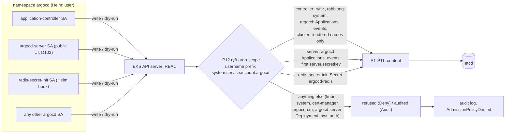

# P12 `ryft-argo-scope`: where Argo CD may write (design, 2026-11-04)

Ticket T12-l (new). Author: platform-architect. Status: **decided 2026-11-04** for the points the
lead settled (identity by username prefix; no Argo CD identity writes an AppProject; the one-time
first `server.secretkey` exemption; its own release after #47; Warn+Audit in Phase 1, Deny at Step B).
T12-l1 built the chart (0.3.0) and the CEL canaries; T12-l2 (kind) and T12-l3 (alerts) follow. Where
the build differs from the sketch below: the match rule is `resources: ["*/*"]` alone (the API
server does not take `"*/*"` next to another entry, and it already matches the main resources),
a Namespace is cluster-scoped whatever `request.namespace` holds (the API server fills it with the
name on UPDATE and DELETE), and the username is read through `has()` in the matchCondition. It amends
`design.md` (P1–P11, D120, D151, D152) and does not replace it.

**Read for this note:**
- `design.md` (revision 3 plus the D151 notes);
- D120, D151 and D152;
- the chart `admission-policy` 0.2.3 (p01–p11, `_helpers.tpl`, `values.yaml`), `admission-values.yaml`,
  `admission.tf` and `tests/admission.tftest.hcl`;
- `argocd.tf` on `origin/infra/argocd-rbac` (#47: `argocd_controller_rules`, `argocd_server_rules`)
  and #47's OPERATIONS section "What Argo CD may no longer do";
- the argo-cd chart 10.10.5, rendered locally with its defaults: the namespaced Roles in `argocd` and
  the `redis-secret-init` hook;
- the CEL harness (`admission-celtest`), the kind runner (`scripts/admission_e2e.sh`,
  `scripts/lib/admission_{lib,ci,full}.sh`) and the fixtures;
- `kubectl kustomize` of every path in `deploy/argocd/apps`, run locally (no cluster).

## The finding, restated with what the render and the chart show

#47 narrows the controller's ClusterRole. The role still gives create, update, patch and delete on
ConfigMaps, Services, ServiceAccounts, Deployments, Jobs, HPAs, Ingresses, NetworkPolicies, PDBs,
the Traefik, cert-manager, VSO and `rabbitmq.com` kinds, and RBAC kinds, **in every namespace**.
No policy matches Argo CD's writes outside `ryft-*` and `rabbitmq-system`:
- P2 matches only R and OPS;
- P3, P5 and P9 match only R;
- P7 matches only `argoproj.io` and Secrets in `argocd`;
- P1 and P6 match only their own kinds.

Two routes are worse than the ones in the review, and neither needs a Pod:

1. **`kube-system/aws-auth`.** The chart's own P6 comment notes that the cluster runs in
   authentication mode `API_AND_CONFIG_MAP` (`values.yaml`, `clusterRoleWrites`). Under that mode a
   stolen controller token can create or patch `kube-system/aws-auth` (ConfigMap write,
   cluster-wide) and map an IAM principal of the attacker's to `system:masters`. That is cluster-admin,
   and cluster-admin deletes the bindings (claim a: bindings are exempt from admission).
2. **The namespaced Roles in `argocd`.** These stay the chart's. #47 says so in OPERATIONS: "Secrets
   and ConfigMaps there are Argo CD's own state". argo-cd 10.10.5 hard-codes them (no values knob)
   and gives:
   - **`argocd-server`:** create, update, patch and delete on `secrets` and `configmaps` in `argocd`,
     and on `applications`, `applicationsets` and `appprojects`;
   - **the controller:** the same on `applications`, `applicationsets` and `appprojects`.

   So a leaked **server** token can do all of this today, and #47 doesn't change it:
   - rewrite `argocd-secret` (`admin.password`, `server.secretkey`);
   - rewrite `argocd-cm` (`users.anonymous.enabled`);
   - rewrite `argocd-rbac-cm` (`policy.default: role:admin`).

   The server is the public component (D103). P7 refuses only Secrets labelled `secret-type`.

Also confirmed:
- **The cert-manager route.** A Deployment in `cert-manager` runs as SA `cert-manager`, which reads
  Secrets cluster-wide and has Route 53 through Pod Identity. Nothing refuses that Deployment today.
- **The `kube-system` route.** A Deployment in `kube-system` can run as a controller-manager SA. For
  example, `generic-garbage-collector` may delete anything, bindings included. Nothing refuses it
  today either.
- **Patches of `argocd-cm` or `argocd-rbac-cm`, or of the `argocd-server` Deployment's image, by the
  controller.** These are allowed by the ClusterRole's configmaps and deployments rules, because
  `argocd` is a namespace like any other.

**Not a regression.** The chart's default `*` allowed all of this. But two texts on the #47 branch
promise that Argo CD cannot switch off or bypass the admission layer:
- `argocd.tf`: "Argo CD cannot switch off or bypass the admission layer";
- OPERATIONS: "a compromised Argo CD … cannot switch off the admission layer".

**That promise is false until P12 is in Deny.** Route 1 alone shows it. #47 must not merge with
those sentences unchanged (ticket T12-l4).

**Aside (not P12).** The branch's controller rules still lack D151's
`{ apiGroups = ["argoproj.io"], resources = ["applications"], verbs = ["get", "list", "watch"] }`. Only
`argocd_server_rules` has an `argoproj.io` rule. Claim i says the app-of-apps waits for ever without it.

## What Argo CD legitimately writes (from the render, 2026-11-04)

The kind run calls this "218 objects". It is the 10 Applications plus:

| App (project) | Objects | Namespaces | Cluster-scoped |
| --- | --- | --- | --- |
| `ryft-platform` (`ryft`) | 55 | `ryft-{api,ingest,migrate,notify,scoring,smoke,web}` | Namespace `ryft-web` |
| `broker-rabbitmq` (`ryft`) | 78 | `ryft-rabbitmq`, plus Certificates in `ryft-{api,ingest,notify,scoring}` | none |
| `rabbitmq-operators` (`ryft-operators`) | 46 | `rabbitmq-system`, plus the 2 Roles and 2 RoleBindings of T12-g in `ryft-rabbitmq` | Namespace `rabbitmq-system`; 14 CRDs `*.rabbitmq.com`; ClusterRoles `messaging-topology-metrics-auth-role`, `messaging-topology-metrics-reader` and `rabbitmq-cluster-service-binding-role`; ClusterRoleBinding `messaging-topology-metrics-auth-rolebinding`; the four webhook configurations of `operators.webhookConfigurations` |
| `vault-{api,ingest,migrate,notify,rabbitmq,scoring,smoke}` (`ryft`) | 24 | their `ryft-<x>` | none |
| `ryft-root` (`ryft-root`) | 10 Applications | `argocd` | none |
| (Terraform under B2, written as admin) | `project.yaml` (4) and `root.yaml` (1) | `argocd` | none |

Totals: 55 + 78 + 46 + 24 + 10 Applications are the 213 objects dry-run as the controller, and the
projects and the root are the 5 dry-run as admin. That makes 218.

**Nothing in `kube-system`, `cert-manager`, `external-dns`, `vault-secrets-operator-system`,
`monitoring`, `amazon-cloudwatch` or `default`.**
- `deploy/k8s/overlays/vault-namespaces/monitoring` is applied by the user (`make monitoring-apply`)
  and has no Argo app.
- The import namespace among the generated vault namespaces has no Argo app either. It is inside
  `ryft-`, so P12 wouldn't refuse one.

Argo CD's own install (Deployments, `argocd-cm`, `argocd-rbac-cm`, `argocd-secret`, NetworkPolicies,
Middlewares) is `helm_release.argocd`, written by the user's identity. **Argo CD does not manage
itself.** It writes only Application objects in `argocd`.

Beyond the render, the components write at runtime (to be confirmed by claim n):

| Writer | Writes | Why |
| --- | --- | --- |
| controller | Application status, operation and finalizers in `argocd` | sync and refresh; P7's carve-out |
| controller | Events in `argocd` | Application events (namespaced Role) |
| controller | `selfsubjectaccessreviews` (CREATE, cluster-scoped) | `resource.respectRBAC: strict` asks per resource type. **Not a write admission sees** (claim o, disproved by the kind run): access reviews never reach validating admission, so no rule lists them |
| controller | hook Jobs in `ryft-migrate` and `ryft-smoke`: create, the hook finalizer UPDATE, delete (`BeforeHookCreation`) | PreSync and PostSync |
| server | Applications in `argocd` (operation, refresh annotation, spec through the UI) and Events there | the UI and CLI; P7 and P10 judge the content |
| server | `argocd-secret` once, on first start, when `server.secretkey` is absent | `InitializeSettings` (claim p). Never in steady state: the admin password and its mtime are Terraform's |
| `argocd-redis-secret-init` | CREATE Secret `argocd-redis`, on chart install only | the argo-cd chart's `pre-install,pre-upgrade` Helm hook. It only reads when the Secret exists |
| repo-server, applicationset-controller (0 replicas) | nothing | no write rules, or not running |

The controller's `argocd-app-controller-shard-cm` exists only with more than one replica and dynamic
distribution. We run one replica, so P12 doesn't allow it. If claim n shows it, the chart needs a
change first.

## Constraints

- One operator; three t3.large nodes.
  - VAP has no pods and no webhook.
  - CEL cost is O(1) per request, except one bounded walk over `argocd-secret`'s keys.
- One owner: the chart (Terraform, the user's apply). Argo CD can't change P12. A blocked Argo CD
  therefore never stands between the user and the fix.
- Value-free messages (D120); no new technology; additive (one policy, one binding, one key).
- The harness and kind impersonate identities (`kca --as <user> --as-group ryft-ci:fixtures`).
  Whatever P12 matches on must survive impersonation.

## Options

| | A. One identity-scoped policy (P12) | B. Widen P1–P11's matchConditions | C. RBAC: Argo writes through RoleBindings per namespace |
| --- | --- | --- | --- |
| What | one VAP that matches every write by an `argocd` service account and admits only the allowlist | each policy also matches Argo's writes outside R | the controller's ClusterRole becomes read-only; one ClusterRole of writes, bound per namespace by RoleBindings |
| Covers ConfigMaps, Services, SAs, HPAs, Jobs outside R | yes | no (no policy owns those kinds) | yes |
| Covers the server's namespaced Role in `argocd` | yes | partly (P7 for Secrets) | no (the chart hard-codes that Role) |
| Owners | the chart | the chart | the RoleBindings need namespaces that exist first: infra/vault for `ryft-<svc>`, and for `ryft-web` and `rabbitmq-system` (which Argo itself creates, D107) a new Terraform owner. Two owners, and D107 changes |
| Testable in today's harness | yes | yes | only the RBAC check, plus kind |
| Cost of a new namespace | values list (prefix `ryft-`: none) | none | a RoleBinding in Terraform per namespace |

**Choice: A.** B leaves the whole finding open for the kinds no policy owns. C is the stronger layer,
but it moves namespace ownership and still can't touch the chart's server Role. C stays a possible
later hardening (see "What P12 does not cover"). It doesn't block A.

## The rule set of P12

**Match.**
- `resourceRules`: groups `*`, versions `*`, resources `*` and `*/*`, scope `*`, operations CREATE,
  UPDATE, DELETE and CONNECT.
- One matchCondition: `request.userInfo.username.startsWith('system:serviceaccount:argocd:')`. The
  namespace comes from `argocd.namespace`, and the trailing colon keeps out a namespace such as
  `argocd-x`.
- No `finalizerRemoval` carve-out. This deviates from "common to every policy", and on purpose: P12
  judges where the requester writes, not what. A finalizer removal outside the scope is an
  out-of-scope write. Inside the scope it passes anyway.

**Identity (decision 1).**
- **Matched by the username prefix, not by an explicit list.** Every service account in `argocd` is
  matched. Each one gets only the capabilities in the table below, and an unknown one (a future
  commit-server or notifications controller) gets nothing.
- **Why the username:**
  - it is what P1, P6, P7 and P10 match;
  - it comes from authentication (a bound token, or impersonation, which only the cluster admin may
    use);
  - it is the same under impersonation, so the fixtures test the real thing.
- **Groups (`system:serviceaccounts:argocd`) are not used.** `--as-group` replaces them, so fixtures
  and production would differ.
- **`userInfo.extra` is not used either.** `authentication.kubernetes.io/pod-name` and its siblings
  are copied along with a stolen token, so they add nothing against theft. Impersonation can set
  them, and they would break the harness.
- **`request.options.fieldManager` (server-side apply) is never used.** The client chooses it.
- **Real tokens behave like impersonation.** The full kind mode already shows it: the real
  controller's P6 findings carry `user.username` `system:serviceaccount:argocd:argocd-application-controller`
  (`adm_full_explained`).

**Capabilities**, each a validation, in this order (the API server reports the first that fails):

| # | Rule | Message (value-free) |
| --- | --- | --- |
| 1 | no CONNECT (exec, attach, port-forward, proxy) and no subresource (`status`, `scale`, `eviction`, `ephemeralcontainers`, `token`, …) | `P12: Argo CD writes no subresource and opens no connection to a pod, service or node.` |
| 2 | only the controller and the server write. The one exception is `argocd-redis-secret-init`: CREATE of Secret `argocd-redis` in `argocd` | `P12: of Argo CD's service accounts only the application controller and the server write (the chart's redis-secret-init creates Secret argocd-redis).` |
| 3 | the server: in `argocd` only, `applications.argoproj.io` and `events`, plus the first `server.secretkey` (below) | `P12: argocd-server writes only Applications and events in argocd (and once the first server.secretkey of argocd-secret).` |
| 4 | the controller, namespaced: a namespace starting with `ryft-`, or in `[rabbitmq-system]`, any resource; in `argocd`, only `applications.argoproj.io` and `events` (core and `events.k8s.io`) | `P12: Argo CD's controller writes namespaced objects only in ryft-* and rabbitmq-system, and in argocd only Applications and events.` |
| 5 | the controller, cluster-scoped: only what the apps render (below) | `P12: Argo CD's controller writes cluster-scoped objects only of the kinds and names its apps render, and deletes no Namespace and no CRD.` |

**Cluster-scoped allowlist (rule 5).** Values drive it, and the lists are the ones P1 and P6 already
hold:

| Kind | Names | Operations |
| --- | --- | --- |
| Namespace | `argoScope.namespaceObjects: [ryft-web, rabbitmq-system]` | CREATE, UPDATE |
| CustomResourceDefinition | name ends with `.rabbitmq.com` (the name is `<plural>.<group>`; a new operator CRD needs no chart change) | CREATE, UPDATE |
| ClusterRole, ClusterRoleBinding | a prefix of `operators.clusterRoleNamePrefixes` | CREATE, UPDATE, DELETE (prune) |
| Mutating- and ValidatingWebhookConfiguration | `operators.webhookConfigurations` (4) | CREATE, UPDATE, DELETE |

Everything else cluster-scoped is refused: ClusterIssuers, PriorityClasses, StorageClasses, PVs,
APIServices, CSIDrivers, IngressClasses, RuntimeClasses and the admission policies themselves.
Content stays P1's and P6's. Access reviews are not in the list on purpose: a SelfSubjectAccessReview
does not reach validating admission (claim o, disproved by the kind run), so P12 neither admits nor
refuses it, and the harness has no case for the reviews. (Only the SelfSubjectAccessReview was
observed.)

**The server's first `server.secretkey` (decision 4).** The server may UPDATE Secret
`argocd-secret` in `argocd` only when all of these hold:
- the old object has `data`, without `server.secretkey`;
- the new object adds that key;
- every other key is unchanged, and no key is removed;
- labels and annotations are unchanged.

It can't be used while a key exists, which is always the case after first start. Without the
exemption, a server started against a recreated `argocd-secret` crash-loops under Deny:
- a DR rebuild where the chart is already in Deny;
- a `-replace` of the argocd release.

**Not in scope of P12.** P12 doesn't judge the content of what it admits:
- Application spec and operation are P7's and P10's;
- Namespaces are P1's;
- RBAC, CRDs and webhooks are P6's;
- workloads are P2–P5, P9 and P11.

`ryft-` is a prefix, as R is everywhere else. Only `infra/vault` (the user) and Argo creates `ryft-*`
namespaces, and Argo creates only the two names (rule 5, P1).

**AppProjects (decision 3).** No Argo CD identity writes an AppProject:
- B2 makes them Terraform's;
- neither the controller nor the server writes AppProject status in our setup (no project tokens);
- both chart Roles allow it, so P12 is the only stop.

If claim n shows a controller status write, the fallback is the controller's UPDATE with an
unchanged `spec`, the same shape as P7's carve-out.

### Template sketch (for the infra engineer; names may change)

```yaml
{{- $prefix := printf "system:serviceaccount:%s:" .Values.argocd.namespace -}}
spec:
  failurePolicy: Fail
  matchConstraints:
    resourceRules:
      - apiGroups: ["*"]
        apiVersions: ["*"]
        operations: ["CREATE", "UPDATE", "DELETE", "CONNECT"]
        resources: ["*", "*/*"]
        scope: "*"
  matchConditions:
    - name: requester-is-an-argocd-service-account
      expression: request.userInfo.username.startsWith({{ $prefix | toJson }})
  variables:
    # Optional request fields are omitted when empty (P1 learned it): every one through has().
    - name: ns
      expression: "has(request.namespace) ? request.namespace : ''"
    - name: sub
      expression: "has(request.subResource) ? request.subResource : ''"
    - name: grp
      expression: "has(request.resource.group) ? request.resource.group : ''"
    - name: res
      expression: request.resource.resource
    - name: name
      expression: |-
        has(request.name) && request.name != '' ? request.name :
        (request.operation == 'CREATE' && has(object.metadata.name) ? object.metadata.name : '')
    - name: isCtl
      expression: request.userInfo.username == {{ include "admission.user.argoController" . | toJson }}
    - name: isSrv
      expression: request.userInfo.username == {{ include "admission.user.argoServer" . | toJson }}
    - name: isApp
      expression: variables.grp == 'argoproj.io' && variables.res == 'applications'
    - name: isEvent
      expression: variables.res == 'events' && variables.grp in ['', 'events.k8s.io']
    - name: inScope
      expression: |-
        {{ .Values.argoScope.namespacePrefixes | toJson }}.exists(p, variables.ns.startsWith(p)) ||
        variables.ns in {{ .Values.argoScope.namespaces | toJson }}
    - name: clusterOK
      expression: |-
        variables.ns == '' && (
          (variables.grp == '' && variables.res == 'namespaces' && request.operation != 'DELETE' &&
           variables.name in {{ .Values.argoScope.namespaceObjects | toJson }}) ||
          (variables.grp == 'apiextensions.k8s.io' && variables.res == 'customresourcedefinitions' &&
           request.operation != 'DELETE' &&
           {{ .Values.argoScope.crdGroups | toJson }}.exists(g, variables.name.endsWith('.' + g))) ||
          (variables.grp == 'rbac.authorization.k8s.io' && variables.res in ['clusterroles', 'clusterrolebindings'] &&
           {{ .Values.operators.clusterRoleNamePrefixes | toJson }}.exists(p, variables.name.startsWith(p))) ||
          (variables.grp == 'admissionregistration.k8s.io' &&
           variables.res in ['mutatingwebhookconfigurations', 'validatingwebhookconfigurations'] &&
           variables.name in {{ .Values.operators.webhookConfigurations | toJson }}))
    - name: serverKeyInit   # the first server.secretkey, never a change of one
      expression: |-
        variables.isSrv && request.operation == 'UPDATE' && variables.ns == {{ .Values.argocd.namespace | toJson }} &&
        variables.grp == '' && variables.res == 'secrets' && variables.name == {{ .Values.argoScope.serverSecret | toJson }} &&
        has(oldObject.data) && !({{ .Values.argoScope.serverInitKey | toJson }} in oldObject.data) &&
        has(object.data) && {{ .Values.argoScope.serverInitKey | toJson }} in object.data &&
        oldObject.data.all(k, k in object.data && object.data[k] == oldObject.data[k]) &&
        object.data.all(k, k in oldObject.data || k == {{ .Values.argoScope.serverInitKey | toJson }}) &&
        (has(object.metadata.labels) ? object.metadata.labels : {}) == (has(oldObject.metadata.labels) ? oldObject.metadata.labels : {}) &&
        (has(object.metadata.annotations) ? object.metadata.annotations : {}) == (has(oldObject.metadata.annotations) ? oldObject.metadata.annotations : {})
  validations:   # rules 1-5 of the table, in that order
```

**Values (chart `values.yaml`, new block; production overrides nothing):**

```yaml
argoScope:
  namespacePrefixes: [ryft-]
  namespaces: [rabbitmq-system]
  namespaceObjects: [ryft-web, rabbitmq-system]   # P1 reads this list too (today a literal in p01)
  crdGroups: [rabbitmq.com]
  serverSecret: argocd-secret
  serverInitKey: server.secretkey
  redisSecretInit: { serviceAccount: argocd-redis-secret-init, secret: argocd-redis }
actions:
  argo-scope: audit   # P12, step B (decision 2)
```

**Type checking and cost.**
- **Type checking.** With `*` resources the API server skips it, so `status.typeChecking` stays
  empty, which the job checks. That empty field doesn't mean P12 was checked, though: the harness is
  what proves it.
- **Cost.** Every list is a literal of at most 4 items. The only walk is over `argocd-secret`'s
  keys, for one requester and one name.
- **Load.** P12 is evaluated on every Argo write, the server-side diff's dry-runs included (about 218
  per full refresh). That is negligible API-server CPU.
- **Metrics.** No metric moves until something is found (claim e).



## Interactions

**Self-management (D94, D95).**
- `ryft-root` syncs only Applications into `argocd`, which rule 4 admits.
- `root.yaml` and the projects are Terraform's (B2), written by the user's identity, which P12
  doesn't match.
- Argo CD's own Deployments and ConfigMaps are `helm_release.argocd`.
- If the user ever wants Argo CD to manage Argo CD, P12 forbids it on purpose; that would be a new
  D-entry.

**Hooks.**
- The PreSync migrate and PostSync smoke Jobs are the controller's writes in `ryft-migrate` and
  `ryft-smoke`: create, the hook finalizer and `BeforeHookCreation` delete. All of that is in scope.
- Their Pods are written by `kube-system:job-controller`, which P12 doesn't match. P2 `pods` judges
  them.
- Helm hooks of the argo-cd chart run as the user (Terraform). Their Pod writes as
  `argocd-redis-secret-init` (rule 2).

**Namespaces.**
- `ryft-web` (D107) and `rabbitmq-system` are admitted by name; no DELETE.
- Removing either from git fails the sync instead of deleting it, as with P1.
- `CreateNamespace=true` on a new app is refused until the chart lists the name. That is D120's "a new
  Argo-made namespace needs the chart first".

**Server-side apply and the server-side diff.**
- An apply is CREATE or UPDATE. The field manager is ignored.
- Dry-runs pass through P12 exactly like real writes (claim d). So a P12 refusal of a legitimate
  object turns the whole app `OutOfSync` with a comparison error (claim f, not tried).

**Prune.**
- DELETEs inside the scope pass.
- An object that left the scope can't be pruned by Argo. It stays as an orphan, which is correct:
  Argo never wrote it.

**Overlap with P1, P6 and P7.**
- P1's Argo rule and parts of P6 and P7 become a second line under P12.
- They stay as they are: they can sit at other steps, and they judge content.
- P1's hard-coded `['ryft-web', 'rabbitmq-system']` moves to `argoScope.namespaceObjects`. The render
  doesn't change; the harness golden for P1 stays.

## Failure modes

| Failure | Blast radius under Deny | Seen as | Recovery |
| --- | --- | --- | --- |
| a legitimate controller write missing from the allowlist (an upgrade's new write: a Lease, a shard ConfigMap, a new kind or namespace) | every app whose sync needs it. If the write is part of controller startup, **all syncing stops** | `AdmissionPolicyDenied` (warning), `ArgoAppOutOfSync`, comparison or sync errors naming `P12:`, controller logs | user break-glass: `kubectl patch validatingadmissionpolicybinding ryft-argo-scope --type=merge -p '{"spec":{"validationActions":["Warn","Audit"]}}'` (always possible, claim a). Then a chart PR (values) and the user's apply. Terraform restores the binding (`-replace=…[0]` if it was patched). **Never through Argo**: Argo can't change the chart, and a blocked Argo doesn't block the fix |
| a server write missing (a first start without the exemption, a new Argo CD version that writes a ConfigMap) | the UI and CLI; the server crash-loops if the write is at init | `AdmissionPolicyDenied`, argocd-server not Ready, the `argocd` health of the UI | as above |
| a CEL error (an unguarded absent request field on a cluster-scoped or DELETE request) | everything P12 matches: every Argo write | `AdmissionPolicyError` (critical when Deny) | break-glass. The harness pins cluster-scoped, DELETE and CONNECT cases so Audit and kind catch it first |
| `redis-secret-init` refused (prefix match, a hook that changed) | `helm_release.argocd` install or upgrade fails at the pre-upgrade hook: a Terraform error | `terraform apply` error, `AdmissionPolicyDenied` | `-var='admission_break_glass=true'` on the same apply, or the binding patch; then the chart |
| the binding deleted, patched or left in break-glass | P12 off: the finding is open again | `AdmissionBindingMissing` (now 13), `AdmissionBindingDrift`, `AdmissionBreakGlass`, the `check` block | `terraform apply -target=helm_release.admission_policy -replace='helm_release.admission_policy[0]'` |
| an attack (a stolen token) | refused | `AdmissionPolicyDenied` for `ryft-argo-scope` with a user from `argocd`; the CloudWatch query in `design.md` §5 by `user.username` | rotate: delete the SA's token Secrets if any (tokens are bound and projected, so restart the pod to rotate), review `argocd-secret` and the audit log, `terraform apply -replace=random_password.argocd_admin` if the server was involved |

Under Deny, every P12 finding means one of two things: an attack, or a missing exemption. The
legitimate set is small and known, so Audit's signal is clear. Any `ryft-argo-scope` line in Phase 1
is a finding to explain.

## Testing

### CEL harness (`make admission-celtest`, test-engineer)

1. **Kinds.**
   - `kinds` in `main.go` gains every kind the renders hold that is "unmodelled" today, because P12
     matches them all: HPA, PDB, Certificate, Issuer, and the `rabbitmq.com` kinds Exchange,
     Binding, Permission, Policy, TopicPermission, User and Vhost.
   - It also gains what the negatives need: Event, ClusterIssuer, PriorityClass, StorageClass,
     PersistentVolume, APIService, Lease, and the subresources
     `deployments/scale`, `pods/eviction` and `serviceaccounts/token`.
   - `ruleMatches` already handles `*` and `*/*`; `Req.Sub` exists, and CONNECT needs a Req with no
     object.
2. **Positive run.**
   - `runPositive` evaluates every render as the controller. That is P12's "a legitimate sync
     passes" offline, with no new code.
   - It changes in one place: the documents of `project.yaml` and `root.yaml` are evaluated as admin
     (they are Terraform's, B2), as the kind run already does (`argocd-hand`). Without that, P12 flags
     the AppProjects.
   - The newly modelled kinds add about **136 positive cases**: 68 documents, create and update.
3. **New cases** (`cases_argo_scope.go`): about **60 named cases**. Each rule gets a refused case and
   an admitted twin:
   - **Controller:**
     - in `cert-manager`: a Deployment with `serviceAccountName: cert-manager` and a Job;
     - in `kube-system`: ConfigMap `aws-auth`, a Service, a Deployment with SA
       `generic-garbage-collector`, a ServiceAccount;
     - in `argocd`: ConfigMap `argocd-cm`, the `argocd-server` Deployment, a NetworkPolicy, a Secret;
     - in `default`: a ConfigMap;
     - an Application outside `argocd`;
     - an AppProject, an ApplicationSet;
     - a ClusterRole or ClusterRoleBinding without the prefix;
     - a CRD of another group;
     - a ClusterIssuer, a PriorityClass, a StorageClass, a PV, an APIService;
     - another Namespace, and Namespace DELETE, CRD DELETE;
     - the subresources `deployments/scale` in `ryft-api` and `serviceaccounts/token`;
     - CONNECT `pods/exec` and `pods/portforward` in `ryft-api`;
     - admitted: every in-scope kind, Application status and operation in `argocd`, Events in
       `argocd`, DELETE of a hook Job, DELETE of a prefixed ClusterRole.
   - **Server:**
     - refused: a Secret or ConfigMap in `argocd` (`argocd-rbac-cm`, unlabelled Secret), an
       AppProject, the `argocd-server` Deployment, an Event in `kube-system`;
     - `argocd-secret`: the first `server.secretkey` admitted; a changed `admin.password` refused;
       the key added together with a changed `admin.password` refused; a replaced `server.secretkey`
       refused; a removed key refused;
     - admitted: an Application create or update.
   - **`argocd-redis-secret-init`:** Secret `argocd-redis` create admitted; another Secret, and an
     UPDATE of `argocd-redis`, refused.
   - **`argocd-repo-server`:** any write refused.
   - **Identity:** the admin, and `system:serviceaccount:argocd-x:…`, writing in `cert-manager` are
     not matched. `system:serviceaccount:kube-system:…` is not matched.
   - **Cost:** `argocd-secret` with 1,000 keys under the API server's budget.
4. **Collisions.**
   - Existing cases whose requester is Argo and whose object is out of P12's scope now also expect
     P12:
     - `P1 argo creates another namespace`;
     - `P1 the application controller deletes a Namespace`;
     - `P6 a CRD of another group`;
     - `P7 an ApplicationSet` / `P7 appset`;
     - claim b's webhook, and every P6 ClusterRole fixture, if its name lacks the prefix.
   - The test-engineer audits each one. **`messages.golden` gains about 6 distinct P12 refusals.**
5. **Emit.**
   - The generator writes one CREATE fixture per distinct refusal that **a single binding** refuses.
   - The P12-only negatives (cert-manager, `kube-system`, `argocd-cm` create, ClusterIssuer) give
     about **5–6 new files** in `fixtures/generated`.
   - Some existing generated fixtures may now be refused by two bindings. If so, the generator picks
     the next single-binding case or drops one. `adm_fixture_coverage` reports it.

### Kind, CI mode (`admission` job; about 1 minute more)

- **Counts.** The chart renders **12 policies and 13 bindings**. `adm_chart_install` counts them from
  the render, so only the docs' "11 and 12" changes.
- **Dry-run.** `adm_dryrun_apps` dry-runs all **218 objects** in Audit and in Deny:
  - 213 as `argocd-application-controller`, 5 as admin;
  - required: **0 refused and 0 P12 warnings in both variants**;
  - no explained shape is added for P12.
- **Multi-binding refusals.**
  - `adm_fixtures` must accept a fixture refused by more than one binding: `# refused-by:` may name
    several, and in Deny the refusal must come from one of them with its message. When two bindings
    deny, the API server's message may name either one, and the harness doesn't pin which.
  - In Audit, every listed binding must warn.
- **Baseline** (`fixtures/baseline/objects.yaml`) gains stand-ins, so CI mode can patch them without
  Argo CD running:
  - in `argocd`: ConfigMaps `argocd-cm` and `argocd-rbac-cm`, Secret `argocd-secret` without
    `server.secretkey`, and a Deployment `argocd-server`;
  - kind's own `kube-system/coredns` serves as the DELETE target.
- **Manual fixtures** (`fixtures/manual/argo-scope.yaml`), about **14** UPDATE, DELETE, CONNECT and
  subresource fixtures:
  - patch `argocd-cm` `users.anonymous.enabled` as the controller (refused);
  - patch `argocd-rbac-cm` `policy.default` as the server (refused);
  - patch `argocd-secret` `admin.password` as the server (refused);
  - add `server.secretkey` as the server (admitted), then change it (refused);
  - patch the `argocd-server` image as the controller (refused);
  - delete `kube-system/coredns` (refused) and Namespace `ryft-web` (refused, P1 and P12) as the
    controller;
  - delete a hook Job (admitted);
  - `deployments/scale` in `ryft-api` (refused);
  - exec into the claim-c Pod as the controller (refused; the fixture group makes RBAC pass, so the
    admission decision is P12's).
- **The canary the review asks for:**
  - **refused:** a Deployment in `cert-manager` with `serviceAccountName: cert-manager`, created as
    the controller. It is generated, refused by `ryft-argo-scope` only, and the API server must agree
    in Deny;
  - **admitted:** the same Deployment as admin, because P12 doesn't match.

### Kind, full mode (`make admission-e2e`; about 5 minutes more)

1. **Audit.** The first sync of every app, with hooks: `adm_full_findings "full-findings-audit"` must
   show **no `ryft-argo-scope` line**. That is the empirical half of claim n.
2. **Deny** (P12 never held, because the tree needs nothing for it):
   - the existing manual syncs, terminate-op, the broker restart and the findings: no P12 line;
   - then three new steps, each followed by `adm_full_wait_apps` and the findings check (claims n and
     p):
     - `kubectl -n argocd rollout restart deployment/argocd-server statefulset/argocd-application-controller`,
       run as admin: the components' startup writes under Deny;
     - `helm upgrade` of `argocd` with the same values: the `redis-secret-init` pre-upgrade hook, run
       by the admin's Helm, its Pod writing as the SA;
     - one SSAR (`kubectl auth can-i --as …controller`): claim o, whether validating admission
       sees access reviews. It does not (disproved), so the stage stays as a canary
       (`claim-o-canary`): it fails if P12 ever refuses a review.
3. **Not tried:**
   - a first install of Argo CD with P12 already in Deny. The harness and the manual fixture pin the
     `server.secretkey` path; a fresh-install run would add about 6 minutes and isn't proposed;
   - a node drain (D151);
   - three workers.

### Claims (added to the table in `design.md`)

| # | Claim | Status | Checked in |
| --- | --- | --- | --- |
| n | Argo CD's controller and server write only the allowlist: sync, hooks, terminate-op, manual sync, restart and chart upgrade show no P12 finding | **PASS** (kind run 41982428417, Audit and Deny: no `ryft-argo-scope` line through the first sync, the syncs, hooks, terminate-op and the restart; and none through the chart upgrade, whose rerun is run 41988993599: the hook Job ran as its service account) | kind full (Audit, then Deny), then Phase 1's 7 days in production |
| o | `selfsubjectaccessreviews` reach validating admission (either way P12 admits them) | **DISPROVED** (kind runs 41982428417 and 41988993599): neither the controller's nor argocd-server's review was refused by P12, so admission does not see them (the access-review REST create does not call the validating hook). Rule 5's entry for them was dead code and is removed (with its 4 harness cases, 983 -> 979); `claim-o-canary` fails the full mode if a Kubernetes version ever starts refusing them | kind audit log |
| p | argocd-server writes `argocd-secret` only when `server.secretkey` is absent; a restart with the key present writes nothing | **PASS** (kind runs 41982428417 and 41988993599: both components rolled out under Deny, `argocd-secret`'s resourceVersion unchanged) | kind full: restart under Deny, no finding; manual fixture |

## Rollout

**Merge order.**
1. **#47 (T12-f)** with T12-l4's honest wording (and D151's `applications` rule). Merge it, then
   Step 0: the user applies it alone and watches one deploy, unchanged.
2. **T12-l (P12)** in its own PR, after #47 is merged. It is chart 0.3.0, with
   `enabled: false` still in `admission-values.yaml`, so it changes nothing in production. CI's
   `admission` job runs against the narrowed RBAC tree, and the full kind run passes on main's tree
   before the PR merges.
3. **Phase 1** starts with P12 in Warn+Audit next to P1–P11: the same apply (`enabled: true`), the
   same 7 days. Checklist additions:
   - **11.** A restart of `argocd-server` and the controller (`kubectl -n argocd rollout restart …`):
     no P12 finding.
   - **12.** An apply of `helm_release.argocd` (a values or chart-version change; any planned change
     counts, no `-replace` needed): no P12 finding.
   - **The daily query** in `design.md` §5, filtered on `ryft-argo-scope`: zero lines is the exit
     condition.
4. **Deny at Step B** (decision 2).

**Not in the same release as #47.** #47 is a change to `helm_release.argocd`, and Step 0 requires that
its plan touch nothing else. P12 is a chart change behind `enabled: false`. Bundling them would:
- either break Step 0's "only `helm_release.argocd` changes";
- or ship P12 untested against the narrowed roles.

Shipping P12 first doesn't help either: it does nothing while the chart is disabled.

**Step placement (decision 2).** P12 blocks only Argo writes, so it can stop deploys, never running
Pods: Step B's class. Its failure is wider than B's (every app, not only `ryft-platform`), but its
Audit signal is clearer than any other policy's. Why not Step D: the aws-auth route stays open for
the whole Phase 2 until D, and P12 guards the premise every other step rests on (that Argo CD can't
turn the layer off). Step A is defined as "small apps only", and P12 isn't one. If the 7 days show
zero P12 lines, the user may move P12 to A; the chart allows any order.

**DR order.** `helm_release.admission_policy` gets `depends_on = [helm_release.argocd]`, so on a
fresh cluster Argo CD has started, and written its `server.secretkey`, before any policy exists. The
exemption covers a later recreate.

**Rollback.**
- A step back is a PR (`argo-scope: audit`) and the user's apply. The fast path is the binding patch.
- Removing P12 is a forward change. `scripts/check_chart_bump.sh` requires the version to go up, so a
  revert ships as 0.3.1 without the template, never as 0.2.3 again. It also takes the `argo-scope` key
  out of `admission-values.yaml`, the generated recording rules and the binding count (back to 12)
  in the same PR.
- No data is involved, and there is no down-migration.

**Chart version.**
- 0.2.3 to **0.3.0**: a new policy and a new values block. The bump script only needs "higher";
  minor marks a new policy.
- `Chart.yaml`'s description becomes "P1-P12".
- The `$known` list in `_helpers.tpl` gains `argo-scope`. The chart's `admission.validate` already
  fails a render without the key.

## What P12 does not cover

1. **Reads.** Admission sees writes only.
   - Both chart Roles in `argocd` read Secrets there. A stolen controller or server token reads
     `server.secretkey` and can mint an Argo CD session for `admin` on the public UI.
   - That session acts as argocd-server, so P7, P10 and P12 bound it: Applications only, pinned
     spec, no foreign revision.
   - The controller also reads ConfigMaps and Services cluster-wide (`aws-auth`'s content included).
   - Closing these reads needs RBAC (option C, or a fork of the chart's Roles), not admission.
2. **Writes inside the scope.** In `ryft-*` and `rabbitmq-system` a stolen controller token still
   writes, and deletes, whatever RBAC allows.
   - P2–P6, P9 and P11 judge content.
   - Nothing judges a Service selector, a ConfigMap value (beyond P5's auth keys), an HPA, a PDB, or
     a cert-manager Certificate or Issuer.
   - Self-heal reverts drift on git-tracked objects; new objects it doesn't touch.
   - A namespaced Issuer can't use cert-manager's Pod Identity for Route 53: `--issuer-ambient-credentials`
     is off, the chart default, and `addons.tf` doesn't set it. Keep it that way.
3. **The controller's choice of revision.** P10's revision rule binds argocd-server only (D151).
   - The controller writes `status.sync.revision` and its own operations, so a stolen controller
     token can start a sync of any commit the repository serves. On GitHub that includes fork-PR
     commits by SHA.
   - What such a commit deploys is still held to the scope (P12) and the content rules.
   - Not fixable at admission: the controller is the one that resolves revisions. Accepted, and said
     plainly.
4. **The admission objects themselves.** They are exempt from admission (claim a), so RBAC holds
   them (#47).
   - #47's escalate/bind limit is closed by P6 in Deny, not by P12.
   - P12 removes the *indirect* routes: `aws-auth`, a Pod running as a controller-manager or
     cert-manager SA.
5. **Every other identity.** Each has its own policy, or none:
   - the operators: P8;
   - VSO: P4 and P5;
   - cert-manager, Traefik, ExternalDNS, the nodes, the kube-controller-manager: none;
   - the user and Terraform: break-glass.
6. **A merged malicious commit.** Argo applies it, within the scope and the content rules. Review is
   the control (D95).

**Covered, for the record:**
- a Deployment, Job, ConfigMap, Service or ServiceAccount from any Argo identity in `cert-manager`,
  `kube-system` or any other namespace outside the scope;
- `aws-auth`;
- the `argocd-server` Deployment's image or service account;
- `argocd-cm`, `argocd-rbac-cm` and `argocd-secret`, from the controller *and* the server (the
  chart's namespaced Roles included);
- AppProjects and ApplicationSets from any Argo identity;
- every subresource and CONNECT;
- every cluster-scoped kind or name the apps don't render.

## Tickets

| Ticket | Owner | What | Size | Order |
| --- | --- | --- | --- | --- |
| T12-l4 | infra-engineer (#47's author) | **On #47 before it merges:**<br>- `argocd.tf`'s comment and OPERATIONS "What Argo CD may no longer do": replace "cannot switch off the admission layer" with the text under Docs below;<br>- add D151's controller `applications` get/list/watch rule;<br>- add a row for the chart's namespaced Roles in `argocd` (unchanged, held by P12) | XS | 1 |
| T12-l1 | infra-engineer | **Chart 0.3.0:**<br>- `templates/p12-argo-scope.yaml`, the `argoScope` values, `$known`, and P1 reading `argoScope.namespaceObjects`;<br>- `admission-values.yaml` (`argo-scope: audit`, the step comment);<br>- `admission.tf` (`depends_on = [helm_release.argocd]`);<br>- `tests/admission.tftest.hcl` (13 keys, a P12 binding in the drift mocks);<br>- design.md §2 (P12), the claims n–p, the step table | M (1 day) | 2, after #47 is merged |
| T12-l2 | test-engineer | **Harness and kind:**<br>- the kinds, admin for the projects and root, `cases_argo_scope.go` (about 60), the collisions, golden, emitted fixtures (about 6);<br>- `adm_fixtures` with several `refused-by`, the baseline stand-ins, `fixtures/manual/argo-scope.yaml` (about 14);<br>- full mode: restart, `helm upgrade`, SSAR, findings;<br>- the OPERATIONS kind-run text (12 and 13) | L (1.5–2 days) | 2, same PR as T12-l1 (the job needs both) |
| T12-l3 | sre | `AdmissionBindingMissing` `< 12` to `< 13` and its summary, the promtool test, `scripts/admission_intended.sh` regenerated (`make alerts-check`), OBSERVABILITY | S | 2, same PR (`admission_intended.sh --check` fails otherwise) |
| T12-l5 | the user | the full kind run on the PR's tree (Actions → `admission-e2e`, `ref` = the branch); review; Phase 1 (unchanged commands, `design.md` §5) with checklist items 11 and 12; Step B with P12 | – | 3, 4 |

**Risks.**
- **Fixture collisions.** P12 sorts before `ryft-argocd*` and `ryft-namespaces`, and the API server
  may report its message instead of the expected one. That is why `adm_fixtures` must accept several
  bindings.
- **A write that kind doesn't show.** One example would be an EKS-only behaviour. Phase 1's 7 days in
  Audit are the guard; any P12 line holds the step.
- **argo-cd chart upgrades.** A new component, a Lease or a shard ConfigMap would be refused. The
  existing rule "the kind e2e on every argo-cd chart upgrade" now also covers P12.
- **An absent request field.** An unguarded one would be a CEL error on every Argo write. The
  harness's cluster-scoped, DELETE and CONNECT cases guard against it.

## Docs to update (with the tickets)

**`OPERATIONS.md`, "What Argo CD may no longer do"** (T12-l4). Proposed text:
> Argo CD's ClusterRoles hold no write on the admission policies or bindings, so Argo CD cannot
> change them directly. What it may write elsewhere is held at admission by P12 (`ryft-argo-scope`):
> the controller writes only in `ryft-*` and `rabbitmq-system`, Applications and events in `argocd`,
> and the cluster-scoped names its apps render; argocd-server writes only Applications and events in
> `argocd`. **Until P12 is in Deny, a stolen controller token is as strong as cluster-admin**
> (`kube-system/aws-auth`, or a Pod running as a `kube-system` controller service account). The chart's
> namespaced Roles in `argocd` stay as shipped; P12 refuses their Secret, ConfigMap and AppProject
> writes.

**`OPERATIONS.md` → Admission policies.**
- The P12 row: whom it matches, and what a refusal looks like (`denied request: P12: …` in the sync,
  a comparison error under the server-side diff).
- Checklist items 11 and 12.
- "A new namespace, kind or cluster-scoped name for Argo CD: the chart (`argoScope`) and
  `argocd.tf` first, then the manifests".
- "Adding a service: nothing, inside `ryft-`".
- The break-glass line for `ryft-argo-scope`.
- "12 policies, 13 bindings".
- Admin password rotation stays Terraform's (`-replace=random_password.argocd_admin`); the UI's
  password change and `argocd cert add` / `gpg add` are refused.

**Elsewhere.**
- `ARCHITECTURE.md` "Not covered": the six items above.
- `OBSERVABILITY.md`: 13 bindings.
- `infra/aws/README.md`: P12.
- `STATUS.md`.
- `DECISIONS.md`: the entry below, and a pointer from D120.

## Proposed DECISIONS entry (the lead numbers it)

```markdown
## D<n> — P12: Argo CD's identities write only where its apps render (amends D120)

- **Why (2026-11-04):** the #47 re-review found that the controller's narrowed ClusterRole still
  writes ConfigMaps, Services, ServiceAccounts, Deployments and Jobs in every namespace, and the
  argo-cd chart's namespaced Roles let argocd-server write every Secret and ConfigMap in `argocd`.
  No policy matched those writes outside `ryft-*`, so a stolen token reached cluster-admin
  (`kube-system/aws-auth`; a Pod as a controller-manager or cert-manager service account) or the
  public UI's admin (`argocd-rbac-cm`, `argocd-secret`). D120's "Argo CD cannot switch off the
  admission layer" was not true.
- **Decision:** a twelfth ValidatingAdmissionPolicy, `ryft-argo-scope`, matched by the username
  prefix `system:serviceaccount:argocd:` (impersonation-safe; groups, `extra` and field managers are
  not used). The controller writes namespaced objects only in `ryft-*` and `rabbitmq-system`, in
  `argocd` only Applications and events, cluster-scoped only Namespaces `ryft-web`/`rabbitmq-system`,
  `*.rabbitmq.com` CRDs, the operators' prefixed ClusterRoles and bindings and four webhook
  configurations (access reviews never reach validating admission, claim o); no Namespace or CRD delete. argocd-server writes only
  Applications and events in `argocd`, plus the first `server.secretkey` of `argocd-secret`. The
  chart's redis-secret-init may create Secret `argocd-redis`. Every other `argocd` service account
  writes nothing. No subresource, no CONNECT. Content stays P1–P11's.
- **Owner and rollout:** the admission chart (0.3.0), Terraform, the user's apply; Warn+Audit with
  Phase 1 (two checklist items: a restart of the Argo CD components, an apply of the argocd
  release), Deny at Step B. `admission_policy` depends on the argocd release. Not in #47's release.
- **Testing:** the CEL harness (every render as the controller, the projects and root as admin,
  about 60 cases), the kind job (218 objects dry-run: 0 refused in Audit and Deny; P12-only fixtures,
  among them a `cert-manager` Deployment as the controller), the full run (no P12 finding through
  sync, hooks, restart and chart upgrade).
- **Accepted:** reads (both Argo CD Roles read Secrets in `argocd`); writes inside the scope beyond
  P2–P11's content rules; the controller's choice of revision; the admission objects stay RBAC's.
- **Consequences:** a new Argo-made namespace, a new cluster-scoped kind or name, or an Argo CD
  version that writes something new needs the chart first; the kind e2e on every argo-cd chart
  upgrade covers it. A new service inside `ryft-` needs nothing. Removing P12 is a forward change
  (0.3.1), never a downgrade.
```

## Decisions needed from the user

1. **Identity set.** Recommended: the username prefix `system:serviceaccount:argocd:`, with
   capabilities per service account and nothing for an unknown one. The alternative is an explicit
   list (controller, server, applicationset-controller): it needs no redis-secret-init exception,
   but a future Argo CD component is then unguarded.
2. **The Deny step for P12.** Recommended: **Step B**. The alternatives are A (earliest, if Phase 1
   shows zero P12 lines) and D (last, which leaves the aws-auth route open longest).
3. **AppProjects.** Recommended: no Argo CD identity writes an AppProject (B2 makes them
   Terraform's). The fallback is controller status-only updates, if claim n shows them.
4. **The server's `server.secretkey` exemption.** Recommended: yes (first value only). Without it, a
   recreated `argocd-secret` under Deny needs break-glass.
5. **Release vehicle.** Recommended: P12 in its own PR after #47 is merged and applied (Step 0),
   before Phase 1; not inside #47.
6. **#47's wording.** Recommended: #47 doesn't merge with "cannot switch off the admission layer";
   T12-l4's text instead, together with D151's missing `applications` rule.
7. **Accept the "does not cover" list,** in particular the controller's choice of revision (item 3)
   and reads of `argocd` Secrets (item 1). Option C (RoleBindings per namespace) and a fork of the
   chart's Roles are later, separate decisions.
8. **Optional, independent of P12: EKS authentication mode `API`** (`infra/aws`, yours). It makes
   `aws-auth` inert whatever admission does.
   - Read-only check first: `aws eks describe-cluster --name ryft-prod-euc1 --query cluster.accessConfig`.
   - Then `aws eks list-access-entries --cluster-name ryft-prod-euc1`: the node role must have an
     access entry before `aws-auth` stops counting.
   - The switch is one-way.
