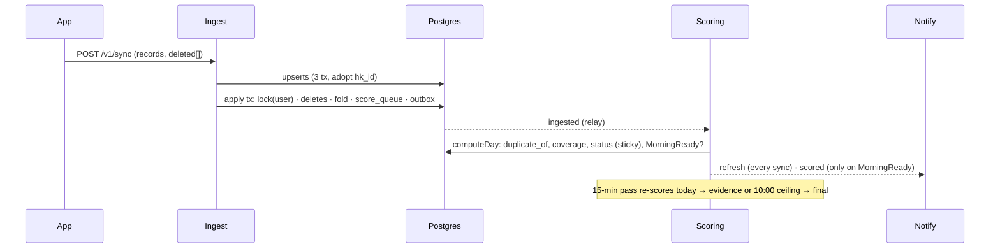

# Design: data quality (deletions, duplicate workouts, night coverage, morning gate)

Brief `CLAUDE_FOLLOWUP_DATA_QUALITY.md`, plan `plan.md` (D-a..D-f). Read against `main` @ `7f0f8db`.
Constraints: three t3.large nodes, one operator, GDPR Art. 9. Postgres is the truth, events only trigger.
Everything is additive, and rolling back means re-pinning images.

## 0. Where the brief does not match the code (fix the brief/plan, not the code)

| # | Brief / plan says | Code says | Consequence |
| --- | --- | --- | --- |
| 1 | `scoring fold-workouts` deletes phone workouts | `0011_train.sql:294-296` restricts scoring's DELETE on `workouts` to `source='ryft-session'` (RLS, Supabase only) | In prod the subcommand would delete **0 rows without an error**, while dry-run still lists 6. Move it to **`ingest fold-workouts`** (D146). |
| 2 | Ingest deletes rows | `0009_service_roles.sql:29`: ingest has SELECT/INSERT/UPDATE only | 0029 grants DELETE on the three raw tables. |
| 3 | Fold key `source_bundle_id`, falling back to `source` | `workouts` has no bundle-id column (`0001_init.sql:54-67`); `UpsertWorkouts` drops it (`store.go:448-456`) | The fold keys on `source` (name). No new column (D146). |
| 4 | RHR floor: "≥ 120 min of sleep HR, else `rhr` null" | RHR is the day's last `resting_hr` **sample** (Apple's or Garmin's own estimate; Garmin stamps it 00:00), falling back to yesterday's (`compute.go:329-332`). It is never derived from sleep HR | The floor gates a value it does not feed. See **U1**. |
| 5 | `night_complete`: last segment ended ≥ 30 min before scoring time | The 15-min timer re-scores today for every active user (`cmd/scoring/main.go:151-161`, `refreshActive` :228-264) | After a 03:00 Garmin sync the 03:30 timer pass would mark the day final and push the half night. The brief's done-criterion fails. See D148. |
| 6 | Primary = "the one with HR samples in its window" | A workout's HR window is by **time**, over every source, de-duplicated (`compute.go:423-431`) | Two overlapping workouts always share one window, so the rule decides nothing. It becomes "HR samples from **its own source**" (D147). |
| 7 | Cross-source rule | No overlap criterion given | Proposed: same activity (or either is `other`) and overlap ≥ 80 % of the shorter one. **U3.** |
| 8 | `ignored.deleted.unknown_id` | The app proposed `ignored.*.unknown_id` (`../app/docs/API_REQUESTS.md:150`); `IgnoredCounts` is per kind (`model.go:157-169`) | **U2**, contract-owner. Recommendation: per kind (`ignored.workouts.unknown_id`), which fits the existing shape. |
| 9 | Plan PR 4 = `internal/notify` | The push trigger is in scoring (`compute.go:548`, `store.go:778` `FirstRecovery`), and notify already sends once per day (`ClaimNotification`, `push.go:160-164`) | The gate is a scoring change and belongs in PR 3. notify only gains the metric. |
| 10 | Risk "user without tz → final" | `users.tz text NOT NULL DEFAULT 'Europe/Berlin'` (`0001_init.sql:7`) | It can't be missing. The real risk is a stale default, which shows as `ceiling` share (D149). |
| 11 | `ProvisionalAllMorning` at 10:30 | A 10:00 ceiling plus the 15-min pass makes "provisional at 10:30" impossible unless scoring is down | The alert measures nothing. It is replaced by the ceiling share (D149). |
| 12 | `ManyUsersStale`: "no samples for 20 h" | `ryft_users_by_last_sync` comes from `devices.last_sync_at` (`store.go:367-387`), and a phone keeps syncing while Garmin is down | It needs a gauge from `user_sources.last_seen` (kind `hr`), which is small and kept by ingest. |
| 13 | Merge | `merge.go:197-203` moves samples by natural key and workouts by `UPDATE user_id` | It needs an `hk_id` guard, and it rules out a self-FK (D147). |
| 14 | Migrations 0029-0031 | A partial index on `samples` scans the whole table. The migrator runs each file in one transaction (`db.go:176-190`), so building it in the same file as `ADD COLUMN` holds ACCESS EXCLUSIVE during the scan | The index goes in its own file (**U4**). That makes four files, **0029-0032**, numbered in merge order. |

## D-a · `hk_id` on samples and sleep segments

**Model:** the natural key stays the record's identity. `hk_id` is a **deletion handle** that the latest upload owns.
HealthKit objects are immutable. A source that "changes" one (Garmin re-writing its resting HR at 00:00) writes the
same natural key under a new UUID and deletes the old one.
- If the server kept the first UUID, the deletion that follows would remove a record Health still has: **data loss**.
- So a record that arrives with `hk_id` *adopts* the matching stored row.

Per record with `hk_id`, in the existing per-kind batch tx (`runBatch`), two statements:
1. `UPDATE samples SET hk_id=$h, value=$v WHERE user_id=$u AND (type,start_at,end_at,source)=(…) AND (hk_id,value) IS
   DISTINCT FROM ($h,$v) AND NOT EXISTS (SELECT 1 FROM samples x WHERE x.user_id=$u AND x.hk_id=$h)`. This adopts the row and
   backfills rows uploaded before the app sent ids, so there are no double rows. `sleep_segments` gets the same statement without `value`.
2. `INSERT … ON CONFLICT DO NOTHING` (**no conflict target**, so a clash on either unique index is a no-op, never a 500).
   Today's sleep upsert is already target-less (`store.go:435-436`).

Records without `hk_id` keep today's statements unchanged (`store.go:420-424`). A renamed source (same `hk_id`, new
`source`) hits the `hk_id` index in step 2 and is dropped as a duplicate. The old row stays, so nothing is counted twice.
The count is inserted rows plus adoptions that changed `value`, and the rest is `duplicate`, as today.
Merge (`merge.go:197-203`) adds `AND NOT EXISTS (… t.hk_id = s.hk_id)` to the samples and sleep moves.

## D-b · Deletions: one "apply" transaction per sync

Upserts stay as they are (three transactions). The existing queue+outbox transaction (`main.go:223-234`) becomes the
**apply** transaction:
```
BEGIN; SELECT pg_advisory_xact_lock(7419004, hashtext($user))  -- one user's raw data: sync apply, fold-workouts
  DELETE FROM samples        WHERE user_id=$u AND hk_id = ANY($ids) RETURNING type, start_at
  DELETE FROM sleep_segments WHERE user_id=$u AND hk_id = ANY($ids) RETURNING end_at
  DELETE FROM workouts       WHERE user_id=$u AND id = ANY($ids) AND source <> 'ryft-session' RETURNING start_at, session_id
  same-source fold (D-c) → more deleted workouts
  queueDays(sync days ∪ days of deleted/folded rows)   -- sorted, as today
  outbox.Insert(ingested{days, reason "sync"})
COMMIT
```
- **Order:** upserts first, then deletions. A record added and deleted in one anchor window ends up deleted, and the
  Garmin pattern (add B, delete A) keeps B. API.md states that deletions apply after the same request's records.
- **Ownership:** every statement is `user_id = token's user`. A wrong user's id and an unknown id produce the same
  `unknown_id` count, so nothing about other accounts leaks. Scoring-owned `ryft-session` workouts can't be deleted.
- **Counting:** ids are made distinct per kind; `deleted.<kind> + unknown_id = distinct ids`. Unknown `kind` and nil uuid
  count as `unknown_id`, not a `422`: the app never retries a 422, so a new kind would stall the stream. Only
  > 2,000 entries gets a `422`.
- **Days:** the existing `touchedDays` rules apply to the returned rows. A deleted workout with a `session_id` adds start −1 d as well, because
  `MatchWorkout` looks ±12 h (`strength_day.go:39`). Ingest cannot read `sessions` and doesn't need to.
- **Session detach = delete the row.** `sessions.workout_id` has no FK (`0011_train.sql:192`). Re-scoring the queued day
  finds no match, so `EnsureSessionWorkout` creates the `ryft-session` workout, the load returns, and `SetSessionLoad` rewrites
  `workout_id`. Ingest writes no column that scoring owns.
- **HR samples in a deleted workout's window stay.** They are separate HealthKit objects with their own deletions.
- **Failure:** if the apply transaction fails, the sync answers **503** (today it is logged and swallowed). Re-sending is
  harmless: upserts dedupe and a deletion that already happened becomes `unknown_id`. Before, a lost queue
  was caught by the timer pass, but a lost deletion would not be.
- `days_touched`/`queued_days` include the deletion and fold days (documented). Logs hold counts only, never ids.

## D-c · Same-source fold: in ingest, under the same lock

- **Where:** ingest at sync time (inside the apply tx), plus `ingest fold-workouts [-user] [-dry-run]` run with
  `kubectl exec` in the ingest pod. Ingest is the one writer of raw rows, it has DELETE after 0029, and the scoring
  consumer can't delete phone workouts (§0 #1). The subcommand writes the outbox, and the running ingest relay sends it.
- **Rule** (a pure function, `scoring.SameWorkout` plus `FoldClusters`, with tests at 120/121 s on both ends):
  - Two workouts are one when they have the same user, the same `source`, the same `activity`, and both
    |Δstart| ≤ 120 s and |Δend| ≤ 120 s.
  - Clusters are connected components, ordered by start.
  - Keep the highest `created_at`, with ties going to the higher `id`.
  - "Most recently uploaded" = `created_at`, which the upsert never updates (`store.go:450-452`).
  - Ties happen only within one batch (the same `now()`), and a batch only holds copies Health still has (a resync
    reads live objects), so either one is correct.
- **Scope on sync:** the request's workout sources, starts in [min − 1 d, max + 1 d], read `FOR UPDATE` through
  `workouts_user_start`. The subcommand covers the user's whole range.
- **Concurrency:** two syncs of one user each insert a copy. Without the lock, each would fold to its own copy and both
  would survive. With `pg_advisory_xact_lock(7419004, user)` the apply transactions run one after the other, and the
  last one sees every committed copy, so the result converges to one. The key is separate from `lockUser` (7419002) so a slow sync never blocks
  `EnsureUser`.
- **`session_id` is not moved.** The fold deletes and queues, and scoring re-attaches the session on re-score. That is
  one writer for that column, and it is the same path a deletion uses.
- **Convergence:** if the server keeps a copy Health deleted, it is still one row. If a later resync re-sends the copy
  Health kept, it becomes the newest and the other is folded.
- **Dry-run** lists `user, day, kept id, folded ids` and writes nothing. Before the prod run, the operator saves
  `SELECT * FROM workouts WHERE id = ANY(<listed>)` as the backup (a fold can't be undone).

## D-d · Cross-source duplicates: `duplicate_of` is a scoring output

- **Column:** `workouts.duplicate_of uuid NULL`, `CHECK (duplicate_of <> id)`, **no FK**.
  - A self-FK `(user_id, duplicate_of) → (user_id, id)` breaks merge. Merge moves workouts with `UPDATE user_id`
    (`merge.go:203`); a primary that moves while its duplicate stays then violates the FK, and Postgres has no
    `ON UPDATE SET NULL (col)`.
  - The value is derived anyway, like `strain`, and recomputed on every scoring of the day.
- **Written by scoring** in `computeDay`: a pure `CrossSourceDuplicates(workouts, ownHRCount)` returns the primary for
  each one. The store sets or clears `duplicate_of` for that day's workouts (0031: `GRANT UPDATE (duplicate_of)` to
  scoring). Clearing on every pass heals deletions and late HR.
- **Rule:**
  - Different `source`, same `activity` (or either is `other`), overlap ≥ 80 % of the shorter one (**U3**).
  - Primary = ≥ 2 HR samples **from its own source** inside its window, then the longer one, then the lower `id`.
  - Every other workout in the cluster points at the primary, so there are no chains.
- **Reads:**
  - Visible = `duplicate_of IS NULL OR NOT EXISTS (primary row)`. A deleted primary shows its duplicate at once,
    until the re-score picks a new primary. The lookup goes through the primary key, so there is no new index.
  - `also_recorded_by` = `array_agg(DISTINCT d.source)` over the visible primary's duplicates.
  - Visible-only readers: `cmd/api/days.go:137`, `cmd/api/workouts.go:29`, `cmd/api/train.go:735`, scoring's session
    candidates (`strength_day.go:39`). Otherwise a session's load lands on a hidden workout.
  - Readers that see all rows: `compute.go:414` (to decide) and `details.workouts` counts only the visible ones.
  - `GET /v1/workouts/{id}` on a duplicate still answers `200`, because the app may hold the link.
- **Strain:** day strain is unchanged (de-duplicated HR, `compute.go:406`). The primary's strain already comes from the time window.

## D-e · Coverage, floors, provisional/final

**Storage (0032, `daily_scores`, nullable, no default, `lock_timeout 5s`):**
- `coverage jsonb`: `sleep_hr_minutes`, `hrv_readings`, `sleep_source`, `hr_source_hours`, `night_complete`. These are
  display-only, `hr_source_hours` has open keys, and M6b pinning adds keys without a migration.
- `score_status text CHECK (IN ('provisional','final'))`: typed, because the gate compares old vs new in SQL.
- `final_at timestamptz`, `first_recovery_at timestamptz`: when it became final, and when it first had recovery with sleep (the old
  trigger). Both are set once with `COALESCE(daily_scores.x, EXCLUDED.x)`.
- Rows scored before 0032 serve `coverage: null`, and the app treats them as final. `rescore_all.sh` fills them; there is
  no in-migration backfill.
- None of these are `historyInputs`, so provisional→final starts no D112 cascade.

**Status is sticky:** once `final_at` is set, the row stays `final` (SQL `CASE`), even if a later segment arrives
before 10:00. `coverage.night_complete` still shows the latest computation. The status never flips back after the push.

**`night_complete`** (pure, `now` injected, `NightComplete(lastEnd, evidence, now, loc)`) is true when either:
- (a) local `now` ≥ 10:00 on the day (the ceiling; every past day is final), or
- (b) **wake evidence:** a sample starts at ≥ the winning sleep source's last segment end + 30 min, from **that source**
  (any type). If that source wrote no non-sleep sample in 7 days (a sleep-only app), a `steps` sample from any source counts.

Garmin at 03:00 writes HR and sleep only up to 03:00, so there is no evidence and the day stays provisional until the
next Garmin sync or 10:00. An Apple Watch writes HR after waking, so the night is final about 30 min after wake. Test
cases: 29/31 min and 09:59/10:00. This deviates from the brief: **U1b**.

**Ceiling without a new trigger:** the 15-min pass already re-scores today for active users, so the 10:00 ceiling lands
by ≈10:15. No new timer or event.

**Loop analysis:** every scoring is started by something outside it (sync, deletion, timer, recompute). The only
self-trigger is the D112 cascade, which is bounded: each day once per call, ≤ 400, and status is not an input. Floors
can change `rhr` and `sleep_performance` (inputs), so the cascade moves later days once and settles.

**Floors:**
- `sleep_hr_minutes` = the `hr_minutes` minute count, de-duplicated, any source, inside [sleep start, end) of the winning
  sleep source.
- Below 60 min of winning-source sleep, `sleep_performance` is null and `sleep_actual_min` stays.
- RHR: **U1**. The recommendation is to gate the *Recovery component*, not the stored `rhr`. Otherwise Garmin users
  whose watch was off at night lose `rhr`, and with it `baseline_rhr_days` and `calibrating_reason`.
- `ModelVersion` is bumped once, in PR 3, with one `rescore_all.sh`.

## D-f · Morning gate

- `UpsertDailyScore` gets a CTE `old (score_status, recovery, sleep_actual_min, first_recovery_at)` and `RETURNING`:
  - `MorningReady`: old not ready AND new ready, where ready = `final ∧ recovery ∧ sleep_actual_min`.
  - `first_recovery_at`.
- It replaces `FirstRecovery` (`store.go:778`). `compute.go:548` emits `ScoredEvent` on `MorningReady && day == today`, and
  the event gains `first_recovery_at`, an additive field.
- **"Final with sleep", not "first final":** if 10:00 makes a day final before the Watch writes sleep at 10:45, the
  push comes at 10:45. A "first final" rule would never send it.
- **Idempotence (D100):** the transition happens in one row, written once. A redelivered ingest event finds it done.
  If ready goes true→false→true (sleep deleted, then re-sent), a second event goes out, and notify's
  `ClaimNotification` (PK `user, day, MORNING_SCORE`, `push.go:160-164`) drops it. The first scoring after the deploy is
  covered by the same claim.
- **Unchanged:** the silent refresh on every sync (`announce`, `main.go:190-200`), quiet hours, and the score read at send time.
  The remaining loss is a crash between the score write and the outbox insert, as today (`main.go:116-118`). Moving that
  insert into the score's transaction is optional and out of scope.
- **Metric:** `ryft_morning_gate_delay_seconds` = `final emit − first_recovery_at`, observed in **scoring**. It is the
  gate's cost on its own; deferrals are already in `ryft_push_notifications_total`. The brief's
  `…push_delay…` measured in notify would mix in quiet hours.



## Migrations (additive; rollback = re-pin images, columns stay)

| File | Change | Lock |
| --- | --- | --- |
| 0029 | `samples.hk_id uuid`, `sleep_segments.hk_id uuid`; `GRANT DELETE ON samples, sleep_segments, workouts TO ryft_ingest` | ACCESS EXCLUSIVE, metadata only, `lock_timeout 5s` |
| 0030 | `CREATE UNIQUE INDEX samples_user_hk ON samples (user_id, hk_id) WHERE hk_id IS NOT NULL`; same on `sleep_segments` | SHARE (blocks ingest writes for the scan) or CONCURRENTLY: **U4** |
| 0031 | `workouts.duplicate_of uuid`, CHECK `NOT VALID` then VALIDATE (small table); `GRANT UPDATE (duplicate_of) ON workouts TO ryft_scoring` | brief ACCESS EXCLUSIVE |
| 0032 | `daily_scores`: `coverage jsonb`, `score_status text` + CHECK, `final_at`, `first_recovery_at` | as 0027 |

- No new table, so account deletion and export are unaffected (the columns ride on rows that are already covered).
- RLS: the `*_services` policies (0009) are `FOR ALL`, so ingest's DELETE needs no new policy. notify's column grants
  (0015:65) don't change.
- An older image that writes after a rollback leaves the new columns as they are. A stale `score_status` sticks only on
  today's row and is rewritten by the next scoring of the new image.

## Failure modes

| Case | What happens | Seen by / recovery |
| --- | --- | --- |
| Concurrent syncs, same user | Apply transactions are serialised by the advisory lock; the last fold sees all copies. A rare 40P01 between one sync's upsert and another's apply surfaces as a 503 | `ryft_http_requests{code=503}`; the app re-sends, harmlessly |
| `hk_id` adopt race (two syncs, same new UUID) | A unique violation in step 1 makes the sync 503, and the next try finds the row | the same |
| Re-sent deletion | `unknown_id`, 200 | `ryft_sync_ignored_total{kind,reason="unknown_id"}` |
| Deletion before its record's upload (an earlier page) | The row returns on the later page, and the app's next deletion handles it | no action |
| Night never `night_complete` by evidence | 10:00 ceiling on the 15-min pass | `ryft_nights_final_total{via="ceiling"}` share alert |
| Day final before sleep arrives | The push comes when sleep makes it ready | gate-delay histogram |
| Rescore loop | Not possible: status isn't a history input, and the cascade is bounded (above) | `ryft_days_rescored_total{reason="history"}` |
| Fold picks the copy Health deleted | Still one row. A resync re-sends the live copy, which then wins | `ryft_workouts_folded_total` |
| Primary deleted | Its duplicate shows at once; the re-score picks a new primary | none needed |
| Apply tx fails | 503 and nothing half-applied (the upserts are idempotent) | logs, 5xx alert |

## Metrics and alerts (amends Q4, for the sre)

- Counters:
  - `ryft_sync_deleted_total{kind}`.
  - `ryft_workouts_folded_total{reason}`, where `same_source` counts deletions and `cross_source` counts newly marked rows.
  - `ryft_nights_final_total{via="evidence|ceiling", hrv="yes|no", was_provisional="yes|no"}`, once per night thanks to the sticky status.
  - `ryft_sync_ignored_total{kind,reason}`.
- `ProvisionalAllMorning` → **`MorningGateCeiling`**: the ceiling share over 24 h ≥ 50 % (with ≥ 5 nights) means the
  evidence rule is wrong or the tz is stale.
- `ManyUsersStale` needs a new gauge, `ryft_users_without_hr_20h`, from `user_sources` (kind `hr`, last_seen < now − 20 h),
  among users who synced in 48 h, set by the scoring pass.
- Q5 cost: `samples_7d` over `samples` on every `GET /v1/me` is a heap scan by source. Measure it on the reporter's
  account; if it's over ~50 ms, compute it in the scoring pass into `user_sources`.

## Tests (beyond the plan's list)

- Adopt: a row without `hk_id` plus a re-send with `hk_id` gives one row with `hk_id` set.
- Natural key re-written under a new UUID, then the old UUID deleted: the row survives with the new value.
- Source rename: no second row and no 500.
- A wrong user's id is `unknown_id` and the other user's row is untouched.
- A `ryft-session` id can't be deleted.
- Merge with a shared `hk_id`.
- Two concurrent syncs with copies: one survivor (race test with the lock).
- `fold-workouts` on Supabase-style RLS (run the integration test with RLS on), so §0 #1 can't come back.
- Night: a Garmin 03:00 fixture stays provisional through a simulated 03:30 pass; an Apple Watch fixture is final 30 min after
  wake; a sleep-only source plus phone steps is final.
- Morning: no push at 03:30, push on evidence. Ceiling-final first and sleep later still pushes once.
- Sticky: final, then a later segment, stays final.

## Needs a user decision

- **U1** RHR floor: gate the Recovery component only (recommended), or null the stored `rhr` as the brief says (more
  `calibrating` days for watch-off-at-night users).
- **U1b** `night_complete` by wake evidence (recommended) instead of "30 min after the last segment", which fails at 03:30.
  Also the ceiling hour: 10:00 sends the push to late sleepers while they are still asleep; 11:00 is an option.
- **U2** `ignored.<kind>.unknown_id` (the app's proposal, recommended) vs `ignored.deleted.unknown_id` (the brief).
- **U3** Cross-source match: same activity (or `other`) and ≥ 80 % overlap of the shorter one.
- **U4** Size of `samples`. Read-only, for the user: `SELECT count(*), pg_size_pretty(pg_total_relation_size('samples')) FROM samples;`.
  Under ~5 M rows, 0030 as a plain index in its own file. Above that, add a no-transaction mode to the migrator (a
  `-- ryft:no-transaction` header) and use `CREATE UNIQUE INDEX CONCURRENTLY`, plus a step that drops an INVALID leftover.
- Fold run in prod is `kubectl exec deploy/ingest -- /ingest fold-workouts -user <reporter> -dry-run`, then the real run,
  then `rescore_all.sh`. It runs against `ryft-prod-euc1` (set the context deliberately).
- Privacy text: probably no change (no new processor or purpose, and deletions improve accuracy). `hk_id` is a new
  pseudonymous identifier; the security-privacy-reviewer should confirm.

## Docs to update

- API.md: `:242-243` (uniqueness), the deletions order, `days_touched`, the three changelog entries.
- SCORING.md: workouts de-dup row, floors, night_complete, status.
- OPERATIONS.md: `ingest fold-workouts`, the backup query.
- OBSERVABILITY.md: the metrics above.
- DECISIONS.md: D144-D149 below.

## Proposed DECISIONS entries

- **D144 — HealthKit ids are deletion handles; the natural key stays the identity.** `hk_id` (nullable, unique per user
  where set) on samples and sleep. A record with an id adopts the stored row with its natural key (backfill, and a UUID
  re-written by its source), and its insert is target-less `ON CONFLICT DO NOTHING`, so no unique index ever fails a
  sync. Index in its own migration (U4).
- **D145 — A sync's deletions, folds, queued days and event commit in one transaction, under a per-user lock.**
  Upserts first, then deletes. Scoped to the token's user. Unknown and foreign ids are counted the same way.
  `ryft-session` workouts are excluded. Ingest gets DELETE. A failed apply is a 503 (the re-send is harmless).
  Deleting a session's workout is the detach; scoring re-attaches on re-score.
- **D146 — Same-source fold lives in ingest, not scoring.** Scoring's RLS forbids deleting phone workouts (0011), and
  one writer owns raw rows. Key `source` + `activity` + ±120 s on both ends. Keep the newest `created_at`, then `id`. No
  `session_id` move. On sync and in `ingest fold-workouts`, under D145's lock.
- **D147 — `duplicate_of` is a scoring output without a foreign key.** Recomputed per scored day. Hidden only while
  the primary exists. Primary = HR from its own source, then the longer one. No FK because merge moves rows by `UPDATE
  user_id`.
- **D148 — Coverage is JSONB, status is typed and sticky; a night is complete on wake evidence or at 10:00.**
  Not on "30 min since the last segment", which the 15-min pass turns into a 03:30 final. Floors as decided in U1. One
  `ModelVersion` bump.
- **D149 — The morning push fires on the transition into "final with recovery and sleep", decided in scoring.**
  notify's per-day claim stays the idempotence. The gate's cost is a scoring histogram. The ceiling share replaces
  `ProvisionalAllMorning`.
