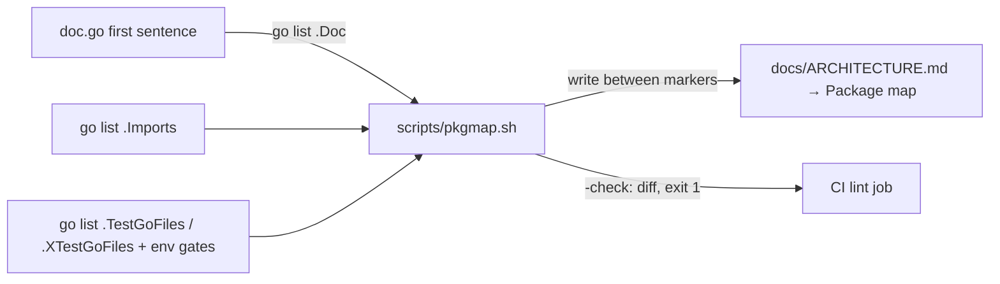
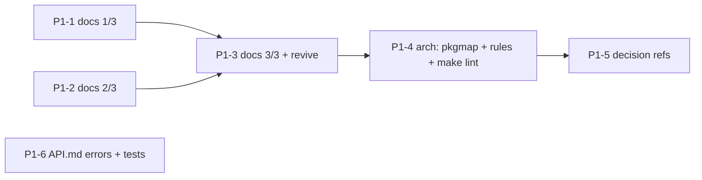

# Phase 1 · Docs in code — design

> **Record, as written 2026-11-04.** Built as #94, #95, #96 (docs), #99 (package map, arch test), #100 (API.md error
> actions), #102 (decision references); the proposed D-P1a–e became D163, D164, D165 and D167 in `docs/DECISIONS.md`
> (D-P1c is in D164). Where the build differs from the text below: the decision-reference check runs in CI's `bytes` job,
> not the `lint` job (#102); `make lint` is the target name (#99). Counts are those of `8ff96cb`, not of today.

Ticket: production hardening (2026-11), Phase 1. Brief: `CLAUDE_FOLLOWUP_PRODUCTION_HARDENING.md` → Phase 1.
Plan: `plan.md` in this directory. Written 2026-11-04 by platform-architect, from `main` at `8ff96cb`.
Every count below comes from the repository at that commit. The commands are in the appendix so anyone
can re-run them.

## Problem

Package intent lives in package comments that are scattered over the source files. The decision trail
(`D<n>`) reaches the code for 85 of the 144 entries. Nothing stops a package from importing something it
must not. 107 exported identifiers fail revive's `exported` rule. The package map in `ARCHITECTURE.md`
does not exist yet, and a hand-written one would go stale. The brief asks for all of this without
changing any behaviour.

## Constraints

- No behaviour change. The doc PRs change comments only, with one exception: splitting a grouped
  `const` declaration in `workoutdup`, which is a declaration change with no new value. The arch and
  error-table PRs add tests, scripts and a doc section. None of them changes a route, an event or a
  stored number. `ModelVersion` stays `2026.10.3`.
- Each PR is at most ~600 changed lines. Moving a comment counts twice (deleted plus added), and the
  line estimates below include that.
- No new dependency. Everything uses `go list`, `go/parser`, `go/doc`, bash and awk. revive already
  ships inside golangci-lint v2.15.0, which CI pins.
- One operator, so no rule may need a person to keep it true. Every check runs in CI or in
  `go test ./...`.
- One owner per rule. A rule that one tool already enforces does not get a second implementation.

## Reconciliations with the brief

| Brief says | Repository says | Consequence |
| --- | --- | --- |
| 28 packages | `go list ./...` lists **34**: 28 under `internal/` and 6 under `cmd/`. The brief counted `internal/` only. | doc.go for all 34 (J1). |
| "No `doc.go` in any package" | True. But **every package already has exactly one package comment**, in some other file (one per package, checked). | Phase 1 *moves* each comment to `doc.go`, corrects it, and adds what it lacks (must-not, invariants, governing docs). It writes none from scratch. |
| "~35 exported identifiers without a comment" | revive `exported` finds **107**: 71 without a comment, 32 whose comment has the wrong form, 2 stutter, 2 grouped consts. | PR split sized on 107 (§5). |
| `internal/model` has no tests | It has 3 test files now (`apidoc_examples_test.go`, `contract_types_test.go`, `schema_snapshot_test.go`, from #87). | Phase 4's list is stale for `model`. `testsupport` has none (a helper). |
| `internal/store`: "one query per method, no business rules, every method takes the user id first (RLS is the second line, D21)" | **All four claims are false today** (§1 → store). D21 is the Swift contract check. RLS does not separate users for the service roles. | The doc.go claims only what holds. **Phase 4's RLS test premise needs re-scoping** (see Needs you). |
| D146–D149 | `DECISIONS.md` ends at **D148**. D149 does not exist, and the numbering skips D119, D122, D123 and D139 (D140 explains D139). | `decision_refs.sh` must accept gaps. |
| `make lint` | There is no `lint` target. CI's `lint` job runs `golangci-lint-action` in `backend/` (v2.15.0). | P1-4 adds `make lint` (J9) unless P0-0 picks another name. |

## 1. Package inventory

Columns: **Owns** (the doc.go first sentence, which becomes the package map's "owns" cell), **Must not**,
**Invariants**, **Governed by**. "Internal imports" are the package's non-test imports today, taken from
`go list`. ⚠ marks a statement in today's comment, or in the brief's sketch, that the code contradicts.
The doc.go must fix each of these.

### cmd/ (6, `package main`)

- **cmd/api** (imports apple, auth, behavior, config, db, eventbus, events, outbox, flags, gate, httpx,
  insights, metrics, model, notify, ratelimit, scoring, sealed, store, train)
  - Owns: the app-facing read and settings API, Train, the journal, consent and invites, push
    registration, account deletion and its reconciler, and the operator's `/v1/admin/`.
  - Must not: write raw HealthKit rows (ingest owns them); compute a stored score (scoring does; api
    calls scoring's pure *view* functions such as sleep views and `NextWake`); publish except through
    the outbox.
  - Invariants: it is the only holder of the Supabase secret key and `DATA_ENCRYPTION_KEY` (the only
    importer of `sealed`); account deletion runs in one transaction under the per-user lock (D39); admin
    calls are audited (D88); the invite gate exempts the routes API.md lists (D87).
  - Governed by: ARCHITECTURE → Services, Account deletion, Remote config; API.md; D39, D78, D87, D88,
    D124–D141.
- **cmd/ingest** (auth, config, db, eventbus, events, outbox, gate, httpx, metrics, model, ratelimit, store)
  - Owns: `POST /v1/sync` and the `fold-workouts` subcommand.
  - Must not: score anything; name `workouts.duplicate_of` (a test pins this, D147); publish except
    `ingested` through the outbox.
  - Invariants: a sync's deletions, queued days and event commit in one transaction under the per-user
    lock (D145); consent comes before the body is read (D129); a conflict between two syncs is a
    retryable 503 (`fail`); NULs are stripped, not refused.
  - Governed by: API.md → POST /v1/sync; D78, D101, D144, D145, D146.
- **cmd/scoring** (config, db, eventbus, events, outbox, httpx, logx, metrics, model, scoring, store)
  - Owns: the scoring consumer (queue `scoring`), the 15-minute pass, `rescore`, and the weekly
    sleep-baseline estimate.
  - Must not: serve user HTTP (health and metrics only); run with more than one replica (D17).
  - Invariants: the handlers are idempotent (D100); `scored`, `session.scored` and `refresh` go out
    through the outbox (D101); rescore skips users without consent (D78).
  - Governed by: ARCHITECTURE → Scoring; SCORING.md; D50, D92, D100, D112.
- **cmd/notify** (apns, config, db, eventbus, events, httpx, logx, notify, store)
  - Owns: process wiring for `internal/notify` (queue `notify`, the stale timer).
  - Must not: publish events (it imports no outbox); read more than `ryft_notify` may (migration 0015).
  - Invariants: without an APNs key it counts instead of sending.
  - Governed by: ARCHITECTURE → Push; D70–D73, D92.
- **cmd/migrate** (db, httpx, smoke)
  - Owns: migrations as the schema owner, seeds, role passwords; `migrate smoke` (the PostSync hook).
  - Must not: run as a service role; be run against production by hand (Argo CD PreSync).
  - Invariants: one transaction per migration under an advisory lock; a password is set only when it
    changed (D93). It reads its own 13 environment variables (⚠ it does not use `config`; Phase 2).
  - Governed by: ARCHITECTURE → Services, Database roles; OPERATIONS; D42, D93, D95.
- **cmd/rabbitmq-topology** (events/amqpbus)
  - Owns: writing the generated topology (Topology Operator objects and the compose definitions);
    `-check`.
  - Must not: hold a production password (dev passwords only; Vault holds the real ones).
  - Invariants: its output is committed, and `make k8s-validate` fails on drift.
  - Governed by: MESSAGING_DESIGN.md; CLAUDE.md (topology is Go); D97, D99.

### internal/ (28)

- **apns** (apple)
  - Owns: sending one APNs request per device token (ES256 JWT over HTTP/2).
  - Must not: decide what to send (that is `notify`); use certificates.
  - Invariants: token-based auth only; one request per token.
  - Governed by: D73.
- **apple** (logx)
  - Owns: Sign in with Apple's REST calls (code → refresh token; revoke on deletion) and `.p8` key
    parsing (apns reuses it).
  - Must not: log the authorization code or the tokens.
  - Invariants: revocation is a precondition of App Store 5.1.1(v).
  - Governed by: API.md → apple-authorization; D39.
- **auth** (config, httpx, logx, metrics, model)
  - Owns: verifying the bearer (JWKS, or apikey in dev) and the per-user rate limit hook.
  - Must not: import `store` or `db`; the user row arrives through `OnAuth`. This holds today and
    becomes rule R8.
  - Invariants: 401 means only "this token is not acceptable"; anything that prevents checking is 503;
    apikey mode refuses to start without `ALLOW_INSECURE_APIKEY_AUTH`.
  - Governed by: ARCHITECTURE → Auth; SUPABASE.md; D29, D30, D32.
- **behavior** (model, train)
  - Owns: the journal's arithmetic.
  - Must not: do I/O (it is pure).
  - Invariants: built-in ids are fixed.
  - Governed by: SCORING.md → Journal; D74–D77.
- **config** (none)
  - Owns: the services' environment configuration.
  - Must not: import anything internal.
  - Invariants: env-only. ⚠ It is not yet *all* configuration: migrate reads 13 variables itself and
    httpx 1 (Phase 2 `config` PR). The doc.go says so.
  - Governed by: D78, D87, D98, D102.
- **db** (behavior, metrics, model, retry, train)
  - Owns: the pool, the embedded migrations, service-role passwords, the built-in seeds, and the
    services' wait for the schema.
  - Must not: hold domain queries (`store` owns those); edit an applied migration.
  - Invariants: grants per role in the migration that adds the table (`TestServiceRoleGrants`); SCRAM
    verifier only, no plaintext (D42).
  - Governed by: ARCHITECTURE → Database roles; SUPABASE.md; D28, D42, D93.
- **eventbus** (config, events, amqpbus)
  - Owns: opening the configured `events.Bus`.
  - Must not: be imported outside `cmd/*`.
  - Invariants: RabbitMQ is the only transport (D102).
  - Governed by: D97, D102.
- **events** (logx, metrics, model)
  - Owns: the five trigger events, their encoding, and what a handler's error means (`Permanent`,
    `Defer`, `Redelivered`).
  - Must not: know a transport or a table (imports no amqpbus, store or db; this holds).
  - Invariants: events are triggers, not records; each has exactly one consumer (D71); handlers are
    idempotent (D100).
  - Governed by: ARCHITECTURE → Events; MESSAGING_DESIGN.md; D71, D97, D100.
- **events/amqpbus** (events, metrics, model, retry)
  - Owns: `events.Bus` on RabbitMQ and the topology as Go.
  - Must not: be imported by anything but `eventbus` and `cmd/rabbitmq-topology` (holds); requeue a
    failure.
  - Invariants: at least once; publishes are confirmed and mandatory; manual ack; a failure is copied
    into a delay tier (5 s / 30 s / 5 min) and then dead-lettered (`dlq.<queue>`); reconnect with
    backoff while `/readyz` reports why.
  - Governed by: MESSAGING_DESIGN.md; OPERATIONS → RabbitMQ; D47, D97–D100.
- **events/outbox** (events, metrics)
  - Owns: the outbox table's rows and the relay.
  - Must not: import a transport (`amqpbus`, `eventbus`); it sends through `events.Sender` (holds).
  - Invariants: `Insert` runs inside the caller's transaction; several replicas never send one row
    twice (`SKIP LOCKED`); a crash between send and mark resends the row, and the idempotent handlers
    absorb it (D100).
  - Governed by: D101.
- **flags** (model)
  - Owns: evaluating feature flags for one user.
  - Must not: do I/O (pure).
  - Invariants: rollout is deterministic per user and key.
  - Governed by: D69.
- **gate** (config, httpx, metrics, model)
  - Owns: the invite and consent gates' decision and answer.
  - Must not: read the database (the user arrives loaded).
  - Invariants: one consent rule for sync and import (D129); warn mode serves the request and sets
    `X-RYFT-Gate`.
  - Governed by: API.md → Errors; D78, D87, D129.
- **httpx** (logx, metrics)
  - Owns: the shared HTTP chain, the error shape, JSON I/O with size and NUL rules, health endpoints,
    shutdown.
  - Must not: import `auth`, `store`, `db` or `events` (holds; R8).
  - Invariants: chain order Instrument → Recover → SecurityHeaders → mux; request ids are the server's
    (D35); 5xx bodies are generic (D37); deadlines are context timeouts (D38).
  - Governed by: ARCHITECTURE → Request path; API.md → Errors; D19, D35, D37, D38.
- **insights** (model)
  - Owns: the Insights cards as pure rules.
  - Must not: do I/O.
  - Invariants: thresholds sit together in `rules.go`.
  - Governed by: ARCHITECTURE → Insights; D81, D82.
- **logx** (none)
  - Owns: JSON logging with request context.
  - Must not: import anything internal.
  - Invariants: no tokens, emails, bodies or health values (enforced by the services' logcheck tests,
    D114).
  - Governed by: OPERATIONS → Data protection (logs); D114.
- **logx/logcheck** (none)
  - Owns: the test-side log shape checker.
  - Must not: be imported by production code (depguard enforces this, D114).
  - Governed by: D114.
- **metrics** (none)
  - Owns: every Prometheus metric, declared in one place.
  - Must not: import anything internal; take a user id or free text as a label (Phase 4 pins this).
  - Invariants: route-pattern labels (D14). ⚠ The comment says "the three services"; there are four.
  - Governed by: OBSERVABILITY.md; D14.
- **model** (none)
  - Owns: the wire types of API.md and the error `code` constants.
  - Must not: import anything internal (holds; R1).
  - Invariants: additive only; never rename or remove a v1 field; closed enums documented.
  - Governed by: API.md; CLAUDE.md contract rules; D21.
- **notify** (apns, events, logx, metrics, model, store)
  - Owns: what to push, to whom and when.
  - Must not: write anything but `notifications_sent` and `push_tokens` (the role allows nothing else).
  - Invariants: claim `(user, day, category)` before sending; quiet hours wait in `notify.wait.*`;
    `refresh` at most once per 5 minutes per account (D92).
  - Governed by: API.md → Push notifications; D70–D73, D92.
- **ratelimit** (none)
  - Owns: the per-pod token bucket per user.
  - Must not: be the only guard for a global limit (recompute is gated in the database).
  - Governed by: API.md → Conventions (rate limits).
- **retry** (none)
  - Owns: start-up retry with backoff and jitter.
  - Must not: retry a request-path call (start-up only).
  - Invariants: jitter avoids the pooler's circuit breaker.
- **scoring** (config, events, metrics, model, store, train, scoring/workoutdup)
  - Owns: the Recovery, Strain, Sleep and Readiness model and the `Engine` that applies it.
  - Must not: delete raw rows (D146; its role cannot); write a stored number under an old
    `ModelVersion`.
  - Invariants: ⚠ only the *formulas* are pure (`algorithms.go`, `sources.go`, `calibrating.go` and
    others). `compute.go`, `sleep.go`, `strength.go` and `workout.go` import `store`, and the Engine
    does I/O. Any change that moves a stored number bumps `ModelVersion`, adds a `changelog.json`
    entry, updates SCORING.md and plans a rescore. Sources are de-duplicated per hour and per night
    (SCORING.md → Several sources). A day's history change re-scores the days after it (D112).
  - Governed by: SCORING.md (→ Model version, → Several sources); D3, D13, D40, D41, D112, D113, D147.
- **scoring/workoutdup** (model)
  - Owns: the two "one activity, one workout" rules.
  - Must not: import `store`, `scoring` or a clock (pure).
  - Invariants: integer overlap ratios. ⚠ The comment says "ingest and the store can use them"; only
    `store` (in ingest's process) and `scoring` import it.
  - Governed by: SCORING.md → Workouts; D146, D147.
- **sealed** (none)
  - Owns: AES-256-GCM for the stored Apple tokens.
  - Must not: be imported outside `cmd/api` (the key lives only in api's namespace; holds; R10).
  - Invariants: associated data binds a ciphertext to its row.
- **smoke** (model)
  - Owns: the in-cluster PostSync smoke.
  - Must not: change anything but the smoke user's step count and consent.
  - Governed by: OPERATIONS; D95.
- **store** (behavior, events, outbox, logx, metrics, model, train, scoring/workoutdup)
  - Owns: every SQL statement against the domain tables. `db` owns the schema, roles and seeds;
    `outbox` owns its table.
  - Must not: talk to the broker (an event is an outbox row in the same transaction, D101); import
    `scoring`, `notify`, `httpx`, `auth` or `gate`; hold a rule that decides a value. Those rules are
    pure functions in `workoutdup`, `train` and `behavior`, which it calls.
  - ⚠ What the brief's sketch claims, against the code:
    - "One query per method" is false. `ApplySync`, `DeleteUser`, `MergeUsers`, `FoldWorkouts` and
      the import are multi-statement transactions. Honest claim: *one method is one unit of work: one
      statement, or one transaction the method opens and commits.*
    - "Every method takes the user id first" is false. 133 exported `*Store` methods: 106 take the
      user id first after `ctx` (94 named `userID`, 12 named `id`), and 27 are operator, cross-user or
      global (`AdminUsers`, `Flags`, `Invites`, `Audit*`, `Feedback*`, `Pending*`, `ActiveUsers`,
      `UserIDs`, `SyncAges`, `PruneScoreQueue`, `ExpectedScoreSec`, `DropPushToken`, `PushDelivered`,
      `StaleCandidates`, `ResolveUser`, `MergeUsers`, `EnsureUser(Identity)`, `Ready`,
      `WithImportRules`, …). Honest claim: *a user-scoped method takes the user id as its first
      argument after ctx and puts it in every WHERE; cross-user methods serve the operator, the timers
      and the reconcilers only.*
    - "RLS is the second line, D21" is false. D21 is the Swift contract check. The service roles'
      policies are `USING (true)` (migration 0009 `<table>_services`; D42 says "the grants are what
      limit them"). RLS keeps `anon` and `authenticated` out (D28) and limits scoring to `ryft-session`
      workouts (0011, restrictive). ARCHITECTURE → Namespaces says "per-user row-level security inside
      the services' own roles" is not covered. Honest claim: *the WHERE clause is the only per-user
      line inside a service role.*
    - "No business rules" is half true. The store owns transactions, locks (D145) and the SQL form of
      a rule; the value-deciding rules are imported.
  - Governed by: ARCHITECTURE → Data model, Database roles; D28, D31, D39, D42, D101, D144, D145, D146.
- **testsupport** (none)
  - Owns: helpers for the Postgres-backed tests.
  - Must not: be imported by non-test code (holds; add to depguard, R11); import anything internal
    (holds; its comment claims it).
- **train** (model)
  - Owns: Train's pure rules (validation, slugs, the merge and conflict rule).
  - Must not: do I/O.
  - Governed by: D61, D124–D141.

## 2. doc.go template

```go
// Package store owns every SQL statement against the domain tables; the services
// reach Postgres only through its methods (db owns the schema, outbox its table).
//
// It must not talk to the broker (an event is an outbox row in the caller's
// transaction, D101) or decide a value: those rules are pure functions in
// scoring/workoutdup, train and behavior, which it calls.
//
// Invariants:
//   - A user-scoped method takes the user id first after ctx and puts it in
//     every WHERE. The service roles' RLS policies admit every row (D42), so
//     this is the only per-user line inside a service.
//   - A method is one unit of work: one statement, or one transaction it opens
//     and commits.
//
// See docs/ARCHITECTURE.md → Data model, Database roles; D31, D39, D42, D145.
package store
```

Rules (the reviewer checks them; P1-4's test enforces the first two):

1. The file holds only the comment and the `package` clause. No other file in the package has a package
   comment. Test-only directories (no non-test `.go` file, e.g. the new `internal` for `arch_test.go`)
   get none.
2. The first sentence is the package map's "owns" cell: at most 160 characters, of the form
   `Package <name> owns|is|turns|…`. `cmd/*` keeps the command form (`// api serves …`).
3. Then, in prose paragraphs: what it must not do; `Invariants:` as a `  - ` list when there are two or
   more; a closing `See` line with docs paths (`docs/X.md → Section`) and D-numbers. Use Go 1.19 doc
   syntax only (lists and indented code), with no `#` headings, so `go doc` renders it plainly.
4. Say why, not what. Do not list exported identifiers. No banners, no author or date tags, no TODOs.
   Move the existing text where it still holds, and correct each ⚠ above.
5. At most ~25 lines. Anything longer is a docs section, linked.

## 3. Dependency rules (`backend/internal/arch_test.go`)

**Mechanism.** `package internal_test` in a test-only directory (the 35th `go list` entry; it adds
nothing to coverage because it has no statements). The test runs `go list -json ./...` from the module
root (located with `go env GOMOD`) with `GOOS=linux GOARCH=amd64` so the file sets are fixed, decodes
`ImportPath`, `Imports` (non-test imports only) and `GoFiles`, and checks a table of rules:
`{pkg, forbid []pattern, allow []{path, why}}`. It also includes a self-test on a synthetic graph, the
same pattern as `TestDocCheckerCatchesMistakes`. Runtime is about 1–2 s, and it needs no Postgres.

**The brief's rules against the current graph**

| Rule | Today | Decision |
| --- | --- | --- |
| R1 `internal/model` imports nothing internal | holds (`bytes`, `encoding/json`, `time`, `uuid`) | keep |
| R2 `internal/store` never imports `scoring`, `notify`, `httpx` | holds for exact paths; **violated** under a prefix rule: `store` → `internal/scoring/workoutdup` (D146, by design: workoutdup imports only `model` so that store can use it) | write R2 on exact paths, plus a named allow-entry `scoring/workoutdup — D146`. Also forbid `auth`, `gate`, `eventbus`, `events/amqpbus`, `apns`, `apple`. Note: `store`→`scoring` and `store`→`notify` are already impossible (both import `store`, so the import would be a cycle). R2 still documents intent and survives a Phase 2 move of `Engine`. |
| R3 `cmd/*` never import each other | **compiler-enforced**: a `package main` is not importable | do not implement it (the compiler owns it); say so in the doc.go of `cmd/*`. |

**Further rules: all hold today, all cheap**

| # | Rule | Why |
| --- | --- | --- |
| R4 | Pure packages `model`, `flags`, `insights`, `behavior`, `train`, `scoring/workoutdup` import no `net/…`, `os`, `database/…`, `github.com/jackc/…`, `amqp091`, `prometheus`, and no internal package but `model`/`train` | CLAUDE.md: every rule is a pure function. `scoring` itself is not in R4 (`Engine`). |
| R5 | Only `eventbus` and `cmd/rabbitmq-topology` import `events/amqpbus`; only `amqpbus` imports `amqp091-go` | services see `events.Bus`; D97/D102 kept the transport swappable |
| R6 | `events` and `events/outbox` import no `amqpbus`, `eventbus`, `store`, `db` | the outbox sends through `events.Sender` (D101) |
| R7 | `pgxpool` only in `db`, `store`, `events/outbox`; `jackc/pgx` at all only in those, plus `testsupport`, plus `cmd/api` and `cmd/ingest` as named allow-entries (`pgx.Tx` for the outbox callback; `pgconn.PgError` codes in ingest's `fail`, to be revisited by Phase 2's `errs`) | "SQL lives in store/db/outbox" becomes checkable |
| R8 | `auth`, `httpx`, `gate` import no `store`, `db`, `events` | the edge stays storage-free (`OnAuth`) |
| R9 | Leaves: `config`, `logx`, `logx/logcheck`, `metrics`, `retry`, `ratelimit`, `sealed`, `testsupport` import nothing internal | cycles stay impossible; testsupport's own comment claims it |
| R10 | `sealed` imported only by `cmd/api` | `DATA_ENCRYPTION_KEY` exists only in api's namespace (sealed's comment) |
| R11 | `testsupport` is tests-only | **depguard**, next to the existing `logcheck-tests-only` rule (D114), not the arch test: one owner per rule. Holds today (no non-test importer). |
| R12 | Every package with non-test files has `doc.go` holding the only package comment; the synopsis is ≤ 160 chars; no `//nolint:revive` in non-test code | makes §2 rule 1–2 and the "zero nolint" budget checkable |

No violation exists today that needs a fix first. The single exception (store → workoutdup) is already a
decision (D146), so it is allow-listed with that citation and needs no new D-entry.

Not proposed (does not hold, or not cheap): "only `config` reads the environment" (migrate and httpx do
too; Phase 2 `config` PR adds it); "`store` user-scoped methods take `userID` first" as an AST check
(the 12 methods that name it `id` and the 27 cross-user ones need an allow-list; defer to the Phase 2
store split, where the files are touched anyway).

## 4. Package map (`scripts/pkgmap.sh`)



- **Table:** `| Package | Owns | Depends on | Tested by |`, one row per package that has non-test
  files (34 today), sorted by import path, path relative to the module (`internal/store`).
- **Owns:** `go list -f '{{.Doc}}'` is go/doc's synopsis, the first sentence of the package comment. The
  script strips the leading `Package <name> ` (or `<name> ` for `cmd/*`), so the cell reads
  "owns every SQL statement …". It escapes `|`.
- **Depends on:** the direct internal imports (`.Imports` filtered to the module prefix), comma
  separated. The brief says `go list -deps`, which is transitive: `cmd/api`'s row would carry about 25
  entries and change on every edit anywhere. Direct imports are the graph R1–R10 reason about (J5).
- **Tested by:** derived, never hand-written:
  - `own (N files)` from `len .TestGoFiles + len .XTestGoFiles`, with the suffix `+Postgres` when a test
    file names `RYFT_TEST_POSTGRES_URL` or imports `testsupport`, and `+RabbitMQ` for
    `RYFT_TEST_AMQP_URL`. Today that is Postgres for `cmd/api`, `cmd/ingest`, `cmd/scoring`, `db`,
    `events/outbox`, `scoring`, `store`, and RabbitMQ for `events/amqpbus`.
  - Without own tests: `via <pkgs>`, the packages whose test files import it (reverse
    `.TestImports`/`.XTestImports`), e.g. `metrics` → via `gate`, `httpx`, `notify`, `scoring`, …
  - Otherwise `none`. Today: `cmd/notify`, `cmd/migrate`, `cmd/rabbitmq-topology` (the last is run by
    `make k8s-validate`, which the script cannot see) and `eventbus`. `testsupport` reads
    `via cmd/api, cmd/ingest, db, store`.
  - `make smoke` and the golden fixtures are not derivable per package. A one-line legend under the
    table names them.
- **Where:** a new `## Package map` section in `docs/ARCHITECTURE.md` between "Services" and "Data
  model": one sentence of intro, then
  `<!-- pkgmap:begin: generated by scripts/pkgmap.sh, do not edit -->` … `<!-- pkgmap:end -->`.
- **Stale detection:** `scripts/pkgmap.sh -check` renders to a temp file, compares it with the marker
  block, and exits 1 with a unified diff and "run scripts/pkgmap.sh". It exits 2 on a missing or
  duplicated marker. It runs in CI's `lint` job (Go is set up there) and in `make lint`. The `go` path
  filter in `ci.yml` gains `docs/ARCHITECTURE.md` and `scripts/pkgmap.sh`; it already lists `docs/API.md`
  for the same reason. Without that, a PR that edits only the section skips the check. Test:
  `scripts/tests/pkgmap_test.sh` with a two-package fixture module (render, `-check` clean, `-check`
  after an edit is 1, missing markers is 2), run by `make test-scripts`.
- **One owner:** the script is the only generator and the only checker. `arch_test.go` does not compare
  the table.
- **Failure mode:** a Go toolchain bump that changes go/doc's synopsis rules turns `-check` red on an
  unrelated PR. The message names the fix (re-run the script), and the toolchain is pinned. The script
  also runs `go list` from `backend/`, so the untracked `.claude/worktrees/` copies never enter the
  table.

## 5. Exported-identifier comments: inventory and PR split

Run: golangci-lint v2.15.0, only `revive` with the rules `exported` and `package-comments` (config in
the appendix). Result: **107 findings, all from `exported`, none from `package-comments`.** Tests add
none (revive's `exported` skips `_test.go`).

| Package | No comment | Wrong form | Other |
| --- | ---: | ---: | --- |
| internal/model | 32 | 1 | 2 stutter: `ModelInfo`, `ModelChangeEntry` |
| internal/store | 10 | 7 | |
| internal/metrics | 1 | 13 | |
| internal/scoring | 9 | 1 | |
| internal/auth | 5 | 1 | |
| internal/events/amqpbus | 3 | 3 | |
| internal/apple | 2 | 2 | |
| internal/config | 3 | 0 | |
| internal/scoring/workoutdup | 0 | 1 | 2 grouped consts (`FoldOverlapNum, FoldOverlapDen`; `OverlapNum, OverlapDen`) |
| internal/sealed | 2 | 0 | |
| internal/notify | 1 | 1 | |
| internal/behavior, httpx, smoke | 1 each | 0 | |
| internal/events/outbox, train | 0 | 1 each | |
| **Total** | **71** | **32** | **4** |

By kind: 32 types, 13 methods, 12 vars, 11 functions and 3 consts lack a comment. Most wrong-form cases
are `Err*` vars and metric vars whose comment starts with something other than the name.

Points that decide the config:

- **Stutter (J2):** renaming `model.ModelInfo` to `model.Info` would touch the `<!-- type: model.X -->`
  annotations in API.md, `testdata/schemas/ModelInfo.json`, the contract test and `cmd/api`, and it
  would break the name parity with the Swift mirror. Proposal: `exported` with
  `arguments: ["disableStutteringCheck"]`. That keeps zero `nolint` and no rename.
- **Grouped consts:** split each into two declarations with their own comment. Same values, same
  behaviour.
- **Explicit rules list:** enabling revive with no `rules:` turns on its default set, which adds 19 more
  findings (12 `unused-parameter`, 6 `redefines-builtin-id`, 1 `superfluous-else`). Phase 1 configures
  `exported` and `package-comments` only.
- **Presets:** do not add golangci's `comments` exclusion preset; it silences exactly this rule.
- With the final config, the count is 105 (107 minus the 2 stutters). The target is 0.

**PR split.** The package sets are disjoint, so the backend-engineer can write all three in parallel.
Each PR moves its packages' comments into doc.go, fixes their findings, and links nothing new by
D-number beyond what the doc.go needs (P1-5 does the D-links).

| PR | Title | Packages (doc.go count) | revive findings | Est. changed lines |
| --- | --- | --- | ---: | ---: |
| P1-1 | `docs: package docs and exported comments (1/3)` | contract and edge: `model`, `httpx`, `auth`, `gate`, `ratelimit`, `config`, `logx`, `logx/logcheck`, `cmd/api`, `cmd/ingest` (10) | 43 (+2 stutter, off by config) | ~420 |
| P1-2 | `docs: package docs and exported comments (2/3)` | data, events, ops: `store`, `db`, `testsupport`, `events`, `events/outbox`, `events/amqpbus`, `eventbus`, `retry`, `metrics`, `smoke`, `cmd/migrate`, `cmd/rabbitmq-topology` (12) | 39 | ~430 |
| P1-3 | `docs: package docs and exported comments (3/3); lint: revive exported` | domain and push: `scoring`, `scoring/workoutdup`, `insights`, `behavior`, `train`, `flags`, `notify`, `apns`, `apple`, `sealed`, `cmd/scoring`, `cmd/notify` (12), plus the `.golangci.yml` revive block | 23 | ~380 |

P1-3 turns the rule on. It is written in parallel but merges last: rebase it on `main` after P1-1 and
P1-2 have merged. Until then its `lint` job is red by design. Merge order: P1-1 and P1-2 in either
order, then P1-3. All three are comment-only apart from the two const splits and the YAML. Review is
code-reviewer only (no runtime change). `make smoke` and the golden fixtures must still pass on all three.

## 6. `scripts/decision_refs.sh` spec

- **D-set:** the `^## D<n> ` headings of `docs/DECISIONS.md` (144 today; gaps are fine).
- **Mentions:** `git ls-files -z` (tracked files only, so `.claude/worktrees/`, `node_modules` and build
  output are out), minus `*.md`, `docs/**` and binaries (`grep -I`). Regex `\bD[0-9]{1,3}\b`. Ranges
  are expanded: `D70–D73`, `D70-D73` and `D124–D141` count every number in between (the code writes
  such ranges today, e.g. `D74–D77`).
- **Skip list:** `scripts/decision_refs.skip`, one `D<n> <reason>` per line. It holds the decisions
  without a code consequence: process, docs-only, operator one-offs, and entries superseded in full. A
  reason is required.
- **Output:**
  - `warning: D<n> (<heading>) has no reference in code or config` for each D that is neither mentioned
    nor skipped.
  - `warning: D<n> is skipped but mentioned in <file>` for a stale skip.
  - `error: D<n> in the skip list has no entry` for a typo.
  - Under `GITHUB_ACTIONS` the lines are `::warning`/`::error` annotations, and the job summary gets
    the count.
- **Exit:** 0 when there are only warnings; 2 when the script itself cannot work (no DECISIONS.md, not a
  git checkout, a skip line without a reason, a skipped D without an entry). A broken check must not
  read as "all linked".
- **Where it runs:** a step in CI's `lint` job after `golangci-lint-action`, with no
  `continue-on-error` (exit 0 is the warning path), and in `make lint`. The `go` path filter does not
  gain `DECISIONS.md`, because that would run the whole Go suite on every D-entry PR. Every push to
  `main` runs it anyway. Test: `scripts/tests/decision_refs_test.sh` (fixture repo: mentioned, missing,
  range, skip, stale skip, reasonless skip → exit 2).
- **Today:** 59 of 144 are unmentioned (60 without range expansion; `D74–D77` in `behavior` covers D75). A first triage for P1-5; the implementer confirms each entry
  against the code:
  - **Link in Go** (the code exists; the comment is missing): D3, D5, D6, D8, D9, D10, D11, D12, D14,
    D19, D20, D29, D30, D31, D32, D35, D37, D38, D39, D40, D41, D50, D63, D112, D113, D136,
    D140, D144, D145.
  - **Link in manifests, Terraform, CI or scripts:** D15, D16, D17, D21 (`scripts/check_swift.sh`),
    D23, D24, D25, D26, D27, D28 (migration 0007), D33, D44, D45, D46, D53, D54, D55, D56, D106,
    D108, D109, D110, D111, D115 (`scripts/check_bytes.sh`).
  - **Skip-list candidates:** D7 (contract additions, lives in API.md), D18 (CI scope, superseded by
    the current workflow), D22 (review log), D49 (operator one-off), D84 (NATS-era DLQ, superseded by
    D97/D100; **the entry should be marked superseded**), D86 (legal drafts; `web/content`).
- P1-5 lands at zero warnings. It is one PR (~59 one-line links, ~120 lines of script, ~80 lines of
  test, ~10 lines of skip list, so ~350 lines).

## 7. API.md error-message table spec (for api-contract-owner)

What exists:

- `API.md` → Errors already has a closed-enum `code` table with a **Do** column. It has all four codes
  in the code (`model.CodeInviteRequired`, `CodeConsentRequired`, `CodeImportInProgress`,
  `CodeImportNotEnabled`, used through `httpx.WriteCodedError` in `gate` and `cmd/api/train_import.go`).
  **No code is missing.**
- `httpx.Fail` sets no `code`. It answers 422 (`msgDBText`), 503 `"request timed out"` with
  `Retry-After`, 500 `"internal error"`, and 499 (log-only, documented in OBSERVABILITY). So the brief's
  "every httpx.Fail code" means the status table.
- The status table (`| Status | When |`) has the client action for 401, 429 and 503, and for 413 on
  sync only.

To do (one PR, `docs: error actions in API.md`, plus a test):

1. Add a **Do** column to the status table, one line per status. Missing today: 400 (fix the request; do
   not resend it unchanged), 403 without a code (read-only built-in; do not retry), 404 (gone or not
   yours; drop the local reference), 409 (id taken: new id; `PUT /v1/sessions/{id}`: adopt the
   returned `Session`), 413 outside sync (send less, per the limits), 422 (do not resend unchanged;
   surface it), 500 (retry later with backoff; show `request_id`). Endpoint-specific statuses (501 on
   apple-authorization) stay in their endpoint tables. 499 never reaches a client and stays out.
   Changelog entry: additive, wording only.
2. Test `internal/model/apidoc_errors_test.go`, next to `apidoc_examples_test.go` and using its
   `apiDocPath`:
   - The set of `Code* = "…"` constants, parsed with `go/parser` from `internal/model/*.go` so a new
     constant joins on its own, must equal the first column of the `code` table, with no empty Do cell.
   - The status table must list 400, 401, 403, 404, 409, 413, 422, 429, 500 and 503, each with a
     non-empty Do.
3. Test `internal/httpx/apidoc_messages_test.go` (it needs the unexported constants): every message that
   API.md quotes verbatim appears in API.md character for character. Those are `msgURLText`,
   `msgDBText`, the NUL message, `"internal error"` and `"request timed out"`; the last two become
   named constants in `httpx`, with the same strings and no behaviour change.
4. **Scope (J6):** other messages stay outside the contract. API.md says "branch on the status code, not
   the text" (Errors) and "branch on it, not on the message" (`code`). Freezing all 66 distinct
   `WriteError` strings would contradict the doc and make every wording fix a contract change.

## Order, failure modes, rollback



- P1-6 is disjoint from all of these (API.md plus two new test files, and two named constants in httpx
  that P1-1's comments do not touch) and runs in parallel from the start.
- P1-4 needs every doc.go first sentence (R12 and the table). P1-5 needs the doc PRs merged (it edits
  comments in the same files) and adds a line to P1-4's `make lint`, so it goes after P1-4.

| Failure | Seen by | Recovery |
| --- | --- | --- |
| P1-3 merged before P1-1/P1-2 | its own `lint` job is red | rebase after the others; nothing deployed |
| `arch_test` red after a refactor | `go test ./...` names the rule and the import | fix the import, or add an allow-entry with a D |
| package map stale | `pkgmap.sh -check` in `lint` | run the script, commit |
| decision link missing | warning only | P-ticket or the next PR touching the file |
| a "comment-only" PR changes code | code-reviewer; golden fixtures, `make smoke` | revert |

Rollback for every Phase 1 PR is `git revert`. Nothing reaches a running pod except the new constant
names in `httpx` (same strings). Phase 1 changes no image behaviour, so promote PRs from these merges
need no smoke beyond the usual.

## Docs to update

- `docs/ARCHITECTURE.md`: the Package map section (P1-4).
- `docs/API.md`: the Errors → Do column and the changelog (P1-6).
- `docs/DECISIONS.md`: the entries below (you merge them); mark D84 superseded by D97/D100.
- `docs/STATUS.md`: the Phase 1 record (revive count 107 → 0, D-link warnings 60 → 0).
- Proposed for you (your files): one line in `plattform/CLAUDE.md` → Rules, "a new package gets a
  `doc.go` (first sentence = package map)", and the same in the `ryft-platform-conventions` skill.

## Proposed D-entries (text for you to number)

**D-P1a — Package docs live in `doc.go`; its first sentence is the package map.** Every package with
non-test files (34 today, `cmd/*` included) has a `doc.go` holding the only package comment: what it
owns (first sentence, ≤ 160 characters, which `scripts/pkgmap.sh` takes through `go list .Doc`), what it
must not do, its invariants, and the docs and D-numbers that govern it. Test-only directories have
none. Rejected: doc comments where they are today (no single place to check, and four of them had gone
stale: store, scoring, metrics, workoutdup), and a hand-written package table (it would rot).
`internal/arch_test.go` enforces placement and length.

**D-P1b — Import rules are a test over `go list`; one owner per rule.** `internal/arch_test.go` checks the
non-test import graph: model and the pure rule packages import no I/O (R1, R4); store does not import
the engine, the edge or the transport, with `scoring/workoutdup` allowed by D146 (R2); only eventbus and
the topology command import amqpbus (R5); the outbox knows no transport (R6); pgx only where SQL lives,
with cmd/api and cmd/ingest named (R7); the edge holds no storage (R8); the leaves stay leaves (R9);
`sealed` is api's alone (R10). Tests-only packages are depguard's (logcheck, D114; testsupport). Rules
the compiler already enforces (`cmd/*` importing each other) are not repeated. Rejected: a new linter
(go-arch-lint, a depguard rule per edge), which would be a new dependency or one YAML list per edge
without a reason column.

**D-P1c — revive `exported` without the stutter check, zero `nolint`.** `.golangci.yml` enables revive
with exactly `exported` (`disableStutteringCheck`) and `package-comments`. Stuttering names stay
because `model.ModelInfo` and `model.ModelChangeEntry` match the Swift mirror and API.md's type
annotations, and renaming them is churn in the contract doc for no reader's benefit. revive's default
rule set stays off (19 unrelated findings); the `comments` exclusion preset stays off. No
`//nolint:revive` in non-test code (R12).

**D-P1d — Decision references are a warning, with a reasoned skip list.** `scripts/decision_refs.sh` lists
D-entries that no tracked non-doc file mentions (ranges expanded), apart from `scripts/decision_refs.skip`
(each line with a reason). It warns in CI's `lint` job and in `make lint`, and fails only when it
cannot run. Rejected: failing the build, which would block an urgent fix on a missing comment, and
inline tags in DECISIONS.md, which change 144 entries' format.

**D-P1e — Error codes are contract, messages mostly not.** The `code` enum and each status's client
action are in API.md and pinned by a test against `model.Code*`. Among messages, only those API.md
quotes verbatim (NUL, database text, URL text, `internal error`, `request timed out`) are pinned. The
other message strings may change without a contract entry, as API.md → Errors already says ("branch on
the status code, not the text"). Narrows the brief's "message strings match the doc".

## Needs you

1. **J1:** doc.go for all 34 packages, `cmd/*` and `testsupport`/`logcheck` included (recommended), or
   only the brief's 28 under `internal/`.
2. **J2 / D-P1c:** turn off revive's stutter check (recommended), or rename `model.ModelInfo` and
   `model.ModelChangeEntry`, which touches API.md and the schema snapshots.
3. **J3 / D-P1b:** drop the brief's "`cmd/*` never import each other" because the compiler enforces it;
   write R2 on exact paths with the D146 allow-entry; add R4–R12.
4. **J5:** "depends on" lists direct imports, not `go list -deps`.
5. **J6 / D-P1e:** pin only the `code` enum and the verbatim-quoted messages, not all 66 strings.
6. **J9:** the target name `make lint` (P0-0 was to decide it).
7. **Phase 4, re-scope:** "user A's role cannot read user B's row through each service role" fails by
   design. The services' policies are `USING (true)` (0009, D42). Either re-scope the test (anon and
   authenticated see nothing, D28; the restrictive scoring policies hold; per-user isolation is
   proven by store tests), or decide to add per-user RLS to the service roles, which is a new D and a
   behaviour change well beyond hardening.
8. Mark D84 superseded (by D97/D100) when you merge the D-entries.

## Appendix: reproduce

```bash
cd backend
go list ./... | wc -l                                             # 34
go list -f '{{.ImportPath}}|{{join .Imports " "}}' ./...          # the graph R1–R10 read
cat > /tmp/revive.yml <<'EOF'
version: "2"
linters:
  default: none
  enable: [revive]
  settings:
    revive:
      rules:
        - name: exported
        - name: package-comments
issues:
  max-issues-per-linter: 0
  max-same-issues: 0
EOF
golangci-lint run --config /tmp/revive.yml ./... | grep -c '(revive)'   # 107
# D-mentions: git ls-files | grep -vE '\.md$|^docs/' | xargs grep -IohE '\bD[0-9]{1,3}\b' | sort -u
```
