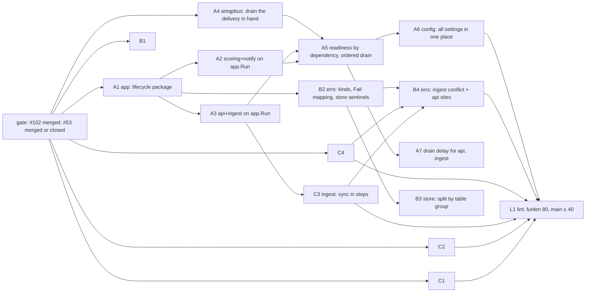

# Phase 2 · Structure — design

> **Record, as written 2026-11-04.** Built so far: A1 #105, A2 #117, B1 #110, C1 #111 + #112, C2 #122 + #123, C4 #119 +
> #120; the rest (A3 to A7, B2 to B4, C3, L1) is not built. The proposed D-P2a–i became D168 to D173 (D-P2a to f of
> #105, whose text replaced this one), D174 (A2), D176 (D-P2h, pure moves) and D177 (characterisation first); D-P2f
> (config), D-P2g (errs) and D-P2i (funlen) of this text are **not** decided: their PRs do not exist. The shutdown
> budget of §1.4 was replaced by #105's table (D169: api and ingest 18 s, 23 s with A7; scoring and notify 25 s; the
> watchdog at 26 s). `scoring rescore -dry-run` does not exist (#112). The `pickSources` step was dropped (#112).
> Function and file counts are those of `origin/main` at `69d1838`.

Ticket: production hardening (2026-11), Phase 2, plus the Phase 3 items that touch the same code ("Goroutine
lifecycle", "The broker, audited", "Auth resilience"). Brief: `CLAUDE_FOLLOWUP_PRODUCTION_HARDENING.md` → Phase 2.
Plan: `plan.md`. Phase 1: `phase1-design.md`. Written 2026-11-04 by platform-architect from `origin/main` at
`69d1838` (`83a889c` on top only re-pins images). The local `main` checkout is behind at `4cfc709`, so every count
below comes from an export of `origin/main`. The commands are in the appendix.

## Problem

The four long-running services (api, ingest, scoring, notify) each build their own lifecycle in `main()`. The
code is similar in each, and each has its own quirks:

- **Two signal handlers per process.** `main` holds one `signal.NotifyContext` and `httpx.Serve` holds another.
  A SIGTERM cancels both at once, so nothing orders the shutdown. The outbox relay, `db.Watch` and the timers stop
  at the same moment the HTTP server begins to drain.
- **The consumers drop the delivery they are working on.** `amqpbus.subscribe` runs the handler inline with the
  same context the signal cancels. On SIGTERM, the event that scoring is scoring fails with `context.Canceled`. It
  is then counted as a failure (`ryft_events_handled_total{result="retry"}`, logged at error as "handle event
  failed, will retry"). Its copy into the retry tier also fails, because amqp091-go v1.16
  `PublishWithDeferredConfirmWithContext` refuses an already cancelled context. That logs a second error ("could
  not retry, rejecting for redelivery"), and the delivery comes back through `Reject(true)`, which uses up one of
  the queue's 10 deliveries (`DeliveryLimit`). This happens on every scoring or notify deploy that has an event in
  flight.
- **A slow shutdown skips the teardown.** When `srv.Shutdown` passes its 10 s, `httpx.Serve` returns an error,
  `main` calls `os.Exit(1)`, and the deferred `bus.Close()`/`pool.Close()` never run.
- **Nothing keeps routing traffic during propagation.** On SIGTERM, `Shutdown` closes the listener at once. Kubernetes
  takes a terminating pod out of the EndpointSlice by itself, but Traefik learns that asynchronously. A
  connection that arrives in that window is refused. The pods have no `preStop` hook and no explicit
  `terminationGracePeriodSeconds` (the default is 30 s).
- **`/readyz` is one string.** `200 {"status":"ready"}` or `503 {"error":"<first failure>"}`. It does not say
  which dependency failed, and it says nothing about the broker in api and ingest, whose readiness leaves it out
  on purpose (D101).
- **Raw goroutines without an owner.** 15 `go` statements in non-test code. The 5 the brief counts are the
  anonymous `go func()` literals (scoring ×2, notify ×1, httpx ×2). The others are `db.Watch` ×4, `outbox.Run`
  ×3, the api's reconciler, notify's `staleLoop` and amqpbus's `supervise`. In scoring and notify a failed HTTP
  listener is logged, and the service then runs without probes until the startup probe kills it.

The rest of Phase 2 (config, errors, file splits, long functions) touches the same `main.go` files, `httpx.go`
and the store, so this design also fixes the order of the PRs.

## Constraints

- Three t3.large nodes, one operator, GDPR Art. 9 data. No new moving part without a runbook line and an alert.
- Behaviour does not change unless a PR says so in its title and has its own D-entry. Proof: the golden fixtures
  (D149, including their two-phase idempotence checks), `make smoke`, `make smoke-hook`, `scoring rescore -dry-run`
  = 0 changed days, `ModelVersion` untouched.
- ≤ ~600 changed lines per PR (pure moves: see J8), each deployable alone, green on `make test lint alerts-check
  smoke`.
- No new framework. stdlib `net/http`, pgx, amqp091-go, slog. A new direct dependency needs a D-entry that names
  the alternative it beat.
- Fixed contracts that must not move (§1.9): ports, paths, env names and defaults, metric names and labels, log
  messages and keys that runbooks grep, the readiness semantics per service, the chain order.
- `kubectl` context is production. This design runs nothing against a cluster. Every rollout step is a PR.

## Reconciliations with the brief

| Brief says (2026-11-04) | `origin/main` at `69d1838` says | Consequence |
| --- | --- | --- |
| 190 Go files, 99 test files, 23.6k non-test lines | **254** Go files, **122** test files; 132 non-test files, **24,249** lines | Sizes below use today's numbers. |
| `model.go` 1,389, `store/train.go` 1,374, `store.go` 1,118 | **1,453**, **1,378**, **1,148**. `cmd/api/train.go` 789 and `scoring/compute.go` 616 as stated | Pure-move PRs; see J8 for how they are measured. |
| `computeDay` ≈ 280, api `main` ≈ 170, scoring `main` ≈ 140, `ApplySync` ≈ 135, `sync` ≈ 110, `trainImport` ≈ 105 | **278, 163, 132, 136, 101, 101**. Not in the brief: ingest `main` **97**, notify `main` **81**, `smoke.Run` 111, `db.Seed` 111, `merger.run` 97, `train.CheckPlan` 97, `admin.merge` 96, `Store.AdminUserDetail` 91, `runFold` 86 | **15 functions over 80 lines** (77 over 40). Phase 2 fixes 8; the other 7 need decomposing or a named allow-list (J9). |
| "36 remaining `os.Getenv` outside `internal/config`" | 36 is the count **including** `internal/config` (21 sites there). **Outside: 15 sites**: `cmd/migrate/smoke.go` 11 (10 variables), `cmd/migrate/main.go` 2 (`DATABASE_URL`, and `DB_PASSWORD_<SVC>` in a loop over 4 roles), `httpx.Logger` 1 (`LOG_LEVEL`), `testsupport` 1 (`RYFT_TEST_POSTGRES_URL`, test helper) | The config PR moves **14 production sites / 16 variables**. testsupport is allow-listed. Smaller than the brief thought. |
| "89 `fmt.Errorf` without `%w` become `%w` or a typed error" | **88**, and **none of them formats an error argument**. Each one creates a new leaf error (validation text, config messages, logcheck's test reports). errorlint's `errorf` check is on, and it would flag a lost wrap. Per package: logcheck 15, config 12, cmd/ingest 12 (the sync's 422 texts), db 9, scoring 8, auth 7, amqpbus 7, smoke 7, other 11. **52 `errors.New`** (brief: 47) | No wrap is missing. The errs work is about **kinds and the HTTP mapping**, not `%w` (J7). |
| "Five raw `go func`" | 5 literals; 15 `go` statements in total (see Problem) | After the app PRs, the only raw `go` left outside `internal/app` is amqpbus `supervise`, which `Close` owns. |
| "the api's reconciler/settle goroutines" | The api's background goroutines are the reconciler, the outbox relay and `db.Watch`. **`settle` is not a goroutine.** It runs inside the request (`cmd/api/train.go:626`). Four handlers detach from the client with `WithoutCancel`: `deleteMe` (2 min), `merge` (deleteTimeout), the import's finish (10 s), the admin audit write (5 s) | Shutdown has to bound these, and today it does: `Shutdown` waits 10 s, then the process exits (§1.6). |
| `errgroup` "already an indirect dependency" | True, and it is already **compiled into every binary**: `pgxpool` → `puddle/v2` → `x/sync/semaphore`. `goleak` v1.3.0 is already in `go.sum` (a test dependency of amqp091-go and client_golang) | Promoting both adds no module to the graph. Each still gets a D-entry (D-P2d). |
| `/readyz` "goes false during drain so the Service stops routing to the pod" | Kubernetes marks a terminating pod not-ready in the EndpointSlice on deletion, **whatever the probe says**. The readiness probe runs every 10 s, so it would not even see a few seconds of drain. What protects requests is a short **delay before the listener closes**, then `Shutdown`'s graceful close | `/readyz` reports `draining` for people and the smoke. The drain delay does the routing work (§1.5, J4). |
| `ryft_shutdown_seconds` | A histogram observed in a process that exits within seconds is almost never scraped (Alloy scrapes on an interval, and the pod is gone afterwards). Pod logs go to CloudWatch, not Grafana (D52) | Measure shutdown in the log line. Exit codes reach Grafana through kube-state-metrics (J2). |
| `app.Spec{Name, Config, Routes, Consumers, Jobs}` | Routes and consumers close over the store, verifier and engine, and those exist only after the pool is open. They cannot be static fields | `Spec` has `Load` (before any connection) and `Build(ctx, Deps) (Parts, error)` (§1.2). |
| D146–D149 / "D149" | D149 exists (the golden files). Phase 1's D-P1a–e are not in `DECISIONS.md` yet | The D-entries here are D-P2a…i. Number them at merge, after Phase 1's. |

Open PRs that overlap: **#102** (`docs/decision-refs`) edits `model/model.go`, `store/store.go` and
`store/train.go`, which are the three files B1 and B3 split. **#53** (`fix/dlq-replay-redelivery`, +1,806/−207,
last updated 2026-10-24) edits `cmd/scoring/main.go`, `amqpbus.go`, `events.go`, `metrics.go` and
`scoring/compute.go`, so it overlaps A2, A4 and C1. Both must merge or close first (J10).

## 1. `internal/app`: the service lifecycle

### 1.1 What the four mains share and where they differ (measured)

| Concern | api | ingest | scoring | notify |
| --- | --- | --- | --- | --- |
| Subcommands before start | — | `fold-workouts` | `rescore`, `learn-baselines` | — |
| Logger | `httpx.Logger("api")` | same | same | same |
| Base config | `config.Load` | same | same | same (pool 2, as scoring) |
| Service config, **before** connecting | `LoadAuth`, `LoadBeta`+`RequirePolicy`, log `beta` | same | `LoadBeta` (no policy), log `beta` | `LoadAPNs` |
| Service config, **after** connecting | `LoadAdmin`, `LoadApple` (in `newAccounts`) | — | — | — |
| Signal | `NotifyContext` in main, plus another in `httpx.Serve` | same | main's, plus `httpx.Serve`'s in a goroutine | same as scoring |
| Pool | `db.Open` (≤ 10 min, schema wait) + `go db.Watch` | same | same | same |
| Broker | `eventbus.Open` (≤ 5 min) | same | same | same |
| Outbox relay | `go ob.Run` | same | same | none (publishes nothing) |
| Other deps | `auth.FromConfig` (starts keyfunc's refresh goroutine on ctx), store `WithImportRules`, engine | `auth.FromConfig` | engine `SetConsentMode`, `OnScored` | `apns.New` when configured |
| Background | `go reconcileEvery` | — | `go func` 15-min pass | `go staleLoop` |
| Consumer | — | — | `ConsumeIngested` (blocks main) | `ConsumeNotify` (blocks main) |
| Metrics port | `ServeMetrics` after pool and broker | same | same | same |
| HTTP | Instrument → Recover → SecurityHeaders → mux; `Serve` blocks main | same | Recover → mux; `go Serve` | same as scoring |
| Readiness | store **and** auth (not broker, D101) | same | store **and** broker | same |
| Route deadlines | 15 s; import 50 s (D129); `DELETE /v1/me` 2 min, detached | sync 50 s | — | — |
| On SIGTERM | listener closes; `Shutdown` 10 s; relay, watch and reconciler stop at once; overtime → `os.Exit(1)` without closing | same | consumer ctx cancelled **mid-handler**; `main` returns; the HTTP goroutine dies with the process | same as scoring |

Shared by all four: logger, base config, signal, pool + watch, broker, metrics server, health mux, HTTP server
and teardown. Different per service: the service config, what is built on the pool, the routes and edge chain,
the extra readiness checks, the consumers and the timers. The subcommands and `migrate` are one-shot jobs and
stay outside `app.Run` (`migrate` is a Job, the subcommands exit when done).

### 1.2 Types

```go
// Package app owns a long-running service's lifecycle: configuration before any
// connection, the pool, the broker, consumers and timers, the HTTP server, and
// the shutdown that undoes them in reverse.
package app

type Spec struct {
	Name           string // api | ingest | scoring | notify: logger, config.Load, broker connection,
	                      // db.Watch label, outbox publisher (all unchanged)
	Edge           bool   // Instrument → Recover → SecurityHeaders (api, ingest); else Recover only
	BrokerRequired bool   // the broker gates /readyz (scoring, notify); api and ingest report it only (D101)
	Outbox         bool   // app runs the relay (api, ingest, scoring); notify publishes nothing

	// Load reads the service's own settings before anything connects (D78: exit at
	// once, not behind the start-up retries). It logs what it logs today ("beta").
	// Its error says which message to log: app.ConfigError{Msg: "beta config", Err: err}.
	Load  func(log *slog.Logger) error
	Build func(ctx context.Context, d Deps) (Parts, error)

	// Zero takes the default; tests shorten them.
	DrainDelay      time.Duration // A5: 0 everywhere; A7: 5 s for Edge services
	ShutdownTimeout time.Duration // HTTP Shutdown: 10 s (today's)
	ConsumerDrain   time.Duration // A4/A5: 15 s for the delivery in hand
}

type Deps struct {
	Log    *slog.Logger
	Config config.Config  // A6: config.Settings
	Pool   *pgxpool.Pool
	Bus    events.Bus
	Outbox *outbox.Outbox // nil unless Spec.Outbox
}

type Parts struct {
	Routes    func(mux *http.ServeMux) // /v1/… ; nil for health-only. Must not register "/", /healthz or /readyz
	Checks    []Check                  // e.g. {Name: "auth", Required: true, Fn: verifier.Ready}
	Consumers []Task                   // block until ctx ends: bus.ConsumeIngested(ctx, log, handle)
	Jobs      []Task                   // timers: scoring's pass, notify's stale check, api's reconciler
}

type Task struct {
	Name string                          // a closed set, written in code: a metric label (P3-2)
	Run  func(ctx context.Context) error // returns when ctx ends; an error stops the service
}

type Check struct {
	Name     string // db | broker | auth
	Required bool   // false: reported in /readyz, never makes it 503
	Fn       func(context.Context) error
}

// Main is what main() calls: signal handling, Run, os.Exit with Run's code.
func Main(s Spec)
// Run starts s and blocks until ctx ends or a part fails; then it shuts down in order.
func Run(ctx context.Context, s Spec) error
```

`Build` gets the **lifetime** context, which is cancelled only at the end of shutdown, not at the signal.
`auth.FromConfig` ties keyfunc's JWKS refresh goroutine to that context. With the signal context, the refresh
would stop before the drain, and goleak would flag it.

A main then reads (scoring, about 20 lines):

```go
func main() {
	if code, ok := subcommand(os.Args); ok { // rescore, learn-baselines: unchanged
		os.Exit(code)
	}
	var beta config.Beta
	app.Main(app.Spec{
		Name: "scoring", BrokerRequired: true, Outbox: true,
		Load: func(log *slog.Logger) (err error) {
			if beta, err = config.LoadBeta(); err != nil {
				return app.ConfigError{Msg: "beta config", Err: err}
			}
			log.Info("beta", "consent", beta.Consent)
			return nil
		},
		Build: func(ctx context.Context, d app.Deps) (app.Parts, error) { return build(ctx, d, beta) },
	})
}
```

`build` (new `cmd/scoring/service.go`) holds what `main` holds today after `bus`: engine, `OnScored`, the handler,
the timer pass, all moved verbatim. After A6, `Load` goes away (`config.ForService` loads everything) and
`Deps.Config` carries it.

**Imports and the arch rules.** `internal/app` imports `config`, `db`, `eventbus`, `events`, `events/outbox`,
`httpx`, `logx`, `metrics`, `model` (from A5), and `pgxpool` for the `Deps.Pool` type. R7 allows `pgxpool` only in
db, store and outbox, so A1 adds `{Pkg: "internal/app", Reason: "opens and closes the services' pool (D-P2a)"}`.
`eventbus/doc.go` says "must not be imported outside cmd/*", and A1 amends it to "cmd/* and internal/app". A new
only-rule R13 says `internal/app` is imported only by the four service commands. The alternative (main opens the
pool and broker and passes them in) puts about 25 lines back into each main and contradicts "≤ 40 lines" (J6).

### 1.3 Lifecycle: start

```mermaid
sequenceDiagram
  participant M as main
  participant A as app.Run
  participant D as Postgres
  participant B as RabbitMQ
  participant K as kubelet / Traefik
  M->>A: Spec
  A->>A: logger, config.Load + Spec.Load (exit 1 here: nothing connected)
  A->>A: metrics :9090 (A5: first; A1–A3: after the broker, as today)
  A->>D: db.Open (≤ 10 min, schema wait) then job "db watch"
  A->>B: eventbus.Open (≤ 5 min)
  A->>A: Build(lifeCtx, Deps): store, verifier, handlers, Parts
  A->>A: relay "outbox" (if Spec.Outbox), Jobs, Consumers
  A->>A: HTTP :8080 listening (/healthz 200 from here)
  K->>A: startupProbe /healthz passes; readinessProbe /readyz
```

One log line per step. These lines exist today and stay: `beta`, `metrics listening`, `amqp connected`, `events`,
`auth`, `admin routes enabled`, `listening`, `consuming ingest events` / `consuming scored events`, `amqp
consuming`. A5 adds a single `started` line with `dur_ms`. HTTP comes **last** on purpose: the `startupProbe`
(`/healthz`, 126 × 5 s = 630 s = `MigrateWait` + 30 s) is what kills a pod stuck in the database wait. A listener
that answered before the pool was open would hand a stuck pod over to the liveness probe, which would then pass.

### 1.4 Lifecycle: stop

The trigger is the first SIGINT/SIGTERM, or any Task returning an error (including the HTTP listener). In order:

| # | Step | api / ingest | scoring / notify | Bound |
| --- | --- | --- | --- | --- |
| S0 | `shutting down` (`reason`: signal / the task's name); `/readyz` → 503 `draining`; the second signal now kills (A5) | ✓ | ✓ | — |
| S1 | cancel Jobs (timers, reconciler) | reconciler | 15-min pass / stale check | — |
| S2 | drain delay: keep listening while Traefik drops the endpoint | 0 in A5, 5 s in A7 | 0 | `DrainDelay` |
| S3 | consumers: stop taking deliveries; the delivery in hand finishes with its own context and is acked (A4) | — | ✓ | `ConsumerDrain` 15 s |
| S4 | HTTP `Shutdown`; on overtime `Close()` and **continue** with the exit code set to 1 | ✓ | health only | `ShutdownTimeout` 10 s |
| S5 | wait for the S1 jobs | ✓ | ✓ | 3 s |
| S6 | stop the outbox relay (after the work that feeds it) and `db watch` | ✓ | scoring | 3 s |
| S7 | `bus.Close()` | ✓ | ✓ | 2 s |
| S8 | cancel the lifetime ctx; `pool.Close()` in a goroutine, waited at most 3 s (it blocks on connections a detached handler still holds) | ✓ | ✓ | 3 s |
| S9 | metrics server `Close`; `shut down` `dur_ms`, `exit` | ✓ | ✓ | — |

Each step logs `msg="shutdown step"` with `step` (a closed set: `jobs`, `drain`, `consumers`, `http`, `relay`,
`broker`, `pool`), `dur_ms` and `err` when it failed or overran. Exit 0 when every step finished in its bound,
else 1. kube-state-metrics' `kube_pod_container_status_last_terminated_exitcode` shows a 1 (or a 137 when the
kubelet's SIGKILL came first) without any new metric.

**Budget.** api/ingest: 5 + 10 + 3 + 3 + 2 + 3 ≈ 26 s worst case. scoring/notify: 15 + 1 + 3 + 3 + 2 + 3 ≈ 27 s
worst case. Both stay under the kubelet's 30 s. A5 writes `terminationGracePeriodSeconds: 30` explicitly into the
four Deployments (same value, with a comment pointing at the budget) so that a later change of either side is
visible in review.

**What the 10 s means for D129's 50 s.** A sync (`syncTimeout` 50 s), an import (`importTimeout` 50 s) or an
account deletion (2 min, detached) still running 10 s after SIGTERM is cut, as today: its transaction rolls back
when the process exits, and the app retries. That is safe for every one of them. Records dedupe and a deletion
already done is `unknown_id` (D144, D145). Import items commit one by one and a resumed request skips what
matched (D126, D131, D140), though the retry may see `429 import_in_progress` until the 70 s lease ends (D132).
The account deletion is one transaction under the per-user lock, and a Supabase step that was cut is the
reconciler's (D39). Raising the budget to cover 50 s would mean a grace period around 75 s on every rollout, node
drain and HPA scale-down, to save a retry the app already makes (J1).

### 1.5 `/readyz`

Shape (additive to API.md → Health: `status` and `error` keep their meaning, `checks` is new). Values are `"ok"`
or the reason; there is one entry per check, in the order db, auth, broker:

```json
{"status": "ready", "checks": {"db": "ok", "auth": "ok", "broker": "ok"}}
{"status": "ready", "checks": {"db": "ok", "auth": "ok", "broker": "amqp not connected for 3m0s: …"}}
{"status": "unready", "error": "broker: amqp not connected for 3m0s: …", "checks": {"db": "ok", "broker": "amqp not connected for 3m0s: …"}}
{"status": "draining", "error": "draining", "checks": {"db": "ok", "broker": "ok"}}
```

The first two are api/ingest (the broker is reported, not required, as D101 decided). The third is scoring with
the broker down. The last is any service after S0. api/ingest keep `request_id` (they sit behind Instrument).

| Service | Required | Reported only |
| --- | --- | --- |
| api, ingest | `db` (pool ping, what `store.Ready` does today), `auth` (`verifier.Ready`: keys loaded) | `broker` |
| scoring, notify | `db`, `broker` (`bus.Ready`) | — |

- The checks run concurrently under the handler's existing 2 s deadline. A check still running at 2 s reads
  `"timed out after 2s"`.
- `error` is `<name>: <reason>` of the first failing required check, in that fixed order. Today it is the bare
  reason. Messages are not contract (D-P1e).
- The type is `model.Readiness{Status, Error, Checks map[string]string, RequestID}`, so API.md gets a ```json
  block annotated `<!-- type: model.Readiness -->`. The examples test (`apidoc_examples_test.go`) and the schema
  snapshot then cover it. There is no Swift mirror (the app never reads it). The handler lives in `internal/app`,
  which owns the state. `httpx.Health` is removed, because it would have no caller left, and the httpx doc.go
  line "health and shutdown" becomes "the server's timeouts".
- **Compatibility, verified.** Every reader of `/readyz` reads the status code only. The readers are: the
  readinessProbe of all four Deployments; the PostSync smoke (`internal/smoke.ready`: "each must answer 200");
  `scripts/smoke.sh` and `scripts/load.sh` (`curl -f`); `make smoke-hook` (`SMOKE_HEALTH_URLS`). CI's e2e polls
  `/healthz`. Argo CD's health for Deployments is the built-in rollout check; its custom Lua checks cover
  `Application`, `HorizontalPodAutoscaler`, `rabbitmq.com` and `VaultStaticSecret` only (`infra/aws/kubernetes/argocd.tf`).
  Nothing parses the body. `/healthz` stays `200 {"status":"ok"}` until the process exits, including during the
  drain, so the liveness probe never fires mid-drain.
- **Forward hook for Phase 3 (Auth resilience).** When the JWKS cache serves stale keys, `auth` must read
  `"stale 3m"` and still pass. `app.Degraded(err)` wraps a reason that is reported but counts as `ok` for the
  status. It is designed here and added only by the Phase 3 PR that needs it.

### 1.6 Consumers: finishing the delivery in hand (A4, `amqpbus`)

- `subscribe` keeps the consume loop on `ctx`. The handler gets `hctx := context.WithoutCancel(ctx)`, which is
  cancelled `ConsumerDrain` (option `Drain`, default 15 s) after `ctx` ends (`context.AfterFunc` + timer). Because
  `handle` runs inline, no new delivery starts after `ctx` ends. The one in hand finishes, settles with `hctx` (its
  retry or DLQ copy can publish now), and is acked. Then the loop sees `ctx.Done`, cancels the consumer tag and
  closes the channel. The `events.Bus` interface does not change.
- If the drain time runs out, the handler sees `context.Canceled` with `ctx` done. `handle` then rejects with
  requeue **without counting an attempt and without a retry copy**. It counts
  `ryft_events_handled_total{result="requeued"}` (a new label value on an existing metric) and logs at info
  `delivery requeued at shutdown`. The redelivered flag then makes the next pod finish the work (D100's "a retry
  re-scores the days after its days").
- Prefetched deliveries that were never handed out (prefetch is 10 today) return to the queue when the channel
  closes, with `redelivered` set, so each of them takes D100's catch-up path once. That is correct but wasteful.
  Phase 3's prefetch decision ("prefetch per consumer set explicitly") should weigh prefetch 1 for scoring: a
  single inline consumer gains nothing from a buffer of 10.
- Scoring's rollout today has `replicas: 1` and the default `maxSurge` 25 % → 1, so two scoring pods overlap
  during every rollout. The drain makes the overlap up to 15 s longer. Phase 3's "one consumer per scoring key"
  decision (`maxSurge: 0` vs a per-user advisory lock) must take that into account. With `maxSurge: 0` the drain
  bound becomes the scoring gap of a deploy.

### 1.7 Goroutines, errgroup, panics

- One `errgroup.Group` per tier (jobs, consumers, http, relay + watch), each with its own context, so the tiers
  stop in the order of §1.4 and not all at once. A failing Task calls the run's `stop(cause)`, which starts the
  ordered shutdown. `errgroup.WithContext`'s cancel-everything-on-first-error is not used, because it would undo
  the ordering. errgroup still earns its place: `Go` + `Wait` + first error is exactly what the tiers need, and
  reviewers know the idiom. The rejected alternative is `sync.WaitGroup` + a mutex-guarded first error (about 20
  lines, equally fine but home-made). Promoting `golang.org/x/sync` to a direct `require` adds no module, since
  it already ships via pgxpool (D-P2d).
- errgroup v0.16 does not recover panics: a panicking Task crashes the process with exit 2, as a panicking
  goroutine does today. **P3-2** (Phase 3, "app: goroutine lifecycle") wraps every Task:
  `recover()` → `ryft_goroutine_panics_total{task}` (the label comes from `Task.Name`, a closed set) → log
  `msg="panic"` with `task`, `panic` and `stack`, in the same form as httpx's Recover (OBSERVABILITY → Panics) →
  return an error → orderly shutdown, exit 1. The `Panics` alert adds the new counter to its sum. Handler panics
  stay with `httpx.Recover` (`ryft_http_panics_total`) and `events.Guarded` (`ryft_event_handler_panics_total`).
- goleak: `goleak.VerifyTestMain` in `internal/app` from A1, against fakes. P3-2 extends it to `events/outbox`,
  `events/amqpbus` (`Close` must stop `supervise`), `auth` (keyfunc's refresh ends with its ctx) and `httpx`.
  httpx's `TestMetricsHaveTheirOwnPort` leaks its metrics server today, and P3-2 fixes that with A1's server
  constructor. goleak is test-only and adds no module (D-P2d).
- A finding for P3-2's "every loop checks `ctx.Done()`": scoring's `refreshActive` loops over every active user
  and does not check `ctx.Err()` between them. After a SIGTERM it logs one `periodic: user` error per remaining
  user. It needs a check per iteration.

### 1.8 Failure modes

| Failure | Seen by | Recovery |
| --- | --- | --- |
| A config error | the area's error line (`config`, `auth config`, `beta config`, `apns config`; A6 adds `admin config`, `apple config` before connecting), exit 1, CrashLoopBackOff | fix the env/secret; nothing connected |
| Postgres down at start | `database` retry lines; no listener, startupProbe fails at 630 s; A5: `/metrics` is up during the wait | as today: kubelet restarts; DBDown fires from the other pods (`ryft_db_up`) |
| Broker down at start | `amqp` retry lines; exit 1 after 5 min | as today (D101: every service waits for its broker at start). A5: `ryft_amqp_connected` is 0 from the first scrape, so `AMQPDisconnected` sees a pod stuck at start. Today such a pod exports nothing. **Existing gap, unchanged:** up to 10 min of DB wait plus 5 min of broker wait exceeds the 630 s startup probe |
| JWKS down at start | `auth` check `no JWKS keys loaded …`, api/ingest unready (keyfunc does not fail the first fetch, `NoErrorReturnFirstHTTPReq`) | as today; AuthUnavailable |
| `Build` fails | `build` error line, ordered teardown of what was opened, exit 1 | restart |
| The HTTP listener fails (port taken) | `serve` error, ordered shutdown, exit 1 | restart. **Error-path change in A2:** scoring and notify used to keep running without probes until the startup probe killed them |
| A consumer returns an error (the broker gone for good, `waitConn` after `Close`) | `consume` error, exit 1 | as today |
| A Task panics | A1–A3: crash with exit 2 (as today); from P3-2: `panic` line, counter, exit 1 | restart; Panics alert |
| HTTP drain overruns 10 s | `shutdown step` `step=http` `err=…`, exit 1 | the cut requests retry (§1.4) |
| Consumer drain overruns 15 s | `delivery requeued at shutdown`, `result="requeued"` | the next pod redelivers (D100) |
| `pool.Close` blocked by a detached handler | `step=pool` `err=timeout` | process exit; Postgres rolls the transaction back |
| SIGKILL before S9 | exit code 137 in kube-state-metrics; no `shut down` line | look for the slow step in the last `shutdown step` line (CloudWatch) |

### 1.9 What must not change

Ports `8080`/`9090` (`PORT`, `METRICS_PORT`). Paths `/healthz`, `/readyz`, `/metrics`, `/v1/*`. Every env name and
default (`config.go`, `cmd/migrate`, smoke). Pool sizes (4; 2 for scoring/notify). The four connection names,
the `db.Watch` labels and the outbox publisher names (= service name). The start-up waits (`MigrateWait` 10 min,
broker 5 min). The chain order and per-route deadlines (15 s, sync 50 s, import 50 s, `DELETE /v1/me` 2 min). The
server timeouts (read-header 10 s, read/write 60 s, idle 120 s, 64 KiB headers; metrics 5 s/30 s). The 10 s HTTP
shutdown budget. Which dependencies gate readiness. `/healthz`'s body. Every metric name and label (A4 only adds
a label value). Every existing log message and key, in particular `beta` (OPERATIONS greps `"msg":"beta"`),
`config`/`beta config` (the subprocess tests assert them), `http`, `panic`, `listening`, `shutting down`. The
subcommand names and flags (`rescore`, `learn-baselines`, `fold-workouts`, `smoke`) and the exit codes (0 clean, 1
failed).

### 1.10 Rollback

Every app PR rolls back with `git revert` plus the next promote. Nothing changes the schema, the broker topology
or a stored number. A5's `terminationGracePeriodSeconds: 30` equals the default, so reverting it changes nothing.
A rollback of A4 brings back the old shutdown behaviour (failed retry publish and a requeue), not data loss.

## 2. The other Phase 2 items, as designed for sequencing

### 2.1 Config (A6, `config: all settings in one place`)

- `config.ForService(name) (Settings, error)` loads everything a service reads (base, auth, beta, admin, APNs,
  Apple). Each loader collects its problems (`errors.Join`, one `VAR: problem` per line) instead of returning the
  first. app logs **one error line per failing area** under the message used today (`config`, `auth config`,
  `beta config`, …), and nothing connects. The admin and Apple settings move before the connections, so a broken
  `ADMIN_API_KEY` or a half-set `APPLE_*` now fails at once instead of after the database wait. That is a
  failure-timing change: title it and give it a D-entry.
- `config.LoadMigrate(roles []string)` (`DATABASE_URL`, `DB_PASSWORD_<ROLE>`; the roles come from `db.ServiceRoles`,
  since config stays a leaf, R9) and `config.LoadSmoke()` (the 10 `SMOKE_*`/`SUPABASE_*` variables, mapped onto
  `smoke.Config` in `cmd/migrate`). `config.LogLevel()` is read first, because the logger has to exist before a
  config error can be logged. The new signature `httpx.Logger(service, level)` touches every logger site,
  subcommands included.
- `Settings` implements `slog.LogValuer` and masks every secret: values are logged as `set`/`unset`, URLs with the
  user info removed (as `amqpbus.Redacted` does). A test fails when a field whose name matches
  `Key|Password|Secret|P8|Token` is not masked. app logs it once at boot, `msg="configuration"`. The `beta` line
  stays as it is.
- A new rule R14 in `arch_test.go`: no `os.Getenv`/`LookupEnv`/`Environ` in non-test code outside
  `internal/config`, with an allow-entry for `testsupport` ("tests only; depguard"). One owner: the arch test,
  which already parses every package.
- Reviews: security-privacy-reviewer (the boot line must hold no secret, no email, no token), code-reviewer.

### 2.2 Error taxonomy (B2, B4)

- `internal/errs` is a leaf (it joins R9) and has the brief's kinds: `NotFound`, `Conflict`, `Invalid{Field,
  Code}`, `Forbidden{Gate}`, `Unavailable{Dep}`, `RateLimited{Class}`. Each store sentinel becomes a value that
  matches **both** its own identity and its kind. `store.ErrNotFound` *is* `errs.NotFound`. `store.ErrTaken`
  satisfies `errors.Is(err, store.ErrTaken)` and `errors.Is(err, errs.Conflict)`. So the 14 `ErrNotFound` sites
  and the others keep compiling and keep their answers.
- `httpx.Fail` maps the kinds as the API already documents: 404, 409, 422, 403, 503 with `Retry-After: 5`, 429.
  **Handlers keep their explicit 4xx lines and texts** ("workout not found", "no such flag", …). The mapping in
  `Fail` only applies to an error that reaches it unmapped, and today such an error is a 500. B2's description
  lists every such path found (by reading each `Fail` site whose call can return a sentinel). If there is none,
  B2 is a pure refactor. If there is one, it is a behaviour fix and the title says so.
- B4 moves ingest's `fail` (pgconn `23505`/`40P01`/`40001` → retryable 503) into the store, which returns
  `errs.Unavailable{Dep: "db"}`. That removes the `pgconn` reason from R7's `cmd/ingest` allow-entry, which Phase
  1 left for this purpose. It also maps the api's remaining sentinel sites through `Fail` where the text is the
  kind's default.
- The 88 leaf `fmt.Errorf` stay as they are (none loses a wrap). The 12 in `config` are rewritten by A6 anyway,
  and the 12 in ingest are the sync's 422 texts. Only an error that crosses into an HTTP answer becomes `errs.Invalid`.
- The brief's test "every store method's error on a missing row is `errs.NotFound`" can only be written for the
  single-row getters, because list methods return empty and some writers return `(zero, nil)` on purpose.
  database-engineer writes the table (about 25 methods, against Postgres) and lists the nil-on-missing methods by
  name as the documented exceptions, without changing them.

### 2.3 Pure moves (B1, B3)

- B1 `model: split by domain`: `days.go`, `sync.go`, `sleep.go`, `train.go` (exercises, sessions), `plans.go`,
  `push.go`, `admin.go`, `journal.go`, `events.go`, `common.go`. No type changes package. Tests follow their types.
- B3 `store: split by table group`: `store.go` keeps `Store`, `New`, `Ready`. `users.go` holds users, identity,
  deletion, Apple tokens and devices. `samples.go` holds samples and sleep. `workouts.go` holds the workout reads
  and marks. `scores.go` holds history, daily scores and trends. `store/train.go` splits into `exercises.go`,
  `sessions.go`, `prs.go`, `plans.go` and `enrollment.go`. Each new file gets its own `_test.go`, moved from the
  existing tests.
- Proof (J8): `go doc -all -u <pkg>` before and after is identical; `git diff --color-moved=zebra
  --color-moved-ws=allow-indentation-change` shows nothing but moved blocks, package clauses and import blocks;
  the tests are the same set (`go test -list . <pkg>`).

### 2.4 Long functions (C1–C4)

| PR | Function (lines) | Steps | Proof |
| --- | --- | --- | --- |
| C1 | `Engine.computeDay` (278) | `loadNight`, `pickSources`, `baselines`, `recovery`, `strain`, `sleepNeed`, `readiness`, `persist`; pure where the data allows, a table test each | golden (both phases, including the idempotence checks), `rescore -dry-run` = 0, `ModelVersion` untouched |
| C2 | `Store.ApplySync` (136) | `dedupe`, `deleteRecords`, `fold`, `queueDays`, `emit` inside the same transaction and lock (D145) | golden pins ApplySync's return, **but not deletions** (D149 → Not covered), so `cmd/ingest/sync_deletions_test.go` (909 lines) is the proof for that path |
| C3 | ingest `sync` (101) | decode and limits → gates → screen → apply → enqueue → respond | ingest tests, logs tests (D117), `make smoke`. **`touchedDays` has no direct test** and golden does not reach it (D149), so C3 adds a table test (DST, the night-sample spill, workouts' next day) |
| C4 | api `trainImport` (101) + `finishImport` (69) | gates → lease → items → finish → respond (D140's order) | `train_import_*_test.go`, golden's import user |

## 3. PR order



| # | Title | Owner (review) | Files (the exclusive set) | Size | Behaviour | Risk |
| --- | --- | --- | --- | ---: | --- | --- |
| A1 | `app: shared service lifecycle (no service uses it yet)` | backend-engineer (platform-architect, code-reviewer) | new `internal/app/*`; `httpx.go` (`Serve`/`ServeMetrics` split into server constructors, `Health` kept until A5); `arch_test.go` (R7 entry, R13); `eventbus/doc.go`; `go.mod`; regenerated package map | ~600 | none: no caller yet | the abstraction is wrong for one service; caught by A2/A3 |
| A2 | `app: scoring and notify start through app.Run` | backend-engineer (sre, code-reviewer) | `cmd/scoring/main.go` + new `service.go`; `cmd/notify/main.go` + `service.go` | ~400 | none, except the error path in §1.8 (HTTP bind failure exits) | a moved closure captures the wrong ctx; `make smoke`, subprocess tests |
| A3 | `app: api and ingest start through app.Run` | backend-engineer (sre, code-reviewer) | `cmd/api/main.go` + new `routes.go`, `service.go`; `cmd/ingest/main.go` (only `main`; the handler stays for C3) | ~500 | none | a route lost or a chain reordered; route table test (below), `make smoke`, `check-swift` |
| A4 | `amqpbus: finish the delivery in hand on shutdown (behaviour change)` | backend-engineer (sre, code-reviewer) | `amqpbus.go`, `amqpbus_test.go`, `amqpbus/doc.go`, MESSAGING_DESIGN, OPERATIONS → RabbitMQ | ~300 | **yes**: in-flight completes; overrun → `requeued` | the drain timer leaks or double-acks; RabbitMQ test, goleak |
| A5 | `app: /readyz names its dependencies; shutdown in order (behaviour change)` | backend-engineer (sre, security-privacy-reviewer for the readyz text, code-reviewer) | `internal/app/*`, `httpx.go` (`Health` removed), `model/readiness.go` + snapshot, `metrics.go` (none if J2 = drop), API.md Health + changelog, OPERATIONS, OBSERVABILITY, 4 × `deployment.yaml` (grace), logs tests (new messages and keys, D117) | ~550 | **yes**: readyz body, drain order, metrics first, second signal | a step blocks the exit past 30 s; shutdown-order test, `make smoke-hook`, a staged prod rollout |
| A7 | `app: 5 s drain delay for api and ingest (behaviour change)` | backend-engineer (sre) | `cmd/api`, `cmd/ingest` Spec lines, OPERATIONS | ~30 | **yes** | slower rollouts by 5 s per pod |
| A6 | `config: all settings in one place; boot line (behaviour change: fail fast)` | backend-engineer (security-privacy-reviewer, code-reviewer) | `internal/config/*`, `cmd/migrate/*`, `cmd/*/main.go` (`Load` removed), `internal/app` (Settings in Deps; boot line), `httpx.Logger`, the subcommands' logger lines, `cmd/api/account.go` (`LoadApple` call), `arch_test.go` R14 | ~600 (may split: services / migrate+smoke) | **yes**: admin/Apple errors before connecting; a new boot line | a secret in the boot line; masking test, review |
| B1 | `model: split by domain` | backend-engineer (code-reviewer) | `internal/model/*.go` (non-test + tests) | move only | none | a merge race with any model edit; land it quickly |
| B2 | `errs: one error taxonomy (package, Fail mapping, store sentinels)` | backend-engineer + database-engineer (platform-architect, code-reviewer) | new `internal/errs`; `httpx.go` (`Fail`); store sentinel declarations (`store.go`, `admin.go`, `beta.go`, `journal.go`, `merge.go`, `train.go`, `train_import.go`); new `store/notfound_test.go`; `arch_test.go` R9 | ~600 | none, or a listed 500 → 4xx fix | a sentinel stops matching; `errors.Is` tests per sentinel |
| B3 | `store: split by table group` | backend-engineer (database-engineer, code-reviewer) | `internal/store/store.go`, `train.go` and their tests | move only | none | as B1 |
| B4 | `errs: ingest conflicts and api sites through Fail` | backend-engineer (code-reviewer) | `cmd/ingest/sync.go` (after C3), `store/apply.go` (after C2) or `store/errors.go`, cmd/api handler files except `train_import.go`, `arch_test.go` R7 entry | ~350 | none (same statuses and texts) | a 503 becomes a 500; `sync` conflict test |
| C1 | `scoring: computeDay in steps` | scoring-scientist (backend-engineer, code-reviewer) | `internal/scoring/compute.go` + new step files and tests | ~600 (C1a/C1b if over) | none | a moved branch changes a number; golden, dry-run rescore |
| C2 | `store: ApplySync in steps` | database-engineer (backend-engineer, scoring-scientist for the fold) | `internal/store/apply.go`, its tests | ~350 | none | the lock or transaction scope moves; `sync_deletions_test`, golden |
| C3 | `ingest: sync handler in steps` | backend-engineer (code-reviewer) | `cmd/ingest/main.go` → new `sync.go`, `main_test.go`, new `touched_test.go` | ~400 | none | a gate moves after the body read (D129); the logs and gate tests |
| C4 | `api: trainImport in steps` | backend-engineer (code-reviewer) | `cmd/api/train_import.go`, its tests | ~350 | none | D140's call order; the import harness tests |
| L1 | `lint: funlen 80 with a named allow-list; main ≤ 40` | backend-engineer (platform-architect) | `.golangci.yml`, `arch_test.go` R15, DECISIONS | ~150 | none | — |

**Parallel tracks on disjoint files.**

- After the gate: A1, B1, A4, C1, C2 and C4 start together. They touch six disjoint file sets.
- After A1: A2 and A3 (disjoint `cmd/*`) and B2 (`httpx.go` `Fail` only, after A1's `Serve` change has merged).
- B3 waits for B2 (the sentinels live in `store.go`/`train.go`). C3 waits for A3 (`cmd/ingest/main.go`). B4
  waits for C2, C3 and C4. A6 waits for A5 (`internal/app`, the mains). L1 goes last.
- A single writer per file at any time. Where two PRs touch one file in different functions (`httpx.go`: A1
  `Serve`, B2 `Fail`, A5 `Health`), they still merge in that order, never in parallel.
- **16 PRs instead of the brief's 7**, each within the size rule (J11).

**Runtime behaviour changes** (sre review, staged): A4, A5, A7, A6 (failure timing only). The error-path note in
A2. B2/B4 only if the inventory finds an unmapped sentinel. **Pure refactors** proven by golden + smoke + tests:
A1, A2, A3, B1, B3, C1–C4, L1.

**Staged rollout of A4/A5/A7.** Images are promoted together (D96, one promote per image group), so the stages
are PRs, not traffic splits:

1. A4 alone: it only changes scoring and notify. Watch one deploy. `ryft_events_handled_total{result="requeued"}`
   should be 0 unless a long recompute was in flight, and there should be no `could not retry` errors on the
   rollout.
2. A5 with `DrainDelay` 0 everywhere. Watch one deploy of all four in CloudWatch Logs Insights:
   `fields @timestamp, data.service, data.step, data.dur_ms, data.err | filter data.msg in ["shutting down",
   "shutdown step", "shut down"] | sort @timestamp desc`. Expect every old pod's `shut down` within 30 s with
   `exit` 0, and `make smoke-prod` green.
3. A7 turns on the 5 s delay for api and ingest. Then watch the edge's 5xx during a rollout (Traefik's
   `code="502"` series if it is scraped, else the ALB's 5xx count in CloudWatch).

Each stage rolls back with its own revert.

## 4. Acceptance criteria (testable)

**A1**
- `go test ./internal/app/...` passes with `goleak.VerifyTestMain` and no leak.
- `TestStartOrder`: with fake openers (pool, bus, listeners on `127.0.0.1:0`), the recorded order is `load →
  pool → watch → bus → build → relay → jobs → consumers → http` (A1: metrics after bus, as today).
- `TestShutdownOrder`: cancelling `ctx` records `jobs → consumers → http → relay/watch → bus → pool → metrics`, and
  Run returns nil.
- `TestLoadErrorConnectsNothing`: a `Load` error returns before the pool opener is called, and the logged message
  is the `ConfigError.Msg`.
- `TestTaskErrorStopsInOrder`: a consumer returning an error triggers the same order, and Run returns that error.
- `TestHTTPOverrunClosesAndContinues`: a handler blocking past `ShutdownTimeout` makes Run call `Close`, then still
  close bus and pool, and return an error (exit 1).
- `arch_test` green with the R7 entry and R13. Package map regenerated (`pkgmap.sh -check`).

**A2/A3**
- `main()` of each service is ≤ 40 lines (measured now by the A1 test helper, enforced later by L1/R15).
- The existing tests pass unchanged, including `TestMainRefusesMissingPolicyBeforeConnecting` (api, ingest:
  `"msg":"beta config"`, exit 1, closed DB port) and both services' logs tests.
- A3 `TestRoutes`: the set of `method pattern` → `(auth?, gate?, timeout)` for the api and ingest muxes equals a
  checked-in table, which A3 writes from today's `main` **before** the move (the first commit of the PR). This
  proves no route, chain step or deadline moved.
- `make smoke`, `make smoke-hook` and `make check-swift` are green. `grep -rn 'signal.Notify' cmd/{api,ingest,scoring,notify}/main.go`
  finds nothing (only `app.Main` and the subcommands hold one).
- Raw `go` statements in non-test code outside `internal/app`: only `amqpbus.supervise`.

**A4**
- Against RabbitMQ (`RYFT_TEST_AMQP_URL`), a handler blocks until released and `ctx` is cancelled. `consume`
  has not returned, and the delivery is unsettled. After release, it is acked: the queue is empty, no copy is in
  a retry tier, and `result="ok"` +1.
- With `Drain` 50 ms and a handler that never returns in time, the message is back in the queue with
  `redelivered=true`, the `x-ryft-attempt` header is unchanged, no retry copy exists, and `result="requeued"`
  +1.
- goleak in the package's test main, and no `drain` timer survives `consume`'s return.

**A5**
- `TestReadyzShape`: a table over (all ok | required down | optional down | check slower than 2 s | draining).
  Each row asserts the status code and the exact JSON (keys `status`, `error`, `checks`, `request_id` per
  §1.5). API.md's example decodes into `model.Readiness`, and the schema snapshot is updated.
- `TestDrainKeepsServing`: with `DrainDelay` 200 ms, after cancel `/readyz` answers 503 `draining`, `/healthz`
  200, and a new request is still served until the delay ends.
- `TestShutdownStaysInBudget`: with the defaults and a consumer that uses its whole drain, the sum of the steps'
  bounds is under 30 s (a constant check against `terminationGracePeriodSeconds`, parsed from the four
  Deployments). It fails when either side changes alone.
- The logs tests know `shutting down`, `shutdown step` (`step`: string from the closed set, `dur_ms`: int,
  `err`), `shut down` (`dur_ms`, `exit`: int) and `started`, with kinds pinned (D117).
- `make k8s-validate` green with the grace periods. The admission kind job (D120) accepts them.
- `make smoke`, `make smoke-hook`, `make alerts-check` green.

**A6**
- `TestAllProblemsAtOnce`: an environment with four broken variables in three areas logs three error lines,
  naming all four variables, and connects nothing (subprocess, closed DB port).
- `TestRedactedMasksSecrets`: reflection over `Settings` finds no secret-named field logged as anything but
  `set`/`unset`, and URLs lose their user info.
- `arch_test` R14: no environment read outside `internal/config` in non-test code (testsupport allow-listed).
- `"msg":"beta"` is still logged with the same keys. The subprocess tests pass.

**B1/B3**
- `go doc -all -u` per package is identical before and after (output attached to the PR).
- Moved-lines check: no non-move line except package clauses, imports and new file headers.
- `go test -list .` gives the same set. Golden and smoke are green.

**B2**
- `errors.Is` table: every store sentinel matches itself and its kind.
- `TestMissingRowIsNotFound` (Postgres): each single-row getter in the table returns `errs.NotFound` for a
  random id, and the documented nil-on-missing methods are listed by name.
- `httpx` table test: each kind → status, `Retry-After` where documented, the generic or kind message. The
  existing `apidoc_messages_test` is green.
- The PR description lists every `Fail` site that could see an unmapped sentinel, with the before/after status.

**B4**
- The ingest conflict test (two concurrent syncs, the same HealthKit id) still answers 503 with `Retry-After: 5`
  and the same text. R7's `cmd/ingest` reason no longer names pgconn.

**C1–C4**
- `go test ./internal/scoring/... -run Golden` is green with **no** change under `testdata/golden`; the guard job
  (`golden-guard`) passes; `ModelVersion` is unchanged.
- `scoring rescore -dry-run` over the six golden users reports 0 changed days.
- Each new step has a table test. C3 adds the `touchedDays` table (a DST day, the HRV spill, a workout's next day).
- Each decomposed function is ≤ 80 lines.

**L1**
- golangci `funlen` with `lines: 80`, `statements: -1`, `ignore-comments: true`, and tests excluded. Every
  remaining exception is one `exclusions.rules` entry (path + function) naming D-P2i. The allow-list comes from a
  dry run, and the expected candidates are `db.Seed`, `smoke.Run`, `merger.run`, `train.CheckPlan`, `admin.merge`,
  `Store.AdminUserDetail` and `runFold`.
- `arch_test` R15: every `main()` in `cmd/*/main.go` is ≤ 40 lines (go/ast). One owner per limit: funlen owns 80,
  the arch test owns 40.
- gocyclo is not added (J9).

## 5. Docs to update

- `ARCHITECTURE.md` → Services (lifecycle paragraph, one per A-PR), Request path (Recover-only services),
  Package map (regenerated: `internal/app`, `internal/errs`).
- `API.md` → Health: the readyz shape, `draining`, the changelog entry (A5).
- `OPERATIONS.md`: "A deploy: what the old pod logs" with the Insights query and the exit codes (A5); the drain
  delay (A7); RabbitMQ → `requeued` (A4).
- `OBSERVABILITY.md`: the `requeued` result (A4), the log lines (A5), `ryft_goroutine_panics_total` (P3-2), the
  Panics alert row.
- `MESSAGING_DESIGN.md`: shutdown and redelivery (A4).
- `DECISIONS.md`: the entries below. `STATUS.md`: the Phase 2 record (main lengths 163/132/97/81 → ≤ 40, functions
  over 80 lines 15 → 7 allow-listed or 0, files over 800 lines 3 → 0).
- The doc.go files: `httpx` (no more health), `eventbus` (importers), `config` ("all configuration", A6), new
  `app`, new `errs`.

## 6. Proposed D-entries (text for you to number)

**D-P2a — Services start and stop through `internal/app`.** `app.Run` owns a long-running service's lifecycle:
the service's settings before any connection, the metrics port, the pool and its watch, the broker, what the
service builds on them (`Build` returns routes, checks, consumers and timers), the outbox relay, and the HTTP
server last, so the startup probe still covers the database wait. `app` may import `pgxpool` (R7) and `eventbus`;
only the four service commands import `app` (R13). Subcommands and `migrate` stay outside. Rejected: static
`Spec` fields for routes and consumers (they need the opened pool); the mains opening the dependencies and
handing them in (each main stays over 40 lines).

**D-P2b — Shutdown order and budget.** On the first signal or a failing part: `/readyz` reports `draining`;
timers stop; an Edge service keeps listening for its drain delay; consumers finish the delivery in hand (15 s)
and ack it; HTTP drains for 10 s (today's budget) and is then closed, and the shutdown continues; the relay,
the broker and then the pool close; each step logs `shutdown step`, and the exit code says whether every step
kept its bound. The sum stays under the explicit `terminationGracePeriodSeconds: 30`. A request still running
after 10 s is cut. That is safe because syncs, imports and deletions are idempotent or transactional (D39, D126,
D131, D144, D145), not because it is waited for. A delivery still running after its 15 s is requeued without
counting an attempt (`result="requeued"`), and its redelivery finishes the work (D100). Rejected: a grace period
long enough for D129's 50 s (about 75 s on every rollout, drain and scale-down, to save one retry); a `preStop`
sleep (an exec hook in four manifests and the admission policy, where a constant in the process does the same).

**D-P2c — `/readyz` names its dependencies.** The body gains `checks` (one entry per dependency: `"ok"` or the
reason) and `status` (`ready`, `unready`, `draining`); `error` keeps its meaning. A check is required or reported.
The broker is reported, not required, in api and ingest (D101). Probes, the PostSync smoke and the scripts read
the status code only, as before. `model.Readiness` documents it in API.md. The draining status serves people and
the smoke. Kubernetes stops routing to a terminating pod by itself, and the drain delay covers the propagation.
Rejected: a separate `/livez`/`/drainz` (a second endpoint for the same state); an object per check (no reader
needs more than the reason).

**D-P2d — errgroup and goleak.** `golang.org/x/sync` becomes a direct requirement for `errgroup` (one group per
shutdown tier). The module already ships in every binary through pgxpool's puddle, so nothing new is compiled in
from a new source. `go.uber.org/goleak` becomes a test-only requirement; it was already in `go.sum` through
amqp091-go's and client_golang's tests. Rejected: a home-made WaitGroup supervisor (fine, but an idiom reviewers
know beats 20 lines they must read); goroutine counts through `runtime.NumGoroutine` (flaky).

**D-P2e — Shutdown is measured in the log, not in a metric.** A histogram observed by a pod that exits seconds
later is almost never scraped. The `shutdown step` lines (CloudWatch, D52) and the container exit code
(kube-state-metrics) carry it. Rejected: `ryft_shutdown_seconds` (from the brief).

**D-P2f — Every setting is read in `internal/config`, all problems at once.** A service, `migrate` and the smoke
load their settings through `config`. Each area collects every problem and logs one line under today's message.
Nothing connects before every setting is valid, so the admin and Apple settings now fail before the database
wait. The services log their settings once at boot through a `slog.LogValuer` that shows a secret only as
set/unset. R14 keeps environment reads in `config` (test helpers excepted). Rejected: a config library (the
loaders are 300 lines of stdlib).

**D-P2g — The error taxonomy is about kinds and the HTTP mapping.** `internal/errs` defines the kinds; the
store's sentinels match their own identity and their kind, so existing `errors.Is` checks keep working; `httpx.Fail`
maps a kind to the status API.md documents; handlers keep their specific 4xx texts. The 88 `fmt.Errorf` without
`%w` stay, because none of them wraps anything (errorlint's `errorf` enforces `%w` where one does). Narrows the
brief.

**D-P2h — A pure move is measured by its non-move lines.** A PR that only moves declarations between files of
one package is exempt from the ~600-line rule when it shows identical `go doc -all -u` output and a
`--color-moved` diff with nothing else in it. Rejected: splitting `model.go` and the store into fourteen
300-line moves.

**D-P2i — Function length: 80 by funlen, 40 for `main` by the arch test.** `funlen` (`lines: 80`, statements
off, comments ignored, tests excluded) with one named exclusion per remaining function, each citing this entry
and the reason it stays long (a seed table, a sequential smoke script, a merge transaction). R15 holds every
`main()` to 40 lines. gocyclo is not enabled: one length rule, not two overlapping ones.

## 7. Needs you

1. **J1, shutdown budget (D-P2b).** Keep 10 s for HTTP inside an explicit 30 s grace, and let the app retry the
   rare sync or import cut at shutdown (**recommended**). The alternative is to raise both to cover D129's 50 s
   (grace about 75 s, which makes every rollout and node drain slower).
2. **J2, `ryft_shutdown_seconds` (D-P2e).** Drop it and use the log lines plus the exit code (**recommended**),
   or keep it as a best-effort histogram.
3. **J3, readyz shape (D-P2c).** String values per check (**recommended**), the check names `db`, `auth`,
   `broker` (**recommended** `auth` over the brief's `jwks`, because it also covers apikey mode), and the broker
   shown but not gating in api and ingest (**recommended**, D101 unchanged).
4. **J4, drain delay.** 5 s in the process for api and ingest, shipped as its own PR (A7) after A5 has run once in
   production (**recommended**). The alternatives are a `preStop` sleep in the manifests, or no delay.
5. **J5, dependencies (D-P2d).** Promote `x/sync` (errgroup) and add `goleak` as a test dependency
   (**recommended**).
6. **J6, `internal/app` opens the pool and the broker (D-P2a).** This needs an R7 allow-entry and an `eventbus`
   doc change (**recommended**). Otherwise the mains keep opening them and cannot reach 40 lines.
7. **J7, errs scope (D-P2g).** Kinds + `Fail` mapping + sentinels, with the leaf `fmt.Errorf` left alone
   (**recommended**), or the brief's conversion of all 88.
8. **J8, pure moves (D-P2h).** Exempt them from the 600-line rule, with the mechanical proof (**recommended**).
9. **J9, function length (D-P2i).** Allow-list the 7 remaining functions over 80 lines (**recommended**), or add
   about seven more decomposition PRs to Phase 2. Also: funlen only, no gocyclo (**recommended**).
10. **J10, the gate.** Merge or close #102 before B1/B3, and #53 before A2, A4 and C1. #53 is three weeks old and
    overlaps four of these PRs. The recommendation is to rebase and merge it first if it is still wanted,
    otherwise close it and fold its redelivery marker into Phase 3's broker PR.
11. **J11, PR count.** Phase 2 becomes 16 PRs (A1–A7, B1–B4, C1–C4, L1; A6 or C1 may each split once) instead of
    the brief's 7, to stay within the size rule.
12. Informational: Phase 3 inputs from this design are scoring prefetch 1 (§1.6), the scoring rollout overlap vs
    `maxSurge: 0` (§1.6), `refreshActive`'s missing per-user ctx check (§1.7), and `app.Degraded` for stale JWKS
    (§1.5).

## Appendix: reproduce

```bash
git archive origin/main | tar -x -C /tmp/om && cd /tmp/om/backend
find . -name '*.go' | wc -l; find . -name '*_test.go' | wc -l                    # 254, 122
grep -rn --include='*.go' -E 'os\.(Getenv|LookupEnv)\(' . | grep -v _test.go | wc -l   # 36 (21 in config)
grep -rn --include='*.go' -E 'os\.(Getenv|LookupEnv)\(' . | grep -v _test.go | grep -v '^./internal/config/'  # 15
grep -rn --include='*.go' -E '^\s*go [a-zA-Z(]' . | grep -v _test.go                 # 15 go statements
# function lengths, fmt.Errorf without %w (and whether any formats an error), errors.New, file sizes:
# a go/ast walk over non-test files (FuncDecl End-Pos lines; Errorf literal without %w and its args)
go mod why -m golang.org/x/sync go.uber.org/goleak                                    # pgxpool→puddle; amqp091-go tests
grep -rn -E 'readyz' ../deploy ../scripts ../Makefile internal/smoke                   # every reader is status-only
```
