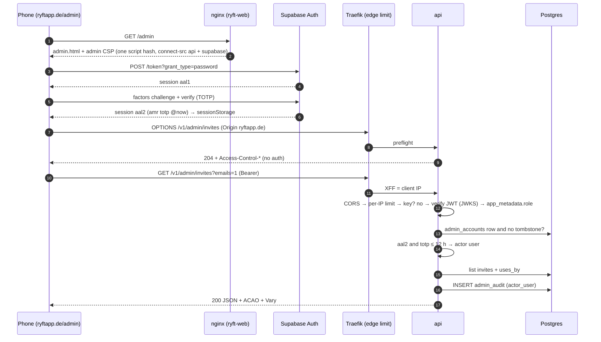
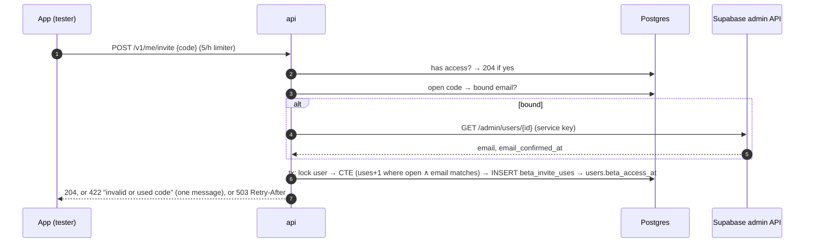
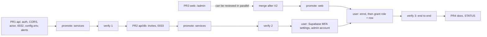

# Admin area on ryftapp.de: design

Ticket `2026-11-05-admin-web`. Author: platform-architect. Input: `brief.md` (same folder). Code read on
`origin/main` at `ab87021` (local `main` was 8 commits behind; nothing was changed in the tree). Every
claim about the current code below names its file, so it can be checked again.

**Numbering:** the entries of section 12 that PR1 implements are in `docs/DECISIONS.md` as D-A = D153, D-B = D154,
D-C = D155, D-D = D156, D-E = D157, D-I = D158 (worded there as decided; where they differ, `DECISIONS.md` wins).
D-F, D-G and D-H take the next numbers with the PRs that implement them.

**Status:** proposal, as written when `main` ended at D152. Section 13 lists the decisions the user has to make.
The entries proposed in section 12 are numbered as the note above says (PR1's are D153-D158).

---

## 0. Summary

The brief's goal stands: a phone-first page at `https://ryftapp.de/admin`, signed in with Supabase and
TOTP, that creates email-bound invite codes, shares them, and shows who redeemed what. The brief is wrong
or risky in twelve places, and this design changes the plan as follows:

1. **Revocation.** The admin role comes from `app_metadata.role` **and** a new allow-list table
   `admin_accounts` that the api checks on every request. A JWT stays valid until it expires (up to
   1 h), so the role claim alone cannot be revoked in time. Deleting the row takes effect on the
   next request.
2. **MFA freshness.** `aal2` alone is not enough. A Supabase session lives until the user signs out,
   so the TOTP must also be recent: the `amr` entry with method `totp` must be at most 12 h old.
3. **Least privilege for the browser.** A token can call only the routes the page needs. Merge,
   flag writes, user detail and resync-hint stay **key-only**, and the server enforces this.
4. **There is no `auth.Claims`.** The real types are the unexported `supabaseClaims` and `Principal`
   in `internal/auth/supabase.go`. The new claims are parsed **leniently**. A strict type would turn
   one odd `amr` shape into a 401 for every app user.
5. **There is no admin limiter today.** Admin routes bypass `auth.Middleware`, so they have no rate
   limit of any kind. The per-IP limiter is new. It reads the client IP from the rightmost
   `X-Forwarded-For` entry, the one Traefik appends; Traefik strips any incoming XFF because its
   forwarded headers are untrusted by default.
6. **Config lives in git, not Vault.** `ADMIN_WEB_ORIGINS` goes into `deploy/k8s/base/api/config.env`
   (the hashed ConfigMap, D111). `PUBLIC_WEB_URL` gets a default in code. **No `terraform apply`**
   is needed, which removes the brief's user step 3.
7. **The web plan cannot work as written.** Web D2 strips the Next/React runtime in the postbuild,
   and `tests/static.test.ts` fails on `'use client'`. So the page becomes **one inline, hashed,
   framework-free script**, with **no supabase-js**: about 200 lines of direct GoTrue REST calls.
   The session is kept in **`sessionStorage`**, not `localStorage`, because `localStorage` is shared
   with every marketing page of the same origin. Trusted Types are set to `'none'`.
8. **Email binding is checked against Supabase's own record.** `POST /v1/me/invite` compares the
   code's email with `email` from the Supabase admin API, and only when `email_confirmed_at` is set.
   It never uses the token's `email` claim or `users.email`.
9. **Migrations must keep rollback safe.** `created_by` needs a `DEFAULT`; `beta_invite_uses` needs
   `ON DELETE CASCADE`; revoke also sets `expires_at`, so an image from before the change refuses a
   revoked code too. PR1 brings its own migration (0032), and the invite migration becomes **0033**.
10. **Email signups stay on.** The app has email accounts (`SUPABASE.md` → checklist 3), so "signups
    must be off" is wrong. An attacker who signs up gets neither a role nor an allow-list row.
11. **No user id in metrics.** A "digest by user id" metric would put a personal id into Grafana
    Cloud, against the privacy text: "service metrics without personal data". It is replaced by an
    info alert `AdminWebUsed` that fires each time the page is used.
12. **Privacy text.** An operator viewing tester emails needs **no** new version (that already happens
    through `/v1/admin/users?emails=1`). Storing a *prospective* tester's email on a bound code is a
    new data category, and the text should name it. The user decides when (U3).

---

## 1. Problem and constraints

**Problem.** Today codes come only from `POST /v1/admin/invites` with `ADMIN_API_KEY`, run from a laptop.
Codes are anonymous, and nobody can see who redeemed one. The operator needs a phone flow: sign in →
email → code + link → share → see the redemption.

**Constraints.**
- **Cost:** three t3.large nodes. No new Deployment, no new Service, no new add-on. Everything goes into
  the existing api and web images.
- **One operator:** steps fit in a phone session. Every new moving part has a runbook line and an alert.
- **GDPR:** the admin page is on the controller's side, but it reaches emails of accounts that hold
  health data (Art. 9). It must not render health data. It uses no cookies, no third-party scripts and
  no CDN.
- **Contract:** `docs/API.md` is additive only. The Swift mirror's `InvitePost` and the app stay
  unchanged.
- **Production is the only cluster:** there is no staging. PR1 and PR2 are therefore designed to be
  **inert until the user's SQL step**: the token path admits nobody without an `admin_accounts` row,
  and existing codes have `email = NULL` and `revoked_at = NULL`.
- **Sequencing with phase 2:** A3 (`docs/work/2026-11-04-production-hardening/phase2-design.md`)
  converts `cmd/api/main.go` to `app.Run` and adds a route table test. PR1 edits `main.go` and
  `adminRoutes` in their current form. Whichever lands second rebases, and A3's route table test must
  carry the key-only classification from PR1 (section 4.6). Recommendation: PR1 lands first.

---

## 2. Options considered

### 2.1 Who is an admin, and how revocation takes effect

| Option | For | Against |
| --- | --- | --- |
| A. `app_metadata.role == "admin"` in the JWT only (brief) | No DB lookup, one place to set it | Revoking takes up to 1 h (`exp`); a banned or deleted user's token keeps working until it expires; anyone who can write `app_metadata` (Supabase dashboard, service key) makes an admin |
| B. Allow-list table only (`admin_accounts`), plus `aal2` | Immediate revocation, Postgres is the source of truth | Any user can reach `aal2` by enrolling their own TOTP, so the row alone is the gate; the page cannot show "not an admin" without calling the api |
| **C. Both: claim AND row AND fresh `aal2` (chosen)** | Granting needs two independent writes (Supabase `app_metadata` and our DB as owner); revoking needs one, and it is immediate (delete the row); the claim gives the page a local hint | One more SQL line in the user's setup, and one indexed lookup per admin request (admin traffic is tiny) |

Other mitigations considered: shortening the project's JWT expiry (affects the app and still is not
immediate), and calling the Supabase admin API on every admin request (a network dependency in the
admin path). Both are rejected in favour of C.

### 2.2 The page's code

| Option | For | Against |
| --- | --- | --- |
| A. React client components + supabase-js (brief) | Familiar | Web D2's postbuild deletes the runtime and `static.test.ts` refuses `'use client'`; about 170 KB of runtime plus about 50 KB of supabase-js; `script-src 'self'` or many RSC inline hashes; Trusted Types conflicts are likely; supabase-js pulls in realtime (`wss:`) unless it is trimmed |
| B. Keep the Next runtime for `/admin` only | React DX | Same CSP and Trusted Types problems; the postbuild learns exceptions; the budget has to be measured again |
| **C. One inline IIFE script built from `web/src/admin/*.ts` with esbuild, DOM built only with `createElement`/`textContent`, GoTrue REST called directly (chosen)** | One SHA-256 in the CSP, no `'self'` scripts, `trusted-types 'none'` holds (no HTML sink exists), no third-party code in the admin page, nothing to list on `/licenses`, about 20–30 KB | We write about 200 lines of auth client (password grant, refresh, MFA factors), and the GoTrue REST shapes are ours to track (they are stable and versioned; the e2e mocks pin them) |

Fallback for C: if the MFA flows turn out harder than expected, `@supabase/auth-js` alone (not
supabase-js: no realtime, storage or postgrest), bundled into the same inline script. Its licence then
goes on `/licenses`. Use it only with the lead's agreement.

### 2.3 Session storage in the browser

| Option | Risk |
| --- | --- |
| `localStorage` (brief) | Shared by **every page of `ryftapp.de`**: script running on a marketing page could read the admin's refresh token; it outlives the tab (lost phone) |
| **`sessionStorage` (chosen)** | Per tab: script on another page cannot read it, and it is gone when the tab closes. Cost: the operator signs in again (password manager + TOTP, about 20 s) after closing the tab |
| A subdomain `admin.ryftapp.de` | Full origin isolation, but another Ingress, certificate and nginx server and a second CORS origin. Not worth it while the marketing pages run no dynamic code (hashed CSP, Trusted Types). Recorded as the v2 hardening if the site ever gets dynamic content |

---

## 3. The claims contract (decision 1)

### 3.1 What the verifier checks today (`internal/auth/supabase.go`), unchanged

- Signature: ES256 or RS256 from the project JWKS. No HS256, no `none`, so a leaked legacy JWT secret
  cannot mint tokens.
- `iss` = `https://<ref>.supabase.co/auth/v1` (`SUPABASE_ISSUER` overrides), `aud` contains
  `authenticated`, `exp` required, `iat` checked, **30 s leeway** (`SupabaseOptions.Leeway`).
- The top-level `role` must equal `authenticated` (this refuses anon and `service_role` tokens).
  `is_anonymous` must not be true, and `sub` must be a non-nil UUID.
- The JOSE header `typ` is **not** checked. That is acceptable: with asymmetric keys GoTrue signs only
  access tokens, and `aud`/`role` already exclude every other token Supabase issues. No change.
- Expired, bad signature, wrong issuer or audience, unknown key with a healthy JWKS: `*Error` 401.
  No keys loaded, an unknown key while the last fetch failed, or a refresh rate-limit: 503 with
  `Retry-After: 5` (D29). The admin path keeps these semantics (section 4.2).

### 3.2 What is added: parsed leniently, never a reason to reject an app user

Additions to `supabaseClaims`:

```go
AAL json.RawMessage `json:"aal"` // "aal1" | "aal2"
AMR json.RawMessage `json:"amr"` // [{"method":"password","timestamp":1730790000}, {"method":"totp",...}]
AppMetadata struct {
    Provider string          `json:"provider"`
    Role     json.RawMessage `json:"role"` // the ONLY source of the admin role
} `json:"app_metadata"`
```

Additions to `auth.Principal` (named so that nobody confuses them with the top-level `role`):

```go
// What the token says about operator access. It never grants anything on its own: cmd/api's
// admin check also requires an admin_accounts row (D-A).
AppRole string    // app_metadata.role when it is a JSON string of <= 32 bytes; else ""
AAL     string    // exactly "aal1" or "aal2"; anything else ""
MFAAt   time.Time // newest amr entry whose method is "totp"; zero when there is none
```

**Rules (PR1 tests each one with hand-signed tokens against the test JWKS in `supabase_test.go`):**

| Token | `Verify` | Principal |
| --- | --- | --- |
| app token, no `app_metadata.role` | ok | `AppRole ""` |
| `app_metadata.role: "admin"` | ok | `AppRole "admin"` |
| `user_metadata.role: "admin"` only (user-writable via `updateUser({data})`) | ok | `AppRole ""` |
| top-level `role: "admin"` | **401 `role`** (today's check) | — |
| `app_metadata.role: 7` or `["admin"]` | ok | `AppRole ""` |
| `amr: ["pwd"]` (RFC 8176 strings) or garbage | ok | `MFAAt` zero |
| `aal: "aal3"` or `2` | ok | `AAL ""` |
| `amr` with `totp` at t1 and t2 | ok | `MFAAt = max(t1, t2)` |

The lenient parsing matters: a typed `[]struct{...}` for `amr` would fail `ParseWithClaims` on an
unexpected shape, and that would sign out **every app user**. A test pins that an app token with a
malformed `amr` or `app_metadata.role` still verifies.

`APIKey.Verify` (local `AUTH_MODE=apikey`) leaves all three fields empty, so the token path never
admits anyone locally. Local admin work uses the key, or the e2e mocks.

### 3.3 Revocation and the token lifetime

- An access token is valid for its `exp` (the project default is 3600 s). Banning, deleting or signing
  out the user does **not** invalidate tokens already issued; only the refresh fails.
- **The app path** (unchanged): a deleted account is refused through the tombstone in `EnsureUser`.
  A banned account works until its token expires (existing behaviour, out of scope).
- **The admin path (new):** every token request checks
  `EXISTS (SELECT 1 FROM admin_accounts a WHERE a.user_id = $1) AND NOT EXISTS (SELECT 1 FROM deleted_users d WHERE d.id = $1)`.
  Deleting the row in the SQL editor (as `postgres`) takes effect on the **next request**. Removing
  `app_metadata.role` takes effect when the token expires (≤ 1 h). Either one is enough.
- **MFA freshness:** `MFAAt` must lie within `[now − 12 h, now + 30 s]`, or the answer is 403
  `mfa_required`. The page then runs a TOTP challenge again (section 7.3). This bounds what a stolen
  refresh token is worth to 12 h without the second factor. The constant is
  `adminMFAMaxAge = 12 * time.Hour` in `cmd/api`, not configuration.
- **Verification item (PR1 acceptance, on the real project, read-only):** decode one admin access
  token from the page and confirm the shapes of `aal`, `amr[].method`, `amr[].timestamp` and
  `app_metadata.role`. Also confirm that a repeated challenge/verify on an `aal2` session issues a
  token whose `totp` timestamp is new. If GoTrue does **not** refresh it, the page's fallback after 12 h
  is a full sign-out and sign-in (section 7.3). Both outcomes fail closed.

---

## 4. Admin authentication in `cmd/api` (decisions 1, 2, 3)

### 4.1 The chain (outermost first)

```
/v1/admin/  →  CORS (httpx)  →  per-IP limiter  →  adminAuth  →  audited  →  Timeout  →  WithRoutes(adm)
```

- CORS is outermost, so 401, 403 and 429 answers carry `Access-Control-Allow-Origin`, and the page can
  read their status and body. A preflight is answered here and never reaches the limiter, the auth,
  the audit or the metrics.
- The limiter runs before the auth, so a flood of bad credentials costs no JWT verification and no DB
  lookup.
- As today, `/v1/admin/` exists only when `ADMIN_API_KEY` is set (`main.go`). Prod always has the key.

### 4.2 `adminAuth`: order of evaluation

```text
1. bearer := "Authorization: Bearer <t>" (scheme case-insensitive, as auth.bearer); absent → 401 (missing)
2. if ConstantTimeCompare(sha256(t), sha256(ADMIN_API_KEY)) == 1 → actor{key, fingerprint}; done
   (hashing first removes the length side channel of ConstantTimeCompare; the key is ALWAYS compared,
   whatever t looks like)
3. if verifier is nil || len(t) > 8 KiB || strings.Count(t, ".") != 2 → 401 (not_a_token)
4. p, err := verifier.Verify(ctx, t)
     *Error 401 → 401 (verifier reason, e.g. expired)
     *Error 503 → 503 "authentication temporarily unavailable", Retry-After: 5 (never a sign-out)
5. p.AppRole != "admin"                                     → 401 (not_admin)
6. allowed, err := st.IsAdminAccount(ctx, p.UserID)         err → 503; !allowed → 401 (not_allowed)
7. p.AAL != "aal2" || MFAAt outside [now−12h, now+30s]       → 403 code mfa_required (mfa_missing | mfa_stale)
8. actor{user, p.UserID}; httpx.Info(ctx).UserID = p.UserID
```

- **No oracle between a bad key and a bad token.** Every 401 is byte-identical: status 401,
  `WWW-Authenticate: Bearer realm="ryft-admin"`, body
  `{"error":"admin key or admin sign-in required","request_id":"…"}`, metric
  `ryft_admin_requests_total{result="unauthorized"}`. The reason (`missing`, `not_a_token`, the
  verifier's reason, `not_admin`, `not_allowed`) appears only in the server log line
  `"admin auth rejected"` and as the access line's `code` (through `httpx.SetCode`, as `auth.fail`
  does).
- **What timing can show.** A JWT-shaped bearer costs one signature check, a random string costs
  nothing. That reveals only that the server tries JWT verification, which is documented anyway. The
  secret (the key) is compared in constant time on every request.
- **The 503 on step 4** is visible to the caller. It means only "the JWKS is down", never anything
  about the key. The key path does not depend on Supabase, so scripts and `make smoke-prod` keep
  working through a Supabase outage.
- **`mfa_required` comes only after steps 5 and 6.** Only a real, allow-listed admin ever sees it. A
  stolen `aal1` token of a non-admin, or of an admin account without a row, gets the same 401 as
  garbage.

### 4.3 Route classes: least privilege for the browser

Key-only routes are registered with a wrapper, so the classification is visible in `adminRoutes` and
testable:

| Route | Key | Token | Page uses |
| --- | --- | --- | --- |
| `GET /v1/admin/flags` | ✓ | ✓ | Flags (read-only) |
| `PUT`, `DELETE /v1/admin/flags/{key}` | ✓ | **403** | — (stays with scripts until a second admin exists) |
| `POST`, `GET /v1/admin/invites`, `DELETE /v1/admin/invites/{code}` | ✓ | ✓ | Invites |
| `GET /v1/admin/feedback`, `POST /v1/admin/feedback/{id}/resolve` | ✓ | ✓ | Feedback |
| `GET /v1/admin/users` | ✓ | ✓ | Users (`?emails=1`) |
| `POST`, `DELETE /v1/admin/users/{id}/access` | ✓ | ✓ | Users: grant, revoke |
| `GET /v1/admin/users/{id}` | ✓ | **403** | — (sync details, identities; `user.sh` only) |
| `POST /v1/admin/users/{id}/merge-into/{to}` | ✓ | **403** | — (destructive; `user.sh` only) |
| `POST /v1/admin/users/{id}/resync-hint` | ✓ | **403** | — |
| `GET /v1/admin/audit` | ✓ | ✓ | not in v1 (allowed for a later screen; read-only) |

`a.keyOnly(h)` answers `403 {"error":"this route needs the admin key"}` without a `code`. It runs inside
`audited`, so the attempt gets an audit row (actor user, status 403), and it counts
`ryft_admin_requests_total{result="forbidden"}`. A test walks every pattern registered in `adminRoutes`
and fails when a route is in neither list. That keeps A3's route table and this table in step.

### 4.4 The actor, the audit and the logs (decision 8)

- `type adminActor struct{ Kind string; ID string }`: `{key, "3fa1c2d9"}` or
  `{user, "<uuid>"}`, stored in the request context by `adminAuth`. `a.keyID` disappears from the
  `admin` struct.
- **Today:** `admin_audit.key_fingerprint text NOT NULL CHECK (length <= 16)` (migration 0022), plain
  text, no JSON. **Migration 0032** adds `actor_user uuid NULL` and the constraint
  `admin_audit_one_actor CHECK ((actor_user IS NULL) = (key_fingerprint <> ''))`. Key rows keep their
  fingerprint; user rows store `key_fingerprint = ''` and `actor_user`. Existing rows (8-hex
  fingerprint, no `actor_user`) pass the constraint; it is added `NOT VALID` and validated in the same
  transaction (the 0031 pattern; small table). Nothing is migrated in place.
  - Why not make `key_fingerprint` nullable: an image from before 0032 scans it into a Go `string`, and
    a NULL would make `GET /v1/admin/audit` fail with a 500 after a rollback.
- `store.AuditEntry` gains `ActorUser *uuid.UUID`. `AuditSince` selects it, and `model.AuditRecord`
  gains **`actor`** (`{"kind": "key"|"user", "id": string?}`, a closed enum). `key_fingerprint` stays
  (v1 never removes a field) and is `""` on user rows. The schema snapshot is updated.
- **Logs:** every admin log line carries `admin_actor` (`"key:3fa1c2d9"` or `"user:1b2c3d4e"`, the
  first 8 hex digits, pseudonymous like `user_id`). `admin_key` stays on key-actor lines for existing
  queries (12 call sites in `cmd/api`). No emails, ever: the invite handlers log `bound: true|false`,
  never the address.
- **Digest:** see section 9 (an info alert instead of a metric keyed by user id).

### 4.5 `mfa_required` in the contract (decision 2)

- `model.CodeMFARequired = "mfa_required"`, placed in `internal/model/admin.go` with the comment
  "operator surface only: `/v1/admin/*`; the app never calls these routes". `codeConstants` reads every
  non-test file of the package. It is written with `httpx.WriteCodedError(w, r, http.StatusForbidden,
  model.CodeMFARequired, …)`, so `apidoc_errors_test` finds the (403, code) pair.
- **API.md → Errors:** a code-table row
  ``| `mfa_required` | `403` | Only on `/v1/admin/*` (the operator's web page and scripts); the app never calls these routes and never receives it. Run a TOTP challenge (Supabase MFA) and send the request again with the new token. |``.
  The `403` status row's `code` cell gains `` `mfa_required` ``, and its When/Do mention the admin case.
- **Swift mirror (in API.md only; the app is untouched):**
  `case mfaRequired = "mfa_required"   // 403 on /v1/admin/* only; the app never receives it`.
  `TestAPIDocErrorCodesMatchCode` requires the case. The changelog says "Swift: the mirror gains the
  case for completeness; the app needs no change, it never calls `/v1/admin/*`." This is additive: the
  app's closed `APIErrorCode` never meets the value.
- Rejected alternative: exempting operator codes from the mirror inside the doc test. That is more test
  machinery for no gain.
- **Metrics:** `ryft_admin_requests_total{result}` gains `mfa_required` and `forbidden`; the help text
  lists all of `ok, invalid, error, unauthorized, mfa_required, forbidden`. New counter
  `ryft_admin_authorized_total{actor="key"|"user"}`, incremented once per request that passed
  `adminAuth`. `ryft_rate_limited_total{class="admin_ip"}` counts the per-IP limiter. No label carries
  an id.

### 4.6 The per-IP limiter (decision 3)

- **Today:** there is no limiter on `/v1/admin/*` at all. The brief's "per-user one" does not exist.
  The edge's per-IP limit (Traefik `ratelimit` Middleware, 20/s, burst 50, `ipStrategy.depth: 0`, D53)
  applies to all of `api.ryftapp.de`.
- **New:** `ratelimit.New(10, 20)` keyed by `httpx.ClientIP(r)`. It is per pod (2–4 replicas, so up to
  4×) and covers every non-preflight request to `/v1/admin/*`. Over the limit: `429` JSON
  `{"error":"too many requests"}` with `Retry-After` (whole seconds, rounded up) and the CORS headers.
- **Which IP, and why it cannot be spoofed:**
  - The NLB keeps the client address (`preserve_client_ip.enabled=true`, `nlb-target-type: ip`,
    `infra/aws/kubernetes/addons.tf`). Traefik's `RemoteAddr` is therefore the client.
  - The Traefik values set no `forwardedHeaders.trustedIPs` or `insecure`. Traefik therefore treats
    every peer as untrusted, **removes** any incoming `X-Forwarded-*`/`X-Real-Ip`, and its proxy
    **appends** the peer address to `X-Forwarded-For`. The api thus receives exactly one XFF value:
    the client.
  - The api's NetworkPolicy admits port 8080 only from Traefik (kube-system) and our own smoke pod
    (`deploy/k8s/base/api/networkpolicy.yaml`; the unused ingress-nginx peer is gone).
  - `httpx.ClientIP(r)` therefore takes the **rightmost** comma-separated XFF entry when it parses as
    an IP, and otherwise the host of `RemoteAddr`. IPv6 keys are masked to /64 (the NLB is IPv4 today;
    this is defensive). A test pins that a forged leftmost XFF is ignored.
  - Do **not** use `X-Real-Ip` or the leftmost XFF entry.
- **Privacy:** the IP lives only as a map key in memory (buckets are dropped when idle). It is never
  logged and never a metric label. This is covered by the privacy text: "your browser's IP address … to
  limit requests per address; it is not stored".
- `internal/ratelimit/doc.go` documents the exception to D36 ("buckets keyed by user id, not IP"): an
  unauthenticated operator surface has no user id before the auth.
- **What it does not protect:** Supabase's own `/auth/v1/token` and `/factors/*/verify`. Those are the
  project's Auth rate limits (section 10).

---

## 5. CORS (decision 4)

`httpx.CORS{Origins, Methods, Headers, Expose []string; MaxAge time.Duration}.Wrap(next)` is generic
and applied **only** in `adminRoutes`. User routes never send CORS headers; a test pins
`GET /v1/config` with `Origin: https://ryftapp.de` → no `Access-Control-*`.

| Request | Answer |
| --- | --- |
| `OPTIONS` with `Origin` ∈ origins, `Access-Control-Request-Method` ∈ {GET, POST, DELETE}, every `Access-Control-Request-Headers` entry ∈ {authorization, content-type} (case-insensitive) | `204`, `Access-Control-Allow-Origin: <origin>` (echoed exactly), `Access-Control-Allow-Methods: GET, POST, DELETE`, `Access-Control-Allow-Headers: Authorization, Content-Type`, `Access-Control-Max-Age: 600`, `Vary: Origin, Access-Control-Request-Method, Access-Control-Request-Headers`. No auth, no limiter, no audit |
| `OPTIONS` preflight from another origin, or with a method or header outside the lists | `204` **without** any `Access-Control-*` (the browser refuses); not counted as unauthorized |
| Any other request with an allowed `Origin` | passes on; the response gains `Access-Control-Allow-Origin: <origin>`, `Access-Control-Expose-Headers: X-Request-ID, Retry-After`, `Vary: Origin` |
| Any other request with a different or no `Origin` | passes on with `Vary: Origin` and no `Access-Control-*`; it still needs the key or a token |

- **Not `PUT`.** The brief lists it, but the only admin `PUT` (flags) is key-only, so the browser never
  needs it.
- **No `Access-Control-Allow-Credentials`.** There are no cookies.
- **Matching** is exact string equality against the normalised config. `null` and `*` are never
  accepted, and there are no wildcards or suffix matches.
- **`Max-Age` 600** is the largest value every engine honours without clamping surprises.
- **Non-browser clients** ignore CORS. CORS is not an access control here; the bearer is. With no
  cookies, there is no CSRF: another origin cannot obtain the operator's token. The allow-list only
  stops other web origins from *reading* responses with a token they already have, which is hygiene.
- **Ingress layer:** `deploy/k8s/overlays/eks/ingress-api.yaml` attaches only `ryft-api-ratelimit`.
  There is no headers Middleware, so Traefik neither adds nor strips CORS headers. **Traefik's own
  answers** (its 429 at the edge, a 502/504) carry no CORS headers, so the browser reports a network
  error. The page shows "no answer from api.ryftapp.de (network or edge limit)" and no request id
  (section 7.4).
- **NetworkPolicy and egress:** nothing changes. Browsers reach the api through NLB → Traefik, which
  is already admitted. The web pod (nginx) makes no calls. No pod gains egress.

**Config (`config.LoadAdmin`, which now returns `config.Admin{Key, WebOrigins, PublicWebURL}`):**
- `ADMIN_WEB_ORIGINS`: comma-separated, trimmed, at most 5, deduplicated. Each entry is a bare origin:
  scheme `https`, or `http` only for host `localhost`, `127.0.0.1` or `[::1]`; no userinfo, path,
  query or fragment; no trailing slash; a lower-case host; an explicit port allowed. **Unset or empty
  means no CORS** (the api starts, and the page fails with a CORS error: closed). A **malformed** value
  stops the api at start-up, like a bad `PRIVACY_POLICY_VERSION`. A Go test parses the line in
  `deploy/k8s/base/api/config.env` with the loader, so a bad value cannot merge, and asserts that
  prod's value has no `http:`.
- `PUBLIC_WEB_URL`: the default `https://ryftapp.de` lives in code (like `PRIVACY_POLICY_URL`).
  Same validation (https, origin only). **No config line is needed.**
- **Where:** `deploy/k8s/base/api/config.env` gains `ADMIN_WEB_ORIGINS=https://ryftapp.de`. It is a
  bare line and not secret. It is **not** in `infra/vault`: Vault holds secrets and the user-flipped
  gates, and this is reviewable config. `docker-compose.yml` leaves it empty (local api in apikey
  mode cannot admit a token anyway).

---

## 6. Invites for a person (decision 7)

### 6.1 Migration `0033_invites_for_email.sql` (PR2)

```sql
SET LOCAL lock_timeout = '5s';

ALTER TABLE beta_invite_codes
    ADD COLUMN IF NOT EXISTS email      text,                       -- NULL: anyone with the code
    ADD COLUMN IF NOT EXISTS created_by text NOT NULL DEFAULT 'key', -- the default is the backfill AND keeps
                                                                     -- an older image's INSERT working
    ADD COLUMN IF NOT EXISTS revoked_at timestamptz;
-- NOT NULL DEFAULT <constant> rewrites nothing (PG >= 11): existing rows read 'key'.

-- DO-block guards as in 0031; NOT VALID, then VALIDATE in the same transaction (small table).
--   beta_invite_codes_email_form:
--     email IS NULL OR (email = lower(email) AND length(email) BETWEEN 3 AND 254
--                       AND email ~ '^[!-~]+@[!-~]+\.[!-~]+$' AND email !~ '@.*@')
--   beta_invite_codes_created_by_form:
--     created_by ~ '^(key|key:[0-9a-f]{8}|user:[0-9a-f]{8}-[0-9a-f]{4}-[0-9a-f]{4}-[0-9a-f]{4}-[0-9a-f]{12})$'
--   beta_invite_codes_bound_single_use:
--     email IS NULL OR max_uses = 1

CREATE TABLE IF NOT EXISTS beta_invite_uses (
    code    text NOT NULL REFERENCES beta_invite_codes(code) ON DELETE CASCADE, -- an older image's hard
                                                                                 -- DELETE keeps working
    user_id uuid NOT NULL REFERENCES users(id),        -- DeleteUser removes the rows first
    at      timestamptz NOT NULL DEFAULT now(),
    PRIMARY KEY (code, user_id)                        -- a code redeems at most once per account
);
CREATE INDEX IF NOT EXISTS beta_invite_uses_user ON beta_invite_uses (user_id);

-- Who redeemed before 0033: users.beta_invite_code holds the stored form (RYFT7K3MQX9P).
INSERT INTO beta_invite_uses (code, user_id, at)
SELECT u.beta_invite_code, u.id, COALESCE(u.beta_access_at, now())
FROM users u JOIN beta_invite_codes c ON c.code = u.beta_invite_code
ON CONFLICT DO NOTHING;

GRANT SELECT, INSERT, UPDATE, DELETE ON beta_invite_uses TO ryft_api;   -- UPDATE: merge moves rows
DROP POLICY IF EXISTS beta_invite_uses_services ON beta_invite_uses;
CREATE POLICY beta_invite_uses_services ON beta_invite_uses TO ryft_api USING (true) WITH CHECK (true);
-- Supabase DO block as 0017: ENABLE RLS; REVOKE ALL FROM anon, authenticated, service_role.
```

- **Migration 0032 (PR1):** the `admin_accounts` table (`user_id uuid PRIMARY KEY` with no foreign key,
  since an admin account has no `users` row; `note text NOT NULL DEFAULT '' CHECK (length <= 200)`;
  `added_at timestamptz NOT NULL DEFAULT now()`), `GRANT SELECT ON admin_accounts TO ryft_api` only,
  a policy `FOR SELECT TO ryft_api`, the RLS and REVOKE block, and the `admin_audit` change from
  section 4.4. The api can read admins and never write them. Only the owner (`postgres`, the SQL
  editor) can. `admin_accounts` is operator configuration, not user data. It is deliberately **not**
  in `DeleteUser`; the tombstone check in section 3.3 covers a deleted admin account. D-A records the
  exception to "every user table is covered by account deletion".
- `internal/db/roles_test.go` adds `admin_accounts: {ryft_api: SELECT}` and
  `beta_invite_uses: {ryft_api: crud}`, with no grant for ingest, scoring or notify.
- `store.DeleteUser` gains `DELETE FROM beta_invite_uses WHERE user_id=$1`, before `users`.
  `store.MergeUsers` moves the rows (`UPDATE … SET user_id = to WHERE user_id = from AND NOT EXISTS
  (same code for to)`, then drops the leftovers) and reports the count. `delete_test.go` counts the
  table.

### 6.2 Redeem: one transaction, one decisive statement

`POST /v1/me/invite` stays behind the existing 5/h per-user limiter (`ratelimit.NewUserLimits`,
unchanged):

1. If the account already has access → `204`, nothing is spent (unchanged; no probing is possible
   from an account with access).
2. `NormalizeInvite(code) == ""` → `422 "invalid or used code"`.
3. `SELECT email FROM beta_invite_codes WHERE code=$1 AND revoked_at IS NULL AND uses < max_uses AND
   (expires_at IS NULL OR expires_at > now())`. If a bound email comes back:
   `verified, err := h.emails.VerifiedEmail(ctx, userID)`, **outside any transaction** (no row lock is
   held across HTTP). If it fails → `503 "the invite could not be checked right now"` with
   `Retry-After: 5` (no `code`).
4. In the transaction: `SELECT … FROM users WHERE id=$1 FOR UPDATE` (serialises the account), recheck
   access, then:

   ```sql
   WITH spent AS (
     UPDATE beta_invite_codes SET uses = uses + 1
     WHERE code = $1 AND revoked_at IS NULL AND uses < max_uses
       AND (expires_at IS NULL OR expires_at > now())
       AND (email IS NULL OR email = $3)            -- $3 NULL when unbound or unverified: never equal
       AND NOT EXISTS (SELECT 1 FROM beta_invite_uses WHERE code = $1 AND user_id = $2)
     RETURNING code)
   INSERT INTO beta_invite_uses (code, user_id) SELECT code, $2 FROM spent RETURNING code
   ```

   No row → `ErrInvalidCode` → the same `422 "invalid or used code"` for unknown, expired, used up,
   revoked, wrong email, unverified email and already redeemed by this account. Then
   `UPDATE users SET beta_access_at = now(), beta_invite_code = $1` (unchanged).
   - **Races.** Two accounts on the last use: the row lock plus READ COMMITTED re-evaluate
     `uses < max_uses`, so exactly one wins. Revoke vs redeem: revoke's `UPDATE` holds the row, and the
     redeem re-evaluates `revoked_at IS NULL`. The same account twice: the users row lock serialises
     it. The primary key is the backstop; a `23505` maps to `ErrInvalidCode`.

**Which email is authoritative, and when it counts as verified.**
- **Not the token's `email` claim.** It is a copy and may predate a change.
- **Not `users.email`.** `EnsureUser` copies the token's claim, at most every 5 minutes.
- **Not `user_metadata.email_verified`.** Users can write it.
- `email` from **Supabase's admin API** `GET /auth/v1/admin/users/{id}` (the api already holds
  `SUPABASE_SERVICE_ROLE_KEY` and calls it in `auth.Admin.GetUser`). It counts **only when
  `email_confirmed_at` is set**: `AdminUserInfo` gains `EmailConfirmedAt *time.Time`. **That proves a mailbox only
  while the project's *Confirm email* is ON** (corrected after the security review of PR2; the first draft said
  "whatever the setting is", which is false): with it off, Supabase sets `email_confirmed_at` at sign-up, and anyone
  holding a leaked link could register the victim's address and redeem the code. A Sign in with Apple account's
  email is confirmed by Supabase on sign-in; an email account is confirmed through its link only with Confirm
  email on. An unconfirmed address never matches. So the user records *Confirm email* on (and *Secure email
  change* on) before the first bound code, and the api reads `mailer_autoconfirm` from the project's public auth
  settings at start and hourly and refuses to create or redeem a bound code while it is true or unknown (D159).
- **Comparison:** the ASCII letters of the address lower-cased, then byte equality with `code.email`. No trimming
  (the first draft said `TrimSpace`; an address with a space around it is refused), and an address outside printable
  ASCII never matches. There is no plus-address stripping and no Gmail dot folding: both would widen who may redeem,
  and for most domains `a.b@` and `ab@` are different mailboxes.
- **Without the admin client** (apikey mode, or no service key), `VerifiedEmail` returns `""`, so
  bound codes never redeem, and creating one is refused (`422`) with a start-up log line. Local stacks and tests use a fake `emails` interface.
- **Apple private relay:** an `@privaterelay.appleid.com` address matches only if the tester gives the
  operator exactly that address. The page says so and recommends an unbound code when unsure, which is
  today's behaviour.

**No oracle before a correct guess of a live bound code.** One message and one status for every refusal. The Supabase lookup
(about 50–150 ms) happens only for a code that exists, is open and is bound, so a timing difference
shows up only *after* a correct guess of a live code. With 31⁸ ≈ 8.5·10¹¹ codes (~39.6 bits), 5 tries
per hour per account and pod, and fewer than about 100 open codes, the chance per guess is around
10⁻¹⁰. Accounts cost a confirmed email each, behind Supabase's sign-up rate limits. Calling Supabase on
every attempt would only add a dependency for unbound codes. The 503 during a Supabase outage is the
same: visible only for a live, bound code.

### 6.3 Create, list, revoke

- `BetaInviteInput` gains `email` (string?). Normalised by trim + lower-case and validated: ASCII
  printable, ≤ 254, one `@`, a dot in the domain, else `422 "email is not a valid address"`. With
  `email`, `max_uses` must be 1 (`422 "a code for one email has max_uses 1"`). `expires_at` keeps
  today's API default (none). The **page** sends 14 days.
- `created_by` is written as `key:<fingerprint>` or `user:<uuid>`.
- **`DELETE /v1/admin/invites/{code}` becomes revoke:**
  `UPDATE … SET revoked_at = COALESCE(revoked_at, now()), expires_at = CASE WHEN revoked_at IS NULL
  THEN LEAST(COALESCE(expires_at, now()), now()) ELSE expires_at END`. The answer is `204`, also when
  the code was already revoked (idempotent); `404 "no such code"` when unknown. Setting `expires_at`
  means an image from before 0033 (rollback) refuses a revoked code too.
  - **Contract note:** this changes the semantics of an existing route ("gone" becomes "still listed,
    revoked"). It is acceptable because the route's only clients are the operator's curl and the page;
    the app never calls admin routes. API.md and OPERATIONS say it. A hard delete is not offered.
  - The audit details get `code` (DB only, for the operator) on create and on revoke.
- **`GET /v1/admin/invites[?emails=1]`** still returns a JSON array of `BetaInvite`, newest first, with
  no pagination at beta size. Every field is **additive**:

  <!-- shape, for API.md (typed model.BetaInvite there) -->
  ```json
  { "code": "RYFT-7K3M-QX9P", "note": "Anna", "max_uses": 1, "uses": 1,
    "expires_at": "2026-11-19T10:00:00Z", "created_at": "2026-11-05T10:00:00Z",
    "email": "a***@g***.com", "created_by": { "kind": "user", "id": "1b2c3d4e-…" },
    "revoked_at": null, "status": "used", "link": "https://ryftapp.de/invite/RYFT-7K3M-QX9P",
    "uses_by": [ { "user_id": "9f8e…", "short_id": "9f8e7d6c", "email": "a***@g***.com",
                   "private_relay": false, "at": "2026-11-05T18:02:11Z" } ] }
  ```

  - `status` is a closed enum, computed in Go by a pure function with a test: `revoked` (revoked_at) >
    `used` (uses ≥ max_uses) > `expired` (expires_at ≤ now) > `open`.
  - `created_by` is the same `Actor` type as the audit's `actor`. Rows from before 0033 show
    `{"kind":"key","id":null}`.
  - `link` = `PUBLIC_WEB_URL + "/invite/" + ShowInvite(code)`. The app's universal link
    `/invite/*` normalises either form.
  - **Emails are masked unless `?emails=1`**, for both `email` and `uses_by[].email`, with the same
    `shown()` and `maskEmail` as `/v1/admin/users`. The audit row records `emails`. The page passes
    `emails=1`.
  - `uses_by` lists only accounts that still exist (a deleted account's row goes with it). `uses` stays
    the count, so `uses > len(uses_by)` means "redeemed by an account deleted since".
- **Retention of a prospective tester's email:** an hourly, idempotent sweep in the api,
  `st.PurgeInviteEmails(ctx, 30*24h)`, sets `email = NULL` once a code can no longer be redeemed
  (revoked, expired, or used up) for 30 days. Its started goroutine is a ticker in `main.go`; its log
  line is `"invite emails purged","n",n`, with no alert (a no-op is normal). Nulling is safe: a code
  that cannot redeem cannot be widened by losing its binding.

### 6.4 Privacy (and `PRIVACY_POLICY_VERSION`)

- **The admin viewing tester emails** (`uses_by`, the users list) is existing processing:
  `/v1/admin/users?emails=1` since D88/D89. The operator is the controller, and the text already says
  "Only the operator has administrative access". **No new version is needed for that.**
- **Storing the email of someone who asked for an invite** (who may never sign up) on
  `beta_invite_codes.email` is a **new category of data about non-users**. Section 3 of the text lists
  "the beta invite code you redeemed" only. The `note` field already may name a person (comment in
  `beta.go`), and that is a gap today too. **Recommendation:** add one sentence ("If you ask for an
  invite, the operator stores your email address with the code until you redeem it, or for at most 30
  days after it expired or was revoked; legal basis Art. 6(1)(b), steps at your request") in a new
  privacy version. The user decides whether that ships with PR2 (one re-consent for a handful of
  testers) or with the next planned text, and whether bound codes stay unused until then. This is U3.
  The `security-privacy-reviewer` confirms. The web's rule applies: the text and
  `PRIVACY_POLICY_VERSION` change in one PR.
- **API.md:** fields only, a changelog entry. The Swift mirror is unchanged: `InvitePost` does not
  change, and the admin types are not in the mirror.

---

## 7. The page (decisions 5, 6, 9)

### 7.1 Build and routing

- **Source:** `web/src/admin/*.ts` (`main.ts`, `auth.ts`, `api.ts`, `ui.ts`, `screens/*.ts`). It is
  plain TypeScript that builds DOM only with `document.createElement`, `textContent`,
  `setAttribute` (never `on*`), `append` and `replaceChildren`. **No** `innerHTML`, `outerHTML`,
  `insertAdjacentHTML`, `document.write`, `eval`, `new Function`, `setTimeout(string)`, or inline
  `style` strings. These are enforced three times: by ESLint (`no-restricted-properties`,
  `no-restricted-syntax`), by a Vitest scan of `src/admin`, and at runtime by `trusted-types 'none'`.
- **Bundle:** `scripts/admin-bundle.mjs` runs in `prebuild`. It calls `esbuild` (a new pinned
  **devDependency**; build time only, nothing ships) with `--bundle --format=iife --minify
  --target=es2022 --charset=utf8` into `src/generated/admin.js`. esbuild escapes `</script>` inside
  strings.
- **Page:** a new route group with **its own root layout**, `src/app/(admin)/layout.tsx`
  (`<html lang="en">`, the tokens CSS, `<meta name="robots" content="noindex, nofollow">`, no site
  header or navigation, no `RootDocument`), and the page `src/app/(admin)/admin/page.tsx`. It is a
  **server component** (no `'use client'`) that renders the shell and
  `<script data-ryft="admin" dangerouslySetInnerHTML={{ __html: ADMIN_JS }} />`, read from
  `src/generated/admin.js` at build time.
  - Why not `(en)/admin` as the brief says: `(en)/layout.tsx` brings the marketing document (nav,
    footer, two theme scripts) that the admin page does not need. A separate root layout keeps the
    page at **one** inline script. Nothing goes under `[locale]`.
  - If `tokens.css` needs `THEME_INIT`'s attribute for dark mode, the layout includes that script too
    (its hash is known). Otherwise it uses the CSS `prefers-color-scheme` fallback. web-engineer
    decides; the CSP then lists one or two hashes.
- **The postbuild** keeps `data-ryft` scripts already. Its check ("no runtime script") stays as it is.
  Static export layout: `trailingSlash: false`, so the file is `out/admin.html`.
- **Single URL, in-page views:** `/admin` with tabs (Invites · Users · Feedback · Flags) and the state
  in `location.hash` (`#invites`). There is one HTML file, one nginx location and one CSP. The fragment
  never reaches the server.
- **`robots`:** `X-Robots-Tag: noindex, nofollow` (nginx) plus the meta tag. **No `Disallow: /admin`
  in `robots.txt`**: it would advertise the path, and a disallowed page cannot be crawled to see its
  `noindex` (U6). `sitemap.ts` is an explicit list and already excludes it; a test pins that.
- **Config:** `web/config/admin.json`
  `{ "apiUrl": "https://api.ryftapp.de", "supabaseUrl": "https://<ref>.supabase.co", "supabaseKey": "sb_publishable_…" }`,
  committed. These values are public by design: the ref is in every token's `iss` and in the app
  binary, and the publishable key is meant for clients. The bundle and `csp.mjs` read the **same**
  file, so the CSP and the code cannot drift. Build args are not used. Use the publishable key, not
  the legacy anon JWT. (U4: confirm committing the ref; the alternative is GitHub repository
  variables passed as build args.)

### 7.2 nginx and the two CSPs

nginx does **not** merge `add_header` across levels. A location with any `add_header` loses every
server-level header. So:

- `nginx/headers-common.conf` holds the seven common headers (`X-Content-Type-Options`,
  `Referrer-Policy no-referrer`, `X-Frame-Options DENY`, `Strict-Transport-Security`,
  `Cross-Origin-Opener-Policy same-origin`, `Cross-Origin-Resource-Policy same-origin`,
  `Permissions-Policy`).
- `headers.conf` = `include headers-common.conf` + `include csp.conf` (the marketing CSP; unchanged
  for every existing location).
- `headers-admin.conf` = `include headers-common.conf` + `include csp-admin.conf`. **Never include
  both** in one location: two CSP headers intersect, and `connect-src 'none'` would win.

```nginx
location = /admin {
    add_header Cache-Control "no-store" always;
    add_header X-Robots-Tag "noindex, nofollow" always;
    include /etc/nginx/snippets/headers-admin.conf;
    try_files /admin.html =404;
}
location = /admin.html { return 301 /admin; }   # never serve the file under the marketing CSP
```

- `/admin/` already 301s to `/admin` through the trailing-slash regex. `/admin/x` falls through to
  `location /`, which answers 404 with the marketing CSP. That fails closed: the admin script's hash
  is not in that policy.
- `Permissions-Policy` stays as it is. `web-share` and `clipboard-write` are not listed, so they keep
  their default `self`. A test pins that neither is disabled.
- **The Dockerfile** copies the new snippets (`headers-common.conf`, `headers-admin.conf`, and
  `csp-admin.conf` from the build stage).

**`scripts/csp.mjs`** writes both snippets. The marketing hashes come from every `out/**/*.html`
**except** `admin.html`; the admin hashes from `admin.html` only.

```text
marketing (unchanged):  default-src 'none'; script-src <hashes>; style-src 'self'; img-src 'self'; font-src 'self';
                        manifest-src 'self'; connect-src 'none'; base-uri 'none'; form-action 'none';
                        frame-ancestors 'none'; require-trusted-types-for 'script'; upgrade-insecure-requests
admin:                  default-src 'none'; script-src 'sha256-<admin.js>'[ 'sha256-<theme-init>'];
                        style-src 'self'; img-src 'self' data:; font-src 'self';
                        connect-src https://api.ryftapp.de https://<ref>.supabase.co;
                        base-uri 'none'; form-action 'none'; frame-ancestors 'none';
                        require-trusted-types-for 'script'; trusted-types 'none'; upgrade-insecure-requests
```

- **`connect-src`** has exactly the two origins from `config/admin.json`, validated as https origins.
  There is no `'self'` (the page fetches nothing from its own origin) and no `wss:` (no realtime
  client exists).
- **`img-src data:`** is for the TOTP QR code. GoTrue returns SVG markup; the page sets
  `img.src = 'data:image/svg+xml;utf-8,' + encodeURIComponent(svg)`. An SVG inside `` runs no
  script, and `src` is not a Trusted Types sink.
- **`form-action 'none'`** stays. The sign-in and TOTP `<form>`s exist for password-manager autofill
  (`autocomplete="username"`, `"current-password"`, `"one-time-code"`). Submission is handled in JS
  with `preventDefault`. If the script fails, the browser cannot send the credentials anywhere.
- **Tests that prove the marketing pages keep `connect-src 'none'`** (both CSPs):
  1. `tests/csp.test.ts`: the marketing policy contains `connect-src 'none'`, contains neither the
     admin hash nor the Supabase host, and does not contain `data:`. The admin policy has exactly the
     two connect origins, `trusted-types 'none'`, `frame-ancestors 'none'` and `form-action 'none'`,
     and no `'unsafe-`, `*`, `'self'` or `'strict-dynamic'` in `script-src` or `connect-src`.
  2. `tests/nginx.test.ts`: every location with `add_header` includes exactly one of `headers.conf`
     or `headers-admin.conf`, and only `= /admin` includes the admin one.
  3. **e2e against the image:** `/`, `/privacy`, `/beta`, `/de`, `/invite/TEST`, `/auth/callback` and
     a 404 each send `connect-src 'none'`, and `page.evaluate(() => fetch('https://api.ryftapp.de/v1/config'))`
     is blocked there. `/admin` sends the admin policy.

### 7.3 Auth client: GoTrue REST, `sessionStorage`

Every call carries `apikey: <publishable key>`, `credentials: 'omit'`, `cache: 'no-store'` and
`referrerPolicy: 'no-referrer'`.

| Step | Call | Then |
| --- | --- | --- |
| Sign in | `POST /auth/v1/token?grant_type=password` `{email, password}` | session (aal1) → `GET /auth/v1/user` → a verified `totp` factor? Challenge : Enrol |
| Enrol (first use) | `DELETE /auth/v1/factors/{id}` for leftover **unverified** factors, then `POST /auth/v1/factors` `{factor_type:"totp", friendly_name:"ryft-admin <date>"}` | QR (data URL) + the secret in large monospace with Copy + a code field → challenge + verify |
| Challenge | `POST /auth/v1/factors/{id}/challenge` → `POST /auth/v1/factors/{id}/verify` `{challenge_id, code}` | new session (aal2, fresh `amr` totp) → the views |
| Refresh | `POST /auth/v1/token?grant_type=refresh_token` `{refresh_token}`, 60 s before `exp`, and once after an api `401` | failure → Sign in |
| Sign out | `POST /auth/v1/logout?scope=global` (bearer) | clear storage → Sign in (U10: global ends every admin session; one operator) |

- **Storage:** `sessionStorage['ryft.admin.session'] = {access_token, refresh_token, expires_at}`.
  Nothing else is stored. There is no `localStorage` use and no cookie. `detectSessionInUrl`
  equivalent: the page never reads the URL apart from its own `#view`. There are no redirects, no
  `redirectTo` and no OAuth.
- **The local "not an admin" hint:** after sign-in the page decodes the access token's payload (no
  verification; UX only). If `app_metadata.role !== 'admin'`, it says "This account is not an operator
  account" and signs out. The server decides regardless.
- **`mfa_required` from the api:** if the session is `aal1`, the page shows Challenge. If it is
  already `aal2` (stale), it shows Challenge again. If the retry is still `mfa_required`, it signs out
  ("Sign in again to confirm with your code"), which is the fallback from section 3.3.
- **GoTrue shapes:** the e2e mocks pin the responses. Before PR3 merges, web-engineer checks each call
  once against the real project with the admin account (read-only apart from the enrolment the user
  does anyway) and records any differences in the mocks.

### 7.4 What the page calls, and what it must not (decision 9)

- **Calls:** `GET /v1/admin/invites?emails=1`, `POST /v1/admin/invites`,
  `DELETE /v1/admin/invites/{code}`, `GET /v1/admin/users?emails=1`,
  `POST`/`DELETE /v1/admin/users/{id}/access`, `GET /v1/admin/feedback?since=<30 days ago>`,
  `POST /v1/admin/feedback/{id}/resolve`, `GET /v1/admin/flags`. That is exactly the token column of
  section 4.3.
- **Never:** `GET /v1/admin/users/{id}`, merge, resync-hint, flag writes (the server refuses them with
  403 anyway), and `/v1/admin/audit` in v1.
- **Rendered fields:**
  - Users: email (+ relay badge), short id, provider, beta access, last sync, created.
  - Feedback: message (`white-space: pre-wrap`, `textContent`), category, app version, created,
    resolved. `diagnostics` are never rendered.
  - Flags: key, enabled, rollout %, the **count** of allow-listed users (not the ids).
  - **Not rendered:** `days_with_hrv_14d`, `nights_with_stages_14d`, `calibrating`, `sources`,
    `days_scored_14d`, `consent_version`. `GET /v1/admin/users` returns these health-derived quality
    fields and the page discards them (a test asserts the rendered column set). A slimmer projection
    (`?view=list`) is a possible v1.1; it is not built now (reviewer item).
- **Errors:** every api error shows `request_id` from the body, or else the `X-Request-ID` header
  (exposed through CORS). `429` shows `Retry-After`. A `TypeError` (no CORS headers, i.e. an edge 429
  or a 502) shows "No answer from api.ryftapp.de (network or edge limit); try again", with no id.
- **Invites UI:**
  - The New form: email (optional; with an email, uses is fixed at 1), note (≤ 200), uses (default 1),
    expires (default 14 days, sent as RFC 3339).
  - The result: the code in large monospace, the link, **Copy** code, **Copy** link, and **Share**
    (`navigator.share({title, text, url})`, hidden when absent, Copy stays).
  - The relay hint text: "Sign in with Apple can hide the email address. If the tester did, leave the
    email empty: anyone with the code can then join."
  - The list as section 6.3, with **Revoke** (confirm) on open codes.
- **Phone-first:** 44 px targets, one column up to 600 px, rows as stacked cards on a phone.
- **Footer:** "Signs in with Supabase Auth; talks to api.ryftapp.de. Nothing else is loaded."
- **web D2 still holds for every other page.** The amendments are in section 12 (web D15–D17), and
  `web/CLAUDE.md`'s "no client components / no forms / localStorage only for the theme / no
  third-party requests" gains an `/admin` exception (U5; it is the web agent's rule file, so the user
  approves).
- **The brand guard** runs over `out/` and so over the inline bundle, which contains only our code.
  The admin strings are English-only operator text inside the bundle and are exempt from the
  `messages/{en,de}.json` parity rule (web D17).

### 7.5 Data and event flows





No events: nothing here publishes to RabbitMQ. No outbox use, no topology change, no new handler, so
D100 and D101 are untouched.

---

## 8. Failure modes

| Failure | Observed by | Effect | Recovery |
| --- | --- | --- | --- |
| JWKS unreachable | `AuthFailures{reason="jwks_unavailable"}`, `/readyz` | token path 503 `Retry-After: 5`; the **key path works** | none needed (D29); the page shows the 503 with its id |
| DB down during the allow-list check | 503 on the admin token path, `DBDown` alerts | the page shows 503 | as for any DB outage |
| `ADMIN_WEB_ORIGINS` malformed | api exits at start (the log says which) | crash loop | cannot merge: the config test reads `base/api/config.env`; break-glass revert of the line |
| `ADMIN_WEB_ORIGINS` missing | the page shows "no answer" (CORS) | page dead, api fine | add the line (PR) |
| Supabase admin API down at redeem | `503` on `POST /v1/me/invite` for **bound** codes only; log `invite email lookup failed` | the tester retries (it uses 1 of 5/h) | none; unbound codes keep working |
| Admin password stolen | Supabase sign-in, then `403 mfa_required` (no TOTP); `AdminUnauthorized` no | nothing reachable | rotate the password; check that factor enrolment needs aal2 (V-MFA-1) |
| Admin phone lost (session + TOTP app) | `AdminWebUsed` fires when someone uses the page | up to 12 h with a cached aal2 session if the phone is unlocked | §10.3 runbook: delete the `admin_accounts` row (immediate) → Supabase *sign out user* / ban → remove the factor → audit since the loss |
| XSS in the admin tab | CSP/TT violations (console); `AdminWebUsed` | token routes only (no merge, no flag writes, no user detail) until the token expires | fix and redeploy; delete the row; rotate the session |
| Scanner floods `/v1/admin/*` | `AdminUnauthorized` (warning, > 20 in 10 min), `RateLimited{class="admin_ip"}` | 401/429, no DB cost | none; if persistent, a Traefik IP deny (Argo-managed Middleware) |
| Rollback of PR2 | — | bound codes act like unbound ones; revoked codes stay refused (`expires_at`); no `uses_by` rows are written in the window | roll forward; re-run the backfill `INSERT … SELECT … ON CONFLICT DO NOTHING` (OPERATIONS) |
| GoTrue refuses an aal2 refresh of `amr` | the page asks to sign in again after 12 h | annoyance | none (fails closed) |

---

## 9. Observability

- **Metrics** (`OBSERVABILITY.md` rows):
  - `ryft_admin_requests_total{result}`: new values `mfa_required` and `forbidden`.
  - `ryft_admin_authorized_total{actor}`: new.
  - `ryft_rate_limited_total{class="admin_ip"}`: new class.
  - `ryft_invite_redemptions_total{result}`: unchanged labels (`invalid` covers every refusal; no new
    label that would split the oracle in Grafana either).
- **Alerts** (`deploy/grafana/alerts/ryft.yaml` plus promtool tests in `ryft.test.yaml`). They ship in
  **PR1** with the metrics, not in PR4: every moving part ships with its alert.
  - `AdminUnauthorized` (warning): `sum(increase(ryft_admin_requests_total{result="unauthorized"}[10m])) > 20`.
    Summary: "Repeated refused admin requests (OPERATIONS → Beta → Admin sign-in)".
  - `AdminWebUsed` (info, `NewFeedback` style):
    `sum(increase(ryft_admin_authorized_total{actor="user"}[10m])) > 0`. Summary: "The admin page was
    used (GET /v1/admin/audit shows by whom)". It replaces the brief's daily digest "N actions by user
    <id>": a user id in a metric or alert label is personal data in Grafana Cloud, which the privacy
    text excludes. A use you did not make is the signal.
- **Logs:**
  - `"admin auth rejected"` with `reason` (info).
  - `admin_actor` on every admin line.
  - `"invite email lookup failed"` (warn).
  - `"invite emails purged"`.
  - The access line's `path` holds a code on `DELETE /v1/admin/invites/{code}`. That is existing
    behaviour, and harmless because the code is revoked by that very request. nginx logs `/invite/*`
    only (`default.conf` map), and Traefik access logs are off (chart default).

---

## 10. Abuse cases (decision 10)

1. **Credential stuffing or brute force against the admin account.**
   - The account email is dedicated and appears nowhere public. The password is ≥ 24 random
     characters from the password manager. *Leaked password protection* is on.
   - The project's Auth rate limits (sign-ins per IP, MFA verifications) cover
     `/auth/v1/token` and `/factors/*/verify`. Our api limiter does not; it only sees api traffic.
   - No CAPTCHA: it would need a third-party script.
   - MFA makes a correct password worth nothing.
   - **V-MFA-1 (blocking user check):** with an aal1 session of an account that has a verified
     factor, enrolling another factor must fail. Additionally set *Maximum enrolled factors* to **1**
     (`max_enrolled_factors`, project-wide; the app uses no MFA), so an attacker with the password
     cannot add their own factor.
   - The first enrolment happens **before** the role and the row are granted (§11), so there is no
     window in which the admin account has a role but no factor.
2. **Invite code brute force:** §6.2. 39.6 bits, 5/h per account and pod, one 422, codes created with
   `crypto/rand` and rejection sampling (`newInviteCode`). There is no per-IP limiter on redeem; the
   edge's 20/s applies, and the per-account limit binds first.
3. **Admin token theft through XSS:** only one script runs (ours, hashed). There are no third-party
   scripts and no HTML sinks; Trusted Types `'none'` makes any sink throw. Every value from the api
   (feedback messages, notes and emails are tester-controlled) goes through `textContent`, and an e2e
   test injects `` into a feedback message and a note. `sessionStorage` keeps
   other pages out. The token's reach is limited by section 4.3, and its life by `exp` and the 12 h
   MFA window.
4. **CORS misconfiguration:** exact matching, no `*` or `null`, the config is validated at start and
   in CI, and a test sends a random origin and gets no ACAO. CORS is not the access control anyway.
5. **The page as an oracle for "is this email an account?":**
   - Creating a bound code never looks the email up.
   - `GET /v1/admin/users` lists all accounts to the admin, which is existing behaviour.
   - Supabase's password grant answers "Invalid login credentials" for unknown and wrong alike.
   - The page offers no sign-up and no password reset.
   - The publishable key on the page gives no capability the app binary does not already give.
6. **Open redirects:** the page does no redirects, reads no URL parameters and has no `redirectTo`.
   nginx's own 301s are fixed (`/admin/` → `/admin`, `/admin.html` → `/admin`).
7. **Clickjacking:** `frame-ancestors 'none'` plus `X-Frame-Options: DENY`. COOP `same-origin` also cuts
   the opener relation.
8. **Share link leakage:**
   - `Referrer-Policy: no-referrer` site-wide (and on the api).
   - nginx logs only `/invite/*`.
   - The universal link opens the app, and its browser fallback runs no script.
   - The code passes through the messenger the operator chooses; that is inherent. Binding to an email
     makes a forwarded code useless to anyone else.
   - Link previews fetch `open.html` only.
9. **Identity linking:** Supabase links OAuth identities to an existing account with the same verified
   email. The admin account's address must therefore **not** be the operator's Apple ID email, or an
   app sign-in with Apple could land in the admin account. The AASA's `webcredentials:ryftapp.de` can
   also offer the saved admin password in the app's email sign-in; do not use it there. Even then the
   session is `aal1` and gets `403`.
10. **A compromised api pod** already holds `ADMIN_API_KEY`, so this design does not make that case
    worse. A compromised Supabase dashboard alone cannot create an admin (no `admin_accounts` row), and
    a DB-only compromise cannot either (no role claim).

### 10.3 Lost phone or suspected compromise (runbook line for OPERATIONS)

1. SQL editor (as owner): `DELETE FROM admin_accounts WHERE user_id = '<admin uuid>';`. This takes
   effect on the next request.
2. Supabase → Authentication → Users → the admin account: *Sign out* (or ban), then remove the MFA
   factor and change the password.
3. Check `curl -s -H "Authorization: Bearer $ADMIN" "$API/v1/admin/audit?since=<loss date>" | jq '.[] | select(.actor.kind=="user")'`.
4. To restore: enrol again from a trusted device, then insert the row again.

---

## 11. Rollout, user steps and rollback (decision 11)

The backend image group rolls all five services (`overlays/eks`, `scripts/pin_images.sh`). ingest,
scoring, notify and migrate change nothing visible. The web group rolls independently. **No Vault or
Terraform step exists in this plan.**



**Order and why:**
- **PR1 merge.** Argo syncs the base `config.env` change at once: a new `ryft-config-<hash>` rolls the
  api with the **old** image, which ignores the variable. The promote PR then pins the new images:
  PreSync migrate (0032), then the api rolls with the new code. Both orders are safe: the new image
  treats a missing variable as "no CORS", and the old one ignores a present one.
- **PR2** has migration 0033 (PreSync, additive). Merge it only after PR1 is live: the migration
  numbers follow the merge order.
- **PR3** may be reviewed in parallel against the mocks. Merge it after PR2 is live (the page needs the
  CORS headers and the new fields).

**User steps (in this order; PR4 writes them into `STATUS.md`):**
1. Supabase → Authentication → Multi-Factor:
   - confirm **TOTP is enabled**;
   - set **maximum enrolled factors to 1**;
   - under Hooks, confirm that **no custom access token hook** exists (or that none touches
     `app_metadata.role`);
   - under Providers → Email, confirm and record the state (Email on, *Confirm email* on, *Secure email
     change* on, `SUPABASE.md` checklist 3). Email signups **stay on**; the gate holds anyway.
2. Supabase → Users → *Add user*: email `admin@ryftapp.de` (U9; not the Apple ID address), a ≥ 24
   character random password from the password manager, *Auto confirm*. Note the user's UUID. **Do not
   grant anything yet.**
3. After PR3 is live: open `https://ryftapp.de/admin` on the phone → sign in → enrol TOTP (in the
   password manager or an authenticator behind biometrics) → the page says "not an operator account"
   and signs out. That is expected.
4. **V-MFA-1:** sign in again with the password only, stop at the challenge screen, and try to enrol
   another factor (the page offers no button: web-engineer provides a one-off devtools snippet in the
   PR, or `curl` with the aal1 token against `POST /auth/v1/factors`). It **must** be refused.
5. SQL editor, as owner (both statements by **id**, not by email):

   ```sql
   update auth.users
      set raw_app_meta_data = coalesce(raw_app_meta_data, '{}'::jsonb) || '{"role":"admin"}'::jsonb
    where id = '<admin uuid>';
   insert into public.admin_accounts (user_id, note) values ('<admin uuid>', 'operator') on conflict do nothing;
   ```

6. Page: sign in → TOTP → the Invites list loads. Create a bound invite for your own second account's
   **confirmed** email → Share → redeem it in the app through the link → the list shows `used` and the
   account in `uses_by`. Revoke a second test code → `revoked`.
7. `make smoke-prod`. It must stay green on the key path.

**Verification commands (read-only; run from a laptop; no `kubectl` writes):**

```bash
API=https://api.ryftapp.de; ADMIN=$(terraform -chdir=infra/vault output -raw admin_api_key)
# V1 (after PR1 is live)
curl -si -X OPTIONS $API/v1/admin/invites -H 'Origin: https://ryftapp.de' \
  -H 'Access-Control-Request-Method: POST' -H 'Access-Control-Request-Headers: authorization,content-type' \
  | grep -iE '^HTTP|^access-control|^vary'                                    # 204, ACAO https://ryftapp.de, Max-Age 600
curl -si -X OPTIONS $API/v1/admin/invites -H 'Origin: https://evil.example' \
  -H 'Access-Control-Request-Method: GET' | grep -ic '^access-control-allow-origin'   # 0
curl -si $API/v1/admin/flags | grep -iE '^HTTP|^www-authenticate'              # 401, Bearer realm="ryft-admin"
curl -s -o /dev/null -w '%{http_code}\n' -H "Authorization: Bearer $SMOKE_TOKEN" $API/v1/admin/flags   # 401 (an app token)
curl -s -o /dev/null -w '%{http_code}\n' -H "Authorization: Bearer $ADMIN" $API/v1/admin/flags         # 200
curl -si -H 'Origin: https://ryftapp.de' -H "Authorization: Bearer $SMOKE_TOKEN" $API/v1/config | grep -ic '^access-control'   # 0
curl -s -H "Authorization: Bearer $ADMIN" "$API/v1/admin/audit?since=$(date -u +%F)" | jq '.[0].actor'  # {"kind":"key","id":"…"}
make smoke-prod
kubectl -n ryft-api logs -l app=api --since=15m | grep -c '"admin_actor"'      # > 0 (read-only)
# V2 (after PR2 is live)
curl -s -X POST -H "Authorization: Bearer $ADMIN" $API/v1/admin/invites \
  -d '{"note":"v2 check","email":"nobody@example.com"}' | jq '{code,email,status,link,created_by}'
curl -s -H "Authorization: Bearer $ADMIN" "$API/v1/admin/invites" | jq '.[0] | {email,uses_by}'   # email masked
curl -s -o /dev/null -w '%{http_code}\n' -X DELETE -H "Authorization: Bearer $ADMIN" $API/v1/admin/invites/<code>   # 204
curl -s -o /dev/null -w '%{http_code}\n' -X DELETE -H "Authorization: Bearer $ADMIN" $API/v1/admin/invites/<code>   # 204 again
# V3 (after PR3 is live)
curl -sI https://ryftapp.de/admin | grep -iE '^content-security-policy|^x-robots-tag|^cache-control'
for p in "" privacy beta de invite/TEST auth/callback no-such-page; do
  printf '/%s: ' "$p"; curl -sI https://ryftapp.de/$p | grep -i '^content-security-policy' | grep -o "connect-src [^;]*"; done   # connect-src 'none' each
curl -s -o /dev/null -w '%{http_code} %{redirect_url}\n' https://ryftapp.de/admin.html   # 301 …/admin
```

(`$SMOKE_TOKEN`: the smoke user's access token, obtained with the password grant as
`scripts/smoke_prod.sh` does.)

**Rollback per PR:**
- **PR1:** `./scripts/pin_images.sh <previous sha> services` and
  `./scripts/hold.sh add services "<reason>"` in one PR. 0032 stays: the old image ignores
  `actor_user` and `admin_accounts`, and the CHECK accepts its inserts. `ADMIN_WEB_ORIGINS` stays and is
  ignored. The page (if live) stops working, which is closed.
- **PR2:** the same. 0033 stays (`created_by` DEFAULT, CASCADE). Revoked codes stay refused through
  `expires_at`. Bound codes act like unbound ones until the roll forward (state it in the hold reason).
  Redemptions during the window get no `uses_by` row; re-run the backfill statement after the roll
  forward.
- **PR3:** `./scripts/pin_images.sh <previous sha> web` and `./scripts/hold.sh add web "<reason>"`.
  `/admin` returns 404 and the marketing pages are unchanged.
- **PR4:** docs only, revert.
- **Disabling the admin page without a deploy:** delete the `admin_accounts` row. The key path is
  unaffected.

---

## 12. Proposed decision entries (the lead numbers them)

**D-A: Admin sign-in by Supabase token: claim, allow-list and fresh MFA.** `/v1/admin/*` accepts
`ADMIN_API_KEY` (compared first, SHA-256 then constant time) or a Supabase access token that verifies
like every `/v1/*` token **and** carries `app_metadata.role == "admin"` (never the top-level `role`,
never `user_metadata`) **and** whose user has a row in `admin_accounts` and no tombstone **and** has
`aal == "aal2"` with a `totp` `amr` entry at most 12 h old. Every other bearer gets one identical
`401`; a real admin without fresh MFA gets `403 mfa_required`. The new claims are parsed leniently: a
malformed `amr` never rejects an app user. Why: a JWT cannot be revoked before `exp` (1 h), and a
Supabase session never expires by itself. The row, owner-written, api-readable only, makes revocation
immediate, and granting needs two independent writes. `admin_accounts` is operator configuration and
is deliberately not in account deletion; the tombstone check covers a deleted admin. Tokens reach only
the routes the page needs; merge, flag writes, user detail and resync-hint stay key-only (403). Would
change with a second admin (then flag writes for tokens) or with Supabase session introspection.

**D-B: CORS on the admin routes only, from `ADMIN_WEB_ORIGINS`.** `httpx.CORS` around `/v1/admin/`:
exact origins, `GET, POST, DELETE`, `Authorization, Content-Type`, exposes `X-Request-ID, Retry-After`,
`Max-Age 600`, `Vary: Origin`, no credentials. A preflight is answered without auth. The variable lives
in `deploy/k8s/base/api/config.env` (public, reviewable, hashed ConfigMap; D111), not Vault. Empty
means off; malformed stops the api, and a test parses the committed value. CORS is not the access
control; the bearer is.

**D-C: A per-IP limiter on `/v1/admin/*`, keyed by the address Traefik appends.** 10/s, burst 20,
per pod, before the auth. The key is the rightmost `X-Forwarded-For` entry. Traefik trusts no
forwarded headers (no `trustedIPs`), so it strips incoming ones and appends the NLB-preserved client
address, and the api's NetworkPolicy admits only Traefik and our smoke pod. The IP lives in memory
only. It is the documented exception to D36's per-user keys: before the auth there is no user.

**D-D: `mfa_required` is an operator-only `403` code.** `model.CodeMFARequired`, in the Errors code
table and the API.md Swift mirror (the doc test ties them). The app never calls `/v1/admin/*` and
needs no change. Rejected: exempting operator codes from the doc test.

**D-E: The admin actor.** `admin_audit.actor_user` (0032) next to `key_fingerprint` (`''` for user
rows; one CHECK pins exactly one actor). `AuditRecord.actor {kind, id}` is additive. Log lines say
`admin_actor`. The key fingerprint was not made nullable, so the image before stays readable after a
rollback.

**D-F: Invites bound to a verified email; revoke instead of delete; who redeemed.** 0033:
`email` (lower-case, single-use only), `created_by` (`DEFAULT 'key'`), `revoked_at`, and
`beta_invite_uses (code, user_id, at)` with primary key `(code, user_id)`, `ON DELETE CASCADE` to the
code, backfilled from `users.beta_invite_code`. The binding compares Supabase's own `email`, only with
`email_confirmed_at` set (admin API), never the token claim or `users.email`. One CTE spends the use
and records it inside the account-locked transaction; every refusal is the same 422.
`DELETE /v1/admin/invites/{code}` revokes (idempotent `204`) and caps `expires_at`, so an older image
refuses it too. A bound email is cleared 30 days after the code stopped being redeemable. Emails in
admin answers are masked unless `?emails=1`.

**D-G: The admin page is one hashed inline script in its own document.** `/admin`, a separate root
layout, built from `web/src/admin` with esbuild (a dev dependency), no framework, no supabase-js
(direct GoTrue REST). The session is kept in `sessionStorage`. The page has its own nginx location and
CSP (`connect-src` exactly the api and the Supabase project, `trusted-types 'none'`,
`img-src 'self' data:` for the QR code). Every other page keeps `connect-src 'none'`. The `noindex`
header and meta tag are used; there is no `robots.txt` entry. The web log gets **D15** (amends D2: the
admin page ships one script of its own), **D16** (amends D5: `sessionStorage` on `/admin` holds the
operator's session), and **D17** (the admin page has forms, talks to two origins, and its English-only
strings live in the bundle, outside `messages/`).

**D-H: Sending the invite by email is v2.** v1 copies and shares. v2: the api sends the link from
`beta@ryftapp.de` through the Google Workspace SMTP relay (preferred once Workspace mail is live: no
new processor, DKIM is already Google's) or SES (new DKIM, a new processor in the privacy text). The
page gains a *Send* button, sending is outboxed (D101) with an idempotent handler, and there is a
bounce/complaint alert. Not built now.

**D-I: Admin alerts without personal data.** `AdminUnauthorized` (warning, > 20 refused in 10 min)
and `AdminWebUsed` (info, any token-authorized request in 10 min) replace a per-user digest. Who acted
is in `GET /v1/admin/audit`, not in Grafana.

---

## 13. Decisions needed from the user

| # | Question | Recommendation |
| --- | --- | --- |
| U1 | Allow-list table `admin_accounts` in addition to `app_metadata.role` (immediate revocation, one more SQL line)? | yes |
| U2 | `sessionStorage` (sign in again per tab) instead of `localStorage`? | yes |
| U3 | Bound emails of prospective testers: add the sentence to the privacy text (a new `PRIVACY_POLICY_VERSION`, every tester consents once more), with PR2 or with the next planned text; until then, bound codes unused? | add it with PR2; it is a handful of testers in a closed beta |
| U4 | Commit the Supabase project URL and publishable key to `web/config/admin.json` (public repo), or GitHub repository variables as build args? | commit (one source for code and CSP; the values are public by design) |
| U5 | Amend `web/CLAUDE.md` (no client components, no forms, `localStorage` for the theme only, no third-party requests) with an `/admin` exception, and use no supabase-js? | yes |
| U6 | `noindex` header and meta only, no `Disallow: /admin` in `robots.txt` (the brief wants both)? | noindex only |
| U7 | Key-only for merge, flag writes, user detail and resync-hint, enforced server-side? | yes |
| U8 | Repeat the TOTP every 12 h? | yes (or 8 h) |
| U9 | Which address for the admin account (not your Apple ID address)? | `admin@ryftapp.de` once Workspace mail works; until then a dedicated alias you control |
| U10 | *Sign out* on the page ends every admin session (`scope=global`)? | yes |
| U11 | `AdminWebUsed` info alert instead of a daily digest by user id? | yes |

---

## 14. Tickets

Sizes are diff lines including tests. "AC" means acceptance criteria; every AC is a test or a command.

### PR1 · `api: admin sign-in by Supabase token with MFA, CORS for the admin origin, actor in the audit`
Owners: backend-engineer (lead), database-engineer (0032), sre (alerts), gitops-engineer (config line),
security-privacy-reviewer and code-reviewer. Size ~1 100. It goes first, before or coordinated with A3.

| Ticket | Owner | Size | AC |
| --- | --- | --- | --- |
| T1.1 `auth`: lenient `aal`, `amr`, `app_metadata.role` → `Principal.AppRole/AAL/MFAAt` | backend | S | the table in §3.2 as `supabase_test.go` cases; an app token with malformed `amr` still verifies |
| T1.2 `db`: 0032 (`admin_accounts`, `admin_audit.actor_user` + CHECK) | database | S | `Migrate` twice is idempotent; `roles_test` grants; an old-style `INSERT` (fingerprint only) passes; ingest, scoring and notify have no privilege |
| T1.3 `cmd/api`: `adminAuth` (§4.2), `keyOnly` (§4.3), the actor in context, the audit actor, `admin_actor` logs | backend | M | a table test: every admin route × {none, garbage, app token, admin aal1, admin aal2 stale, aal2 fresh without row, aal2 fresh with tombstone, allow-listed, key} → the expected status; the 401s byte-equal (body + headers); JWKS down: JWT → 503, key → 200; every route in exactly one class; the key-only routes with a token → 403 + an audit row |
| T1.4 `httpx`: `CORS`, `ClientIP`; `ratelimit` admin per-IP | backend | S | allowed origin, other origin, no origin, preflight ok/refused (204, no ACA*), a forged leftmost XFF ignored, IPv6 /64, 21st request in a burst → 429 + `Retry-After` + ACAO; `GET /v1/config` never has ACA* |
| T1.5 `config`: `LoadAdmin` → `{Key, WebOrigins, PublicWebURL}`; the `config.env` line | backend, gitops | S | valid/invalid origin cases; a test parses `deploy/k8s/base/api/config.env`; `make k8s-validate` |
| T1.6 contract: `CodeMFARequired`, `Actor`, `AuditRecord.actor`; the API.md admin section (both bearers, the route table, CORS, codes), Errors rows, the mirror case, the changelog; schema snapshots | backend | S | `make check-api-doc`; `go test ./internal/model -run TestSchemaSnapshots`; `make check-swift` (mirror) |
| T1.7 metrics + `AdminUnauthorized`, `AdminWebUsed` + promtool tests; OBSERVABILITY rows | sre | S | `promtool test rules deploy/grafana/alerts/ryft.test.yaml` green with fire and no-fire cases |
| T1.8 docs: OPERATIONS → Beta (two bearers, key-only routes, `admin_actor`, the lost-phone runbook §10.3), SUPABASE → What the services check (`app_metadata.role`, `aal`, `amr`), DECISIONS D-A…D-E, D-I | platform-lead | S | `scripts/decision_refs.sh` green |

Verification before merge: `cd backend && go vet ./... && go test -race ./...`, `make smoke`,
`make smoke-supabase` (with `SUPABASE_*`), `make check-api-doc`, `make k8s-validate`, `make pkgmap-check`.

### PR2 · `api/db: invites for a person, revoke, who redeemed`
Owners: backend-engineer, database-engineer, test-engineer; security-privacy-reviewer and
code-reviewer. Size ~900. After PR1 is live.

| Ticket | Owner | Size | AC |
| --- | --- | --- | --- |
| T2.1 `db`: 0033 (§6.1) | database | S | idempotent; backfill from `users.beta_invite_code`; an old-image `INSERT` without `created_by` passes; an old-image `DELETE` of a used code passes (cascade); `roles_test` |
| T2.2 `store`: `CreateInvite(email, createdBy)`, `Invites` (+`uses_by`), `RevokeInvite`, `RedeemInvite` (§6.2 CTE), `PurgeInviteEmails`; `DeleteUser` and `MergeUsers` cover `beta_invite_uses` | backend, database | M | the redeem tests below; `delete_test` counts the table; the merge moves the rows and reports them |
| T2.3 `cmd/api`: validation, `status`, `link` (`PUBLIC_WEB_URL`), the `?emails=1` masking, the verified-email lookup (`AdminUserInfo.EmailConfirmedAt`), the purge ticker, logs without emails | backend | M | a pure `inviteStatus` test; the 503 on lookup failure for bound codes only |
| T2.4 tests | test | M | bound + confirmed matching email → 204 and a use row; different email → 422; same email **unconfirmed** → 422; relay address bound / account real email → 422; revoked → 422; used → 422; expired → 422; same account twice (access revoked by the admin in between) → 422; an account with access → 204 and nothing spent; **race**: two accounts on the last use → exactly one 204 (`-race`, 50 iterations); revoke during redeem → never both; every 422 body byte-equal; revoke twice → 204, 204; unknown → 404 |
| T2.5 contract docs: API.md admin section fields + JSON examples typed `model.BetaInvite`/`[]model.BetaInvite`, the changelog ("Swift: none; `InvitePost` unchanged"); OPERATIONS → Beta curl updated (DELETE = revoke) | backend | S | `make check-api-doc` |

### PR3 · `web: /admin: sign in with a second factor, invites, users, feedback`
Owners: web-engineer, test-engineer; security-privacy-reviewer and code-reviewer. Size ~1 800. It is
reviewed in parallel and merged after PR2 is live.

| Ticket | Owner | Size | AC |
| --- | --- | --- | --- |
| T3.1 tooling: `esbuild` devDep (pinned), `scripts/admin-bundle.mjs`, `(admin)` layout and page, `config/admin.json`, the split `csp.mjs`, `nginx/headers-common.conf`/`headers-admin.conf`, the `/admin` locations, Dockerfile | web | M | `out/admin.html` has exactly one `data-ryft` script; the `csp.test`/`nginx.test` cases of §7.2; `static.test` unchanged and green; marketing `csp.conf` byte-identical to `main` for the same marketing pages |
| T3.2 auth client (§7.3), `sessionStorage`, refresh, the error mapping (§7.4) | web | M | Vitest: refresh 60 s before `exp`; 401 → one refresh → retry; `mfa_required` aal1/aal2 paths; `TypeError` → the "no answer" text; nothing written to `localStorage` |
| T3.3 screens: Sign in, Enrol (QR + secret), Challenge, Invites (new, copy, share, revoke), Users (filter, grant, revoke), Feedback (resolve), Flags (read-only), footer | web | L | screenshots at 390 px and 1280 px in the PR; 44 px targets; the rendered user columns are exactly §7.4 |
| T3.4 e2e (Playwright against the image; every request outside the image aborted, api and Supabase mocked by route): sign-in → enrol → challenge; `mfa_required` path; bound invite + copy; share present and absent; revoke; grant access; XSS payloads in feedback and note rendered as text with no `securitypolicyviolation`; marketing pages `connect-src 'none'` and `fetch` blocked; `/admin` CSP and `X-Robots-Tag`; axe on every screen | test, web | M | `make web-e2e` green; the CI `web-e2e` job runs the new spec |
| T3.5 web docs: web DECISIONS D15–D17, `web/CLAUDE.md` exception (after U5), `README`/HANDOFF lines; sitemap test | web | S | `npm run lint` (brand, messages) green |

Verification: `make web-test web-build`, `make web-e2e`; Lighthouse budget unchanged (`/admin` is not in
`lighthouserc.json`).

### PR4 · `docs/ops: the admin area and the user's steps`
Owner: platform-lead (sre for the runbook lines). Size ~250. After PR3 is live.

- OPERATIONS → Beta: "Inviting a tester from your phone", what a bound code does, revoke, the key path
  kept for scripts, the lost-phone runbook. → Supabase: MFA settings, max factors 1, no access token
  hook, email provider state recorded. → Apex site: the second CSP and the V3 commands.
- SUPABASE.md: checklist item "MFA (TOTP), max enrolled factors 1", and the role claim and why it is in
  `app_metadata`.
- STATUS.md: the user steps of §11 in order, and the verification commands.
- DECISIONS: D-F, D-G, D-H.
- AC: `scripts/decision_refs.sh`; the user steps run once end to end (§11 step 6).

---

## 15. Security checklist for the reviewer

- [ ] The admin role is read **only** from `app_metadata.role`; tests for top-level `role` and
  `user_metadata.role`.
- [ ] New claims are parsed leniently; an app token with odd `amr`/`aal`/`app_metadata.role` still
  verifies.
- [ ] The key is compared first, as a SHA-256 in constant time, on every request.
- [ ] All 401s are byte-identical; reasons appear only in logs. `mfa_required` comes only after the
  role and the allow-list.
- [ ] `admin_accounts`: SELECT-only for `ryft_api`, RLS on, no grant to anon, authenticated or
  service_role; the tombstone check is in the same query.
- [ ] MFA freshness of 12 h enforced server-side; `aal` exactly `aal2`.
- [ ] Key-only routes refuse tokens (403, audited); the route-class test covers every registered
  pattern.
- [ ] CORS only on `/v1/admin/`, exact origins, no credentials, no `*`/`null`; a preflight never reaches
  the auth; user routes have no ACA*.
- [ ] `ClientIP`: rightmost XFF, never leftmost or `X-Real-Ip`; never logged; no metric label.
- [ ] No emails or codes in log lines added by this work; the audit details hold codes (DB only).
- [ ] Redeem: one statement decides; one 422 for every refusal; verified email from the Supabase admin
  API with `email_confirmed_at`; the race tests pass under `-race`.
- [ ] Migrations additive; an image from before each runs against the new schema (DEFAULT, CASCADE,
  CHECKs accept its writes); revoke caps `expires_at`.
- [ ] `beta_invite_uses` covered by `DeleteUser` and `MergeUsers`; the purge clears bound emails after
  30 days.
- [ ] The page: one hashed script, `trusted-types 'none'`, no HTML sinks (lint + scan), no third-party
  code, `sessionStorage` only, `form-action 'none'`, `frame-ancestors 'none'`.
- [ ] The marketing CSP unchanged (`connect-src 'none'`), proven by unit and e2e tests; the admin hash
  and the Supabase host are absent from it.
- [ ] The page renders no health-derived field and calls no key-only route.
- [ ] V-MFA-1 done by the user (a second factor cannot be enrolled at aal1); max factors 1.
- [ ] The privacy text decision (U3) recorded before bound codes are used.

---

## 16. Docs to update

`docs/API.md` (a new "Admin routes (operator only)" section, Errors code and status rows, the mirror
case, the changelog), `docs/OPERATIONS.md` (Beta, Supabase, Apex site), `docs/SUPABASE.md` (checklist
item, what the services check), `docs/OBSERVABILITY.md` (metrics and alerts), `docs/ARCHITECTURE.md`
(the package map is regenerated; an admin path note in Auth), `docs/DECISIONS.md` (D-A…D-I),
`docs/STATUS.md` (user steps), `web/docs/DECISIONS.md` (D15–D17), `web/CLAUDE.md` (after U5),
`internal/ratelimit/doc.go` (the D36 exception), and the privacy texts (after U3, en and de, with
`PRIVACY_POLICY_VERSION`).
