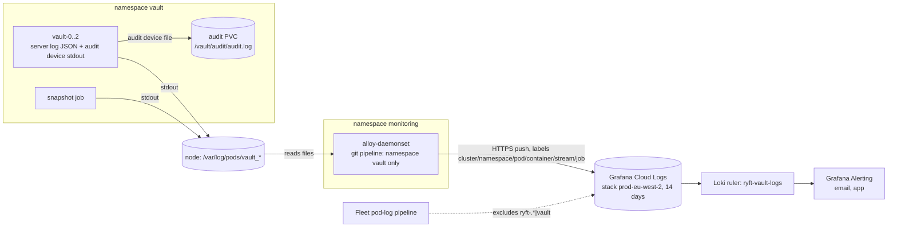
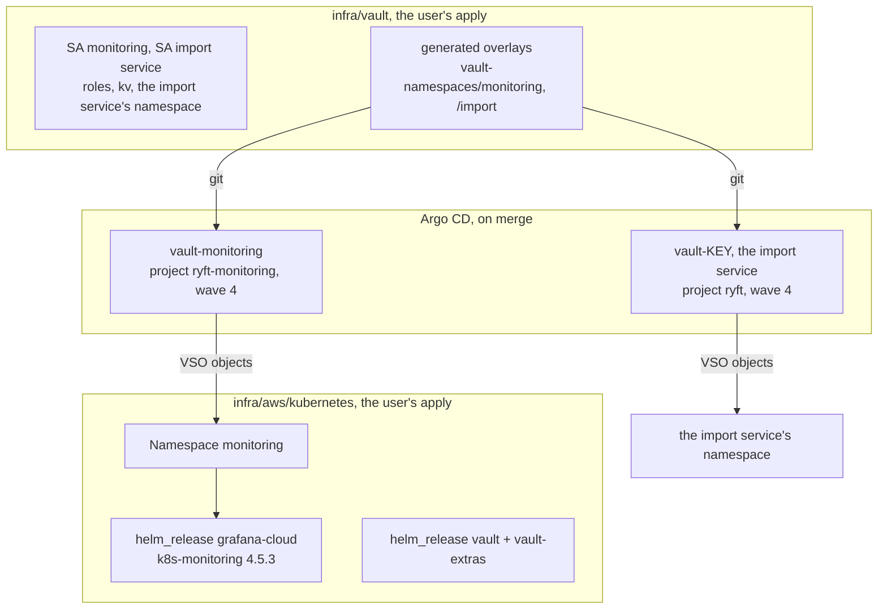

# Vault CE design, addendum 1: logs to Grafana, automatic apply, key custody, on-demand nodes, the EKS endpoint

Ticket: V0 addendum (`plan.md`, "More answers"). Author: platform-architect. Date: 2026-11-05.
Read from `origin/main` at `6b508e5`, together with `design.md`, `plan.md` and `versions.md` in this directory.
For the five topics below this note wins over `design.md`. Everything else stays as `design.md` says. Facts that
can't be checked offline are marked **to verify**, and Appendix B gives the command or URL for each.

The workload with the brand-named namespace is called **the import service** here. `<key>` is its service key in
`infra/vault/variables.tf`, and `ryft-<key>` is the namespace the generator emits.

**The user's answers** (2026-11-05):
- (a) the 5 recovery keys are held by the user in 1Password, a single custodian;
- (b) the nodes are `ON_DEMAND`;
- (c) Vault's logs, audit stream included, go to Grafana, not CloudWatch;
- (d) the monitoring and import-service groups move to automatic apply;
- (e) the EKS public endpoint is narrowed after decommission.

---

## 0. Summary

| # | Topic | Recommendation | Cost | Changes |
| --- | --- | --- | --- | --- |
| 1 | Logs | The server log (JSON, `info`) and a `stdout` audit device are shipped to the stack's hosted Logs (Loki). The shipper is `alloy-daemonset`, reading the node's container log files, and the pipeline is **in the collector's values in git**, limited to namespace `vault`. It is not Fleet Management's pipeline: that one excludes `ryft-.*\|vault`. The PVC audit file stays as the complete local record. **No CloudWatch sink.** Six Loki rules in group `ryft-vault-logs`. Beyla and the SDK injector exclude `vault` | ~0.1 GB/month of the free tier's 50 GB; one new key `LOKI_USERNAME`; one rule file | PR 2 (server log format, collector pipeline), PR 3 (audit enable options, OIDC claims), PR 4 (Loki rules instead of Fluent Bit). D197, D198, D199 |
| 2 | Automatic apply | **The import service:** an Argo CD app `vault-<key>` in wave 4. It needs no new power, because the existing `vault-<x>` pattern already admits it. **monitoring is split in two.** Its operator objects become an Argo CD app `vault-monitoring` in a VSO-only project (V7b). The collector chart becomes a Terraform `helm_release` in `infra/aws/kubernetes`, which also takes over the namespace (V7c). Deploying the collector chart on merge (through Argo CD or a CI identity) is **rejected** | V7a: one file. V7b: one project, one P7 entry, one P12 carve-out, one renderpolicy entry. V7c: a namespace handover, a release import, `make monitoring-apply` removed | Tickets V7a/V7b before 5i/5h. V7c recommended before PR 2. D200, D201, D202 |
| 3 | Recovery keys | Spread the keys **2-2-1 over three places** (1Password, paper in the home safe, paper off site), so that no place holds three. PGP-encrypted shares only with two hardware keys. Break-glass is `generate-root`, and a yearly drill also exercises the alert | two envelopes, a safe | PR 3's OPERATIONS text. D203 |
| 4 | On-demand nodes | The Spot wording goes. PDB `maxUnavailable: 1`, pinned. No node maintenance while the StatefulSet has an un-rolled revision (`OnDelete`), plus a new `VaultUpdatePending` rule. Managed node group updates are never forced. The drill is written down | one alert rule, one `check` | PR 1 (check), PR 2 (PDB pin), PR 4 (rule), soak drill. D204 |
| 5 | EKS endpoint | PR 6c after PR 6 sets the operator's `/32`s plus the NAT addresses. Private access must be on. The way back is the AWS API, which no CIDR blocks | one tfvars edit, docs | new PR 6c. D205 |

**Open questions** (each one is answered or defaulted before the PR named):
1. **(V7)** Monitoring: V7b alone (a merge switches the operator objects, and the chart stays on `make
   monitoring-apply`), or V7b plus V7c (recommended)? V7c needs one `terraform state rm` by the user.
2. **(PR 3)** Custody: where is the off-site place, and does a second person hold the fifth share? PGP: yes or no?
3. **(PR 2)** Should Fleet's pod-log exclusion gain `vault` on the day PR 2 deploys Vault? Recommended: yes. The
   git pipeline ships it in the same change.
4. **(PR 3)** Use OIDC `user_claim = "sub"`, which puts a pseudonymous id in every audit line, not the email?
5. **(PR 2)** Accept Grafana Labs' DPA (STATUS step 2 still lists it as open) and update the record of processing?
   The privacy text stays unchanged (section 1.7).
6. **(V7a)** Where does the import service's workload come from? It isn't in git (`workload_kind = ""`), so V7a
   automates its Secret, not its Job.
7. **(6c)** Are your home and travel IPv4 addresses stable? A DS-Lite or CGNAT line makes a `/32` shared and
   short-lived (section 5.3).
8. **(V7c)** Do you approve the wording for the repo rules (the instructions file at the root of `plattform/`) in section 2.6? Agents can't edit that file.

---

## 1. Vault's logs to Grafana Cloud

### 1.1 What exists today

| Path | What it carries | Destination | Retention | Who configures it |
| --- | --- | --- | --- | --- |
| Fluent Bit (`infra/aws/kubernetes/logs.tf`, D52) | container logs matching `/var/log/containers/*_ryft-*_*.log` and Traefik's | CloudWatch `/ryft/ryft-prod-euc1/containers`, eu-central-1, KMS key `alias/ryft-prod-euc1-logs` | 14 days | Terraform (the user) |
| Fleet Management's pod-log pipeline on `alloy-daemonset` (preset `filesystem-log-reader`) | pod logs of every namespace except `ryft-.*`, which is excluded in Fleet (D51: "a Fleet Management setting, not a boundary") | the Grafana Cloud stack's hosted Logs (Loki) | the stack's (free tier: 14 days, **to verify**) | Grafana Cloud's remote config, **not git** |
| EKS control-plane logs | API, audit, authenticator | CloudWatch | infra/aws | Terraform |

Facts from the repo:
- **Loki is in use.** OPERATIONS → Monitoring step 5 and → Data protection (logs) both check that
  `{namespace=~"ryft-.*"}` returns nothing in Explore → Loki. That check only makes sense if other namespaces arrive.
- **The stack is `prod-eu-west-2`.** That covers the Prometheus write URL in `deploy/monitoring/k8s-monitoring.yaml`
  and the Synthetic Monitoring URL in OPERATIONS. The privacy text records Grafana Labs as "in London, United
  Kingdom: service metrics without personal data" (`web/content/legal/*/privacy/2026-10-26.mdx`).
- **Tenant.** The Prometheus user is `3085952` (`PROM_USERNAME`) and the Fleet user is `1580862`. The Logs user and
  URL (`logs-prod-<n>.grafana.net`) aren't in the repo (**to verify**: the stack's Loki details page).
- **Token.** `GC_TOKEN` is the access policy token the Fleet pipelines write with. Whether its scopes include
  `logs:write` is **to verify**. It probably does, if Fleet ships pod logs today.
- **DPA.** STATUS → Beta step 2 lists Grafana Labs' DPA as not yet accepted ("if the logs keep going there").

**Consequence for PR 2.** If Fleet's pod-log pipeline takes every namespace not excluded (**to verify**), Vault's
stdout reaches Grafana **from the moment PR 2 creates namespace `vault`**. That happens through a pipeline nobody
reviewed, with labels and parsing nobody chose. Section 1.4 avoids this.

### 1.2 What Vault writes

**The server log.** This is hclog. With `log_format = "json"` each line carries `@level`, `@message`, `@module`,
`@timestamp` and the fields of the message. At `info` it covers:
- seal and unseal;
- Raft, autopilot and leadership;
- plugin errors;
- Kubernetes auth errors, which name the service account and namespace;
- the listener.

It holds no secret values and no tokens. Two exceptions must stay off:
- **`log_level` `debug` and `trace`** are more verbose. Pin `info`.
- **`verbose_oidc_logging`** on an OIDC role writes the ID token's claims (email, name) into the server log. Pin
  `false` and test it.

**An audit entry.** There is one `request` and one `response` line per request (JSON, `format=json`). HMAC-SHA256
uses the device's salt, which lives inside Vault and isn't in the log. Defaults on 2.2.1 are **to verify** in the kind
run (Appendix B #3):

| Field | Holds | In clear? |
| --- | --- | --- |
| `time`, `type` | timestamp, `request`/`response` | yes |
| `request.id`, `operation`, `path`, `mount_point`, `mount_type`, `mount_accessor`, `namespace.id` | e.g. `read kv-api/data/config`, `update auth/kubernetes/login` | yes |
| `request.remote_address`, `remote_port` | the pod IPs of VSO and the snapshot job; `127.0.0.1` through a port-forward (**to verify**) | yes. The operator's home address never reaches Vault; it is in the EKS API audit log in CloudWatch |
| `request.client_token`, `client_token_accessor` | the token and its accessor | HMAC (the accessor because `hmac_accessor` defaults to true) |
| `request.data` | the login JWT, a userpass password, KV writes from Terraform | values HMAC, keys in clear |
| `request.headers` | only headers listed in `sys/config/auditing/request-headers` | none are listed (keep it so) |
| `auth.display_name` | `oidc-<user_claim value>` for the operator, a `kubernetes-…` name for VSO, `token-terraform` for the 1-hour token (formats **to verify**) | yes |
| `auth.policies`, `token_policies`, `identity_policies`, `metadata`, `entity_id`, `token_type`, `token_ttl` | policy names; Kubernetes metadata `role`, `service_account_name`, `_namespace`, `_uid`; OIDC metadata `role` plus any `claim_mappings` | yes |
| `auth.client_token`, `auth.accessor`, `response.auth.client_token` | issued tokens | HMAC |
| `response.data` | every KV value VSO reads | values HMAC, keys in clear (the key names, which are in git anyway) |
| `error` | `permission denied`, `invalid role name`, … | yes |

**Options.**
- `log_raw` defaults to false and must stay false. Set it explicitly, assert it, and alert on any change (1.8).
- `hmac_accessor` defaults to true.
- `elide_list_responses` is irrelevant here.
- The audit `filter` and `exclude` options are Enterprise features (**to verify**), so CE can't drop fields at
  the source.
- `sys/audit-hash/<device>` (admin policy) computes the HMAC of a known value for an investigation, for example
  "did VSO read the rotated password?".

### 1.3 Which audit devices

| | `file` on the audit PVC | `file` with `file_path=stdout` | sidecar tailing the PVC file | `socket` to Alloy | `syslog` |
| --- | --- | --- | --- | --- | --- |
| How it leaves the pod | it doesn't | containerd writes it to the node's log file, and `alloy-daemonset` reads that file | the sidecar's stdout, then as left | TCP from Vault to a listener in Alloy | no syslog daemon in the image |
| New moving parts | none | none | a third image in P2's `vault` allowlist, and a container in Vault's pod | a listener in Alloy, egress `vault`→`monitoring`, ingress to the collector | n/a |
| Can a Grafana or Alloy outage stall Vault? | no | **no**: the shipper reads files after the fact | no | **yes**: a peer that doesn't drain blocks the device, and a refused connection fails it | n/a |
| Blocking classes it adds | an EBS I/O stall (hangs), a full disk (fails) | a stalled containerd-shim pipe. Vault's own server log uses the same pipe, so this adds **no new class** | as the file | the network | n/a |
| Completeness | everything since init | kubelet rotation (`containerLogMaxSize`/`MaxFiles`, typically 10 MiB × 5, **to verify** on AL2023) and pod deletion drop lines that haven't been shipped | as the file | lossy on failure | n/a |
| Verdict | **keep**: the local, complete record | **keep**: the shipped copy | reject | reject | n/a |

**Blocking.** If no enabled device records a request, Vault refuses it. With two devices, one failing doesn't stop
Vault. Whether a device that **hangs** (rather than fails) stalls requests while the other device succeeds is **to
verify** on 2.2.1. The kind e2e adds a third device that writes into a FIFO with no reader, then times a KV read. The
only device that can hang is the PVC file, through EBS.

The probes won't catch a hang: `sys/health` is not audited (**to verify**). Two signals do:
- `VaultAuditLogsMissing`: no audit lines for 2 h, while VSO alone makes dozens an hour;
- VSO's `SecretSynced=False`.

**Result.** The design's two devices stay as they are. Only the destination of `stdout` changes, from Fluent Bit
and CloudWatch to Grafana. Nothing on the shipping side can stop Vault serving.

### 1.4 Which shipping path

| | A. Fleet's pod-log pipeline (do nothing) | **B. A pipeline in the collector's values (chosen)** | C. Fluent Bit to CloudWatch (`design.md`) | D. B plus C |
| --- | --- | --- | --- | --- |
| Config reviewed in git | no (remote) | yes | yes | yes |
| Labels and the server/audit split | Fleet's | ours (1.5) | n/a | ours |
| A stable basis for alerts | no: a Fleet edit changes or drops it silently | yes | the repo has no CloudWatch alarms | yes |
| Matches the user's answer (c) | yes | yes | no | yes, plus a second copy |
| Running cost | ~0 | ~0 | about €0.05 a month (the key already exists) | both |
| What the extra copy buys | n/a | n/a | an IAM-separated copy in eu-central-1 | a second off-cluster copy |

**Choice: B.** Then:
- Fleet's pod-log exclusion becomes `ryft-.*|vault` (the user, in the Grafana UI), so nothing is ingested twice.
- **There is no CloudWatch sink.** The PVC file is the complete record, and Grafana holds the off-cluster copy for
  14 days.
- A second off-cluster copy only helps when Grafana is lost **and** the PVC is lost within the same 14 days. That
  isn't worth a second pipeline and a second place to look.
- Revisit this when a second person gets Vault admin. An IAM-separated copy has value then.
- Fluent Bit's input stays as it is (`*_ryft-*_*`), so the design's PR 4 line "Fluent Bit input gains `vault`" goes.

**The shape of B** (k8s-monitoring 4.5.3 keys **to verify** against the chart's `values.yaml`):
- **The feature.** The chart's own pod-logs feature, gather method `volumes` (the node's files), on collector
  `alloy-daemonset`, which already mounts them. Namespaces: `[vault]` only.
- **The destination.** A new one, `vault-logs`, of type `loki`:
  - URL `https://logs-prod-<n>.grafana.net/loki/api/v1/push` (**to verify**);
  - `usernameKey: LOKI_USERNAME` and `tenantIdKey: LOKI_USERNAME`, plus `passwordKey: GC_TOKEN`, from
    `ryft-secrets`, the same pattern as `admission-signals`;
  - `LOKI_USERNAME` is the stack's Logs user. It isn't a secret, but with an existing Secret the chart reads every
    field from it. It joins `service_secrets.monitoring` (tfvars, the user), and the `infra/vault` tests expect the
    key.
- **NetworkPolicy.** None changes. `alloy-daemonset` is host-network, which NetworkPolicy doesn't govern, and
  `monitoring` has no egress policy (`design.md` section 6). The pipeline reads files and opens no connection to
  Vault. If `monitoring` ever gets a default-deny, `alloy-deployment` needs 443 to the public range for Loki (the
  daemonset doesn't).
- **Coexistence.** It runs next to Fleet's remote pipelines in the same Alloy, as the two admission scrapes do
  today.



### 1.5 The Loki label policy

- **Stream labels, and only these:** `cluster`, `namespace`, `pod`, `container`, `job="ryft/vault"`, and `stream` with
  the values `server`, `audit` and `other` (the snapshot job, the start script). That is at most 3 pods × 3 streams,
  plus four short-lived job pods a day.
- **Never a label from a line's content:** path, mount, display name, entity id, remote address, request id, error,
  level. They stay in the JSON and are extracted at query time (`| json`).
- **No structured metadata from audit fields.**
- **No rewriting of audit lines** (no `stage.replace`, no dropped fields): an edited audit trail is weaker evidence.
  Server lines are left untouched as well.
- **The split.** A `stage.json` extracts `type` and `@level`. A present `@level` means `server`; `type` in
  `request`/`response` means `audit`; anything else is `other`. If that proves flaky, the fallback is the stdout
  device's `prefix` option plus a `stage.regex`.
- **The duplicate check** (Explore, after Fleet's exclusion): `{namespace="vault", job!="ryft/vault"}` returns
  nothing.

### 1.6 Retention and cost

- **Retention.** The free tier keeps logs 14 days (**to verify**, grafana.com/pricing), the same as CloudWatch's
  group. Per-stream retention isn't offered on the tier (**to verify**), so nothing is set.
- **Volume.** VSO makes about 13 static-secret reads an hour (nine `config` and four `amqp-user-*`) and about 9
  logins or renewals, which is 22 requests and 44 entries an hour. The snapshot job adds 4 runs a day. That gives
  about 1,100 entries a day at ~1.5 KB, about 1.7 MB a day. The server log adds under 1 MB a day.
  **Together: ~0.1 GB a month, 0.2 % of the free tier's 50 GB** (**to verify**). On a paid tier at about $0.50/GB
  (**to verify**), it costs cents. How much of the allowance today's non-RYFT namespaces use is **to verify**
  (Grafana Cloud → Usage).
- **The PVC file** has no rotation (Vault reopens only on SIGHUP) and grows about 0.6 GB a year on 5 Gi.
  `VaultVolumeFilling` covers it. It is kept while the volume lasts: it is the integrity record of who touched
  credentials, and its only personal data is the operator's pseudonymous id.

### 1.7 Privacy and GDPR

- **No app user's data passes through Vault.** Values are credentials, HMAC'd in the log. The App Review demo
  email and the smoke user's email are KV **values**, so they are HMAC'd too. Paths and key names are system data.
- **The only personal data is the operator's:**
  - the display name `oidc-<claim>`;
  - the entity id;
  - the time of every admin action.
- **Recommendation: pseudonymous ids.**
  - With `user_claim = "email"`, the operator's email would sit in every operator line. Use `user_claim = "sub"`,
    Google's stable numeric account id, with `bound_subject` set to it (and `bound_claims.hd` for the Workspace
    domain).
  - Don't map `email` or `name` into metadata, and set `verbose_oidc_logging = false`.
  - Pod IPs, service account names and namespace names are not personal data.
- **The processor.** Grafana Labs is already a processor named in the privacy text, for metrics, in London. The
  data subject here is the controller's own operator, not an app user.
  - **Assessment: the privacy text needs no change.** It tells users what happens to *their* data, and none of
    theirs is in this stream.
  - If the user wants the sentence to be precise anyway ("service metrics and infrastructure logs, without personal
    data of users"), the change goes with a `PRIVACY_POLICY_VERSION` change in the same PR (the repo rules). It isn't
    free.
- **To do (the user):**
  - accept Grafana Labs' DPA now;
  - add the flow to the record of processing: "Vault server and audit logs: operator's pseudonymous id, pod
    addresses; Grafana Labs, UK; 14 days; Art. 6(1)(f), security of the credentials";
  - if a second admin ever exists, tell them (employee data). The pseudonymous id still holds.
- **The transfer.** UK adequacy decision, Art. 45 (**to verify** that the renewed decision is in force). The stack's
  Logs region equals its metrics region (**to verify** on the stack's details page).
- **The worst misconfiguration** in this addendum is `log_raw = true`. It would hand every credential to a third
  party in clear. The guards:
  - the option is set explicitly at enable;
  - the kind e2e asserts it on both devices;
  - `VaultAuditConfigChanged` pages on any write to `sys/audit*`;
  - the `terraform` token has no `sys/audit` (`design.md` 2.3).

  If it happens anyway, treat it as the exposure of every credential: rotate them all, and ask for deletion through
  Loki's delete API (the `logs:delete` scope; availability on the tier **to verify**).
- **Who can read the stream:**
  - the stack's members (the user only; OPERATIONS → Monitoring);
  - Grafana Labs;
  - Fleet's remote config (D51, accepted);
  - and, in the cluster, anyone with `pods/log` in `vault`. That includes **argocd-server**, whose ClusterRole has
    `pods/log` `get` cluster-wide (D180). A leaked server token reads the HMAC'd stream (metadata, no values). Note
    for P12's follow-ups, not a blocker.

### 1.8 Two more collector settings for `vault`

- **Beyla must not instrument Vault.** Its eBPF uprobes on Go's `net/http` read request structures in Vault's
  process memory, and it exports routes and durations. D51 left Beyla's `ryft-*` exclusion as "the next step if that
  matters". For the process that holds the unsealed keyring, it matters. Exclude namespace `vault` from Beyla's
  discovery (the chart key or the Fleet setting is **to verify**).
- **The SDK injector.** Its `webhook.excludedNamespaces` gains `vault`; P2 would refuse an injected container anyway.
  **Found in passing:** the import service's namespace is missing from that list today, although OBSERVABILITY says
  every `ryft-*` namespace belongs there (**to verify** whether that is deliberate; add it in V7a).

### 1.9 What changes in the design's PRs

- **PR 2** (`infra/aws/kubernetes`):
  - The chart values gain `server.logFormat: json` and `server.logLevel: info` (keys **to verify**), with a terraform
    test.
  - No NetworkPolicy change.
  - The collector values gain the `vault` pipeline, the `vault-logs` destination and both exclusions from 1.8. They
    ride V7c's `helm_release` if V7c has landed, otherwise `make monitoring-apply`.
  - Before that: `LOKI_USERNAME` joins tfvars, and `infra/vault` is applied, so VSO restarts the collectors once.
  - On the same day the user sets Fleet's exclusion to `ryft-.*|vault`.
  - The kind e2e saves the server and audit lines (`kubectl logs`) as fixtures for the rule tests, asserts `log_raw`
    and `hmac_accessor` on both devices, and runs the FIFO case from 1.3.
- **PR 3** (bootstrap and OPERATIONS):
  - Step 3 enables both devices with explicit options (1.10).
  - The OIDC role carries `user_claim = "sub"`, `bound_subject`, no email or name claim mappings and
    `verbose_oidc_logging = false`, each in a terraform test.
  - OPERATIONS → Data protection (logs) gains a "Vault" bullet (what, where, 14 days, who reads).
- **PR 4:**
  - "Fluent Bit input gains `vault`" goes.
  - New `deploy/grafana/alerts/vault-logs.yaml` (1.11). `make alerts-check` runs `check_rule_groups.sh` on it, and
    `make alerts-apply` loads it into the Loki ruler.
  - The fixture test for the line filters is added.
  - `ryft-vault` gains `VaultUpdatePending` (section 4), which makes 8 rules.
  - OBSERVABILITY → Logs: "Vault's logs are the one exception that goes to Grafana Cloud".

### 1.10 Bootstrap step 3, as it should read

```bash
# 3. Audit, before anything else is written. Two devices; Vault serves while one of them records.
#    Options explicit, so a changed default can't switch raw logging on.
VAULT_TOKEN=<root> vault audit enable file file_path=/vault/audit/audit.log log_raw=false hmac_accessor=true format=json
VAULT_TOKEN=<root> vault audit enable -path=stdout file file_path=stdout log_raw=false hmac_accessor=true format=json
#    -> the node's container log -> alloy-daemonset (namespace vault only) -> Grafana Cloud Logs, 14 days
VAULT_TOKEN=<root> vault audit list -detailed       # both devices, log_raw false
VAULT_TOKEN=<root> vault read sys/config/auditing/request-headers   # empty
```

### 1.11 Log-based alerts: group `ryft-vault-logs` (Loki ruler, 6 rules, limit 20)

```yaml
# deploy/grafana/alerts/vault-logs.yaml: data-source rules for the stack's Loki ruler (not Prometheus).
namespace: ryft
groups:
  - name: ryft-vault-logs
    interval: 1m
    rules:
      - alert: VaultAuditConfigChanged     # an audit device enabled, disabled or tuned, or audited headers changed
        expr: |
          sum(count_over_time({namespace="vault", stream="audit"} |= "\"type\":\"request\"" | json
            | request_path=~"sys/audit(/.*)?|sys/config/auditing/.*" | request_operation=~"create|update|delete" [10m])) > 0
        labels: { severity: critical }
      - alert: VaultUnsealFailing          # KMS refused, the key is disabled, or credentials are missing; a sealed pod exports no metrics
        expr: |
          sum by (pod) (count_over_time({namespace="vault", stream="server"}
            |~ "(?i)failed to unseal|error unsealing|AccessDeniedException|KMSInvalidStateException|DisabledException" [10m])) > 0
        for: 5m
        labels: { severity: critical }
      - alert: VaultRootTokenUsed          # break-glass: generate-root, or a request made with a root token
        expr: |
          sum(count_over_time({namespace="vault", stream="audit"}
            |~ "\"path\":\"sys/generate-root/(attempt|update)\"|\"policies\":\\[\"root\"\\]" [10m])) > 0
        labels: { severity: warning }
      - alert: VaultPermissionDeniedBurst  # a wrong policy after a change, or someone probing with a stolen token
        expr: |
          sum by (auth_display_name) (count_over_time({namespace="vault", stream="audit"}
            |= "\"type\":\"response\"" |= "permission denied" | json [10m])) > 10
        labels: { severity: warning }
      - alert: VaultRaftTrouble            # peers losing contact; complements VaultQuorumAtRisk
        expr: |
          sum(count_over_time({namespace="vault", stream="server"}
            |~ "failed to heartbeat|failed to appendEntries|failed to contact" [10m])) > 5
        for: 10m
        labels: { severity: warning }
      - alert: VaultAuditLogsMissing       # VSO alone makes dozens of entries an hour: the device, the shipper or Fleet's exclusion is broken, or Vault hangs
        expr: absent_over_time({namespace="vault", stream="audit"}[2h])
        labels: { severity: warning }
```

**Notes.**
- **The strings are to verify** against 2.2.1's real lines (the kind fixtures): the generate-root path, the
  `policies` shape and the Raft and KMS messages.
- **Draining a node** makes `VaultRaftTrouble` count briefly. The `for: 10m` and the threshold keep it quiet; the
  drill in section 4 confirms that.
- **Tests.** There is no promtool for LogQL. `scripts/tests/vault_log_rules_test.sh` extracts each rule's line
  filters and runs them, with `grep -E`, over the captured fixtures (must match) and over negative lines (must not).
  `mimirtool rules check --backend=loki` checks the syntax (**to verify** that 2.16 has the flag).
- **Loading.** `mimirtool rules load --backend=loki --address=$GRAFANA_LOKI_URL --id=$GRAFANA_LOKI_USER
  --key=$GRAFANA_RULES_TOKEN`. That the rules token's `rules:write` covers Logs, and that Loki rules route through
  the same notification policies, are both **to verify**.
- **Group limit.** `check_rule_groups.sh` counts the file. The 20-rule limit is assumed for the Loki ruler as well
  (**to verify**).
- **Rollout.** Load the rules after bootstrap (PR 4), not earlier: before Vault exists `VaultAuditLogsMissing` would
  fire.
- **Content.** Alert text is value-free, like D158's. The `auth_display_name` label is the operator's pseudonymous
  id or a service account name.

### 1.12 Failure modes of the log path

| Failure | Seen as | Recovery |
| --- | --- | --- |
| Collector down, or Grafana unreachable | `VaultAuditLogsMissing` after 2 h (it evaluates in the cloud, so it works while the cluster is dark); `AdmissionSignalsMissing` at the same time | collector back. Lines still in the node's files are shipped; older ones are only in the PVC file |
| Fleet also ships `vault` (exclusion missing) | the duplicate check in 1.5 returns lines | fix the exclusion in Fleet |
| A label regression (high cardinality) | Explore → logs volume by label; Grafana usage | fix the pipeline in git; the chart test pins the label list |
| `stdout` device failing | `VaultAuditFailing` (metric, `design.md` section 11) | the server log says why; disable and re-enable that device (admin) |
| Both devices failing | Vault refuses requests: VSO `SecretSynced=False`, `VaultAuditFailing` | free the PVC (`VaultVolumeFilling`) or fix stdout |
| `log_raw` switched on | `VaultAuditConfigChanged` (critical) | turn it off, then rotate every credential (OPERATIONS → Vault → rotation) and request deletion |

---

## 2. Automatic apply for monitoring and the import service

### 2.1 What "apply" means today

| | monitoring | the import service |
| --- | --- | --- |
| Namespace | `monitoring`, Pod Security `privileged`, created by `infra/vault` (`services.monitoring`, D51) | `ryft-<key>`, Pod Security `restricted`, created by `infra/vault` |
| Service account, Vault role, KV, generated overlay | `infra/vault`: SA `monitoring`, `deploy/k8s/overlays/vault-namespaces/monitoring` (VaultConnection, VaultAuth, VaultStaticSecret restarting `grafana-cloud-alloy-daemonset` and `-deployment`) | `infra/vault`: SA `<key>`, `deploy/k8s/overlays/vault-namespaces/<key>` (the same three kinds, no restart target: `workload_kind = ""`) |
| Who puts the operator objects into the cluster | `make monitoring-apply KUBE_CONTEXT=ryft-prod-euc1`, step 1: `kubectl apply -k …/monitoring` (client-side apply from the user's laptop) | the user's `kubectl --context ryft-prod-euc1 apply -k …/<key>`; not in `make k8s-apply-eks`'s `NAMESPACES` and not an Argo CD app |
| The workload | step 3: `helm upgrade --install grafana-cloud grafana/k8s-monitoring --version 4.5.3 -n monitoring --values deploy/monitoring/k8s-monitoring.yaml --wait`, from the user's laptop. Owner: the Helm release Secret, written by the user's CLI (neither Terraform nor Argo CD). Pipelines: Fleet Management (remote) | **not in git** (open question 6) |
| Drift correction | none | none |

So the collector is today **the one cluster add-on that is neither a Terraform release nor an Argo CD app**.
The repo rules ("cluster add-ons … stay Helm releases in `infra/aws/kubernetes`") don't list it. It is a deviation the
repo already lives with.

### 2.2 Constraints

- **The repo rules and D94.** Argo CD manages workloads only. Add-ons are Helm releases in `infra/aws/kubernetes`, and
  "nothing has two owners". The one exception is the RabbitMQ operators (project `ryft-operators`).
- **D95.** Projects are applied by hand and never synced. `ryft` deploys this repository into `ryft-*` only, with
  `Namespace` as its one cluster kind.
- **D180.** The controller's ClusterRole is an allowlist. It has no DaemonSets, StatefulSets, CronJobs or Secrets,
  no `escalate`, and `bind` on one name. It **does** include the VSO kinds, Certificates, Deployments and ConfigMaps
  in every namespace (P12 note, "The finding").
- **P7.** Applications must use our repository at `main` with one plain source: no `helm`, `kustomize`, `plugin` or
  `directory`, and nothing from a chart repository. A fixed name→(project, path, namespace) map applies, with
  `vault-<x>` matched by pattern to `vault-namespaces/<x>` in `ryft-<x>`.
- **P12** (#121, open). The controller writes namespaced objects only in `ryft-*` and `rabbitmq-system`. Today
  nothing stops a stolen controller token from creating a Deployment in the privileged `monitoring`, which means node
  root. P12 is what closes that.
- **renderpolicy** (`scripts/lib/check_argocd.py`). `PROJECT_PATHS` binds each project to its paths. Image
  invariants apply to project `ryft`.
- **Terraform is the user's.** No agent applies it. A merge never applies Terraform.

### 2.3 Options

**The import service.**

| | I1. Argo CD app `vault-<key>` (**chosen**) | I2. `infra/vault` applies the objects (`kubernetes_manifest`) | I3. A CI job with a deploy identity |
| --- | --- | --- | --- |
| What changes | one file in `deploy/argocd/apps`, wave 4 | the generator also applies what it writes | a workflow, an IAM role trusted by GitHub OIDC, an EKS access entry |
| Project, RBAC, P7, P12 | **none**: project `ryft` (destination `ryft-*`), P7's pattern, the ClusterRole and P12 rule 4 already admit it | none | a new identity |
| On merge? | yes | no: on the user's `infra/vault` apply | yes |
| What a stolen Argo CD token gains | nothing it can't already do (it writes VSO kinds in every `ryft-*` today) | n/a | the CI identity's power |
| Verdict | **chosen** | non-uniform with the other `vault-<x>` | rejected (see M3) |

**monitoring.**

| | M1. Argo CD owns all of it (chart vendored as YAML) | M2. Terraform owns all of it (chart release plus `kubernetes_manifest` of the operator objects) | M3. A CI job with a deploy identity | **M4. Split: operator objects in Argo CD, chart in Terraform (chosen)** |
| --- | --- | --- | --- | --- |
| Changes | new project for `monitoring` with ClusterRole, ClusterRoleBinding, MutatingWebhookConfiguration and probably CRDs (the Alloy operator's, **to verify**); D180 gains DaemonSets and `escalate`/`bind` (KSM's ClusterRole lists Secrets; RBAC's escalation check needs the writer to hold that); P1, P7, P12 and renderpolicy widened for third-party privileged images | `helm_release` in `infra/aws/kubernetes`; `kubernetes_manifest` × 3 in `infra/vault` | a workflow with `helm upgrade`, a role with cluster-admin-equivalent rights (the chart writes cluster RBAC, webhooks and privileged DaemonSets) | **V7b:** a project `ryft-monitoring` (VSO kinds and Certificate only, destination `monitoring`), a P7 fixed entry, a P12 carve-out, a renderpolicy entry. **V7c:** `helm_release` plus the namespace handover |
| Cutover 5h | a merge | the user's `infra/vault` apply. It can't come before review, so it comes after the merge, and the generated file then needs a second PR | a merge | **a merge, like 5a–5g** |
| Collector changes (PR 2, PR 4) | a merge | the user's `infra/aws/kubernetes` apply, which those PRs need anyway | a merge | the user's `infra/aws/kubernetes` apply, which those PRs need anyway |
| What a stolen Argo CD controller token gains | **node root on every node**: a privileged, host-PID DaemonSet in a `privileged` namespace reads every Secret mounted on any node and Vault's process memory (the unsealed keyring) | nothing | nothing for Argo CD; **the CI identity is cluster admin**, reachable from a public repository's workflows | RBAC: nothing (it already writes those kinds there). P12: a carve-out of four kinds in `monitoring`, whose content P4 and P13 judge. Worst case: delete the operator objects, so VSO's ownerReference deletes `ryft-secrets` and the collectors fail at their next restart. That is a telemetry outage, caught by the cloud-side absence alerts, and **no path to a credential** (P4 pins address, mount and `kubernetes` auth; role `monitoring` reads only `kv-monitoring`) |
| Repo rules | violates D94 and the repo rules (an add-on in Argo CD) and D180 (`escalate`) | fits | violates the repo rules ("Git is the only way … Argo CD … or the user's Terraform") and **blocks PR 6c**: GitHub-hosted runners have no fixed addresses, so the endpoint would stay `0.0.0.0/0` | fits, with a D-entry for a project outside `ryft-*` |
| Verdict | **rejected** | possible fallback, if the user wants Argo CD nowhere near `monitoring` | **rejected** | **chosen** |

### 2.4 The recommendation and what it costs

**V7a: the import service** (gitops-engineer).
- `deploy/argocd/apps/vault-<key>.yaml`: a copy of `vault-smoke.yaml` with the name, path and namespace of the import
  service, `sync-wave: "4"`.
- **Why wave 4.** Every other `vault-<svc>` is wave 0 because waves 1–3 need their Secrets. Nothing waits on the
  import service. In wave 4 an unhealthy sync of it holds only later changes to `deploy/argocd/apps` until
  `argocd app terminate-op ryft-root` (D95). `ryft-platform` syncs itself from `main` and isn't held.
- Also: `excludedNamespaces` in the collector values gains the import service's namespace (1.8).
- **Adoption** as in OPERATIONS → Cutover to Argo CD (once): the first sync must show no diff. Then the user stops
  applying it by hand.
- **Cost:** about 30 lines. No change to RBAC, project, P7 or P12.

**V7b: monitoring's operator objects** (gitops-engineer).
- **`deploy/argocd/project.yaml`** gains the project below. The user applies it by hand, as every project (D95).
  ```yaml
  apiVersion: argoproj.io/v1alpha1
  kind: AppProject
  metadata: { name: ryft-monitoring, namespace: argocd }
  spec:
    description: The collector's Vault Secrets Operator objects (the collector itself is a Terraform add-on, D202)
    sourceRepos: [https://github.com/timkrebs/ryft-platform.git]
    destinations: [{ server: https://kubernetes.default.svc, namespace: monitoring }]
    clusterResourceWhitelist: []
    namespaceResourceWhitelist:
      - { group: secrets.hashicorp.com, kind: VaultConnection }
      - { group: secrets.hashicorp.com, kind: VaultAuth }
      - { group: secrets.hashicorp.com, kind: VaultStaticSecret }
      - { group: cert-manager.io, kind: Certificate }     # vault-ca, pre-staged by PR 3
    # No orphanedResources: every object of the chart in monitoring would be reported.
  ```
- **The app.** `deploy/argocd/apps/vault-monitoring.yaml`, project `ryft-monitoring`, path
  `deploy/k8s/overlays/vault-namespaces/monitoring`, destination `monitoring`, wave 4.
- **Admission values** (`infra/aws/kubernetes/admission-values.yaml`):
  - `argocd.applications` gains the fixed entry `vault-monitoring: {project: ryft-monitoring, path: …/monitoring,
    namespace: monitoring}`. P7 checks the fixed map before the pattern, which would expect `ryft-monitoring`.
  - P12, in #121 or after it, gets the carve-out: in `monitoring` the controller may write only those four kinds.
    #121 needs a note either way.
  - P4 already matches every namespace. Its CE mount rule yields `kv-monitoring`.
- **renderpolicy.** `PROJECT_PATHS["ryft-monitoring"] = {"deploy/k8s/overlays/vault-namespaces/monitoring"}`.
  `make k8s-validate` must pass on the VSO-only render: whether the default-deny invariant applies to a namespace
  without workloads is **to verify**. The existing `vault-<x>` renders suggest it doesn't.
- **Tests.**
  - celtest: `vault-monitoring` into `monitoring` is accepted; any other app into `monitoring` is refused; a
    Deployment in `monitoring` by the controller is refused under P12.
  - `check_argocd` cases.
- **`make monitoring-apply`** loses its `kubectl apply -k` and `wait` lines. Otherwise there would be two owners;
  self-heal would revert a hand apply anyway.
- **Cost:** one project, one P7 entry, one P12 rule, one renderpolicy entry, the tests, and the user's project apply
  and `infra/aws/kubernetes` apply (admission values).

**V7c: the collector as a Terraform add-on** (infra-engineer).
- **The release** in `infra/aws/kubernetes/monitoring.tf`:
  ```hcl
  resource "kubernetes_namespace_v1" "monitoring" {
    metadata {
      name   = "monitoring"
      labels = { "pod-security.kubernetes.io/enforce" = "privileged", … }   # exactly today's labels
    }
  }
  import { to = kubernetes_namespace_v1.monitoring; id = "monitoring" }

  resource "helm_release" "k8s_monitoring" {
    name       = "grafana-cloud"   # the restart targets and Fleet's collector names derive from it
    namespace  = kubernetes_namespace_v1.monitoring.metadata[0].name
    repository = "https://grafana.github.io/helm-charts"
    chart      = "k8s-monitoring"
    version    = "4.5.3"
    values     = [file("${path.module}/values/k8s-monitoring.yaml")]   # moved from deploy/monitoring/
    wait       = false   # the collectors need ryft-secrets, which exists only after infra/vault and VSO (DR order)
  }
  import { to = helm_release.k8s_monitoring; id = "monitoring/grafana-cloud" }
  ```
- **Hand-over of the namespace.** A `removed` block can't name a single `for_each` instance, so `services.monitoring`
  gains `manage_namespace = false` in `infra/vault`. Its SA and Vault role reference the namespace by name. The user
  runs `terraform -chdir=infra/vault state rm 'kubernetes_namespace_v1.service["monitoring"]'` **before** the
  `infra/aws/kubernetes` apply. That leaves a window with no owner, which is harmless, rather than two owners.
- **Plan expectations.**
  - `infra/vault`: no change after the `state rm`.
  - `infra/aws/kubernetes`: 2 to import, 0 to add, at most an in-place update of the release (values formatting).
    **Nothing to destroy or replace. A replace is a stop.**
- **Fallback, if the user wants no state operation.** The namespace stays in `infra/vault`, and the release gets
  `count = length(data.kubernetes_resources.monitoring_ns.objects)`. That skips it on a fresh cluster until
  `infra/vault` has run, and the DR runbook gains "apply `infra/aws/kubernetes` again".
- **Tests** (`terraform test`):
  - chart and version pinned;
  - `remoteConfig.secret.create == false`;
  - `excludedNamespaces` ⊇ every `ryft-*` namespace of `infra/vault`'s services, plus `vault`;
  - the `vault` pipeline's namespaces equal `[vault]`;
  - `wait == false`.
- **Removed:** `make monitoring-apply` and `K8S_MONITORING_VERSION`. A break-glass `helm upgrade` would fight
  Terraform, so the runbook says "fix it in git".
- **Docs:** OBSERVABILITY → Collection, OPERATIONS → Monitoring step 4, and the D51 note.
- **Cost:** one new file, one moved file, one state operation by the user, and the docs.



### 2.5 The cutovers 5h and 5i under this

Both become **the same procedure as 5a–5g** (`design.md` 9.2): an agent's PR with `vso_on_k8s` plus the name, the
user's plan and apply on the branch, the regenerated overlay committed, CI, merge. Argo CD syncs the app, and VSO
re-reads from CE.

| | 5h monitoring (`vault-monitoring`) | 5i the import service (`vault-<key>`) |
| --- | --- | --- |
| Expected restart | the restart targets roll `alloy-daemonset` and `alloy-deployment` once, if the rehearsal shows that a byte-identical source restarts | none (no targets) |
| Verify | `vault_diff.sh --secret monitoring` equal; Grafana → Fleet Management → Collectors all online; no `401`/`403` in `kubectl --context ryft-prod-euc1 -n monitoring logs ds/grafana-cloud-alloy-daemonset --since=15m`; `up{job="ryft/kube-apiserver-admission"} == 1`; `VaultScrapeDown`, `AdmissionSignalsMissing` and `VaultAuditLogsMissing` quiet for 30 min | `vault_diff.sh --secret <key>` equal; `SecretSynced=True` at the new generation; the next run of its workload (open question 6) |
| Rollback | `git revert`: Argo CD restores the HCP shape | the same |
| Note | do it after 5a–5g: it touches the telemetry that verified them. Its failure shows in **cloud-side absence alerts**, which still work when the collectors are dark | none |

The design's sentence "monitoring and the import service need the user's re-apply after the revert" goes.

### 2.6 Where "automatic" conflicts with a rule, and the rule change

- **The import service (V7a):** no conflict. It is D95's `vault-<svc>` pattern.
- **monitoring's operator objects (V7b):** no conflict with D94 ("workloads only"): VSO objects already belong to
  Argo CD (D95, wave 0). But project `ryft-monitoring` is the first project for a non-`ryft-*` namespace that isn't
  the operators' (D95). That needs D201.
- **The collector chart, "automatic on merge": this conflicts.**
  - It conflicts with the repo rules ("Cluster add-ons … stay Helm releases in `infra/aws/kubernetes`"; "Git is the only
    way …: Argo CD … or the user's Terraform").
  - It conflicts with D94, and with D180 (`escalate`).
  - Making it true would need a rule change: "Argo CD may own the Grafana collector", with its cluster kinds,
    DaemonSets and `escalate`. **I recommend against it** (section 2.3, M1).
  - With V7c the chart is "automatic" only in the sense that no separate command is needed: it rides the
    `infra/aws/kubernetes` applies the Vault PRs need anyway.
- **The wording for the repo rules** (the user's file at the root of `plattform/`). Proposed text for the add-on sentence:
  > Cluster add-ons (ALB controller, Traefik, cert-manager, ExternalDNS, VSO, Vault, the Grafana Cloud collector,
  > Argo CD itself) stay Helm releases in `infra/aws/kubernetes`; nothing has two owners. The exceptions are the
  > RabbitMQ operators (project `ryft-operators`, D97) and the collector's Vault Secrets Operator objects (project
  > `ryft-monitoring`, D201).

---

## 3. Recovery key custody with one custodian

**What the keys can do.** With KMS auto-unseal the recovery keys decrypt nothing. Any three of them authorize:
- `vault operator generate-root`, a root token and therefore every credential;
- `vault operator rekey -target=recovery`, a new set of keys;
- a seal migration.

To use them, an attacker also needs a network path to 8200. The NetworkPolicy admits only VSO, the collector, the
snapshot job and the peers. So in practice that path is a port-forward, which takes AWS credentials, the EKS access
entry and, after PR 6c, an allowed address.

**What 3-of-5 protects with all five in one 1Password account:**
- **Against theft:** nothing. Whoever opens the account has all five, so it equals 1-of-1.
- **Against loss:** only the loss of one or two *items*, such as a corrupted or deleted item. The realistic loss
  modes are correlated: account lockout, a lost Secret Key and password, a 1Password outage in an incident. Each
  loses all five at once.
- **What actually guards the root path today:** 1Password's account security, the Kubernetes path to the pod, and
  the audit line with its alert (`VaultRootTokenUsed`).

**Recommendation: three places, and no place holds three keys** (2-2-1):

| Place | Shares | If this place is lost | If this place is stolen |
| --- | --- | --- | --- |
| 1Password, a dedicated vault `RYFT break-glass` (not shared), one item per share | 1, 2 | paper 3 + 4 + 5 = 3 left | 2: not enough |
| Paper, sealed envelope, home safe | 3, 4 | 1 + 2 + 5 = 3 left | 2: not enough |
| Paper, sealed and signed envelope, off site (a bank box, or a trusted person) | 5 | 4 left | 1: not enough |

- **Separate items in separate 1Password vaults of the same account add almost nothing** (same login). One vault
  with one item per share is enough.
- **A second person** holding share 5 makes the keys survive the user's own absence. They can't use it alone: it is
  one share, and they have no cluster access. It is about the keys, not delegation. If the user is ever unavailable,
  someone also needs AWS access, which is a separate continuity question.
- **PGP (`-recovery-pgp-keys`).** At init, each share is encrypted to an OpenPGP public key, so no plaintext share
  ever appears in the terminal, and stored shares, paper included, are useless without the private key. With one
  custodian it pays off **only with hardware keys**: two YubiKeys with the same OpenPGP subkeys, one with the
  1Password place and one off site. Without hardware it moves the problem to where the private key lives.
  - Command: `vault operator init -recovery-shares=5 -recovery-threshold=3
    -recovery-pgp-keys=k1.asc,k2.asc,k3.asc,k4.asc,k5.asc -root-token-pgp-key=k1.asc`.
  - The same public key may be listed five times (**to verify** in kind).
  - Decrypting in an incident: `echo <share> | base64 -d | gpg -dq`, which the yearly drill exercises.
  - **Default if the user doesn't decide: no PGP, the 2-2-1 plaintext split.**
- **Verify every share once at bootstrap, then yearly and after any rekey.**
  - Run generate-root twice, with shares {1,2,3} and with {3,4,5}. Each run produces a root token, which is revoked
    at once. Both runs are audited, and `VaultRootTokenUsed` must fire, which also proves the alert path.
- **A place is compromised or lost:** rekey with three remaining shares the same day:
  `vault operator rekey -target=recovery -init -key-shares=5 -key-threshold=3`.

**Break-glass with OIDC.** When Google, the OAuth client, Vault's egress to Google or the OIDC config itself fails:

```bash
# 0. Reach the cluster (after PR 6c from an allowed address, or widen first: section 5.4)
kubectl --context ryft-prod-euc1 -n vault port-forward svc/vault-active 8200:8200 &
export VAULT_ADDR=https://127.0.0.1:8200 VAULT_CACERT=~/.config/ryft/vault-ca.pem
unset VAULT_TOKEN VAULT_NAMESPACE
# 1. A one-time password, then the attempt
OTP="$(vault operator generate-root -generate-otp)"
vault operator generate-root -init -otp="$OTP"            # prints the nonce
# 2. Three recovery keys, one per call, typed at the prompt (never on the command line)
vault operator generate-root -nonce=<nonce>               # three times; the third prints the encoded token
# 3. Decode in this shell only
export VAULT_TOKEN="$(vault operator generate-root -decode=<encoded token> -otp="$OTP")"
# 4. Repair: the OIDC config or role, the admin policy. Then:
vault token revoke -self; unset VAULT_TOKEN OTP
```

- `vault operator generate-root -status` and `-cancel` show or stop an attempt. Anyone with network access can
  cancel one, which is a nuisance, not a breach.
- With auto-unseal the command takes **recovery** keys (**to verify** in the kind run).
- No second standing login, such as a sealed userpass, is kept. It would be one more credential, and generate-root
  is rare, audited and alerted.

**The wording for OPERATIONS → Vault → Bootstrap, step 8** (proposed text):

> **Recovery keys.** Vault unseals itself with KMS; the five recovery keys decrypt nothing. Any three of them create
> a root token (`vault operator generate-root`), so three keys plus a port-forward are full control of every RYFT
> credential, and losing three removes the break-glass path (Terraform state still rebuilds every value). One person
> holds them: <name>. They are split so that no place holds three and losing any one place leaves three:
> shares 1 and 2 in 1Password (vault `RYFT break-glass`, one item each), shares 3 and 4 on paper in the home safe,
> share 5 on paper at <off-site place>. Record here: the init date, 5 shares, threshold 3, the date of the last
> verification. Never record key material, a photo of it, or which share is where beyond this table.
> **Verify** yearly and after a rekey: generate-root with shares 1-3 and with 3-5, revoke both tokens, and confirm
> that `VaultRootTokenUsed` fired. **If a place is lost or exposed:** rekey the same day with three remaining shares.
> **Break-glass** (OIDC unusable): the commands above; afterwards revoke the token and note the date and reason here.

---

## 4. ON_DEMAND nodes

**What the answer settles.**
- `design.md` 10 question 6 is closed.
- In the risk table, "Quorum loss … higher on Spot" becomes node loss and node replacement. The causes on on-demand
  capacity are: EC2 retirement events, an AZ outage, managed node group updates (AMI, Kubernetes version), a change
  of instance type, and a failed instance.
- In `plan.md` the risk "Quorum loss on three Spot nodes" goes, and "Done when … a Spot interruption …" becomes "a
  node replacement".
- Spot later needs a decision of its own. The likely shape is a separate on-demand group for Vault and RabbitMQ.
- PR 1 adds a `check "stateful_quorum_needs_on_demand"` in `infra/aws`, a warning when `node_group.capacity_type ==
  "SPOT"`.

**The PDB.**
- `plan.md` V2 says `minAvailable: 2`; `design.md` and `versions.md` use the chart's computed `maxUnavailable: 1`.
  **Pin `server.ha.disruptionBudget.maxUnavailable: 1`.** It means the same at 3 replicas, but after a scale-up it
  still allows only one disruption, whereas `minAvailable: 2` would allow three at 5 replicas. A terraform test pins
  it.
- **`unhealthyPodEvictionPolicy` stays at the default `IfHealthyBudget`.** Unlike the web PDB's `AlwaysAllow`, this
  is the right choice for Vault. A sealed or not-ready pod can be evicted while the budget is healthy (2 ready of
  3), so draining *its* node works. But a ready pod can't be evicted while another is not ready, so a drain never
  takes the second voter. Whether the chart sets the field is **to verify** (`helm template`).

**`OnDelete` and drains.**
- An eviction deletes the pod, and the StatefulSet recreates it from the **current** template. So a chart or image
  change that hasn't been rolled by hand yet gets rolled **by the next drain**: an unplanned Vault upgrade in the
  middle of node maintenance.
- **Rule:** before any node maintenance, `updatedReplicas == replicas` on the StatefulSet. Every chart or image
  change is rolled at once: standbys first, then the leader after `vault operator step-down`.
- New rule in `ryft-vault` (8 of 20). `status.currentRevision` isn't relied on: with `OnDelete` it is known not to
  advance reliably (**to verify** in kind).
  ```yaml
  - alert: VaultUpdatePending        # a template change not yet rolled: the next drain would roll it
    expr: max(kube_statefulset_status_replicas{namespace="vault", statefulset="vault"}) - max(kube_statefulset_status_replicas_updated{namespace="vault", statefulset="vault"}) > 0
    for: 24h
    labels: { severity: info }
  ```
  Whether the series arrive through Fleet is **to verify**, as for the other kube-state-metrics series.

**Managed node group updates** (AWS's documented phases: setup, scale up, upgrade, scale down; **to verify** at
https://docs.aws.amazon.com/eks/latest/userguide/managed-node-update-behavior.html):
- **Surge first.** New nodes come up across the AZs before old ones are drained. The scale-up is the larger of twice
  the AZ count and `maxUnavailable`. So a zonal Vault volume finds a node in its zone.
- **Drains respect PDBs.** A pod that can't be evicted for 15 minutes fails the update (`PodEvictionFailure`).
  **Never use `force`** on this cluster: it would ignore Vault's and RabbitMQ's budgets.
- `update_config` isn't set in `infra/aws/modules/eks`. The module's default (`max_unavailable_percentage = 33`,
  one node of three) is **to verify**: `aws eks describe-nodegroup … --query nodegroup.updateConfig`.

**The node-replacement drill** (a soak criterion; the user's steps, OPERATIONS → Vault → Node maintenance):

```bash
C=--context=ryft-prod-euc1
# Before: three ready, nothing pending, one disruption allowed, failure tolerance 1
kubectl $C -n vault get pods -o wide -L vault-active
kubectl $C -n vault get sts vault -o jsonpath='{.status.updatedReplicas}/{.status.replicas}{"\n"}'   # 3/3
kubectl $C -n vault get pdb vault                                   # ALLOWED DISRUPTIONS 1
vault operator raft autopilot state                                 # through the port-forward, admin token: Healthy, Failure Tolerance 1
# 1. A standby's node: drain, then replace the instance in the same zone
NODE=$(kubectl $C -n vault get pod vault-2 -o jsonpath='{.spec.nodeName}')
kubectl $C drain "$NODE" --ignore-daemonsets --delete-emptydir-data --timeout=15m
#    vault-2 Pending (its volume is in that zone): expected
IID=$(kubectl $C get node "$NODE" -o jsonpath='{.spec.providerID}' | sed 's|.*/||')
aws autoscaling terminate-instance-in-auto-scaling-group --region eu-central-1 --instance-id "$IID" --no-should-decrement-desired-capacity
kubectl $C get nodes -L topology.kubernetes.io/zone -w              # the replacement joins in the same zone (to verify)
#    vault-2 starts, unseals by KMS, rejoins; autopilot Healthy again
# 2. The same for the active pod's node (leadership moves within seconds)
# 3. Once in the soak: a node group version update (latest AMI release, same Kubernetes minor)
aws eks update-nodegroup-version --region eu-central-1 --cluster-name ryft-prod-euc1 --nodegroup-name <name from: aws eks list-nodegroups>
```

**Acceptance:**
- zero `SecretSynced=False` beyond 10 minutes;
- `VaultNoActiveNode` silent;
- autopilot failure tolerance back to 1 within 10 minutes of each node;
- `make smoke-prod` green afterwards;
- `VaultRaftTrouble` quiet, or at most one short firing at info level. Its `for` and threshold get tuned here.

---

## 5. Narrowing the EKS public endpoint after decommission

### 5.1 Why it is open

`endpoint_public_access_cidrs` defaults to `0.0.0.0/0` (`infra/aws/variables.tf`; its validation message already
says "your own address together with HCP Vault's egress addresses"). HCP Vault Dedicated sits outside the VPC, and
for every Kubernetes login it calls TokenReview on the EKS **public** endpoint (`design.md` 1.1; OPERATIONS → EKS:
"Kubernetes auth needs HCP Vault to reach the EKS API"). After PR 6 (HCP's auth objects destroyed, the cluster
deleted), nobody outside calls it any more.

### 5.2 What else uses the public endpoint

| Client | Uses the public endpoint? | After narrowing |
| --- | --- | --- |
| The user's `kubectl`, `helm`, the `make` targets, `scripts/{trace,rescore_all,dlq,check_registry}.sh`, port-forwards (Vault, Argo CD UI and CLI) | yes, from the user's address | only from an allowed address |
| Terraform `infra/aws/kubernetes` and `infra/vault` (kubernetes and helm providers) | yes; runs are **local** (D56), so from the user's address. If a workspace were remote, HCP's runners would need it (**to verify**: all four workspaces Local) | only from an allowed address |
| Terraform `infra/aws`, `infra/aws/dns` | no (AWS provider only) | unaffected: **this is the way back** |
| CI (`ci.yml`, `pr.yml`, `deploy-watch.yml`, `admission-e2e.yml`) | no: no workflow has AWS credentials; promote is a git PR; e2e is kind | unaffected |
| Nodes (kubelet), VSO, Argo CD, Vault CE, ALB controller, ExternalDNS, every in-cluster client | the **private** endpoint, if `endpointPrivateAccess` is true (the module's default; **to verify**) | unaffected. **If private access were off, nodes would go NotReady: the precondition** |
| Pod Identity agent | the EKS Auth API, not the cluster endpoint | unaffected |
| Grafana Cloud (Fleet, alerts, synthetics) | no: the collectors push out; synthetics check `ryftapp.de` | unaffected |
| `api.ryftapp.de`, `ryftapp.de`, the Argo CD UI behind Traefik (D103) | no: the NLB, not the API endpoint | unaffected |
| The EKS console's resource view | the user's browser (**to verify**) | only from an allowed address |
| The kind rehearsal | no | unaffected |

### 5.3 The safe sequence (the user's; PR 6c gives the commands)

**Preconditions.**
- PR 6 is applied and the HCP cluster is deleted.
- No other cluster update is running: `aws eks list-updates --region eu-central-1 --name ryft-prod-euc1`.
- Then:

```bash
aws eks describe-cluster --region eu-central-1 --name ryft-prod-euc1 \
  --query 'cluster.resourcesVpcConfig.{private:endpointPrivateAccess,public:endpointPublicAccess,cidrs:publicAccessCidrs,vpc:vpcId}'
#   private must be true; otherwise stop (narrowing would cut the nodes off)
aws ec2 describe-vpc-attribute --region eu-central-1 --vpc-id <vpc> --attribute enableDnsSupport     # true
aws ec2 describe-vpc-attribute --region eu-central-1 --vpc-id <vpc> --attribute enableDnsHostnames   # true
aws ec2 describe-nat-gateways --region eu-central-1 --filter Name=vpc-id,Values=<vpc> \
  --query 'NatGateways[].NatGatewayAddresses[].PublicIp'
curl -4 -s https://checkip.amazonaws.com     # from home, on several days; from every place you work
```

**Which addresses.**
- **The user's stable IPv4 `/32`s, plus the NAT gateway addresses.** In-VPC clients already have the private path,
  so the NAT addresses widen nothing. They are a safety net for anything that resolves the public name from inside.
- **A DS-Lite or CGNAT line** (common on German cable) gives an IPv4 address shared with other customers that also
  changes. The narrowing is then weaker and less stable. A fixed-address VPN egress would fix it, but that is a new
  moving part and not proposed.
- EKS caps the list (**to verify**: the current limit), so keep it short.

**Steps.**
1. `terraform.tfvars` in `infra/aws`: `endpoint_public_access_cidrs = ["<home>/32", "<nat-1>/32"]`.
2. `terraform -chdir=infra/aws plan -out=tfplan`. Expected: **exactly one in-place update**,
   `module.eks…aws_eks_cluster.this`, `vpc_config[0].public_access_cidrs`. Anything else is a stop.
3. `terraform -chdir=infra/aws apply tfplan`, then `aws eks wait cluster-active --region eu-central-1 --name
   ryft-prod-euc1`. The API stays reachable during the update.
4. Verify:
   - `kubectl --context ryft-prod-euc1 get nodes`: 3 Ready;
   - `kubectl --context ryft-prod-euc1 -n argocd get applications`: Synced and Healthy;
   - `kubectl --context ryft-prod-euc1 get vaultstaticsecret -A`: all synced;
   - `terraform -chdir=infra/vault plan`: runs;
   - from another network (a phone hotspot): `curl -sk --max-time 10 https://<endpoint>/version` times out.
5. Watch 24 h: no Argo CD, VSO or Vault alert.

### 5.4 Rollback and lockout

- **No CIDR can lock the user out of the fix.** `infra/aws` uses only the AWS provider, and the CIDR list is an AWS
  API setting, not a Kubernetes one.
- **The way back from anywhere with AWS credentials:**
  - put `["0.0.0.0/0"]` (or the new address) into tfvars, then plan and apply `infra/aws`; or
  - break-glass from the CLI:
    `aws eks update-cluster-config --region eu-central-1 --name ryft-prod-euc1 --resources-vpc-config
    endpointPublicAccess=true,publicAccessCidrs="<addr>/32"`, then align tfvars so the next plan doesn't undo it.

    It takes minutes, and it fails while another update is running.
- **Travelling:** run the same command with the hotel's address before the first `kubectl`, and remove it again
  afterwards.
- **Real lockout risks, and their guards:**
  - private access off: the precondition;
  - lost AWS credentials: account recovery, out of scope;
  - the user's own address changing in the middle of an incident: the break-glass command above, which is section 3's
    step 0 as well.

### 5.5 Ticket PR 6c

| | |
| --- | --- |
| Title | `infra: the EKS API endpoint for the operator's addresses only (after HCP)` |
| Owner | infra-engineer; review security-privacy-reviewer, code-reviewer, sre |
| Depends on | PR 6 applied and the HCP cluster deleted; PR 6b merged |
| Changes | `infra/aws/variables.tf`: the description and validation message lose HCP; a `check "public_endpoint_narrow"` warns while the list contains `0.0.0.0/0`, with a `terraform test` run (`expect_failures = [check.public_endpoint_narrow]` with the default). `terraform.tfvars.example`: the comment. `infra/aws/README.md` (rows "EKS cluster" and "AWS-0040/0041"). OPERATIONS → EKS (the HCP paragraph goes; a new "Reaching the API from a new address" with 5.4's commands). D205 |
| Acceptance | `terraform -chdir=infra/aws fmt -check && validate && test` green; the PR body carries 5.3 (preconditions, plan expectation, verification) and 5.4 (rollback) verbatim; no CI workflow gains AWS credentials (grep test in `check_workflows.sh`, if it has one for this; otherwise review) |
| The user | the tfvars edit, plan, apply, the five checks, 24 h watch |

---

## 6. Proposed D-entries (continuing after Appendix A; numbers D197–D205, re-check at merge)

**D197 — Vault's logs go to Grafana Cloud through the collector's own pipeline, not CloudWatch (amends D193; D52 and
D51 unchanged for `ryft-*`)**
Vault's server log (JSON, `info`) and its `stdout` audit device are shipped by `alloy-daemonset` from the node's
container log files to the stack's hosted Logs. The pipeline is in the collector's values in git and covers
namespace `vault` only. Its stream labels are `cluster`, `namespace`, `pod`, `container`, `stream` and `job`, and
nothing is taken from a line. Fleet Management's pod-log pipeline excludes `ryft-.*|vault`, so remote config neither
ships nor shapes these logs. No copy goes to CloudWatch: the PVC audit file is the complete local record, and
Grafana the off-cluster copy for 14 days. The stream holds no app user's data, and the operator appears under a
pseudonymous OIDC subject. So the privacy text is unchanged, the record of processing names the flow, and Grafana
Labs' DPA is accepted. Beyla and the SDK injector exclude `vault`, because Beyla's probes read Vault's process
memory.

**D198 — Vault's audit: two file devices, raw logging off, nothing over the network**
Bootstrap enables `file` at `/vault/audit/audit.log` and `file` with `file_path=stdout`. Both set
`log_raw=false hmac_accessor=true format=json` explicitly, and no request header is audited. Vault serves while one
device records. A `socket` or `syslog` device, or a sidecar, is not used: an undrained socket stalls Vault, and a
sidecar is one more image in `vault`. With the `stdout` device, Grafana or Alloy being down can't affect Vault. The
OIDC role uses `user_claim = "sub"` and `bound_subject`, maps no email or name, and sets
`verbose_oidc_logging = false`. `log_raw` on would hand every credential to a third party, so any write to
`sys/audit*` pages (D199) and the kind run asserts the options.

**D199 — Log-based Vault alerts in a Loki rule group of their own**
Group `ryft-vault-logs` in `deploy/grafana/alerts/vault-logs.yaml`, loaded into the stack's Loki ruler by
`make alerts-apply` and counted by `check_rule_groups.sh` (D179). The rules:
- `VaultAuditConfigChanged` and `VaultUnsealFailing` (critical);
- `VaultRootTokenUsed`, `VaultPermissionDeniedBurst`, `VaultRaftTrouble` and `VaultAuditLogsMissing` (warning).

They cover what metrics can't: a sealed pod exports nothing, and a hung audit device counts no failure. LogQL has no
promtool, so the line filters are pinned by a test over lines captured in the kind run.

**D200 — The import service's operator objects are an Argo CD application (amends D95's waves)**
`deploy/argocd/apps/vault-<key>.yaml`, project `ryft`, wave 4. Nothing waits on it, and an unhealthy sync holds only
later changes to the app list. P7's `vault-<x>` pattern, the project's `ryft-*` destinations, the controller's
ClusterRole and P12 already admit it, so nothing gains power. The user's `kubectl apply -k` for it ends. Its workload
isn't in git yet.

**D201 — monitoring's operator objects are an Argo CD application in a project of their own (amends D51, D95)**
`vault-monitoring`, wave 4, project `ryft-monitoring`: destination `monitoring`, and only VaultConnection, VaultAuth,
VaultStaticSecret and Certificate. No cluster-scoped kind. P7 gets a fixed entry, P12 a carve-out for those four
kinds in `monitoring`, and renderpolicy binds the project to that path. The monitoring cutover is then a merge, like
every other group. The collector itself stays out of Argo CD (D202): its chart needs privileged host DaemonSets,
cluster roles that list Secrets and a mutating webhook. That would make a stolen controller token node root on every
node.

**D202 — The Grafana Cloud collector is a Terraform add-on in `infra/aws/kubernetes`, which also owns namespace
`monitoring` (amends D51, D94's add-on list)**
`helm_release` `grafana-cloud` (k8s-monitoring, pinned; values in `infra/aws/kubernetes/values/`), adopted with an
`import` block, `wait = false`. The namespace (Pod Security `privileged`) moves from `infra/vault` (the user's
`state rm`) to `infra/aws/kubernetes` (`import`). The DR order is then: namespace and chart, then `infra/vault` (SA,
Vault role), then Argo CD. `make monitoring-apply` is removed. Chart and values changes take the user's apply, like
every add-on; nothing deploys the collector on merge. A CI deploy identity was rejected: it would be cluster admin,
reachable from a public repository, and it would keep the API endpoint open to GitHub's address ranges.

**D203 — Vault's recovery keys: one custodian, three places, no place holds a threshold (amends D193)**
Five shares, threshold 3:
- two in a dedicated 1Password vault;
- two on paper in the home safe;
- one on paper off site.

Losing any one place leaves three shares, and stealing any one place yields at most two. With all five in one
password manager the threshold would protect against nothing but a corrupted item. PGP-encrypted shares are used
only with two hardware keys. Break-glass is `vault operator generate-root` through a port-forward, and every use
pages. A yearly drill (generate-root with shares 1–3 and 3–5) proves every share and the alert. A lost or exposed
place means a rekey the same day.

**D204 — Vault runs on on-demand nodes; node maintenance only with a rolled StatefulSet (amends D196)**
The node group stays `ON_DEMAND`, and a `check` in `infra/aws` warns on Spot (two interruptions at once lose Raft
quorum). The PDB is pinned to `maxUnavailable: 1`, not `minAvailable: 2`, which would allow more disruptions after
a scale-up. `unhealthyPodEvictionPolicy` stays at the default, so a sealed pod can be drained but blocks draining a
second voter. Because updates are `OnDelete`, a drain recreates a pod from the current template. So every chart or
image change is rolled by hand before node maintenance, and `VaultUpdatePending` (info) fires after 24 h. Managed
node group updates are never forced. The soak drill replaces a standby's node, then the leader's, then runs one node
group version update.

**D205 — After HCP, the EKS public endpoint admits the operator's addresses only**
Once HCP's TokenReview calls are gone (PR 6), the only outside clients are the operator's tools and local Terraform
runs. `endpoint_public_access_cidrs` becomes the operator's IPv4 `/32`s plus the NAT gateway addresses, and a
`check` warns while `0.0.0.0/0` is listed. The precondition is private endpoint access, without which the nodes would
lose the API. `infra/aws` uses only the AWS provider, so a wrong list is fixed from anywhere with AWS credentials,
through Terraform or `aws eks update-cluster-config`. A fully private endpoint (VPN, bastion) was rejected as new
moving parts, and CI gets no cluster credentials.

---

## 7. Exact edits to `plan.md`

**E1. The tickets table.**

Replace the row of PR 4 with:
```
| 4 | `ops: snapshots, metrics and alerts for Vault` (CronJob, scrape, `ryft-vault` with `VaultUpdatePending`, the Loki group `ryft-vault-logs`; no Fluent Bit change) | sre, test-engineer | apply, load the Prometheus and the Loki rules, first snapshot check |
```
Insert after the row `5a..5i`:
```
| V7a | `deploy: the import service's operator objects through Argo CD` (`deploy/argocd/apps/vault-<key>.yaml`, wave 4; D200) | gitops-engineer | merge; the app Synced and Healthy, no diff at adoption; stop the hand apply |
| V7b | `deploy: monitoring's operator objects through Argo CD` (project `ryft-monitoring`, P7 fixed entry, P12 carve-out, renderpolicy; D201) | gitops-engineer | apply `deploy/argocd/project.yaml` by hand (D95); plan and apply `infra/aws/kubernetes` (admission values); the app Healthy, no diff |
| V7c | `infra: the Grafana Cloud collector as a Terraform add-on` (namespace `monitoring` and release `grafana-cloud` imported into `infra/aws/kubernetes`; `make monitoring-apply` removed; D202) | infra-engineer | `state rm` of the namespace in `infra/vault`; plan (2 imports, no destroy or replace) and apply `infra/aws/kubernetes` |
| 6c | `infra: the EKS API endpoint for the operator's addresses only` (D205) | infra-engineer | preconditions, tfvars, plan (one in-place update), apply, the checks, 24 h watch |
```

**E2. The order.** Replace "Order: 1, then 2a and 2 (2 merged after the user's apply of 1), 3, bootstrap, 3b, 4, 5a
to 5i one at a time, 14 days soak, 6, 6b." with:
```
Order: V7c and V7a whenever (they don't depend on Vault; V7c before 2 lets PR 2's collector values ride an apply
instead of `make monitoring-apply`); 1; 2a and V7b; 2 (merged after the user's apply of 1); 3, bootstrap, 3b, 4;
5a to 5g one at a time; 5i and 5h last (V7a and V7b must be merged first); 14 days soak; 6; 6b; 6c.
```

**E3. The acceptance criteria.**

In V2, replace "PDB `minAvailable: 2`" with:
```
PDB `maxUnavailable: 1`, pinned in values and tested (D204); `server.logFormat: json`, `server.logLevel: info`
```
In V4, append:
```
the Loki rule group `ryft-vault-logs` (6 rules) passes `check_rule_groups.sh`, its line filters match the kind
fixtures and miss the negative lines; `VaultUpdatePending` has a firing and a quiet promtool test; no Fluent Bit change
```
Add these paragraphs:
```
V7a: the app renders through `check_argocd` (project `ryft`, its path, wave 4); celtest accepts it under P7 and P12;
the first sync shows no diff; the import service's namespace is in the collector's `excludedNamespaces`.

V7b: `project.yaml` holds `ryft-monitoring` exactly as in addendum-1 section 2.4; P7 accepts `vault-monitoring` into
`monitoring` and refuses any other app there; P12 (when built) admits only the four kinds in `monitoring`; a
Deployment in `monitoring` by the controller is refused in celtest; `make k8s-validate` green; `make monitoring-apply`
no longer applies the overlay.

V7c: `terraform test` pins chart and version, `wait = false`, `remoteConfig.secret.create = false`, the
`excludedNamespaces` superset (every `ryft-*` of `infra/vault` plus `vault`), the Vault pipeline's namespace list; the
plan expectation in the PR body is 2 imports and at most an in-place update of the release; the DR order in
OPERATIONS reads namespace and chart, then `infra/vault`, then Argo CD.

V6c: `terraform -chdir=infra/aws test` green with the new check; the PR body carries addendum-1 sections 5.3 and 5.4.
```
In V5x, append:
```
5h and 5i reach the cluster by Argo CD (V7a, V7b) like every other group; 5h last, its verification includes the
collectors online in Fleet and no 401/403 in their logs
```

**E4. The risks.** Replace the row "Quorum loss on three Spot nodes" with:
```
| Quorum loss during node loss or node replacement (nodes are ON_DEMAND) | PDB `maxUnavailable: 1` with strict readiness; required anti-affinity over three zones; managed node group updates surge per zone and are never forced; no node maintenance with an un-rolled StatefulSet (`VaultUpdatePending`); the soak drill (addendum-1 section 4) |
```
Add the row:
```
| Vault's logs at a third party | no app user data in the stream; `log_raw` off, asserted and alerted; pseudonymous OIDC subject; Grafana DPA accepted; record of processing updated (addendum-1 section 1.7) |
```

**E5. Done when.** Replace "a Spot interruption of a Vault node leaves the cluster unsealed and serving" with:
```
a node replacement of a Vault node (drain and terminate) and one managed node group version update leave the
cluster unsealed and serving with zero sync errors; Vault's audit lines arrive in Grafana and `VaultRootTokenUsed`
fired in the custody drill
```

**E6. The rollbacks.** Add:
```
- V7a, V7b: revert; the objects stay (no finalizers, D95) and the user may apply them by hand again.
- V7c: revert plus `terraform state rm` of the release and namespace in `infra/aws/kubernetes` and an import back
  into `infra/vault`; the running collector is never deleted (no destroy in either direction).
- 6c: `endpoint_public_access_cidrs = ["0.0.0.0/0"]` and apply, or `aws eks update-cluster-config` from anywhere.
```

**E7. What the user has to run.** Replace item 1 with "Answer the open questions in `design.md` and in addendum-1
section 0". After item 5, insert "5a. Grafana Cloud: Fleet's pod-log exclusion `ryft-.*|vault`; accept the DPA". After
item 7, insert "8. PR 6c: narrow the EKS endpoint (addendum-1 section 5.3)".

---

## 8. Edits to `design.md` (for the PR that folds this addendum in)

- **Section 0, decision 6:** unchanged. Add a decision 12: "Vault's logs to Grafana through the collector's own
  pipeline; audit devices file and stdout (D197, D198)".
- **Section 8, step 3:** replace it with 1.10. Step 8 becomes the custody text of section 3. The paragraph after it
  ("Userpass with TOTP versus OIDC") gets a line: "the user chose OIDC; break-glass as in addendum-1 section 3".
- **Section 9.2, rows 5h and 5i:** "Argo CD `vault-monitoring` (V7b)" and "Argo CD `vault-<key>` (V7a)", with the
  verification from 2.5. The last paragraph of 9.2 (re-apply after a revert) goes.
- **Section 10:** questions 4, 6, 7, 8 and 9 are closed with a pointer here. In the risks, the quorum row becomes
  on-demand wording.
- **Section 11:** `ryft-vault` gains `VaultUpdatePending` (8 rules). A new paragraph covers the logs and points to
  1.11.
- **Section 12:**
  - PR 3's user column: "`make monitoring-apply`, the import service's apply" goes if V7a and V7b are merged
    (otherwise those apply the pre-staged `vault-ca` Certificate).
  - PR 4: "Fluent Bit input gains `vault`" becomes the Loki pipeline and rules. "`make monitoring-apply`" becomes
    "apply `infra/aws/kubernetes`" (V7c).
  - New rows: V7a, V7b, V7c, 6c.
- **Section 13, row 17:** the resolution becomes "Grafana Cloud through the collector's own pipeline (addendum-1,
  D197)".
- **Appendix A, D193:** "two file devices, the PVC and stdout to CloudWatch" becomes "two file devices, the PVC and
  stdout (shipped to Grafana Cloud, D197)". "kept as the custody note says" becomes "kept as D203 says".
- **Appendix C:** add OBSERVABILITY → Logs and → Collection, OPERATIONS → Monitoring (steps 4 and 5), → Data
  protection (logs), → EKS, → Vault → Node maintenance, `infra/aws/README.md`, the record of processing (user), and
  `docs/STATUS.md` (DPA).

---

## Appendix B: to verify

| # | Fact | How |
| --- | --- | --- |
| 1 | Fleet's pod-log pipeline takes every namespace not excluded; which namespaces arrive today | Grafana Explore (Loki): `sum by (namespace) (count_over_time({namespace=~".+"}[1h]))` |
| 2 | The stack's Logs URL and user; same region as metrics; `GC_TOKEN` has `logs:write` | Grafana Cloud → the stack → Loki → Details; Access policies → the Kubernetes Monitoring policy → scopes |
| 3 | Audit defaults on 2.2.1 (`log_raw` false, `hmac_accessor` true), the display-name formats, `remote_address` through a port-forward | kind: `vault audit list -detailed -format=json`; a KV read and a port-forwarded login, then the stdout lines |
| 4 | `filter`/`exclude` audit options are Enterprise-only | https://developer.hashicorp.com/vault/docs/audit (options table) |
| 5 | A hanging device stalls requests although another records | kind: a third `file` device on a FIFO without a reader; time `vault kv get` |
| 6 | `sys/health` is not audited | kind: curl it, look for an audit line |
| 7 | kubelet container log rotation on AL2023 EKS nodes | `kubectl --context ryft-prod-euc1 get --raw /api/v1/nodes/<node>/proxy/configz \| jq '.kubeletconfig.containerLogMaxSize, .kubeletconfig.containerLogMaxFiles'` (read-only) |
| 8 | k8s-monitoring 4.5.3 keys: pod-logs feature, `volumes` gather method, namespaces, Loki destination fields, Beyla discovery exclusion, whether the chart ships CRDs (the Alloy operator) | the chart's `values.yaml` at 4.5.3; `helm template grafana/k8s-monitoring --version 4.5.3 -f <values> \| grep -c 'kind: CustomResourceDefinition'` |
| 9 | Vault chart keys `server.logFormat`, `server.logLevel`; PDB fields (`unhealthyPodEvictionPolicy`) | `helm template vault hashicorp/vault --version 0.34.1 -f <values>` |
| 10 | Free-tier logs: 50 GB a month, 14 days; paid price per GB; per-stream retention; current usage | https://grafana.com/pricing; Grafana Cloud → Usage |
| 11 | `mimirtool rules check/load --backend=loki` in 2.16; the rules token covers Logs; Loki rules route through Alerting's policies; the 20-rule group limit applies to Loki | `docker run --rm <MIMIRTOOL_IMAGE> rules load --help`; Grafana Cloud → Alerting after a load |
| 12 | The log strings the rules match (generate-root path, `policies` shape, Raft and KMS messages) | the kind fixtures of PR 2 |
| 13 | Loki delete API on the tier | https://grafana.com/docs/grafana-cloud/ (Logs → delete requests) |
| 14 | UK adequacy decision in force | https://commission.europa.eu (adequacy decisions, United Kingdom) |
| 15 | Grafana Labs' DPA applies to the stack's plan | https://grafana.com/legal/ (DPA) |
| 16 | `helm_release` import ID `namespace/name` with helm provider ~> 3.3; the plan after import | provider docs (Import section); the user's plan of V7c |
| 17 | renderpolicy's default-deny invariant and a VSO-only render in `monitoring` | `make k8s-validate` on the V7b branch |
| 18 | `vault operator generate-root` uses recovery keys with auto-unseal; `-recovery-pgp-keys` accepts the same key five times | the kind run of PR 2 |
| 19 | `kube_statefulset_status_replicas_updated` arrives through Fleet; `currentRevision` with `OnDelete` | Grafana Explore; kind: change the template, read `.status` |
| 20 | Managed node group update phases, surge size, `updateConfig` default; the replacement lands in the emptied zone | https://docs.aws.amazon.com/eks/latest/userguide/managed-node-update-behavior.html; `aws eks describe-nodegroup --region eu-central-1 --cluster-name ryft-prod-euc1 --nodegroup-name <ng> --query nodegroup.updateConfig`; the drill |
| 21 | `endpointPrivateAccess` true; VPC DNS attributes; the EKS limit on public CIDRs | section 5.3's commands; the EKS docs (cluster endpoint access) |
| 22 | All four HCP Terraform workspaces run Local | HCP Terraform → each workspace → Settings → Execution mode |
| 23 | The EKS console's resource view calls the API from the browser | open it from a non-allowed address after 6c |
| 24 | Whether the import service's namespace is missing from `excludedNamespaces` on purpose | `deploy/monitoring/k8s-monitoring.yaml` history; the user |
