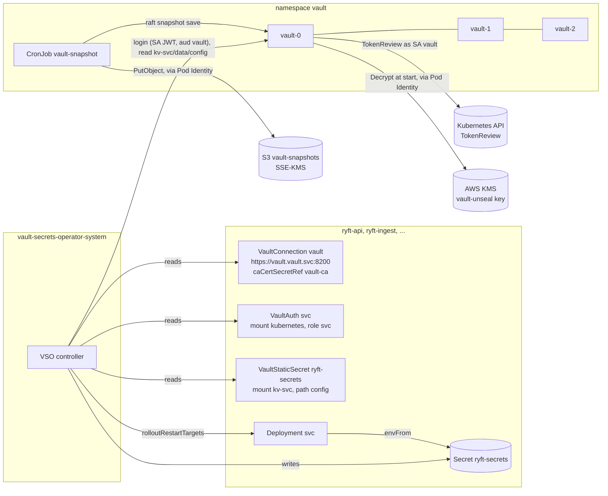

# Vault Community Edition in the cluster, migrated from HCP Vault Dedicated: design

Ticket: `CLAUDE_FOLLOWUP_VAULT_CE.md` (V0 of `plan.md`). Author: platform-architect. Date: 2026-11-05.
Read from `origin/main` at `6b508e5`. Version pins come from `versions.md` (same directory) and are reconciled
here. Where that file doesn't cover a fact and I can't check it offline, the fact is marked **to verify**, with the
command or URL that settles it (collected in Appendix B).

The brief's workload with the brand-named namespace is called **the import service** here. Its namespace and
service key are whatever `infra/vault` emits, and nothing in this note spells them out.

---

## 0. Summary

**Problem.** Every RYFT credential lives in HCP Vault Dedicated: one Enterprise namespace per workload
(`admin/ryft/<svc>`), reached over HCP's public address. For logins, HCP calls back into the EKS API through the
public endpoint, which is why `endpoint_public_access_cidrs` stays `0.0.0.0/0`. The goal is Vault Community Edition
(CE) inside `ryft-prod-euc1`: 3 Raft replicas, KMS auto-unseal, snapshots to S3. The following must not change:
- every workload sees only its own keys;
- every `ryft-secrets` keeps byte-identical content;
- no service restarts with different credentials;
- no Postgres or broker password changes.

**Constraints.**
- Three t3.large nodes, one per zone (D57, D64). The nodes are CPU-bound.
- One operator.
- GDPR. Vault holds credentials, not health data, but the credentials open the health data.
- Git or the user's Terraform is the only path to production.
- Admission is designed but still in Phase 0 (`enabled: false`).
- Argo CD's ClusterRoles are an allowlist (D180, merged, not yet applied).

**Options for who owns the Vault server.**

| | A. Argo CD Application (wave -1), the brief | B. Terraform add-on in `infra/aws/kubernetes` (**chosen**) | C. Keep HCP |
| --- | --- | --- | --- |
| Fits D94 / CLAUDE.md "Argo CD manages workloads only" | No. Vault is the platform the add-on VSO consumes | Yes. Same layer as VSO, cert-manager, Argo CD | n/a |
| Argo CD power needed | statefulsets and cronjobs write (D180 allows neither), `escalate`/`bind` on the chart's discovery Role, a ClusterRoleBinding to `system:auth-delegator`, a new AppProject for a non-`ryft-*` namespace, P7's fixed app map, renderpolicy's image allowlist | none | none |
| Blast radius of a stolen Argo CD controller token | It could rewrite the server that holds every credential | Unchanged, provided P12 and the new P13 keep Argo CD out of `vault` (section 5) | unchanged |
| KMS key, pod identity, namespace, CRB, chart ordering | across two owners (Terraform, then Argo CD) | one apply, `depends_on` | n/a |
| Chart changes | merge deploys them (but upgrades are manual anyway: `updateStrategy: OnDelete`) | the user's `terraform apply` | n/a |
| Disaster-recovery order | needs a wave hack and keeps the root unhealthy until init | natural: `infra/aws/kubernetes` brings Vault (uninitialised), Argo CD's waves wait at wave 0 until VSO syncs | n/a |
| Cost | as B | 3 × (100m / 256Mi), about 45 GiB gp3 (about $4.3/month), 2 KMS keys ($2/month), S3 pennies; the HCP line goes | the HCP line stays |

**Choice: B.** The Vault server is a pinned `helm_release` in `infra/aws/kubernetes`. The objects the chart cannot
render (the server Certificate, the NetworkPolicies, the snapshot CronJob) go in a small local chart beside it, the
same pattern as `charts/cluster-issuers`.

Everything that consumes Vault stays where it is:
- `infra/vault` keeps the Vault objects, namespaces and service accounts;
- `deploy/k8s/overlays/vault-namespaces/<svc>` keeps the generated VSO objects;
- the `vault-<svc>` apps stay in wave 0.

**Decisions at a glance** (the D-entries are proposed in Appendix A):

| # | Decision | Deviation from the brief |
| --- | --- | --- |
| 1 | Isolation by mount and policy. One `auth/kubernetes`, and one role, policy and `kv-<svc>` per service. `kv-operator` for the demo password | Policy grants `data/config` only, no `metadata` (VSO doesn't need it; today's live policy proves it) |
| 2 | One Terraform root, two `vault` provider configurations (default = HCP, alias `k8s`). The `random_*` stay put. CE writes are switched on by a committed local, and the per-namespace source by a committed set | `vault_target` becomes two committed locals (`write_k8s`, `vso_on_k8s`), not a tfvars enum. Dual-write through the soak |
| 3 | KMS auto-unseal through EKS Pod Identity (Vault 2.2.1, AWS SDK v2). Key and bucket in `infra/aws` with `prevent_destroy`. Roles and associations in `infra/aws/kubernetes` | Seal names the key ARN, not the alias |
| 4 | TLS from a **dedicated** cert-manager CA `ryft-vault` (not `ryft-internal`). `tls_reload_interval = "5m"` (new in 2.2.0), no sidecar | The brief said the D98 CA |
| 5 | Namespace `vault`, Pod Security `restricted`, `disable_mlock = true`, read-only root, `/tmp` emptyDir. The admission chart extends P1/P2/P3/P4 to `vault` and adds P13 | admission-celtest alone proves nothing: today no policy even looks at `vault` |
| 6 | Default deny. Ingress on 8200 only from VSO, the cluster collector and the snapshot job, plus Raft. Egress: KMS 443 public, API server 443 VPC, the pod identity agent `169.254.170.23:80`, DNS | Brief omitted the API server and the pod identity agent |
| 7 | Raft snapshot every 6 h by a CronJob of two upstream images pinned by digest (vault and aws-cli) to SSE-KMS S3. Terraform state is the second copy of every KV value | |
| 8 | Admin: port-forward only, userpass with TOTP login MFA, root revoked, a 1-hour `terraform` token | Recommend TOTP login MFA (CE has it) over a bare userpass; OIDC later |
| 9 | Cutover per group by a PR that flips one name in `vso_on_k8s` plus the regenerated overlay. `vault-ca` Certificates are pre-staged | Not "promote PRs" |
| 10 | Unauthenticated metrics on the listener, admitted by NetworkPolicy from the cluster collector only. New alert group `ryft-vault` | |
| 11 | Probes: liveness tolerates sealed and uninitialised, readiness does not. The `vault` Service publishes ready pods only | The user's two probes are the wrong way round |



Vault is **not on the request path**. Workloads read `ryft-secrets` from etcd. A Vault outage stops syncs and
rotations, but it neither stops running pods nor stops new pods from starting while the Secrets exist. That fact
shapes the risk choices below: 3 replicas are a convenience, not a requirement, and an RPO of 6 h is generous.

---

## 1. Architecture: mounts, auth, policies, VSO objects

### 1.1 Layout in CE (no namespaces)

| HCP today (per service, inside `admin/ryft/<svc>`) | CE (root namespace) |
| --- | --- |
| namespace `admin/ryft/<svc>` | none |
| `auth/kubernetes` per namespace, configured with the EKS public endpoint, the cluster CA and a long-lived `vault-auth` reviewer JWT per namespace | **one** `auth/kubernetes`: `kubernetes_host = "https://kubernetes.default.svc"`, no CA, no reviewer JWT (Vault uses its own pod's SA token and CA, re-read periodically) |
| role `<svc>` in each mount | role `<svc>` in the one mount, bound to exactly `[<sa>]` × `[<k8s_ns>]`, `audience = "vault"`, `token_ttl = var.token_ttl` (3600), `token_max_ttl = 4 × token_ttl` (same as today) |
| `kv/` (v2) per namespace, secret `config` (and `amqp-user-<c>` in rabbitmq) | `kv-<svc>/` (v2) per service, same secret names |
| `operator/` in `admin/ryft`, secret `demo` | `kv-operator/`, secret `demo` (no role may read it) |
| policy `<svc>` per namespace | policy `<svc>` |

**Why one auth mount, not one per service** (`versions.md` §10 suggests either):
- The isolation is the role's binding to one namespace and service account, and Vault checks it on every login
  through TokenReview.
- Per-service mounts would all share the same reviewer, the same cluster and the same config, so they add no
  isolation, while adding nine configs and changing `VaultAuth.mount`, which P4 pins to `kubernetes`.

**Why a mount per service, not one `kv/` with prefixes.** The policy stays two lines. A mistake in a glob can't widen
access across services. The `VaultStaticSecret` changes only in `mount`, and P4 can bind the mount to the namespace
(`kv-` + the namespace without `ryft-`).

**Reserved names.** Policy names share the root namespace with Vault's own, and the mount `kv-operator` must not
collide. A validation on `var.services` refuses the keys `default`, `root`, `admin`, `terraform`, `vault-snapshot`
and `operator`.

### 1.2 Exact shapes (HCL; new file `infra/vault/k8s.tf`, every resource `provider = vault.k8s`)

```hcl
locals {
  k8s_services = local.write_k8s ? local.services : {}
}

resource "vault_auth_backend" "k8s" {
  count       = local.write_k8s ? 1 : 0
  provider    = vault.k8s
  type        = "kubernetes"
  path        = "kubernetes"
  description = "Kubernetes auth for ${var.eks_cluster_name} (Vault in the cluster)"
}

# Reviewer = Vault's own service account (system:auth-delegator from the chart's
# ClusterRoleBinding vault-server-binding). No reviewer JWT, no CA: both come from the pod.
# Issuer validation stays off (deprecated field, default true; versions.md §6).
resource "vault_kubernetes_auth_backend_config" "k8s" {
  count                = local.write_k8s ? 1 : 0
  provider             = vault.k8s
  backend              = vault_auth_backend.k8s[0].path
  kubernetes_host      = "https://kubernetes.default.svc"
  disable_local_ca_jwt = false
}

resource "vault_mount" "k8s_kv" {
  for_each    = local.k8s_services
  provider    = vault.k8s
  path        = "kv-${each.key}"
  type        = "kv"
  options     = { version = "2" }
  description = "Application secrets for ${each.key}"
}

resource "vault_policy" "k8s_service" {
  for_each = local.k8s_services
  provider = vault.k8s
  name     = each.key
  policy   = <<-HCL
    # ${each.key}: read its own config, nothing else.
    path "kv-${each.key}/data/config" {
      capabilities = ["read"]
    }
    %{~if each.value.amqp == "server"}
    # The RabbitMQ users' credentials, for the Topology Operator.
    path "kv-${each.key}/data/amqp-user-*" {
      capabilities = ["read"]
    }
    %{~endif}
  HCL
}

resource "vault_kubernetes_auth_backend_role" "k8s_service" {
  for_each                         = local.k8s_services
  provider                         = vault.k8s
  backend                          = vault_auth_backend.k8s[0].path
  role_name                        = each.key
  bound_service_account_names      = [each.value.service_account]
  bound_service_account_namespaces = [each.value.k8s_ns]
  audience                         = "vault"
  token_policies                   = [vault_policy.k8s_service[each.key].name]
  token_ttl                        = var.token_ttl
  token_max_ttl                    = var.token_ttl * 4
}

# The same locals as the HCP side: same values, a copy, not a rotation.
resource "vault_kv_secret_v2" "k8s_config" {
  for_each            = local.write_k8s ? local.services_with_secrets : {}
  provider            = vault.k8s
  mount               = vault_mount.k8s_kv[each.key].path
  name                = "config"
  delete_all_versions = true
  data_json           = jsonencode(local.service_kv[each.key])
}

resource "vault_kv_secret_v2" "k8s_amqp_user" {
  for_each            = local.write_k8s && local.amqp_server != null ? toset(local.amqp_clients) : toset([])
  provider            = vault.k8s
  mount               = vault_mount.k8s_kv[local.amqp_server].path
  name                = "amqp-user-${each.key}"
  delete_all_versions = true
  data_json           = jsonencode({ username = each.key, password = random_password.amqp[each.key].result })
}

resource "vault_mount" "k8s_operator" {
  count       = local.write_k8s ? 1 : 0
  provider    = vault.k8s
  path        = "kv-operator"
  type        = "kv"
  options     = { version = "2" }
  description = "Operator-only secrets (no workload policy)"
}

resource "vault_kv_secret_v2" "k8s_demo" {
  count               = local.write_k8s ? 1 : 0
  provider            = vault.k8s
  mount               = vault_mount.k8s_operator[0].path
  name                = "demo"
  delete_all_versions = true
  data_json           = jsonencode({ email = var.demo_email, password = random_password.demo.result })
}

# The snapshot CronJob's identity (used from PR 4 on).
resource "vault_policy" "k8s_snapshot" {
  count    = local.write_k8s ? 1 : 0
  provider = vault.k8s
  name     = "vault-snapshot"
  policy   = <<-HCL
    path "sys/storage/raft/snapshot" {
      capabilities = ["read"]
    }
  HCL
}

resource "vault_kubernetes_auth_backend_role" "k8s_snapshot" {
  count                            = local.write_k8s ? 1 : 0
  provider                         = vault.k8s
  backend                          = vault_auth_backend.k8s[0].path
  role_name                        = "vault-snapshot"
  bound_service_account_names      = ["vault-snapshot"]
  bound_service_account_namespaces = ["vault"]
  audience                         = "vault"
  token_policies                   = [vault_policy.k8s_snapshot[0].name]
  token_ttl                        = 600
  token_max_ttl                    = 600
}
```

**`shared_secrets`.** Nothing changes. They are written into each service's `kv-<svc>/config` filtered by that
service's `secret_keys`, exactly as `local.service_kv` does today. The brief's test "`shared_secrets` land in every
`kv-<svc>/config`" misreads the variable: they land **only** in the services that list the key. The test pins
that (section 2.5).

**The operator demo password.** It lives at `kv-operator/demo`, and no role's policy names it. `scripts/seed_demo.sh`
and `scripts/lib/admin.sh` read `VAULT_NAMESPACE=admin/ryft … -mount=operator` and `-mount=kv` today. In PR 3 they
gain a CE branch (`-mount=kv-operator demo`, `-mount=kv-api config`, no `VAULT_NAMESPACE`), selected by `VAULT_ADDR`
pointing at `127.0.0.1`. The HCP branch goes in PR 6.

**Audience and TTLs.** Both are unchanged. The role sets `audience = "vault"`, and VSO requests tokens with
`audiences: ["vault"]` (`tokenExpirationSeconds` default 600). Vault tokens last 1 h, 4 h at most, and include the
`default` policy (VSO needs `lookup-self` and `renew-self`).

**The token reviewer in the cluster.** The chart's `server.authDelegator.enabled: true` renders ClusterRoleBinding
`vault-server-binding` → `system:auth-delegator` for SA `vault/vault`. Since Vault is a Terraform-owned release,
Argo CD needs no `bind`. Vault's own pod token is a kubelet-rotated projected token, and Vault re-reads it
(`versions.md` §6). The nine `vault-auth` SAs, their long-lived token Secrets and the nine ClusterRoleBindings are
HCP-only and go in PR 6. **They are a standing cluster-wide TokenReview credential, so removing them is a security
gain, not just cleanup.**

### 1.3 VSO objects after the change

**Per-namespace VaultConnection, kept.** D46 turned the default VaultConnection and the default auth method off, so
that a namespace without its own objects gets nothing. One shared default connection would need the CA Secret in
`vault-secrets-operator-system`, and it would let any VaultAuth that names no connection use it. **Decision: keep
`VaultConnection vault` per namespace.**

**The CA Secret.** VSO resolves `caCertSecretRef` in the VaultConnection's own namespace, so every namespace needs a
Secret with `ca.crt`. Three ways to get it:
- **(a)** A literal Secret in the generated overlay (the template's old `vault_ca_b64` path). Refused: Argo CD's
  controller has no `secrets` write (D180), and P4 forbids a CA on the connection today.
- **(b)** Reuse D98's `amqp-client`. Refused: it exists only in the four client namespaces, and it would couple
  Vault trust to the broker.
- **(c) Chosen.** A cert-manager `Certificate vault-ca` per namespace from the new ClusterIssuer `ryft-vault`
  (section 4). cert-manager's CA issuer writes `ca.crt` into the Secret. The leaf key in it is inert, because Vault
  verifies no client certificates and the leaf is **not** signed by `ryft-internal`, which the broker trusts for
  mTLS (D98).

Argo CD may write `certificates.cert-manager.io` already. `project.yaml`'s `orphanedResources.ignore` gains
`{ kind: Secret, name: vault-ca }`.

Generated `deploy/k8s/overlays/vault-namespaces/api/vault.yaml`, target `k8s`:

```yaml
# Generated by infra/vault — do not edit by hand (terraform apply rewrites it).
apiVersion: cert-manager.io/v1
kind: Certificate
metadata:
  name: vault-ca
  namespace: ryft-api
spec:
  # Only ca.crt is used (the VaultConnection's trust); the leaf is inert: Vault verifies no
  # client certificates and ryft-vault is not a CA the broker trusts.
  secretName: vault-ca
  commonName: vso.ryft-api
  duration: 8760h
  privateKey: { algorithm: ECDSA, size: 256, rotationPolicy: Always }
  usages: [digital signature]
  issuerRef: { name: ryft-vault, kind: ClusterIssuer, group: cert-manager.io }
---
apiVersion: secrets.hashicorp.com/v1beta1
kind: VaultConnection
metadata:
  name: vault
  namespace: ryft-api
  annotations: { argocd.argoproj.io/sync-wave: "0" }
spec:
  address: https://vault.vault.svc:8200
  skipTLSVerify: false
  caCertSecretRef: vault-ca
---
apiVersion: secrets.hashicorp.com/v1beta1
kind: VaultAuth
metadata:
  name: api
  namespace: ryft-api
  annotations: { argocd.argoproj.io/sync-wave: "0" }
spec:
  vaultConnectionRef: vault
  # Vault Community Edition: no namespace (isolation is the role, the policy and the mount).
  method: kubernetes
  mount: kubernetes
  kubernetes:
    role: api
    serviceAccount: api
    audiences: ["vault"]
---
apiVersion: secrets.hashicorp.com/v1beta1
kind: VaultStaticSecret
metadata:
  name: ryft-secrets
  namespace: ryft-api
  annotations: { argocd.argoproj.io/sync-wave: "1" }
spec:
  vaultAuthRef: api
  mount: kv-api
  type: kv-v2
  path: config
  refreshAfter: 1h
  destination:
    name: ryft-secrets
    create: true
    overwrite: true
    transformation:
      excludeRaw: true
  rolloutRestartTargets:
    - kind: Deployment
      name: api
```

**What the generator emits per target** (`templates/vso.yaml.tftpl` gains a `target` argument; `vso.tf` computes
the arguments per service from `contains(local.vso_on_k8s, name)`):

| Field | `hcp` | `k8s` |
| --- | --- | --- |
| `Certificate vault-ca` | emitted (pre-staged from PR 3, harmless) | emitted |
| `VaultConnection.address` | `var.vault_address_for_cluster` | `https://vault.vault.svc:8200` (a local, not a variable: P4 pins it) |
| `VaultConnection.caCertSecretRef` | absent | `vault-ca` |
| `VaultAuth.namespace` | `admin/ryft/<svc>` | absent |
| `VaultAuth.mount`, role, SA, audiences | `kubernetes`, `<svc>`, `<sa>`, `[vault]` | same |
| `VaultStaticSecret.mount` | `kv` | `kv-<svc>` |
| in-app sync waves | none | Connection and Auth `0`, StaticSecret `1` (the source is switched before the secret object asks for it) |
| everything else (`refreshAfter`, destination, `excludeRaw`, labels of `amqp-user-*`, `rolloutRestartTargets`) | identical | identical |

The `vault_ca_bundle_b64` path and the literal `vault-ca` Secret are removed in PR 6. A precondition on `local_file.vso`
refuses `k8s` for a service while `local.write_k8s` is false.

**Failure modes and rollback.**
- **A role bound to the wrong SA or namespace.** The login fails with 403, VSO keeps the old Secret
  (`SecretSynced=False`), and Argo CD shows the app Degraded. Rollback: revert the group's PR.
- **A policy missing `amqp-user-*`.** The broker's users stop refreshing. It shows up in that group's verification
  (the next refresh sees 403). Rollback: as above.
- **A service named `operator` or `default`.** Refused at plan time by the validation.

---

## 2. Terraform: one root, two Vaults

### 2.1 One root or two

**Two roots** (`infra/vault-ce` with its own workspace) would need two things:
- The secret values from the old state, either by `tfe_outputs` / `terraform_remote_state` of every value as one
  sensitive output, or by moving the `random_*` across workspaces at decommission. The second is a cross-state move,
  the operation that emptied four states in D56.
- A second state holding every credential.

**One root** keeps the `random_*` where they are and keeps one state with secrets. It adds only new addresses, so PR 3
touches **no existing resource**: the HCP plan is a no-op except for the new `local_file` content (`vault-ca`).

**Decision: one root, workspace `ryft-prod-euc1-vault` unchanged** (D56, local execution).

### 2.2 Providers

A provider block cannot be conditional, but two configurations of one provider can coexist:

```hcl
# HCP (unchanged): address and namespace from variables, token from VAULT_TOKEN.
provider "vault" {
  address   = coalesce(var.vault_address, var.vault_address_for_cluster)
  namespace = var.vault_parent_namespace_root != "" ? var.vault_parent_namespace_root : null
}

# Vault CE in the cluster, through `kubectl port-forward` on the operator's machine.
# Everything explicit, so nothing from the HCP environment (VAULT_TOKEN, VAULT_CACERT,
# VAULT_NAMESPACE) can leak into it.
provider "vault" {
  alias            = "k8s"
  address          = var.vault_k8s_address                    # default "https://127.0.0.1:8200"
  ca_cert_file     = pathexpand(var.vault_k8s_ca_cert_file)   # default "~/.config/ryft/vault-ca.pem"
  token            = var.vault_k8s_token                      # ephemeral, from TF_VAR_vault_k8s_token
  skip_child_token = true                                     # the token is already 1 h and bounded
}

variable "vault_k8s_token" {
  description = "Token for the in-cluster Vault (policy terraform, 1 h). Only from TF_VAR_vault_k8s_token; never in a file."
  type        = string
  sensitive   = true
  ephemeral   = true   # not written to the plan or the state (Terraform >= 1.10; pinned 1.16.6)
  default     = null
}
```

Rules for the user's shell, written into the README:
- Never export `VAULT_CACERT` or `VAULT_NAMESPACE` while running Terraform. The HCP provider would pick them up and
  fail on TLS or on the namespace. Each provider sets these itself.
- `VAULT_TOKEN` is the HCP admin token, as today. `TF_VAR_vault_k8s_token` holds the CE token.

**The switches** (new file `infra/vault/targets.tf`). They are committed locals, not tfvars, so git is the record of
which namespace reads which Vault:

```hcl
locals {
  # Whether this root writes the in-cluster Vault (D191). false until cutover step 2.
  write_k8s = false
  # Namespaces whose operator objects read the in-cluster Vault; one name per cutover PR.
  vso_on_k8s = toset([])
}
```

**To verify:** that Terraform doesn't call `ConfigureProvider` for `vault.k8s` while no resource instance uses it
(`write_k8s = false`). Acceptance: the user's `terraform plan` of PR 3 succeeds **without** a port-forward and
without `TF_VAR_vault_k8s_token`. **Fallback if it doesn't:** PR 3 merges with the alias block commented out, and
PR 3b (`write_k8s = true`) adds it. That ordering is harmless.

### 2.3 How the Terraform token is obtained

All of this happens on the user's machine, through the port-forward (section 8 has the bootstrap):

```bash
kubectl --context ryft-prod-euc1 -n vault port-forward svc/vault-active 8200:8200 &   # 127.0.0.1 only
export VAULT_ADDR=https://127.0.0.1:8200 VAULT_CACERT=~/.config/ryft/vault-ca.pem
vault login -method=userpass -no-store username=<operator>       # password + TOTP passcode
# (with -no-store the token is printed once: export it as VAULT_TOKEN in this shell only)
export TF_VAR_vault_k8s_token="$(vault token create -policy=terraform -ttl=1h -explicit-max-ttl=1h -display-name=terraform -field=token)"
unset VAULT_ADDR VAULT_CACERT; export VAULT_TOKEN=<the HCP admin token>   # for the default provider
terraform -chdir=infra/vault plan -out=tfplan && terraform -chdir=infra/vault apply tfplan
# (the ephemeral token must be set again at apply: it is not in tfplan)
```

The `terraform` token is a child of the admin token. Revoking the admin session revokes it too.

The `terraform` policy is committed in `infra/vault/bootstrap/terraform.hcl` and written by hand at bootstrap, not
by Terraform, so Terraform can't widen its own policy:

```hcl
path "sys/mounts"                    { capabilities = ["read"] }
path "sys/mounts/kv-*"               { capabilities = ["create", "read", "update", "delete", "sudo"] }
path "sys/mounts/kv-*/tune"          { capabilities = ["read", "update"] }
path "sys/auth"                      { capabilities = ["read"] }
path "sys/auth/kubernetes"           { capabilities = ["create", "read", "update", "delete", "sudo"] }
path "sys/auth/kubernetes/tune"      { capabilities = ["read", "update"] }
path "auth/kubernetes/config"        { capabilities = ["create", "read", "update"] }
path "auth/kubernetes/role/*"        { capabilities = ["create", "read", "update", "delete", "list"] }
path "sys/policies/acl"              { capabilities = ["list"] }
path "sys/policies/acl/*"            { capabilities = ["create", "read", "update", "delete"] }
path "sys/policies/acl/admin"        { capabilities = ["deny"] }
path "sys/policies/acl/terraform"    { capabilities = ["deny"] }
path "kv-*/data/*"                   { capabilities = ["create", "read", "update", "delete"] }
path "kv-*/metadata/*"               { capabilities = ["read", "delete", "list"] }
# Nothing on sys/audit, sys/seal, sys/storage/raft, sys/generate-root, auth/userpass, identity/*.
```

**To verify:** which of these endpoints need `sudo` on 2.2.1 (`sys/auth/<path>` does; `sys/mounts/<path>` may not).
The kind rehearsal applies `infra/vault` with exactly this token, and every 403 there is a missing line.

This token is bounded, not sandboxed. It can write a policy that grants `sys/*` and bind a role to it. Since this
root also creates Kubernetes service accounts, it is admin-equivalent through that path. What it cannot do is turn
off audit, touch the admin identity, or outlive its hour. It holds every secret anyway, through the state.

### 2.4 State and secret values

- The `random_password` / `random_bytes` resources stay at their addresses. Both targets read `local.service_kv`,
  `random_password.amqp`, and so on. **That is what makes the migration a copy.**
- The state gains about 60 resources. It already holds every value. `data_json_wo` (write-only) for the CE secrets
  would remove nothing, because the `random_*` results remain in state. Not used.
- **Dual-write through the soak** (changes the brief's "HCP untouched"). Every apply in steps 2 to 6 writes both
  Vaults. A rotation during the soak (`-replace=random_password.db["api"]`, then migrate) therefore leaves HCP
  current. **A rollback to HCP after such a rotation would otherwise hand out a stale database password.**

### 2.5 Tests (`infra/vault/tests/`)

`mock_provider "vault" {}` and `mock_provider "vault" { alias = "k8s" }`. The existing 20-odd runs stay as they are
(the HCP target). New runs:

1. `k8s_target_is_off_by_default`: with `write_k8s = false` there are no `vault.k8s` resources, and every generated
   manifest equals `tests/golden/hcp/*.yaml`, Certificate included.
2. `each_service_gets_one_mount_one_role_one_policy`: with the target on (an `override_locals`-style variable for
   tests, or a `run` with `variables { test_write_k8s = true }` wired into the local), the keys of `vault_mount.k8s_kv`,
   `vault_policy.k8s_service` and `vault_kubernetes_auth_backend_role.k8s_service` equal `keys(var.services)`.
3. `policies_read_only_their_own_config`: the policy text of each service mentions `kv-<that service>/` and no other
   `kv-` mount. rabbitmq alone has `amqp-user-*`. No policy mentions `kv-operator`.
4. `roles_trust_one_namespace_and_one_service_account`: bound names, namespaces, `audience == "vault"`, TTLs, as the
   HCP test.
5. `same_values_on_both_targets`: for every key of `local.services_with_secrets`,
   `vault_kv_secret_v2.k8s_config[k].data_json == vault_kv_secret_v2.config[k].data_json`. Likewise `amqp_user` and
   `demo`.
6. `shared_secrets_reach_only_the_services_that_list_them`: with `shared_secrets = { BETA_GATE = "on",
   CONSENT_ENFORCE = "on" }`, the CE configs of api and ingest hold `BETA_GATE`, scoring's doesn't, and
   `CONSENT_ENFORCE` reaches api, ingest and scoring only.
7. `auth_config_is_in_cluster`: `kubernetes_host == "https://kubernetes.default.svc"`, and `token_reviewer_jwt` and
   `kubernetes_ca_cert` are null.
8. `golden_k8s`: with `vso_on_k8s = ["api", "migrate", "rabbitmq"]`, the files equal `tests/golden/k8s/*.yaml`.
9. `k8s_source_needs_write_k8s` (expect_failures on the precondition).
10. `reserved_service_names_are_refused` (expect_failures on the validation).
11. `decommission_keeps_the_random_values` (PR 6): with the HCP files removed, the `random_*` addresses and counts
    are unchanged.

`make k8s-validate` already validates `tests/golden/*.yaml` against the CRD schemas. The new golden directory is
added to the loop in the Makefile.

### 2.6 The fate of the HCP resources

Untouched until PR 6. Then:
- the HCP resource blocks are deleted (`namespaces.tf`, the HCP halves of `kubernetes-auth.tf`, `secrets.tf` and
  `operator.tf`);
- the plan shows **only destroys**: the HCP Vault objects and the reviewer SAs, token Secrets and ClusterRoleBindings;
- the user applies while HCP is still reachable, then deletes the HCP cluster in the portal.

PR 6b removes the default provider, `vault_parent_namespace_root`, `vault_address(_for_cluster)`,
`vault_ca_bundle_b64` and the namespace label `ryft.dev/vault-namespace`, and renames the alias to the default if
the user wants. **Fallback if HCP is already gone:** `removed { from = …; lifecycle { destroy = false } }` blocks
forget the HCP addresses without calling HCP.

**Rollback** before PR 6 is free: `write_k8s = false` would destroy the CE objects, which nothing reads unless a
namespace was switched. After PR 6, there is no rollback to HCP. That is why the soak exists.

---

## 3. KMS auto-unseal with EKS Pod Identity

**Version support** (`versions.md` §3, verified 2026-11-05):
- Vault 2.2.0+ builds the awskms wrapper on AWS SDK for Go v2 (`config.LoadDefaultConfig`), and its default chain
  includes the container credential provider that Pod Identity uses. 2.2.1 ships `aws-sdk-go-v2/config v1.32.37`,
  far above the minimum.
- Earlier versions from 1.15.5 to 2.1.2 inherit support from `aws-sdk-go v1.55.8`.
- **Not run-tested.** The proof is section 8, step 4 (`Seal Type awskms`, unsealed after a pod deletion).
- Pod Identity doesn't inject `AWS_REGION`, so the seal stanza sets `region`.
- No `AWS_ACCESS_KEY_ID`, no shared credentials file, and **no `eks.amazonaws.com/role-arn` annotation** on the SA.
  Anything earlier in the chain would win.

**IAM actions:** `kms:Encrypt`, `kms:Decrypt`, `kms:DescribeKey` (verified, the awskms docs).

**Terraform in `infra/aws`** (PR 1; new file `vault.tf`, next to the cluster). These two must outlive any rebuild of
the Kubernetes layer:

```hcl
data "aws_iam_policy_document" "vault_keys" {
  statement {
    sid       = "AccountAdministers"          # as logs.tf: IAM policies decide who uses the key
    actions   = ["kms:*"]
    resources = ["*"]
    principals { type = "AWS", identifiers = ["arn:${local.partition}:iam::${local.account_id}:root"] }
  }
}

resource "aws_kms_key" "vault_unseal" {
  description             = "Vault auto-unseal for ${local.name}. Deleting or disabling it makes the Vault data unreadable."
  key_usage               = "ENCRYPT_DECRYPT"
  enable_key_rotation     = true      # KMS keeps old material; Vault decrypts with the ciphertext's version
  deletion_window_in_days = 30
  policy                  = data.aws_iam_policy_document.vault_keys.json
  tags                    = local.tags
  lifecycle { prevent_destroy = true }
}

resource "aws_kms_alias" "vault_unseal" {
  name          = "alias/${local.name}-vault-unseal"
  target_key_id = aws_kms_key.vault_unseal.key_id
}
# aws_kms_key.vault_snapshots + alias/${local.name}-vault-snapshots: the same, for the bucket (section 7).
```

**Pod identity in `infra/aws/kubernetes/iam.tf`** (PR 2), the pattern of `fluent_bit_pod_identity`:

```hcl
data "aws_kms_alias" "vault_unseal" { name = "alias/${var.cluster_name}-vault-unseal" }

module "vault_unseal_pod_identity" {
  source  = "terraform-aws-modules/eks-pod-identity/aws"
  version = "~> 2.10"

  name                 = "${var.cluster_name}-vault-unseal"
  attach_custom_policy = true
  policy_statements = [{
    sid       = "AutoUnseal"
    actions   = ["kms:Encrypt", "kms:Decrypt", "kms:DescribeKey"]
    resources = [data.aws_kms_alias.vault_unseal.target_key_arn]
  }]
  associations = {
    vault = { cluster_name = var.cluster_name, namespace = "vault", service_account = "vault" }
  }
  tags = local.tags
}
```

**The seal stanza** (in the chart's Raft config, rendered by Terraform):

```hcl
seal "awskms" {
  region     = "eu-central-1"
  kms_key_id = "<data.aws_kms_alias.vault_unseal.target_key_arn>"
}
```

The **ARN, not the alias**: re-pointing the alias at another key would change what Vault encrypts new seal data
with, silently. The ARN is plan-time known (data source).

**The chicken and egg.**
1. PR 1 (`infra/aws`) is applied first and creates the key.
2. PR 2 (`infra/aws/kubernetes`) reads it by alias. `helm_release.vault` has
   `depends_on = [module.vault_unseal_pod_identity]`, so the association exists before the first pod. The Pod
   Identity webhook injects credentials only at pod creation.
3. A pod created before its association starts without credentials, fails the seal and crash-loops. Fix: delete the
   pod (user, `kubectl --context ryft-prod-euc1 -n vault delete pod vault-N`).

**Failure modes.**

| Failure | Seen as | Recovery |
| --- | --- | --- |
| KMS unreachable (egress, NAT down) | A restarting pod stays sealed or crash-loops; running pods are unaffected (KMS is used at start) | Fix egress. Pods unseal on restart |
| Association missing or role policy wrong | Same, `AccessDeniedException` in the log | Terraform. Delete the pod |
| Key disabled | No restarted pod can unseal | `aws kms enable-key` (user) |
| Key scheduled for deletion | Same, in 30 days | `aws kms cancel-key-deletion` (user). `prevent_destroy` stops Terraform from scheduling it |
| Key deleted | Vault data and snapshots are unreadable | Rebuild: init a fresh Vault, bootstrap, `infra/vault` apply (Terraform state recreates every KV value). Hours, no credential lost |

**Rollback.** PR 1 is additive. Deleting the key needs `prevent_destroy` removed first: a deliberate two-step.

---

## 4. TLS: a cert-manager Certificate, reloaded without restarts

**A dedicated CA** (amends D98). In `charts/cluster-issuers` (values `vaultCA.enabled`):
- a self-signed bootstrap issuer signs root `RYFT Vault CA` (ECDSA P-256, ten years, `rotationPolicy: Never`, in
  `cert-manager`);
- a CA ClusterIssuer `ryft-vault` signs from it.

The reason is separation. Whoever can get a leaf from `ryft-internal` presents a valid TLS factor to the broker. Nine
per-namespace `vault-ca` leaves under that CA would hand that factor to `ryft-smoke`, `ryft-migrate`, `monitoring`
and the others. Under `ryft-vault` the leaves are inert. The cost is one more root, to rotate in ten years.

**The server certificate** (`charts/vault-extras`, namespace `vault`):

```yaml
apiVersion: cert-manager.io/v1
kind: Certificate
metadata: { name: vault-tls, namespace: vault }
spec:
  secretName: vault-tls
  duration: 8760h          # a year, renewed 30 days before (as the broker's, D98)
  renewBefore: 720h
  privateKey: { algorithm: ECDSA, size: 256, rotationPolicy: Always }
  usages: [server auth, digital signature]
  dnsNames:
    - vault
    - vault.vault
    - vault.vault.svc
    - vault.vault.svc.cluster.local
    - vault-active
    - vault-active.vault.svc
    - vault-active.vault.svc.cluster.local
    - vault-standby
    - vault-standby.vault.svc
    - vault-internal
    - vault-internal.vault.svc
    - vault-0.vault-internal
    - vault-1.vault-internal
    - vault-2.vault-internal
    - vault-0.vault-internal.vault.svc
    - vault-1.vault-internal.vault.svc
    - vault-2.vault-internal.vault.svc
    - localhost
  ipAddresses: [127.0.0.1]       # the port-forward and the in-pod CLI (VAULT_ADDR https://127.0.0.1:8200)
  issuerRef: { name: ryft-vault, kind: ClusterIssuer, group: cert-manager.io }
```

The pod names are listed explicitly. A fourth replica needs a name here, which the chart test checks: the number of
`vault-N.vault-internal` names equals `server.ha.replicas`.

**How Vault picks up a renewal.** Vault 2.2.0 added `tls_reload_interval` on the TCP listener. Vault re-reads the
files at that interval and reloads them when the content changed (`versions.md` §5, verified in the 2.2.1 source; CE,
not Enterprise).
- The Secret is mounted as a whole-directory volume (no `subPath`) at `/vault/userconfig/vault-tls`. The kubelet
  refreshes it in place within about a minute.
- **Decision: `tls_reload_interval = "5m"`.** No reloader sidecar, no `shareProcessNamespace`. A sidecar would see
  Vault's process, and that process holds the unsealed keyring.
- SIGHUP stays the manual fallback (`tls_cert_file` and `tls_key_file` are reloaded on SIGHUP).
- `retry_join` reads `leader_ca_cert_file` at join time only.
- The user's `leader_client_cert_file` and `leader_client_key_file` are dropped: the listener requires no client
  certificate.

**`VAULT_CACERT=/vault/userconfig/vault-tls/ca.crt`** (`server.extraEnvironmentVars`) serves the in-pod CLI and the
chart's `VAULT_ADDR=https://127.0.0.1:8200`. On the operator's machine, the same CA goes to
`~/.config/ryft/vault-ca.pem`, read from the `vault-ca` Secret of namespace `vault` (only `ca.crt`; section 8).

**Failure modes.**
- **Renewal fails** (issuer broken). The existing `CertificateExpiring` fires 14 days before expiry. It matches every
  namespace, so no new rule is needed.
- **Renewed but not reloaded** (the interval is off, or a 2.2.x regression). Nothing measures the served certificate
  in-cluster. The runbook check, quarterly and in the soak: `openssl s_client -connect 127.0.0.1:8200 -servername
  vault.vault.svc </dev/null 2>/dev/null | openssl x509 -noout -serial -enddate` through the port-forward, compared
  with `kubectl -n vault get certificate vault-tls -o jsonpath='{.status.notAfter}'`. Fallback: SIGHUP, or delete
  the pods one at a time.
- **The kind test** forces a renewal (`cmctl renew -n vault vault-tls`) and asserts that the served serial changes
  within 6 minutes, with no pod restart.

---

## 5. Pod Security and admission

**What the chart renders** (0.34.1, `versions.md` §2; **to verify** with `helm template` of the final values):
- StatefulSet `vault` (3 pods, `podManagementPolicy: Parallel`, `updateStrategy: OnDelete`);
- Services `vault`, `vault-active`, `vault-standby`, `vault-internal` (headless, publishes not-ready addresses for
  `retry_join`), and `vault-ui` (ClusterIP);
- ConfigMap `vault-config`, SA `vault`;
- Role and RoleBinding `vault-discovery-*` (pods get/list/watch/update/patch, for `service_registration`);
- ClusterRoleBinding `vault-server-binding`, PDB `vault` (`maxUnavailable: 1`).

With `injector.enabled: false` and `csi.enabled: false` there is no webhook and no DaemonSet. The helm test pod
exists only under `helm test`.

**Values that make it Pod Security `restricted`** (the securityContext replaces the chart's default completely, so
everything is repeated):

```yaml
server:
  statefulSet:
    securityContext:
      pod:       { runAsNonRoot: true, runAsUser: 100, runAsGroup: 1000, fsGroup: 1000, seccompProfile: { type: RuntimeDefault } }
      container: { allowPrivilegeEscalation: false, readOnlyRootFilesystem: true, capabilities: { drop: [ALL] } }
  volumes:
    - { name: vault-tls, secret: { secretName: vault-tls, defaultMode: 0440 } }
    - { name: tmp, emptyDir: { medium: Memory, sizeLimit: 16Mi } }   # the start script writes /tmp/storageconfig.hcl
  volumeMounts:
    - { name: vault-tls, mountPath: /vault/userconfig/vault-tls, readOnly: true }
    - { name: tmp, mountPath: /tmp }
```

`disable_mlock = true` is **required** with Raft since 1.20 (Vault refuses to start without an explicit value), and
the 2.0.2+ image has no `IPC_LOCK` anyway. So nothing needs a capability. There are no init containers in the server
pod. The Pod Identity webhook adds a projected token volume, which `restricted` allows. **To verify** in the kind
test: the namespace is labelled `enforce=restricted` and the pods start. The read-only root filesystem with `/tmp`
and the chart's `home` emptyDir covers every write path. An interactive `vault login` inside the pod would fail to
write `~/.vault-token`, which is a reason to use the port-forward.

**The namespace** (Terraform, `kubernetes_namespace_v1.vault` in `infra/aws/kubernetes`):
`pod-security.kubernetes.io/{enforce,warn,audit}=restricted`. The user's `spec.finalizers` and `env: prod` are not
needed.

**What P1–P11 do with namespace `vault` today: nothing.**
- P1, P2, P3 and P5 match `ryft-*` (and `rabbitmq-system`, `argocd`).
- P6, P7, P8, P10 and P11 judge Argo CD, the operators or the broker.
- P9 judges Ingresses.
- P4 judges the VSO objects in the RYFT namespaces, and they change shape.

The most sensitive namespace would be invisible to the layer, so the admission chart changes in PR 2 (the user's
apply, same root):

| Policy | Change |
| --- | --- |
| P1 namespaces | `vault` joins the in-scope names (restricted labels on enforce, warn and audit; versions `latest`). Argo CD may not write it (already true: only `ryft-web` and `rabbitmq-system`) |
| P2 workloads | `vault` joins the match. Images are exactly `^docker[.]io/hashicorp/vault:2[.]2[.]1@sha256:962a92876e168d68eaaa24b0b8b49bbce1cb63024060a67bba95cd158a366fc2$` and the aws-cli pin (section 7), as values `images.vault` and `images.awsCli`. No image volumes. The `ryft-*` rules on commands, args and automount do **not** apply: the chart's start script is a command, and Vault needs its SA token |
| P3 netpol | `vault` joins the match, with three extra egress shapes for that namespace only: VPC CIDR on 443 (the API server, the broker's T12-k shape), `169.254.170.23/32` on 80 (the Pod Identity agent), and the existing public 443 shape. default-deny is protected as everywhere |
| P4 vso | VaultConnection keys `address`, `skipTLSVerify`, `caCertSecretRef`. `address` in `vaultAddresses` (a list during the cutover: HCP's and `https://vault.vault.svc:8200`; PR 6 leaves the second). `caCertSecretRef` absent or `vault-ca`. VaultStaticSecret `mount` is `kv` (until PR 6) or `'kv-' + (ns.startsWith('ryft-') ? ns.substring(5) : ns)`. VaultAuth `namespace` absent or under `admin/ryft/` (until PR 6, then must be absent) |
| P12 argo-scope (#121, open) | Argo CD's two identities may not create, update or delete anything in namespace `vault`. Without it a stolen controller token can create a Deployment and a Certificate in `vault`, repoint Service `vault` (it holds services write), and harvest the JWTs VSO sends |
| **P13 new `ryft-vault-trust`** | Certificates naming issuer `ryft-vault` only as `vault/vault-tls` (the DNS list above) or as `<ns>/vault-ca` (commonName `vso.<ns>`, no dnsNames, no ipAddresses, no `server auth` usage). CertificateRequests naming `ryft-vault` only from `system:serviceaccount:cert-manager:cert-manager` (CEL cannot read a CSR's names). This closes "issue yourself a cert for `vault.vault.svc`" |

Rollout follows D120. P4's dual shape and P13 go with step A (small config objects). P1, P2 and P3's `vault` branches
go with B and C.

`admission-values.yaml`'s terraform test compares `vaultAddresses` with the generated `vault.yaml` files (today it
compares the single `vaultAddress`).

**Tests:**
- `admission-celtest` gets an accept and a refuse case per new branch, plus a fixture for each P13 refusal.
- `admission-e2e` (kind) server-side dry-runs the **rendered Vault chart and `vault-extras` under the Terraform
  identity** with every binding in Deny. That is what "admission-celtest against the rendered chart" has to mean:
  celtest evaluates CEL cases, it doesn't render charts.

**Order constraint.** CI's required `admission` job dry-runs every Argo CD render through the policies. The first
`k8s`-shaped `vault.yaml` (PR 5a) fails P4 unless PR 2's P4 change is merged. PR 2 must merge before any cutover PR.
The pre-staged `vault-ca` Certificate (PR 3) passes today's policies.

**Rollback.** Revert the admission chart's values. Policies are in Audit until the user's step changes anyway.

---

## 6. Network policies

The existing pattern is `default-deny` (empty podSelector, Ingress and Egress, no rules) plus `allow-dns` (to
`kube-system` `k8s-app: kube-dns`, 53/UDP and 53/TCP), then one policy per workload. Namespaces are selected by
`kubernetes.io/metadata.name` (D44). The same pattern goes into `charts/vault-extras`:

```yaml
# vault-server: who reaches Vault and what Vault reaches.
podSelector: { matchLabels: { app.kubernetes.io/name: vault, component: server } }
policyTypes: [Ingress, Egress]
ingress:
  - from:   # the operator does every login and read (it is the only client)
      - namespaceSelector: { matchLabels: { kubernetes.io/metadata.name: vault-secrets-operator-system } }
        podSelector: { matchLabels: { <VSO controller labels: to verify> } }
    ports: [{ protocol: TCP, port: 8200 }]
  - from:   # the cluster collector's scrape of /v1/sys/metrics (section 11), not the host-network DaemonSet
      - namespaceSelector: { matchLabels: { kubernetes.io/metadata.name: monitoring } }
        podSelector: { matchLabels: { <alloy-deployment labels: to verify> } }
    ports: [{ protocol: TCP, port: 8200 }]
  - from: [{ podSelector: { matchLabels: { app.kubernetes.io/name: vault-snapshot } } }]
    ports: [{ protocol: TCP, port: 8200 }]
  - from: [{ podSelector: { matchLabels: { app.kubernetes.io/name: vault, component: server } } }]
    ports: [{ protocol: TCP, port: 8200 }, { protocol: TCP, port: 8201 }]
egress:
  - to: [{ podSelector: { matchLabels: { app.kubernetes.io/name: vault, component: server } } }]
    ports: [{ protocol: TCP, port: 8200 }, { protocol: TCP, port: 8201 }]
  - to: [{ ipBlock: { cidr: <vpc_cidr> } }]          # Kubernetes API: TokenReview, service registration (T12-k pattern)
    ports: [{ protocol: TCP, port: 443 }]
  - to: [{ ipBlock: { cidr: 0.0.0.0/0, except: [10.0.0.0/8, 172.16.0.0/12, 192.168.0.0/16, 100.64.0.0/10, 169.254.0.0/16] } }]
    ports: [{ protocol: TCP, port: 443 }]             # KMS (kms.eu-central-1.amazonaws.com, through the NAT)
  - to: [{ ipBlock: { cidr: 169.254.170.23/32 } }]    # EKS Pod Identity agent on the node
    ports: [{ protocol: TCP, port: 80 }]
---
# vault-snapshot: the CronJob's pods.
podSelector: { matchLabels: { app.kubernetes.io/name: vault-snapshot } }
policyTypes: [Ingress, Egress]
egress:
  - to: [{ podSelector: { matchLabels: { app.kubernetes.io/name: vault, component: server } } }]
    ports: [{ protocol: TCP, port: 8200 }]
  - to: [{ ipBlock: { cidr: 0.0.0.0/0, except: [ the five private ranges ] } }]
    ports: [{ protocol: TCP, port: 443 }]             # S3 (no gateway endpoint in the VPC; through the NAT)
  - to: [{ ipBlock: { cidr: 169.254.170.23/32 } }]
    ports: [{ protocol: TCP, port: 80 }]
```

- **Port-forward needs no rule.** The stream enters the pod's network namespace through the kubelet and the
  container runtime, below NetworkPolicy. Terraform's path is therefore not a network peer.
- **Kubelet probes** come from the node and are admitted by the VPC CNI regardless of policy (OPERATIONS → Network
  policy).
- **`vault-secrets-operator-system` and `monitoring` have no egress policies today.** Nothing changes there.
- **To verify:** that the VPC CNI's eBPF policy filters pod traffic to `169.254.170.23` at all. If it doesn't, the
  rule is harmless. If it does and the rule were missing, the pod would stay sealed. The PR 2 canary settles it:
  pods unseal.
- **Not opened:** 8200 from the VPC range. The host-network collector would need it, but it would give every pod on
  the VPC range a way to Vault's API (D51's reasoning for 9090).
- **Failure.** A missing VSO rule shows as `SecretSynced=False` with an i/o timeout. Wrong VSO labels look the same.
  Rollback: fix the labels in values. Both are visible in the smoke group first.

---

## 7. Storage, snapshots, bucket

**StorageClass.** `gp3-encrypted` exists (`infra/aws/kubernetes/storage.tf`; default, `Retain`,
`WaitForFirstConsumer`, expansion on; D26). Each `volumeClaimTemplate` names it explicitly (D26), because the field
is immutable.

**Sizes.** `dataStorage` 10 Gi and `auditStorage` 5 Gi per pod: 45 GiB, about $4.3 a month.
- Raft holds a few hundred KiB of secrets. The space is for BoltDB growth and local snapshot staging.
- Audit volume: VSO refreshes about 9 namespaces hourly, a login plus a read, both request and response. That is
  roughly 1,000 entries a day, about 1.5 MB. 5 Gi lasts years, so the rotation question (Vault reopens audit files
  only on SIGHUP) is moot. `VaultVolumeFilling` covers it anyway.
- `Retain` means volumes outlive PVCs. The teardown list in `infra/aws/README.md` gains them.

**Snapshot CronJob** (`charts/vault-extras`, PR 4). Image strategy: two **upstream images pinned by digest**, no
custom image:
- the same `docker.io/hashicorp/vault:2.2.1@sha256:962a…` as the server (one pin, one P2 rule), as an init container
  that writes the snapshot to an emptyDir;
- `public.ecr.aws/aws-cli/aws-cli:<version>@sha256:<digest>` uploads it (**to verify**: the current version and
  index digest, `crane digest public.ecr.aws/aws-cli/aws-cli:<version>`; at least the AWS CLI release that supports
  Pod Identity, per https://docs.aws.amazon.com/eks/latest/userguide/pod-id-minimum-sdk.html).

Why not the alternatives:
- A custom image would be one more build, pin and promote.
- A Go command in the migrate image (the D95 precedent) would need the AWS SDK in `backend/` for one job, or
  hand-written SigV4 with container credentials. That doesn't pay for itself.

```yaml
apiVersion: batch/v1
kind: CronJob
metadata: { name: vault-snapshot, namespace: vault }
spec:
  schedule: "17 */6 * * *"
  timeZone: Etc/UTC
  concurrencyPolicy: Forbid
  successfulJobsHistoryLimit: 3
  failedJobsHistoryLimit: 3
  jobTemplate:
    spec:
      backoffLimit: 2
      activeDeadlineSeconds: 600
      template:
        metadata: { labels: { app.kubernetes.io/name: vault-snapshot } }
        spec:
          serviceAccountName: vault-snapshot        # pod identity association -> S3 role
          automountServiceAccountToken: false
          restartPolicy: Never
          securityContext: { runAsNonRoot: true, runAsUser: 100, runAsGroup: 1000, fsGroup: 1000, seccompProfile: { type: RuntimeDefault } }
          volumes:
            - { name: work, emptyDir: { sizeLimit: 512Mi } }
            - { name: vault-ca, secret: { secretName: vault-ca, items: [{ key: ca.crt, path: ca.crt }] } }
            - name: vault-token
              projected: { sources: [{ serviceAccountToken: { audience: vault, expirationSeconds: 600, path: token } }] }
          initContainers:
            - name: snapshot
              image: docker.io/hashicorp/vault:2.2.1@sha256:962a…
              env:
                - { name: VAULT_ADDR, value: https://vault-active.vault.svc:8200 }
                - { name: VAULT_CACERT, value: /ca/ca.crt }
                - { name: HOME, value: /work }
              command: [/bin/sh, -ec]
              args:
                - |
                  export VAULT_TOKEN="$(vault write -field=token auth/kubernetes/login role=vault-snapshot jwt=@/var/run/secrets/vault/token)"
                  vault operator raft snapshot save /work/snap
                  vault token revoke -self
              volumeMounts: [ work:/work, vault-ca:/ca (ro), vault-token:/var/run/secrets/vault (ro) ]
              securityContext: { allowPrivilegeEscalation: false, readOnlyRootFilesystem: true, capabilities: { drop: [ALL] } }
          containers:
            - name: upload
              image: public.ecr.aws/aws-cli/aws-cli:<version>@sha256:<digest>
              env: [ { name: AWS_REGION, value: eu-central-1 }, { name: HOME, value: /work } ]
              command: [/bin/sh, -ec]
              args:
                - |
                  key="snapshots/vault-$(date -u +%Y%m%dT%H%M%SZ).snap"
                  aws s3api put-object --bucket "$BUCKET" --key "$key" --body /work/snap \
                    --server-side-encryption aws:kms --ssekms-key-id "$SNAPSHOT_KEY_ARN" >/dev/null
                  echo "{\"msg\":\"snapshot uploaded\",\"key\":\"$key\",\"bytes\":$(wc -c </work/snap)}"
              volumeMounts: [ work:/work ]
              securityContext: { allowPrivilegeEscalation: false, readOnlyRootFilesystem: true, capabilities: { drop: [ALL] } }
```

Notes on the job:
- `put-object` rather than `s3 cp`: a single PUT, so no multipart, so no `kms:Decrypt` needed.
- **To verify:** that the aws-cli image runs as a non-root UID with `HOME` on the emptyDir. Its default user is
  root, so `runAsUser` comes from the pod.
- **To verify:** that `vault operator raft snapshot inspect` exists in 2.2.1. If it does, the init container runs it
  before the upload and fails the job on a corrupt file.

**The job's identity in AWS** (`infra/aws/kubernetes/iam.tf`, module `vault_snapshot_pod_identity`, association
`vault/vault-snapshot`):
- `s3:PutObject` on `arn:aws:s3:::<bucket>/snapshots/*`;
- `kms:GenerateDataKey` on the snapshot key with condition `kms:ViaService = s3.eu-central-1.amazonaws.com`.

That is all. No `GetObject`, `ListBucket` or `DeleteObject`: a stolen job identity can add objects but cannot read or
remove old ones. **To verify:** that the module's `policy_statements` accepts `conditions`; otherwise use an
`aws_iam_policy` with `attach_custom_policy` and the policy ARN.

**Bucket** (`infra/aws`, PR 1): `${local.name}-vault-snapshots-${local.account_id}`, `prevent_destroy`, plus:
- versioning on;
- SSE-KMS with `aws_kms_key.vault_snapshots` and `bucket_key_enabled = true`;
- public access block, all four on;
- ownership `BucketOwnerEnforced`;
- lifecycle on prefix `snapshots/`: current objects expire after 30 days, noncurrent after 7, incomplete multipart
  uploads are aborted after 1 day;
- bucket policy: deny `aws:SecureTransport = false`, and deny `s3:PutObject` unless
  `s3:x-amz-server-side-encryption-aws-kms-key-id` equals the snapshot key ARN.

The user's admin identity reads for restores through the account statement. **A separate key from the unseal key**,
so the snapshot role never holds a key that unwraps Vault's root key.

**What a snapshot is.** Barrier-encrypted Raft data. It opens only with the unseal key, which is in KMS. **Terraform
state holds every KV value as well.** So the snapshot is a convenience (the audit devices, the admin identity, the
`terraform` and `admin` policies, the MFA config), not the only copy of the credentials.

**Restore** (OPERATIONS → Vault → Restore; drilled in kind):
1. A fresh Vault with the **same** KMS key.
2. A temporary `vault operator init`, then log in with that root token.
3. `vault operator raft snapshot restore -force <file>`. **To verify** in the drill whether a fresh cluster with the
   same KMS key needs `-force` (`versions.md` §8: the seal-hash check refers to the keyring; a fresh init has a new
   one).
4. Wait for "vault is unsealed" in the log.
5. Log in with the restored admin identity, revoke the temporary root.

The recovery keys after a restore are the old cluster's.

**Failure modes.**
- **Job fails** (login 403 before PR 3b, S3 403, NAT). `VaultSnapshotStale` after 13 h. The CronJob ships in PR 4,
  after step 2, when its role exists.
- **Job succeeds but uploads garbage.** The `inspect` step if it exists, and the monthly drill.

---

## 8. Bootstrap (once, the user, from OPERATIONS → Vault → Bootstrap)

Precondition: PR 2 applied. `kubectl --context ryft-prod-euc1 -n vault get pods` shows three pods `Running` and
`0/1` ready (uninitialised = not ready, by design). Every command below runs on the user's machine. None of it goes
into a chat, a PR or a log.

```bash
# 0. The CA for the local CLI (only ca.crt, from the inert vault-ca Secret)
mkdir -p ~/.config/ryft && umask 077
kubectl --context ryft-prod-euc1 -n vault get secret vault-ca -o jsonpath='{.data.ca\.crt}' | base64 -d > ~/.config/ryft/vault-ca.pem
export VAULT_CACERT=~/.config/ryft/vault-ca.pem VAULT_ADDR=https://127.0.0.1:8200
unset VAULT_NAMESPACE VAULT_TOKEN

# 1. Init on vault-0 (vault-active has no endpoint before init)
kubectl --context ryft-prod-euc1 -n vault port-forward pod/vault-0 8200:8200 &
vault operator init -recovery-shares=5 -recovery-threshold=3
#    -> 5 recovery keys + the initial root token. Put each key into its custody place now (open question 4);
#       clear the terminal scrollback afterwards. KMS seal: these are recovery keys, not unseal keys.

# 2. Wait for the joins (retry_join), then verify
vault status                                   # Seal Type awskms, Initialized true, Sealed false, HA Mode active
VAULT_TOKEN=<root> vault operator raft list-peers   # vault-0, vault-1, vault-2, all voters

# 3. Audit, before anything else is written (two devices: one failing must not block Vault)
VAULT_TOKEN=<root> vault audit enable file file_path=/vault/audit/audit.log
VAULT_TOKEN=<root> vault audit enable -path=stdout file file_path=stdout    # -> Fluent Bit -> CloudWatch

# 4. Prove auto-unseal: delete one standby pod, it must come back unsealed without anyone
kubectl --context ryft-prod-euc1 -n vault delete pod vault-2 && sleep 60 && vault status   # via the port-forward to vault-0

# 5. Policies from git (committed HCL, reviewed in PR 3)
VAULT_TOKEN=<root> vault policy write admin     infra/vault/bootstrap/admin.hcl
VAULT_TOKEN=<root> vault policy write terraform infra/vault/bootstrap/terraform.hcl

# 6. The admin identity: userpass + TOTP login MFA (exact identity/mfa commands: to verify on 2.2.1 docs)
VAULT_TOKEN=<root> vault auth enable userpass
VAULT_TOKEN=<root> vault write auth/userpass/users/<operator> token_policies=admin token_ttl=1h token_max_ttl=8h password=-   # reads from stdin
#    first login creates the entity; enroll TOTP for it (QR into the authenticator), then enforce:
VAULT_TOKEN=<root> vault write identity/mfa/method/totp issuer=RYFT period=30 key_size=30 algorithm=SHA256 digits=6
VAULT_TOKEN=<root> vault write identity/mfa/method/totp/admin-generate method_id=<id> entity_id=<entity>
VAULT_TOKEN=<root> vault write identity/mfa/login-enforcement/admin mfa_method_ids=<id> auth_method_accessors=<userpass accessor>
vault login -method=userpass -no-store username=<operator>        # must ask for the passcode; must succeed

# 7. Revoke the root token (from now on: generate-root with 3 recovery keys, break-glass only)
VAULT_TOKEN=<root> vault token revoke -self
VAULT_TOKEN=<root> vault token lookup     # must fail: permission denied

# 8. Custody note in OPERATIONS.md (who holds which recovery key, date) - names, never key material
```

**Userpass with TOTP versus OIDC (Google Workspace, D142).**

| | userpass + TOTP (recommended) | OIDC with Google |
| --- | --- | --- |
| Second factor | Vault's login MFA (in CE since 1.10; **to verify** for 2.2.1: https://developer.hashicorp.com/vault/docs/auth/login-mfa) | Google's 2-step verification |
| External dependency in an incident | none | Google, an OAuth client and its secret in Vault, Vault egress to Google |
| DR | works from a restored snapshot with nothing else | needs the OAuth client to still exist |
| A second admin later | another user | a group claim |
| Mistake cost | TOTP misconfigured → locked out → generate-root with recovery keys | same, plus Google |

**Recommendation:** userpass + TOTP now, OIDC only when a second person needs access.

**`admin.hcl`** grants everything (it replaces root for daily use, and its logins are audited under a name).
Day-to-day the operator uses it only to create the `terraform` token and for runbooks.

**Failure modes.**
- **Init on the wrong pod.** Harmless: the others join it.
- **A recovery key lost.** 3 of 5 still suffice.
- **Three lost.** No generate-root. With the admin login gone too, the way back is to rebuild: a fresh init, then
  `infra/vault` apply from state. Secrets are not lost.
- **TOTP lockout.** Generate-root with recovery keys, then fix the enforcement.

---

## 9. Cutover

### 9.1 What VSO does when the source of a `VaultStaticSecret` changes

From VSO's design (chart 1.6.0 as deployed; **to verify** against the source of that release,
`internal/controller/vaultstaticsecret_controller.go`, and **proven in the kind rehearsal**, which is the acceptance
test):

- **A spec change bumps `metadata.generation`, and VSO reconciles at once**, not after `refreshAfter`. A change to the
  referenced VaultConnection or VaultAuth invalidates VSO's client cache (the key includes the objects' generations),
  so the next read logs in afresh against the new address and mount.
- **The destination Secret keeps its content until a read succeeds.** On any error (TLS, 403, mount missing) VSO
  sets `SecretSynced=False` and backs off. It does not delete or blank `ryft-secrets`. VSO's ownerReference on the
  Secret means **deleting** the VaultStaticSecret deletes the Secret. The cutover therefore **updates the objects in
  place under the same names** (Argo CD server-side apply), and never renames or recreates them.
- **Restart on a byte-identical source.** Whether `rolloutRestartTargets` fire when the data's HMAC is unchanged but
  the generation moved is **not known offline**. Both outcomes are safe:
  - restart: each workload rolls once with identical credentials (api and ingest 2 replicas, rolling; scoring and
    notify single, a few seconds of consumer pause, the queue holds);
  - no restart: nothing needs one, because the values are identical.
  The kind rehearsal records which, and each cutover PR states the expected behaviour.
- **What restarts workloads.** Only VSO's `rolloutRestartTargets`, which patch
  `spec.template.metadata.annotations."vso.secrets.hashicorp.com/restartedAt"`. ryft-platform's ignoreDifferences
  already admits that on Deployments. D111's hashed ConfigMaps don't apply to Secrets. Jobs (migrate, smoke) and the
  broker namespace restart nothing; they read the Secret at their next run. Running containers keep the environment
  they started with whatever happens to the Secret.
- **Within one sync.** The in-app sync waves apply VaultConnection and VaultAuth (wave 0) before the
  VaultStaticSecret (wave 1). A transient where VSO reads the old mount through the new connection is short-lived,
  and keeps the old Secret if it happens.
- **CA in time.** The `vault-ca` Certificate is pre-staged by PR 3 (days earlier), so `caCertSecretRef` resolves at
  the first reconcile.

```mermaid
sequenceDiagram
  participant U as User
  participant G as git / Argo CD (vault-svc app)
  participant VSO
  participant HCP as HCP Vault
  participant CE as Vault CE
  participant K as Secret ryft-secrets
  Note over HCP,CE: step 2: both hold identical values (dual-write)
  U->>U: scripts/vault_diff.sh --kv svc  (equal) and --secret svc (fingerprint saved)
  U->>G: merge PR "vault: cutover of svc" (vso_on_k8s += svc, regenerated overlay)
  G->>VSO: VaultConnection/VaultAuth (wave 0), VaultStaticSecret mount kv-svc (wave 1)
  VSO->>CE: login role svc (SA JWT, aud vault)
  CE-->>VSO: token (policy svc)
  VSO->>CE: read kv-svc/data/config
  VSO->>K: write (identical bytes), SecretSynced=True
  VSO-->>G: maybe rollout restart (recorded in the rehearsal)
  U->>U: vault_diff.sh --secret svc (fingerprint equal), make smoke-prod, signals 30 min
  alt anything wrong
    U->>G: git revert of the PR; VSO reads HCP again (identical values)
  end
```

### 9.2 Order of groups and what each one verifies

One PR per group, merged only after the previous group's 30-minute watch. A services hold
(`./scripts/hold.sh add services "vault cutover"`, D175) is **recommended** for the cutover days, so a promote doesn't
roll images in the middle of a group's verification. It isn't required: the paths are disjoint.

| # | Group | How it reaches the cluster | Extra verification |
| --- | --- | --- | --- |
| 5a | smoke | Argo CD `vault-smoke` | `make smoke-prod`. The next PostSync smoke passes (the user triggers `argocd app sync ryft-platform`, which also runs migrate's PreSync with its old source) |
| 5b | notify | `vault-notify` | `PushFailing` quiet, `ryft_db_up{service="notify"}`, `ryft_amqp_connected` |
| 5c | scoring | `vault-scoring` | a sync-to-score round trip (`make smoke-prod`), queue depth |
| 5d | ingest | `vault-ingest` | `HTTP5xxRatio`, `make smoke-prod` |
| 5e | api | `vault-api` | as ingest, plus an admin call (`ADMIN_API_KEY`), and Sign in with Apple revocation keys present (key names only) |
| 5f | rabbitmq | `vault-rabbitmq` | four `amqp-user-*` Secrets with equal fingerprints. The Topology Operator's `User` objects Ready. No client reconnects with 403 |
| 5g | migrate | `vault-migrate` | the user triggers `argocd app sync ryft-platform`. The PreSync migrate passes (it reads the owner URL and the role passwords; D93 means no password is rewritten) |
| 5h | monitoring | **`make monitoring-apply KUBE_CONTEXT=ryft-prod-euc1`** (not an Argo CD app) | collectors restart once. Fleet and remote_write healthy (no 401s) |
| 5i | the import service | the user's `kubectl --context ryft-prod-euc1 apply -k deploy/k8s/overlays/vault-namespaces/<its dir>` (not an Argo CD app) | its next Job run |

**How a group PR is made.**
1. An agent opens the PR with `vso_on_k8s` gaining the name, and the expected golden diff.
2. The user checks out the branch and runs `terraform -chdir=infra/vault plan`. Expected: exactly the `local_file` of
   that group changes, and no Vault change.
3. The user applies (with the HCP token and the CE token, since `write_k8s` is true by then).
4. The user commits the regenerated `deploy/k8s/overlays/vault-namespaces/<svc>/` to the same branch.
5. CI (`manifests`, `admission`) goes green, then merge.

Files under `vault-namespaces/` are never edited by hand (CLAUDE.md).

**Rollback per group.** `git revert` of that PR's squash commit. The overlay returns to the HCP shape, and VSO reads
HCP, which holds identical values thanks to dual-write. In `infra/vault`, the revert also removes the name from
`vso_on_k8s`, so the next apply doesn't flip it back. `monitoring` and the import service need the user's re-apply
after the revert.

### 9.3 `scripts/vault_diff.sh`

```
scripts/vault_diff.sh --context ryft-prod-euc1 --kv [svc...]      # HCP kv vs CE kv-<svc>, per key
scripts/vault_diff.sh --context ryft-prod-euc1 --secret svc        # live Secret ryft-secrets vs CE kv-<svc>/config
scripts/vault_diff.sh --context ryft-prod-euc1 --secret svc --save ~/.cache/ryft/fp-svc   # fingerprint file before a switch
```

- **The context is mandatory** (D150). No default, and it refuses if the name doesn't match
  `kubectl config get-contexts -o name`.
- **Tokens only in subshells.**
  - The HCP side runs as `( export VAULT_ADDR=$HCP_ADDR VAULT_NAMESPACE=admin/ryft/$svc VAULT_TOKEN=$HCP_VAULT_TOKEN;
    vault kv get -format=json -mount=kv config )`.
  - The CE side runs as `( export VAULT_ADDR=https://127.0.0.1:8200 VAULT_CACERT=… VAULT_TOKEN=$CE_VAULT_TOKEN; vault kv
    get -format=json -mount=kv-$svc config )`.
  - The tokens come from `HCP_VAULT_TOKEN` / `CE_VAULT_TOKEN`, or from `read -rs` prompts, and are unset on exit
    (trap).
  - The script runs `set +x` and `umask 077`, and writes no temp file except the `--save` fingerprint file.
- **Comparison without values.** Each side goes through `jq -S '.data.data'` (or the Secret's decoded `.data`) and
  is turned **in the pipe** into lines `key<TAB>sha256(salt || key || value)`, with a random per-run salt held in a
  shell variable. The fingerprint file stores the salted hashes and the salt, so it is not a dictionary across runs.
- **Output**, one line per key, plus a summary:
  `api  kv-api/config  DATABASE_URL  equal`, `… differs`, `… only-hcp`, `… only-ce`. Exit 1 on anything but `equal`.
- **Covers** `config` for every service with secrets, `amqp-user-<c>` for rabbitmq, and `operator/demo` versus
  `kv-operator/demo`.
- **Tests** (`scripts/tests/vault_diff_test.sh`, in `make test-scripts`): a fake `vault` and a fake `kubectl` on
  `PATH`. Cases: equal, a differing value, a missing key on either side, a missing context, and **a canary value that
  must never appear in stdout or stderr**, even with `set -x` exported by the caller.

### 9.4 The soak (14 days after the last group) and decommission

**Soak exit criteria** (all logged in STATUS):
- 14 days of zero `SecretSynced=False` beyond 10 minutes;
- no `ryft-vault` alert above info;
- at least 56 successful snapshots;
- one restore drill from a real snapshot into kind, on the user's laptop (the drill needs the user's AWS session for
  the KMS key, with short-lived credentials in a kind Secret, deleted after);
- one planned node drain of a Vault node with zero sync errors;
- one forced certificate renewal served without restart;
- `vault_diff.sh --kv` all equal on the last day.

During the soak, HCP **keeps receiving every apply** (dual-write). HCP is not read by anything.

**Decommission (PR 6, the user's explicit go).**
1. Delete the HCP resource blocks. The plan shows destroys only.
2. The user applies.
3. P4 is narrowed to the CE shape (`infra/aws/kubernetes`, user apply).
4. The user deletes the HCP cluster in the portal.
5. Docs: ARCHITECTURE trust drawing, OPERATIONS, `infra/vault/README.md`, the Obsidian notes (user).

PR 6b removes the HCP provider and variables. Afterwards the user may narrow `endpoint_public_access_cidrs`, because
nothing outside calls TokenReview any more. That is a separate decision.

---

## 10. Risks and open questions for the user

**Open questions** (answers needed before the PR named):

1. **Licence (before PR 2).** Vault CE 2.2.1 is BUSL-1.1, licensor IBM. Internal use is expressly not a competitive
   offering (`versions.md` §7). Accept?
2. **Version policy (before PR 2).** CE patches only the latest minor (2.0 → 2.1 → 2.2 within six months). Chart
   0.34.1 is tested up to Vault 2.0.4, not 2.2.1. Options:
   - pin 2.2.1 (recommended: the only supported CE line, and it has `tls_reload_interval` and SDK v2 for awskms) and
     accept the untested chart/app combination, covered by the kind e2e;
   - pin 2.0.4, which the chart tests but which has no CE patches any more.
   Either way, budget a minor upgrade every few months (OnDelete: one pod at a time, by hand).
3. **Admin identity (before bootstrap).** userpass with TOTP (recommended) or OIDC with Google Workspace.
4. **Recovery key custody (before bootstrap).** 5 shares, threshold 3. With one person, five shares in one password
   manager equal one share. Proposed: 2 in the password manager, 1 printed in a safe, 2 with a trusted second person
   in sealed envelopes. Who, and where?
5. **RPO (before PR 4).** Snapshots every 6 h, kept 30 days. Terraform state is the second copy of every value, so a
   lost snapshot window loses only manual changes (admin users, MFA). Acceptable, or hourly?
6. **Node capacity type (before PR 2).** The default is `ON_DEMAND`; Spot is a tfvars switch. I didn't read tfvars.
   Please run `kubectl --context ryft-prod-euc1 get nodes -L eks.amazonaws.com/capacityType,topology.kubernetes.io/zone`.
   On Spot, two interruptions at once lose Raft quorum. Vault then serves nothing until a node returns, which is
   automatic (EBS keeps the data, KMS unseals). Workloads are unaffected (section 0). Accept, or keep the node group
   on-demand?
7. **The import service and monitoring are applied by hand.** Should they get `vault-<x>` Argo CD apps in this
   change (P7 already admits `vault-<x>` by pattern), or stay manual?
8. **After decommission:** narrow the EKS public endpoint (`endpoint_public_access_cidrs`)?
9. **Audit shipping:** OK to add `vault` to Fluent Bit's input (Vault's own logs plus the stdout audit device, into
   the existing KMS-encrypted 14-day group)? The audit log holds HMAC'd paths, pod IPs and the operator's user name.
   No health data and no values (D52, D114).

**Risks.**

| Risk | Likelihood / impact | Answer |
| --- | --- | --- |
| Quorum loss (2 of 3 nodes) | low on on-demand, higher on Spot / no data loss, syncs pause | 3 zones (D57), required anti-affinity, PDB `maxUnavailable: 1` with strict readiness (a sealed pod counts as down, so a drain cannot take a second one), `VaultNoActiveNode` critical |
| Zonal EBS: a replacement node lands in another zone | low / one pod Pending | max_size 4 allows a surge node; the managed node group balances zones; runbook: scale or cordon until a node in the zone exists |
| Permanent loss of 2 volumes | very low | restore from snapshot, or `peers.json` recovery from the survivor (runbook) |
| KMS key deleted | very low / Vault rebuilt from Terraform state, hours | `prevent_destroy`, 30-day window; Terraform state rebuild documented |
| Argo CD compromise reaches Vault | low / all secrets | Argo CD admin is already secret-equivalent today (it can run a pod with `envFrom: ryft-secrets` in any `ryft-*` namespace). The new path (impersonating `vault.vault.svc`) is closed by P12 + P13 in Deny; until then it is open, like today's |
| Port-forward drops mid-apply | medium / a partial apply | re-run; every resource is idempotent |
| Wrong Vault written (environment leaks) | low | explicit provider arguments, `vault_diff.sh` before every group |
| Chart 0.34.1 with Vault 2.2.1 | low | kind e2e on the exact pins; read the chart diff on every bump |
| Docker Hub pull limits | low | `IfNotPresent`; digests are cached per node; `public.ecr.aws/hashicorp/vault` as a fallback registry (**to verify** that the same index digest is published there) |
| HCP Terraform stays a HashiCorp dependency and holds every secret | accepted | unchanged by this work (D56) |

---

## 11. Observability

**Metrics access. Decision: `unauthenticated_metrics_access = true` in the listener's `telemetry` block**, scoped by
NetworkPolicy to the cluster collector.
- Without it, `/v1/sys/metrics` answers only on the active node (standbys redirect), and a scrape token would have to
  live in `kv-monitoring/config`. That namespace is privileged and its pipelines are steered remotely by Grafana
  Fleet Management (D51), so the token would sit where remote config can read it.
- The metrics carry mount paths, role names, counts and timings, but no secret values.
- **To verify:** the exact series names on 2.2.1, by curling `/v1/sys/metrics?format=prometheus` in the kind test.

**The scrape.** `deploy/monitoring/k8s-monitoring.yaml` gets a scrape of the chart's own on the **`alloy-deployment`
collector**: it is not host-network, so the NetworkPolicy can name its pods. The scrape writes to the
`admission-signals` destination.
- `discovery.kubernetes` of pods in namespace `vault` with `component=server`, port 8200;
- `scheme = "https"`, `metrics_path = "/v1/sys/metrics"`, `params = { format = ["prometheus"] }`;
- `tls_config { ca_file = "/etc/vault-ca/ca.crt", server_name = "vault.vault.svc" }`, the CA from the monitoring
  namespace's own `vault-ca` Secret mounted into alloy-deployment;
- job label `ryft/vault`, interval 60 s;
- telemetry `prometheus_retention_time = "2m"` (at least twice the scrape interval), `disable_hostname = true`.

**To verify:** the chart 4.5.3 key for raw Alloy config on a collector (`collectors.alloy-deployment.extraConfig`)
and for extra mounts. Vault pods get **no** `prometheus.io/*` annotations: Fleet's annotation scrape over plain HTTP
would only fail.

**Alerts.** New group `ryft-vault` in `deploy/grafana/alerts/ryft.yaml`, 7 rules (limit 20, guidance 18, D179). Each
rule has a promtool test that fires and one that doesn't:

```yaml
- name: ryft-vault
  rules:
    - alert: VaultPodNotReady          # sealed, uninitialised, or not serving; one pod is not an outage
      expr: max by (pod) (kube_pod_container_status_ready{namespace="vault", container="vault"}) == 0
      for: 15m
      labels: { severity: warning }
    - alert: VaultNoActiveNode         # no leader: syncs and rotations stop
      expr: (sum(vault_core_active{job="ryft/vault"}) or vector(0)) < 1
      for: 5m
      labels: { severity: critical }
    - alert: VaultQuorumAtRisk         # losing one more node loses quorum
      expr: min(vault_autopilot_failure_tolerance{job="ryft/vault"}) < 1 or max(vault_autopilot_healthy{job="ryft/vault"}) == 0
      for: 10m
      labels: { severity: warning }
    - alert: VaultSnapshotStale
      expr: |
        (time() - max(kube_cronjob_status_last_successful_time{namespace="vault", cronjob="vault-snapshot"})) > 13 * 3600
          or absent(kube_cronjob_status_last_successful_time{namespace="vault", cronjob="vault-snapshot"})
      for: 30m
      labels: { severity: warning }
    - alert: VaultAuditFailing         # one device failing; all failing blocks every request
      expr: sum(increase(vault_audit_log_request_failure{job="ryft/vault"}[10m])) + sum(increase(vault_audit_log_response_failure{job="ryft/vault"}[10m])) > 0
      labels: { severity: warning }
    - alert: VaultVolumeFilling        # data or audit PVC
      expr: max by (persistentvolumeclaim) (kubelet_volume_stats_used_bytes{namespace="vault"} / kubelet_volume_stats_capacity_bytes{namespace="vault"}) > 0.8
      for: 30m
      labels: { severity: warning }
    - alert: VaultScrapeDown
      expr: (max(up{job="ryft/vault"}) or vector(0)) == 0
      for: 15m
      labels: { severity: warning }
```

- A whole-cluster seal is caught by `VaultNoActiveNode`: a sealed node serves no metrics, so `vault_core_unsealed`
  cannot page by itself.
- `VaultCertificateExpiring` is **not** a new rule: the existing `CertificateExpiring` matches
  `vault/vault-tls` and the `vault-ca` Certificates. A test case with `namespace="vault"` is added.
- **To verify** in Grafana Explore that `kube_cronjob_status_last_successful_time`, `kube_pod_container_status_ready`
  and `kubelet_volume_stats_*` arrive through the Fleet pipelines. If the kubelet volume series don't arrive,
  `VaultVolumeFilling` is dropped, never shipped against an absent series.
- `OBSERVABILITY.md` → Alerts lists each rule with what to do; `scripts/check_rule_groups.sh` counts the new group.

**Dashboard row "Vault"** (OBSERVABILITY → panel list):
- active node and unsealed per pod;
- autopilot healthy and failure tolerance;
- requests by route (`vault_core_handle_request` rate) and logins (`vault_core_handle_login_request`);
- token count;
- snapshot age;
- PVC usage;
- audit failures;
- days left on `vault-tls`.

---

## 12. Tickets (the brief's six PRs, adjusted)

| PR | Title | Owner (review: security-privacy-reviewer and code-reviewer on all; sre on 2, 4, 5x) | Testable acceptance | The user |
| --- | --- | --- | --- | --- |
| 1 | `infra: KMS keys and the snapshot bucket for Vault` (`infra/aws`) | infra-engineer, test-engineer | `terraform -chdir=infra/aws fmt -check && validate && test`. New runs: both keys `enable_key_rotation`, deletion window 30, the AccountAdministers policy only; the bucket: versioning Enabled, SSE-KMS with the snapshot key, `bucket_key_enabled`, all four public-access blocks, the lifecycle (30 / 7 / 1 days), a policy with the two deny statements; `prevent_destroy` present (grep test in the suite). Plan expectation in the PR body: 2 keys, 2 aliases, 1 bucket, 6 bucket sub-resources, 0 change, 0 destroy | plan, apply |
| 2 | `infra: Vault CE as a Terraform add-on` (`infra/aws/kubernetes`) | gitops-engineer (values, NetworkPolicies, extras chart), infra-engineer (pod identity, release, CA), test-engineer (kind) | `addons.tftest.hcl` new runs: chart 0.34.1, image tag and digest exact, `replicas = 3`, config contains `disable_mlock = true`, the `seal "awskms"` region, `tls_reload_interval`, `service_registration "kubernetes"`, `unauthenticated_metrics_access`; `ui.serviceType = ClusterIP`, injector off, `publishNotReadyAddresses = false`, readiness strict and liveness lenient (exact paths), the securityContext fields, `wait = false`, `depends_on` the unseal association; the unseal role has exactly the three KMS actions. admission-celtest cases for P1/P2/P3/P4/P13. **kind e2e** (`admission-e2e` extended): chart and extras under PSS restricted with every binding in Deny; transit-seal stand-in (a dev Vault in kind; CE has no "file seal"); init with recovery shares; 3 voters; a pod deleted comes back unsealed; a forced renewal served within 6 min without restart; `infra/vault` applied in kind with the bounded `terraform` token (every 403 fails the test); a VSO `VaultStaticSecret` in the CE shape syncs; a snapshot saved and restored with `-force` into a second kind Vault | plan, apply; then `kubectl --context ryft-prod-euc1 -n vault get pods` (3 Running, 0/1 ready) |
| 3 | `vault: a Kubernetes target beside HCP` (`infra/vault`, scripts, docs) | infra-engineer, test-engineer | the runs in 2.5; golden `tests/golden/{hcp,k8s}/`; `make k8s-validate` with the new golden dir; `scripts/vault_diff.sh` and its test in `make test-scripts` (canary never printed); `seed_demo.sh` and `lib/admin.sh` CE branch tests; OPERATIONS → Vault rewritten (bootstrap, Terraform through the port-forward, day 2, snapshots, restore, DR order, "a pod is sealed", "the leader is gone", custody); `infra/vault/README.md`. Plan expectation: only `local_file` changes (the `vault-ca` Certificate in every overlay), **and the plan succeeds without a port-forward** | bootstrap (section 8); plan, apply; commit the regenerated overlays (Argo CD syncs the Certificates); `make monitoring-apply`, the import service's apply |
| 3b | `vault: write the in-cluster Vault` (`write_k8s = true`) | infra-engineer | plan expectation: CE mounts, roles, policies, secrets, snapshot role only; no HCP change | plan and apply through the port-forward; `vault_diff.sh --kv` all equal |
| 4 | `ops: snapshots, metrics and alerts for Vault` | sre, test-engineer | CronJob in `vault-extras` (tests: schedule, Forbid, both images by digest, the S3 role's actions); the snapshot pod identity module; Fluent Bit input gains `vault`; the collector scrape; `make alerts-check` green with the `ryft-vault` group and a firing plus a quiet test per rule; `check_rule_groups.sh` passes; OBSERVABILITY (metrics, alerts, panel row) | apply `infra/aws/kubernetes`; `make alerts-apply`; `make monitoring-apply`; check the first object: `aws s3 ls s3://<bucket>/snapshots/` within 6 h |
| 5a–5i | `vault: cutover of <group>` | gitops-engineer | the PR body carries: the golden diff of that group only; `vault_diff.sh --kv <svc>` equal (user, before); after the sync `--secret <svc>` fingerprint equal; `SecretSynced=True` at the new generation; the restart behaviour as recorded by the rehearsal; `make smoke-prod` green; the group's signals clean 30 min. PR 2's P4 must be merged first | plan and apply on the branch, commit the generated files, merge, the verification, the revert if needed |
| 6 | `vault: decommission HCP` | infra-engineer | plan expectation: destroys only (HCP objects, 9 reviewer SAs, 9 token Secrets, 9 CRBs); `decommission_keeps_the_random_values`; P4 narrowed; ARCHITECTURE trust drawing, OPERATIONS, README, the namespace table | the explicit go after the soak criteria; apply; delete the HCP cluster; Obsidian notes |
| 6b | `vault: drop the HCP provider and variables` | infra-engineer | `terraform validate` and `test` green with one Vault provider; no `admin/ryft` left (`grep -rn 'admin/ryft' --exclude-dir=.git`, docs history aside) | plan (no change), apply |

**Order:** 1 → 2 (reviewed in parallel with 1, merged after the user's apply of 1) → 3 → bootstrap → 3b → 4 → 5a …
5i (one at a time) → 14 days → 6 → 6b. The tests are built with 2, 3 and 4, not after them.

---

## 13. Where the brief conflicts with repository rules, and the resolution

| # | The brief says | Rule or fact | Resolution |
| --- | --- | --- | --- |
| 1 | "Vault CE as an Argo CD application", wave -1 | CLAUDE.md and D94 (Argo CD manages workloads; platform add-ons are Terraform). D180's allowlist has no statefulsets, cronjobs or secrets write, and bind on one name only. Project `ryft` admits `ryft-*` only and is applied by Terraform (D120). P7's fixed app map. renderpolicy's image allowlist for project `ryft` | A Terraform add-on in `infra/aws/kubernetes` (D188). Negative waves *are* valid, and ryft-root has the Application health check, so a wave -1 app would gate wave 0. But an uninitialised Vault is unhealthy, and D95 says such a wave holds every later change. Not needed with B: Argo CD's wave 0 waits for VSO by itself |
| 2 | KMS, pod identity and S3 all in `infra/aws` | Pod identity roles of in-cluster controllers live in `infra/aws/kubernetes/iam.tf` | Key and bucket in `infra/aws` (they outlive the Kubernetes layer, `prevent_destroy`). Roles and associations in `infra/aws/kubernetes`, in the same apply as the chart |
| 3 | `vault_target = "hcp" \| "k8s"` | Migration needs both at once, and the switch is per namespace. tfvars are the user's secret file and not reviewed | Two committed locals (`write_k8s`, `vso_on_k8s`), validated by preconditions; the PRs are the record |
| 4 | Soak: "HCP untouched (no Terraform applies to it)" | A rotation during the soak would make a rollback hand out stale credentials | Dual-write until PR 6 |
| 5 | Policy also reads `kv-<svc>/metadata/config` | Least privilege; today's HCP policy has `data` only and VSO syncs with it | `data/config` only (plus rabbitmq's `amqp-user-*`) |
| 6 | Test: `shared_secrets` land in **every** `kv-<svc>/config` | `variables.tf`: filtered by `secret_keys` | Test that they reach exactly the listing services |
| 7 | Certificate from the internal CA (D98) | D98's CA is a broker trust anchor for mTLS | A dedicated `ryft-vault` CA (amends D98). Per-namespace `vault-ca` Certificates, because Argo CD cannot write Secrets |
| 8 | "a sidecar or the chart" for reload | Vault 2.2.0 `tls_reload_interval` | No sidecar |
| 9 | `VaultSnapshotStale` via "the pushgateway-free pattern"; a timestamp metric from the job | There is no such pattern in the repo; KSM's CronJob series exist | `kube_cronjob_status_last_successful_time` (to verify in Grafana) |
| 10 | `startupProbe if the chart offers it` | 0.34.1 doesn't (`versions.md`) | `livenessProbe.initialDelaySeconds: 60` with a lenient path |
| 11 | The user's readiness `sealedcode=204&uninitcode=204` and liveness `standbyok=true` | With those, a sealed pod is "ready" (counted by the PDB, routed by the Service), and an uninitialised pod is killed by liveness before anyone can init it | Swapped: readiness `/v1/sys/health?standbyok=true`, liveness `…&sealedcode=204&uninitcode=204`; `publishNotReadyAddresses: false` on `vault`; `wait = false` on the release |
| 12 | `priorityClassName` "of the repo's own classes if any" | None exist | None; Vault is not on the request path |
| 13 | "admission-celtest against the rendered chart" | celtest evaluates CEL cases; no policy matches `vault` today | Extend P1/P2/P3/P4, add P13 (P12 for Argo CD), and run the rendered chart in admission-e2e |
| 14 | Network: VSO, Raft, KMS, DNS, metrics | Vault also calls the API server (TokenReview, service registration) and the Pod Identity agent | Egress 443 to the VPC CIDR and 80 to `169.254.170.23/32` added; P3 extended for them |
| 15 | Kind test "with a file seal stand-in" | CE has no file seal | Transit seal against a dev Vault in kind |
| 16 | Step 4 "one promote PR per group" | Promote PRs pin images in `overlays/eks` only (D96) | Cutover PRs by agents plus the user's generated files; an optional services hold (D175) |
| 17 | "ship the audit log to CloudWatch like the service logs" | Fluent Bit reads only `*_ryft-*_*.log` and Traefik | Add `vault`'s path (PR 4), after the user's answer to question 9 |
| 18 | The user's manifest `image.tag: "2.2.1"` with "Enterprise" comment | Digest pinning (the broker's precedent); `versions.md` | `docker.io/hashicorp/vault:2.2.1@sha256:962a92876e168d68eaaa24b0b8b49bbce1cb63024060a67bba95cd158a366fc2`, chart 0.34.1; the comment goes |
| 19 | The user's `retry_join` with client cert and key | The listener requires no client certificate | `leader_ca_cert_file` only |
| 20 | `kms_key_id = "<alias>"` | An alias can be re-pointed silently | The key ARN from the data source |
| 21 | Agents "prepare, test, document" | No `terraform apply`, no tfstate or tfvars, no `kubectl` against production by agents; generated files untouched; kubectl context is production (memory) | Every apply, init, port-forward, cutover apply and revert is a user step with `--context ryft-prod-euc1` spelt out; agents run `fmt`/`validate`/`test`, kind, promtool, and the scripts' tests only |
| 22 | `plan.md` V2 "Argo CD prunes the application" rollback | Follows from #1 | Rollback of PR 2 is a revert plus the user's apply. PVCs are retained (`Retain`); deleting data is a separate manual step |

---

## Appendix A: proposed D-entries (titles and text; not written to DECISIONS.md)

Numbers from D186 (the last on `origin/main` is D185). Re-check at merge: several PRs are in flight.

**D186 — Vault Community Edition in the cluster replaces HCP Vault Dedicated (amends D45, D46)**
RYFT's secrets move from HCP Vault Dedicated (Enterprise namespaces `admin/ryft/<svc>`, reached over the public
endpoint) to Vault CE 2.2.1 in namespace `vault` on ryft-prod-euc1: three replicas with integrated storage (Raft),
auto-unseal by AWS KMS, Raft snapshots to S3. Reasons: the HCP cost line goes, the public Vault endpoint and HCP's
TokenReview calls into the EKS API go, and the whole secret path lives in git and Terraform. The user accepts BUSL-1.1
(internal use; licensor IBM) and CE's "latest minor only" support, so a minor upgrade is planned every few months.
Workloads keep reading Kubernetes Secrets that VSO syncs, so Vault is not on the request path. An outage stops syncs
and rotations, not the services. HCP Terraform stays the state store (D56) and is the second copy of every value.

**D187 — Isolation by mount, role and policy instead of namespaces**
CE has no namespaces. Each service gets a KV v2 mount `kv-<svc>`, a policy `<svc>` that reads only
`kv-<svc>/data/config` (rabbitmq also `amqp-user-*`), and a role `<svc>` in the one `auth/kubernetes` mount, bound to
its namespace and service account with audience `vault` and today's TTLs. One auth mount, because per-service mounts
would share the same reviewer and cluster and add no isolation. The demo password moves to `kv-operator` (no role).
Kubernetes auth is configured in-cluster: `kubernetes_host` is the in-cluster API, the reviewer is Vault's own service
account through `system:auth-delegator`, and issuer validation stays off. The nine long-lived `vault-auth` reviewer
tokens and their cluster role bindings are deleted at decommission. Service names that collide with Vault's or the
operator's (`default`, `root`, `admin`, `terraform`, `vault-snapshot`, `operator`) are refused.

**D188 — The Vault server is a Terraform add-on, not an Argo CD application (amends D94's list of add-ons)**
The chart (`hashicorp/vault` 0.34.1, image pinned by digest) is a `helm_release` in `infra/aws/kubernetes`, beside a
local chart `vault-extras` (server Certificate, NetworkPolicies, snapshot CronJob). Argo CD would have needed write on
StatefulSets and CronJobs, a binding to `system:auth-delegator`, bind or escalate on the chart's Role, a project for a
non-`ryft-*` namespace and an image outside renderpolicy. Each of those widens what a stolen controller token can do,
and the server holding every credential is the worst place to widen it. The KMS association, namespace, binding and
chart now order themselves in one apply. Argo CD's wave 0 waits for VSO, which is the disaster-recovery order. Chart
changes need the user's apply; Vault's `OnDelete` updates are manual anyway. `wait = false`, because an
uninitialised Vault is not ready by design.

**D189 — KMS auto-unseal through EKS Pod Identity; the keys and the bucket outlive the cluster**
The seal is `awskms`, with the key ARN and the region in the stanza. Vault 2.2.x uses AWS SDK v2's default chain,
which includes the Pod Identity container credentials, so there are no static keys and no IRSA annotation. Role
`<cluster>-vault-unseal` may `kms:Encrypt`, `kms:Decrypt` and `kms:DescribeKey` on that key only, through the
association `vault/vault`. The unseal key, a separate snapshot key and the snapshot bucket are in `infra/aws` with
`prevent_destroy`; the roles and associations are in `infra/aws/kubernetes`. Losing the unseal key makes Vault's data
and snapshots unreadable. Recovery is then a fresh Vault plus `infra/vault` from state: hours, no credential lost.

**D190 — Vault's TLS comes from a CA of its own; renewal reloads itself (amends D98)**
A second cert-manager CA, `ryft-vault`, signs the server certificate (the Service and pod names, `localhost`,
`127.0.0.1`; one year, renewed 30 days before) and one `vault-ca` Certificate per RYFT namespace. That Secret's
`ca.crt` is the VaultConnection's `caCertSecretRef`; Argo CD cannot write Secrets, and a literal CA in git would need
it. A separate CA, because leaves of `ryft-internal` are a TLS factor at the broker (D98). Vault 2.2's
`tls_reload_interval = "5m"` picks up renewals without a restart or a sidecar. An admission policy limits what may be
issued from `ryft-vault`.

**D191 — One `infra/vault` root writes both Vaults during the migration; git says which namespace reads which**
A second configuration of the `vault` provider (alias `k8s`) reaches the in-cluster Vault through the user's
port-forward, with an explicit address, CA file and an ephemeral 1-hour token. All CE objects are new addresses that
read the same locals, so the `random_*` values reach both Vaults and the migration is a copy, not a rotation. Two
committed locals switch the CE writes on (`write_k8s`) and move namespaces one PR at a time (`vso_on_k8s`). Every
apply writes both Vaults until decommission, so a rollback never hands out a stale credential. Rejected: a second
root, which would need either a cross-state move of the secret values (D56's failure) or a second state with every
credential.

**D192 — Raft snapshots every 6 hours to S3 by two pinned upstream images**
A CronJob in `vault` logs in with Kubernetes auth (role `vault-snapshot`, policy `read` on
`sys/storage/raft/snapshot`). It saves with the server's own image and uploads with the AWS CLI image, both pinned by
digest. The bucket is SSE-KMS with its own key, versioned, kept 30 days, TLS-only, and puts must name its key. The job
may put objects and do nothing else: no get, no list, no delete. Freshness is alerted after 13 h from kube-state-metrics.
A restore needs the same KMS key and is drilled in kind. Not a custom image or Go code: one build and one SDK fewer.

**D193 — Vault administration: port-forward, userpass with TOTP, no root token, a bounded Terraform token**
No Ingress and no LoadBalancer: the UI and API are reachable only by `kubectl port-forward` (an Ingress like D103's
only on request). Init gives 5 recovery keys with threshold 3, kept as the custody note says. Audit goes to two file
devices, the PVC and stdout to CloudWatch, so that one failing device doesn't block Vault. The operator logs in with
userpass and Vault's TOTP login MFA, chosen over OIDC for having no external dependency in an incident. The root token
is revoked after bootstrap. Terraform gets a 1-hour child token with the committed `terraform` policy, which cannot
touch audit, seal, Raft, the admin identity or its own policy. The token is bounded but not a sandbox: it can still
write policies and roles.

**D194 — Vault metrics without a token, reachable only from the cluster collector**
`unauthenticated_metrics_access` on the listener lets each node answer `/v1/sys/metrics` itself. Standbys would
otherwise redirect, and a scrape token would live where Fleet Management's remote config can read it (D51). The
NetworkPolicy admits port 8200 only from VSO, the `alloy-deployment` collector, the snapshot job and Vault's peers,
never from the VPC range. The alerts are their own group `ryft-vault` (D179): no active node (critical), pod not
ready, quorum at risk, snapshot stale, audit failing, volume filling, scrape down. `CertificateExpiring` already
covers the certificates.

**D195 — The admission layer covers namespace `vault` (amends D120)**
P1 holds `vault` to Pod Security `restricted`. P2 admits there only the two digest-pinned images. P3 judges its
NetworkPolicies, with three egress shapes: the VPC on 443 for the API server, the Pod Identity agent on 80, and the
public shape on 443. P4 learns the CE shape of the VSO objects (address list during the migration, `caCertSecretRef:
vault-ca`, mount `kv-<namespace's service>`, no Vault namespace) and loses the HCP shape at decommission. P12 keeps
Argo CD's identities out of `vault`. A new P13 limits Certificates and CertificateRequests for `ryft-vault` to the
server certificate and the per-namespace `vault-ca` shape. Same rollout steps as D120.

**D196 — Vault's probes: alive when sealed, ready only when serving**
Liveness accepts sealed and uninitialised (`sealedcode=204&uninitcode=204`), so a Vault waiting for init or for KMS
isn't killed. Readiness requires initialised, unsealed, active or standby. The `vault` Service publishes ready pods
only, and the chart's PDB (`maxUnavailable: 1`) counts a sealed pod as down, so a drain can't take a second node
while one is sealed. The user's draft had the two paths the other way round.

## Appendix B: to verify (each with the command or URL)

| # | Fact | How |
| --- | --- | --- |
| 1 | Terraform doesn't configure the unused `vault.k8s` provider | user: `terraform -chdir=infra/vault plan` on PR 3 without a port-forward or `TF_VAR_vault_k8s_token` |
| 2 | `terraform` policy completeness, `sudo` needs | the kind e2e applies `infra/vault` with that token; also `vault path-help sys/mounts/kv-x` |
| 3 | VSO restart on a byte-identical source change, and Secret retention on errors | the kind rehearsal; VSO source at the deployed release: `github.com/hashicorp/vault-secrets-operator/blob/<tag>/internal/controller/vaultstaticsecret_controller.go` |
| 4 | Pod Identity unseal on 2.2.1 in practice | section 8 step 4; CloudTrail `Decrypt` by `<cluster>-vault-unseal` |
| 5 | The VPC CNI filters `169.254.170.23` | the same canary: pods unseal with the rule |
| 6 | Chart render: Services, `publishNotReadyAddresses` scope, `home` volume, `apiAddr` | `helm template vault hashicorp/vault --version 0.34.1 -f <values>` |
| 7 | `server.ha.apiAddr: https://$(HOSTNAME).vault-internal:8200` expands | the render plus `vault status` in kind (`HA Cluster` address) |
| 8 | `tls_reload_interval` reloads a cert-manager renewal | kind: `cmctl renew -n vault vault-tls`, then `openssl s_client … | openssl x509 -noout -serial` |
| 9 | Login MFA (TOTP) commands on 2.2.1 CE | https://developer.hashicorp.com/vault/docs/auth/login-mfa and the kind e2e |
| 10 | `vault operator raft snapshot inspect` exists | `vault operator raft snapshot -h` in the pinned image |
| 11 | Restore into a fresh cluster with the same key needs `-force` | the kind drill |
| 12 | aws-cli version and digest; non-root run | `crane digest public.ecr.aws/aws-cli/aws-cli:<v>`; Pod Identity minimum: https://docs.aws.amazon.com/eks/latest/userguide/pod-id-minimum-sdk.html; the kind job |
| 13 | `public.ecr.aws/hashicorp/vault` carries the same index digest | `crane digest public.ecr.aws/hashicorp/vault:2.2.1` |
| 14 | VSO and alloy-deployment pod labels | user: `kubectl --context ryft-prod-euc1 -n vault-secrets-operator-system get pods --show-labels`, same for `-n monitoring` |
| 15 | k8s-monitoring 4.5.3 keys for raw Alloy config and extra mounts | the chart's `values.yaml` at 4.5.3 |
| 16 | Metric names (`vault_core_active`, `vault_autopilot_*`, `vault_audit_log_*`) | kind: `curl --cacert … https://…:8200/v1/sys/metrics?format=prometheus` |
| 17 | `kube_cronjob_status_last_successful_time`, `kubelet_volume_stats_*` in Grafana Cloud | Grafana Explore |
| 18 | `eks-pod-identity` module accepts statement conditions | the module's `variables.tf` at the locked version |
| 19 | Node capacity type and zones | question 6 |

## Appendix C: docs to update

- `docs/ARCHITECTURE.md` → Namespaces and trust (the drawing: Vault in `vault`, KMS, S3; "a Vault namespace" →
  "a mount, a role, a policy").
- `docs/OPERATIONS.md`:
  - Namespaces and identities (the HCP column);
  - EKS steps 4 and 6;
  - Vault (bootstrap, custody, Terraform through the port-forward, day 2, snapshots, restore, DR order, "a pod is
    sealed", "the leader is gone", minor upgrades one pod at a time with `OnDelete`);
  - Network policy (the `vault` rows);
  - Admission (P1–P4, P13);
  - the "re-reads hourly" note.
- `docs/OBSERVABILITY.md` (metrics, the `ryft-vault` alerts, the panel row).
- `infra/vault/README.md` (the drawing, prerequisites, usage with two tokens).
- `infra/aws/README.md` (teardown: retained volumes, `prevent_destroy` on the keys and the bucket).
- `docs/DECISIONS.md` (Appendix A; mark D45's "Vault Enterprise or HCP" prerequisite superseded by D186).
- `docs/STATUS.md` (the step list with verify and rollback lines).
- The admission design note (P13).
- `plan.md` (V2 is a Terraform add-on; the rollback line).
- `scripts/lib/admin.sh`, `scripts/seed_demo.sh` (the CE branch).
- `deploy/k8s/base/smoke/job.yaml` and `deploy/monitoring/k8s-monitoring.yaml` comments naming `admin/ryft/...`.
- The Obsidian notes (user).
- Privacy text: no change. "Credentials are kept in a secrets vault" stays true, and AWS (KMS, S3) is already a
  processor. HashiCorp leaves as a vendor once HCP Vault is deleted; if the user's record of processing lists it,
  update that record.
