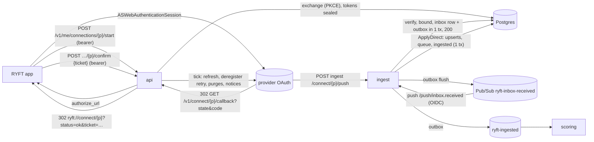
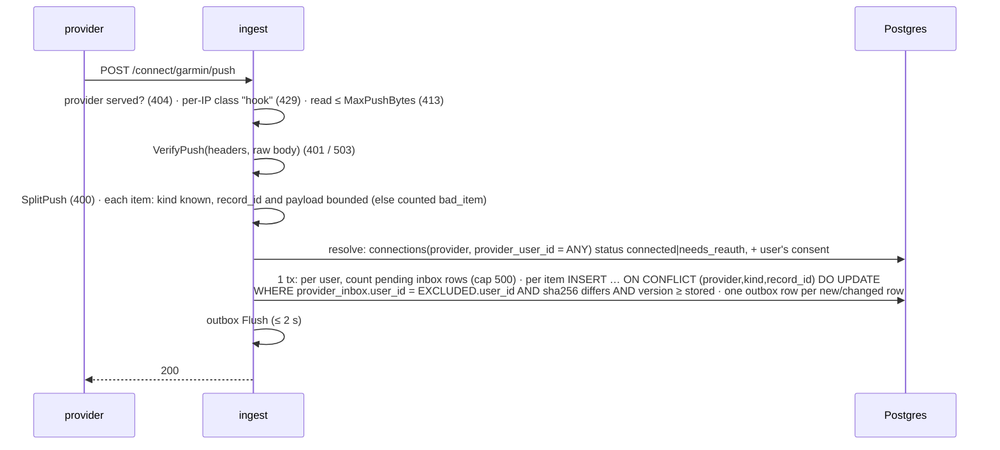
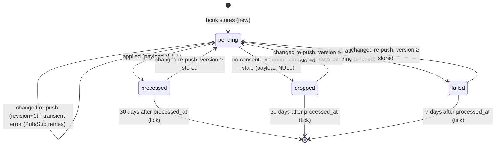

# Design: direct connections, phase 1 (provider-agnostic, a fake provider; Garmin first, Suunto later)

T1 of `plan.md`. Decision: **D257** (`d257.md`, appended to `DECISIONS.md` by the lead). Migration **0042**. Phase 2
(the Garmin adapter) needs the programme's documentation and credentials. Nothing below about Garmin's wire format,
endpoints, verification or limits comes from memory. Every such point is marked **phase 2, from the programme docs**.

## 1. Problem and constraints

A Garmin's data reaches RYFT only through Apple Health today, and that path carries no HRV, respiration or SpO₂
(the root plan §3). HRV is 45 % of Recovery. A direct connection is OAuth at the provider plus push delivery of the
user's sleep and HRV to a public webhook. Suunto writes no sleep, HRV or resting HR to Apple Health, so the same
foundation must serve it later.

Constraints:
- **One operator.** Every new moving part gets a runbook line and an alert.
- **Cost.** Cloud Run with request-based CPU. Nothing runs between requests, so there are no workers and no timers:
  ticks and pushes only (D219).
- **GDPR Art. 9.** Special-category data from a new source. Consent to the policy in force is checked server-side.
  Data minimisation. "Disconnect deletes" is the promise the root plan's data card makes.
- **Sealed tokens.** `internal/sealed`'s invariant stays: only api holds `DATA_ENCRYPTION_KEY`.
- **No history.** The starter tier has no history, so a dropped push is data lost for good.
- **Every event through the outbox** (D101). Every handler is idempotent (D100). The topology is Go.
- **The contract is additive** (`API.md`).

## 2. Options considered

| | A: hook in ingest, inbox, process on a push of our own (**chosen**) | B: hook in api, process in api | C: hook stores, ingest's tick processes |
| --- | --- | --- | --- |
| Where the data is written | ingest, through the same upserts and apply transaction as a sync | api would need write grants on `samples`, `sleep_segments`, `user_sources` (it has DELETE only) | ingest |
| Latency push → score | seconds (outbox → Pub/Sub → ingest → `ingested` → scoring) | seconds | up to 15 min plus the tick budget |
| Failure handling | Pub/Sub retries, the DLQ, and policies 4 and 5 with no new alert (they follow the topology) | the same, but api becomes a data writer | a home-made retry loop in a tick, and no backlog signal |
| Token on the processing path | none (D257: processing never needs a token) | api has them, which invites using them | none |
| New parts | one topic, one DLQ, one hold subscription | the same, plus new api grants | none |

B mixes the identity/settings service with the raw-data writer. C bends "an event per inbox row through the outbox"
and has no backlog signal. A reuses the boring parts we already run.

## 3. The model in one picture



## 4. Contract (T2 writes `API.md` from this; additive only)

All routes are on **api** except the hook. New error codes: `connection_limit` (409), `unknown_provider` (404),
`connect_ticket_invalid` (409), `connect_expired` (410), and on the admin merge `merge_has_connections` (409).
`consent_required` (403) already exists.

### 4.1 `GET /v1/me/connections`
```json
{ "connections": [
    { "provider": "garmin", "status": "connected", "connected_at": "2026-11-23T07:10:00Z",
      "last_data_at": "2026-11-24T05:02:11Z", "provides": ["hrv", "sleep"], "history": "none",
      "provider_user_id": "a1b2c3…", "permissions": ["HEALTH_EXPORT"] } ],
  "available": [
    { "provider": "garmin", "provides": ["hrv", "sleep"], "history": "none", "accepting": true } ] }
```
- `connections`: the account's connections in `connected`, `needs_reauth` or `revoked` (a **closed** enum of three).
  A grant waiting for its confirm (§6.2) is not a connection and is never listed.
- `revoked`: the user removed RYFT at the provider. The data is deleted (§8), and reconnecting starts over.
- `last_data_at`: when RYFT last stored a record from this connection. `null` until the first one.
- `provider_user_id` (`string?`) and `permissions` (`[string]`, in the provider's own words, an **open** set; the
  example value is illustrative, not Garmin's): what RYFT keeps about the provider account (Art. 15, review S7).
  `null` and `[]` on a `revoked` connection, whose copies are cleared (S6). Show them, don't interpret them.
- `provides`: the `UserSource.kinds` vocabulary (closed).
- `history`: `"none"`. The set is **open** for later tiers: read an unknown value as `"none"`.
- `available`: the providers this account may connect now, connected or not. A provider is listed when it is in
  `CONNECT_PROVIDERS`, the account has its flag `connect.<provider>`, and its secrets are configured. `fake` is listed
  only under `CONNECT_FAKE=on`, which is compose only.
- `accepting`: `false` at the user cap, counted without the caller's own connection, open states and pending grant
  (§6.1). So a reconnect, or a second start by the same account, is always accepted.

### 4.2 `POST /v1/me/connections/{provider}/start`
No body. Answers `200 {"authorize_url": "https://…", "expires_at": "…"}` (10 min).

Refusals:
- `404 unknown_provider`: not served, or the flag is off for this account. It does not say which.
- `403 consent_required`: no consent to the policy in force. `CONSENT_ENFORCE=warn` acts as `on` here, as for the
  import (D141).
- `409 connection_limit`: at the cap (§6.1).
- `429`: rate class `connect`, bursts of 5, then 1 a minute per account.
- `503`.

A reconnect while `connected` or `needs_reauth` is allowed. Until it is confirmed, the live connection and its tokens
stay as they are, and `GET` shows no change (review B1). At confirm it is replaced. If the provider account is a
different one, the old connection is disconnected first: its data is deleted as in §4.5.

### 4.3 `GET /v1/connect/{provider}/callback`
This route takes no bearer and no App Attest token, and the invite gate does not apply. It is mounted on api's outer
mux next to `DELETE /v1/me`, outside the `/v1/` chain. Query: `state`, and `code` or `error`.

It always answers `302` with `Location: ryft://connect/{provider}?status=<s>[&ticket=<t>]`:
- `status` is one of `ok`, `denied`, `expired`, `error` (closed).
- `ticket` (32 lowercase hex characters) is present with `ok` only.
- An unknown provider is `302 …?status=error`.
- `Cache-Control: no-store` and `Referrer-Policy: no-referrer` come from SecurityHeaders.

The URL carries no token, code, provider user id or health value. **Deviation from the brief: the `ticket`** (§6.2).
It is a one-time binding nonce, worthless without the bearer of the account that started the flow. It closes the
"attacker's authorize URL, victim's provider account" hole that a bearer-less callback has otherwise.

### 4.4 `POST /v1/me/connections/{provider}/confirm`
Body `{"ticket": "…"}`. Answers `200` with the `Connection` object above.

Refusals:
- `404 unknown_provider`: the provider is no longer served, or the flag `connect.<provider>` is off for this account
  now (the flag gates `available`, start **and** confirm). The pending grant is then handled like an expired one:
  queued for deregistration under the live-grant rule (§6.3, B2) and deleted.
- `409 connect_ticket_invalid`: wrong account or unknown ticket. Nothing changes.
- `410 connect_expired`: more than 10 min after the callback. The pending grant is dropped. It is deregistered only
  if no live connection holds that provider account (§6.3, B2).
- `403 consent_required`.
- `409 connection_limit`: only if the cap moved under it.

The app calls it once, right after the callback URL reaches it. A repeat with the same ticket answers `200` with the
connection again, until 10 min after the callback; after that it answers `410 connect_expired` (review S3). A confirm
whose provider account is not the account's current one replaces that connection (§4.2).

### 4.5 `DELETE /v1/me/connections/{provider}`
Bearer and the per-user limit only: **no App Attest, no invite gate, no flag check** (as `API.md` says). Ending a
connection must never be harder than starting it. It works for a provider no longer in `CONNECT_PROVIDERS` too (the
tokens then wait in the queue until an adapter can deregister them).
```json
{ "status": "disconnected", "deregistered": true, "data_deleted": true }
```
- `deregistered`: `bool?`, over every grant this call ends: the live connection's tokens **and** an unconfirmed
  pending grant for the provider.
  - `true`: each was deregistered at the provider, or skipped because a live connection of another account holds that
    provider account (§6.3's rule; RYFT holds no token from this call any more, so nothing is left to do).
  - `false`: at least one attempt failed and is retried in the background for 30 days; the app has nothing to do.
  - `null`: there was nothing to deregister (no connection or a `revoked` one, and no unconfirmed pending grant).
  - A pending grant alone (no connection) gives `true` or `false` by the same rules.
- `data_deleted`: always `true` (§8), also when there was no data.
- Idempotent: a second call answers the same shape with `deregistered: null`.

### 4.6 `DELETE /v1/me`
Gains `"connections_deregistered": bool?`, with the same rules as `deregistered` in §4.5 over all the account's
grants (connections and unconfirmed pending grants, every provider): `null` when there were none, `true` when each
was deregistered or skipped as live elsewhere, `false` while the background retry has work. Same spirit as
`apple_token_revoked`.

### 4.7 Other additive fields
- `User.sources[].origin`: `healthkit` or `direct` (closed). A direct source has `name` = the provider's display name
  (`"Garmin"`), `bundle_id: null`, its `kinds` and its `samples_7d`.
- `Sample.type` gains `hrv_rmssd` (ms). `samples_7d` keys are open, and `hrv_rmssd` is added.
- `coverage.sleep_origin` (`healthkit`, `direct`, or `null` without a night) and `coverage.hrv_metric` (`sdnn`,
  `rmssd`, or `null` without HRV). Both arrive with PR 3, which builds `coverage` (§11).
- `GET /v1/config` → `flags["connect.garmin"]`, shipped `{enabled: true, rollout_pct: 0}`: dark, testers by the
  allow-list (D69's "dark").

Admin: `POST /v1/admin/users/{id}/merge-into/{to}` refuses (also with `force=1`) with `409 merge_has_connections` while the source account holds any
connection. The dry run reports the count. The operator asks the user to disconnect first.

## 5. Storage: migration `0042_connections.sql` (database-engineer)

The migration starts with `SET LOCAL lock_timeout = '5s'` (D116). Everything is additive. Every `CHECK` added to an
existing table is `NOT VALID`: it is enforced on new rows and scans nothing. Every new table gets RLS on Supabase as in
0037: the `*_services` policy for its roles, and `REVOKE ALL` from `anon`, `authenticated` and `service_role`.

### 5.1 New tables

**`connections`**: one per account and provider. Metadata only, no secret.

| Column | Type | Constraint / note |
| --- | --- | --- |
| `user_id` | uuid | NOT NULL, FK `users(id)` ON DELETE CASCADE |
| `provider` | text | NOT NULL, `CHECK (provider ~ '^[a-z][a-z0-9]{1,31}$')` |
| `provider_user_id` | text | NULL, `CHECK (length(provider_user_id) BETWEEN 1 AND 128)`, and `CHECK ((status = 'revoked') = (provider_user_id IS NULL))`: the provider's id of its user, set to NULL when the row becomes `revoked` (S6) |
| `status` | text | NOT NULL, `CHECK (status IN ('connected','needs_reauth','revoked'))`. A link waiting for its confirm is not a connection; it lives in `connection_pending` (B1) |
| `status_reason` | text | NULL, `CHECK (status_reason IN ('refresh_failed','permissions','provider_revoked','relinked'))` |
| `permissions` | text[] | NOT NULL DEFAULT `'{}'`, `CHECK (cardinality(permissions) <= 32)`: what the user granted, in the provider's words. Set to `'{}'` when `revoked` (S6) |
| `policy_version` | text | NOT NULL: the consent in force at the confirm |
| `connected_at` | timestamptz | NOT NULL DEFAULT now(): set again on each confirm |
| `status_at` | timestamptz | NOT NULL DEFAULT now() |
| `last_data_at` | timestamptz | NULL: set by ingest's consumer |
| PK | | `(user_id, provider)` |

Indexes:
- `connections_provider_user` UNIQUE on `(provider, provider_user_id)` WHERE `status IN ('connected','needs_reauth')`:
  one live link per provider account. Pending grants are outside it (B1).
- `connections_provider_status` on `(provider, status)`: the cap and the gauges.

**`connection_pending`**: api only. A grant between the callback and its confirm, kept apart from the live
connection, which stays untouched until the swap (B1).

| Column | Type | Constraint / note |
| --- | --- | --- |
| `user_id`, `provider` | uuid, text | PK `(user_id, provider)`: one pending grant per account and provider; a newer callback replaces it (and its grant goes the §6.3 way). FK `users(id)` ON DELETE CASCADE |
| `provider_user_id` | text | NOT NULL, CHECK as `connections` |
| `permissions` | text[] | NOT NULL DEFAULT `'{}'`, CHECK as `connections` |
| `access_enc`, `refresh_enc` | bytea | NULL: sealed with ADs `connect:pending-access:<provider>:<user_id>` / `connect:pending-refresh:…`. NULL once confirmed, because the tokens moved to `connection_tokens`, re-sealed under the live ADs |
| `access_expires_at`, `refresh_due_at` | timestamptz | NULL, as in `connection_tokens` |
| `confirm_hash` | bytea | NOT NULL, `CHECK (octet_length(confirm_hash) = 32)`: SHA-256 of the ticket, kept until `confirm_expires_at`, so a repeat confirm answers 200 (S3) |
| `confirm_expires_at` | timestamptz | NOT NULL: callback + 10 min |
| `confirmed_at` | timestamptz | NULL: set by the confirm |
| `created_at` | timestamptz | NOT NULL DEFAULT now() |

Index on `(confirm_expires_at)` for the purge. Pushes never resolve to a pending grant: ingest has no grant on this
table, so a push for it is `unknown_user`.

**`connection_tokens`**: api only, sealed (D48's own-table pattern).

| Column | Type | Constraint / note |
| --- | --- | --- |
| `user_id`, `provider` | uuid, text | PK, FK `(user_id, provider)` → `connections` ON DELETE CASCADE |
| `access_enc` | bytea | NOT NULL. AD: `connect:access:<provider>:<user_id>` |
| `refresh_enc` | bytea | NULL. AD: `connect:refresh:<provider>:<user_id>` |
| `access_expires_at` | timestamptz | NULL |
| `refresh_due_at` | timestamptz | NULL: when api's tick refreshes. Set by the provider adapter (`Grant.RefreshDue`). NULL means never |
| `refresh_attempts` | int | NOT NULL DEFAULT 0 |
| `last_error` | text | NULL, `CHECK (last_error ~ '^[a-z_]{1,64}$')`: a code, never the provider's text |
| `updated_at` | timestamptz | NOT NULL DEFAULT now() |

Index `connection_tokens_due` on `(refresh_due_at)` WHERE `refresh_due_at IS NOT NULL`.

**`connection_states`**: api only. Open OAuth flows, 10 min, single use.

| Column | Type | Constraint / note |
| --- | --- | --- |
| `state_hash` | bytea | PK, `CHECK (octet_length(state_hash) = 32)`: SHA-256 of `state`. The state itself is never stored |
| `user_id` | uuid | NOT NULL, FK `users(id)` ON DELETE CASCADE |
| `provider` | text | NOT NULL, the same CHECK as `connections` |
| `verifier_enc` | bytea | NOT NULL: the PKCE verifier, sealed. AD: `connect:state:<hex state_hash>` |
| `policy_version` | text | NOT NULL |
| `created_at` | timestamptz | NOT NULL DEFAULT now() |
| `expires_at` | timestamptz | NOT NULL: `created_at` + 10 min |

Indexes: `(user_id, provider, created_at)` for the cap of 3 open states per account **and provider** (a fourth
deletes the oldest),
`(provider, expires_at)` for the cap reservation, and `(expires_at)` for the purge. A callback consumes a state with
`DELETE … WHERE state_hash = $1 AND provider = $2 RETURNING …`.

**`connection_deregistrations`**: api only. The retry queue for disconnects and account deletions, the counterpart of
`deleted_users.apple_token_enc`.

| Column | Type | Constraint / note |
| --- | --- | --- |
| `id` | bigserial | PK |
| `user_id` | uuid | NOT NULL, **no FK**: it outlives the account. It is the sealed tokens' AD |
| `provider` | text | NOT NULL, CHECK as above |
| `provider_user_id` | text | NOT NULL, CHECK as above |
| `reason` | text | NOT NULL, `CHECK (reason IN ('disconnect','account_deleted','confirm_expired','cap','missing_permission','replaced'))` |
| `access_enc`, `refresh_enc` | bytea | NULL: moved still sealed from `connection_tokens`, same AD |
| `created_at` | timestamptz | NOT NULL DEFAULT now() |
| `next_attempt_at` | timestamptz | NOT NULL DEFAULT now() |
| `attempts` | int | NOT NULL DEFAULT 0 |
| `last_error` | text | NULL, code CHECK as above |

Index on `(next_attempt_at)`. A row is deleted on success, on "already gone at the provider", or 30 days after
`created_at` (given up, counted, notice).

**`provider_inbox`**: ingest owns it. One row per provider record.

| Column | Type | Constraint / note |
| --- | --- | --- |
| `id` | bigserial | PK |
| `provider` | text | NOT NULL, CHECK as above |
| `kind` | text | NOT NULL, `CHECK (kind ~ '^[a-z][a-z_]{1,31}$')`. The Go side is closed: `sleep`, `hrv`, `deregistration`, `permissions` |
| `record_id` | text | NOT NULL, `CHECK (length(record_id) BETWEEN 1 AND 128)`. The adapter must make it unique within (provider, kind) across users; if the provider's ids are per user, it prefixes them (phase 2). The hook's `DO UPDATE` is guarded by `user_id` as well (S1, §7.2), so a collision can never write one account's data into another's row |
| `user_id` | uuid | NOT NULL, FK `users(id)` ON DELETE CASCADE: resolved at the hook. Pushes for nobody are not stored |
| `version` | bigint | NOT NULL DEFAULT 0: the provider's ordering token for this record (an update time, a validation rank: phase 2). 0 when it has none |
| `revision` | int | NOT NULL DEFAULT 1: +1 on each changed re-push. Part of the event's message id |
| `payload` | jsonb | NULL: the one record as the provider sent it. NULL once `processed` or `dropped` |
| `payload_sha256` | bytea | NOT NULL, `CHECK (octet_length(payload_sha256) = 32)`: an identical re-push is a no-op. Kept after the payload goes |
| `state` | text | NOT NULL DEFAULT `'pending'`, `CHECK (state IN ('pending','processed','dropped','failed'))` |
| `received_at` | timestamptz | NOT NULL DEFAULT now(): the latest (re)receipt |
| `processed_at` | timestamptz | NULL: when it left `pending` |
| `attempts` | int | NOT NULL DEFAULT 0 |
| `error` | text | NULL, `CHECK (error ~ '^[a-z_]{1,64}$')`: a code (`parse`, `no_consent`, `no_connection`, `stale`, `expired`, `attempts`), never payload text |

Constraints and indexes: UNIQUE `(provider, kind, record_id)`; `(state, received_at)` for the sweeps, the age gauge and
the purge; `(user_id)` for deletion and disconnect.

### 5.2 Columns on existing tables

All are nullable or have a constant default, so no table rewrite. The `CHECK`s are `NOT VALID`.

| Table | Column | Type | Note |
| --- | --- | --- | --- |
| `samples` | `origin` | text NOT NULL DEFAULT `'healthkit'` | `CHECK (origin IN ('healthkit','direct')) NOT VALID` |
| `samples` | `vendor` | text NULL | `CHECK (vendor ~ '^[a-z][a-z0-9]{1,31}$') NOT VALID`. Direct rows: the provider. HealthKit rows: from the record's `source_bundle_id` via `connect.VendorOfBundle` (only `com.garmin.connect.mobile` → `garmin` today; it is in our own `API.md` example, so verify it against `user_sources` once). NULL when unknown |
| `samples` | `record_id` | text NULL | `CHECK (length(record_id) <= 160) NOT VALID`: `<kind>:<record_id>` of the inbox row that wrote it. Direct rows only |
| `sleep_segments` | `origin`, `vendor`, `record_id` | as above | |
| `sleep_segments` | `record_state` | text NULL | `CHECK (record_state IN ('provisional','final')) NOT VALID`: the provider's validation state of the night, mapped by the adapter. Direct rows only. `night_complete` follows it (PR 3) |
| `user_sources` | `origin` | text NOT NULL DEFAULT `'healthkit'` | CHECK as above |
| `daily_scores` | `hrv_metric` | text NULL | `CHECK (hrv_metric IN ('sdnn','rmssd')) NOT VALID`: the metric of `hrv_ms`, `hrv_baseline_ms` and `baseline_hrv_days`. NULL with `hrv_ms` set means `sdnn` (every row before PR 3; the reads `COALESCE`, there is no backfill) |
| `daily_scores` | `coverage` | jsonb NULL | data-quality design D-e, never built (STATUS: `docDrift`). Keys: D-e's plus `sleep_origin` and `hrv_metric` |
| `daily_scores` | `score_status` | text NULL | `CHECK (score_status IN ('provisional','final')) NOT VALID` (D-e) |
| `daily_scores` | `final_at`, `first_recovery_at` | timestamptz NULL | D-e |

Why `origin` is a column even though direct rows also have a reserved `source`:
- **Direct rows' `source` is `ryft-direct-<provider>`.** This is the uniqueness guarantee: the natural keys `(user,
  type, start, end, source)` and `(user, start, end, stage, source)` cannot collide with a HealthKit source someone
  named "Garmin". The api shows the provider's display name (`connect.DisplayName`).
- **ingest's `screen` drops sync records whose `source` starts with `ryft-direct-`.** They are counted as
  `ignored.unknown_type`, and `API.md` says why.
- **`origin` is what queries filter on.** Scoring and the disconnect delete must not parse prefixes.
- **`vendor` is what "direct beats Apple Health for the same vendor" compares.**

**No new index on `samples` or `sleep_segments`.** Building one scans the table, and the migrator holds the file's
ALTER locks in one transaction (0030's note). The replacement and the disconnect delete use the existing
`samples_user_type_start` and `sleep_user_end` indexes, with the time bounds in §7.3.

### 5.3 Flag row
```sql
INSERT INTO feature_flags (key, enabled, rollout_pct) VALUES ('connect.garmin', true, 0) ON CONFLICT (key) DO NOTHING;
```
The fake has no flag: `CONNECT_FAKE=on` (compose only) is its gate.

### 5.4 Grants (`internal/db/roles_test.go` pins them)

| Object | `ryft_api` | `ryft_ingest` | `ryft_scoring` | `ryft_notify` |
| --- | --- | --- | --- | --- |
| `connections` | SELECT, INSERT, UPDATE, DELETE | SELECT (`user_id`, `provider`, `provider_user_id`, `status`); UPDATE (`status`, `status_reason`, `status_at`, `last_data_at`, `provider_user_id`, `permissions`): the last two only to clear them on a revocation, which the `revoked` ⇔ NULL check pins | — | — |
| `connection_tokens` | SELECT, INSERT, UPDATE, DELETE | — | — | — |
| `connection_pending` | SELECT, INSERT, UPDATE, DELETE | — | — | — |
| `connection_states` | SELECT, INSERT, DELETE | — | — | — |
| `connection_deregistrations` (+ seq) | SELECT, INSERT, UPDATE, DELETE, USAGE | — | — | — |
| `provider_inbox` (+ seq) | SELECT (`id`, `user_id`, `provider`, `state`), DELETE | SELECT, INSERT, UPDATE, DELETE, USAGE | — | — |
| new columns on `samples`, `sleep_segments`, `user_sources` | covered by the existing table grants (api SELECT/DELETE) | covered (SELECT/INSERT/UPDATE/DELETE on the first two); **new: DELETE on `user_sources`**, for `deleteDirectData` on a deregistration notice (S2) | SELECT (table grant) | — |
| `daily_scores` new columns | SELECT | — | SELECT, INSERT, UPDATE (table grant) | **no** new column grant (notify's column list stays) |

RLS policies:
- `connections_services` TO `ryft_api, ryft_ingest`.
- `connection_tokens_services`, `connection_pending_services`, `connection_states_services`,
  `connection_deregistrations_services` TO `ryft_api`.
- `provider_inbox_services` TO `ryft_ingest, ryft_api`.

**Scoring gets nothing new.** It reads `origin`, `vendor`, `record_state` and `hrv_metric` through grants it already
holds.

### 5.5 Deletion, merge, export
- **`DELETE /v1/me` (`store.DeleteUser`, one transaction).** Before `DELETE FROM users`: `INSERT INTO
  connection_deregistrations … SELECT` from `connections ⋈ connection_tokens` and from the unconfirmed rows of
  `connection_pending` (reason `account_deleted`, every status except `revoked`). The §6.3 rule decides at the attempt
  whether the provider is called. Then `DELETE` from `provider_inbox`, `connection_states`, `connection_pending`,
  `connection_tokens` and `connections`.
  The foreign keys cascade too, for an image from before 0042. The samples and sleep rows go as today.
- **The merge** refuses while the source has a connection (§4.7).
- **Export (Art. 15, S7).** `GET /v1/me/connections` carries the connection metadata, `provider_user_id` and
  `permissions` included. Tokens, states, pending grants, the inbox and the queue are credentials or transient, and are
  not exported (as App Attest keys and push tokens are not). Direct records are
  `samples` and `sleep_segments` rows like any other.

## 6. api: OAuth, tokens, cap, deletion

### 6.1 User cap
- **Config:** `CONNECT_<PROVIDER>_USER_CAP`, an integer ≥ 0. It is a required key of `deploy/run/config.env`
  (`CONNECT_GARMIN_USER_CAP=0` until phase 2 sets the programme's number). Compose: `CONNECT_FAKE_USER_CAP=5`.
- **Counted:**
  - the provider's `connections` in `connected` or `needs_reauth`;
  - plus the distinct accounts without such a connection that hold an unexpired `connection_states` row or an
    unconfirmed, unexpired `connection_pending` row.
  - **Never the caller's own:** its live connection, its open states and its pending grant are left out of the count
    at start, callback, confirm and in `accepting` (code review (a)). Otherwise a user's second tap on "Connect", or
    their own confirm, could hit `409` on the slot their first start reserved.
- **Enforced** at `start`, and again at `callback` and `confirm`, in the writing transaction under
  `pg_advisory_xact_lock(7419009, hashtext(provider))`. Class **7419009** is new in `store/locks.go`. 7419008 belongs
  to open PR `push/activity-scored`.
- A callback that finds the cap full after the exchange queues the fresh grant (reason `cap`, under §6.3's live-grant
  rule) and answers `status=error`. This is rare, because start reserves a slot for 10 min.

### 6.2 Flow (start → callback → confirm)
```mermaid
sequenceDiagram
    participant A as app
    participant API as api
    participant P as provider
    A->>API: POST /v1/me/connections/garmin/start (bearer)
    API->>API: consent in force? flag? cap (lock 7419009)
    API->>API: state = 32 random bytes hex; verifier = 32 random bytes b64url; store sha256(state), sealed verifier
    API-->>A: 200 authorize_url (state, S256 challenge, redirect_uri)
    A->>P: ASWebAuthenticationSession(authorize_url)
    P-->>API: GET /v1/connect/garmin/callback?state&code
    API->>API: DELETE state RETURNING (single use); expired → status=expired; error=access_denied → denied
    API->>P: Exchange(code, verifier) → Grant{provider_user_id, tokens, permissions}
    API->>API: 1 tx: upsert connection_pending (sealed pending tokens, confirm_hash); the live connection is untouched
    API-->>A: 302 ryft://connect/garmin?status=ok&ticket=T
    A->>API: POST /v1/me/connections/garmin/confirm {ticket T} (bearer)
    API->>API: 1 tx (lock 7419009, lockApply): hash(T) matches this account's pending row, not expired, consent in force;<br/>the swap (below); pending row: tokens NULL, confirmed_at set, kept until confirm_expires_at
    API-->>A: 200 Connection
```
- The **state is hex**, so Cloud Armor's `sqli` rule (libinjection's `--`, D247) cannot match our half of the query.
  The provider's `code` can.
- **The callback's URL in Google's logs (review S4): both measures, in PR 2, infra-engineer.**
  - **A logging exclusion, `infra/gcp/logging.tf`:** a third entry of `log_exclusions`, `connect-callback`, drops every
    entry whose `httpRequest.requestUrl` contains `/v1/connect/`. That covers the load balancer's kept entries (a
    preview match or a denial, which keep the full URL with `state` and `code` for 14 days) and Cloud Run's request
    log of api (whose 5xx entries are otherwise kept with the URL). **It is unconditional**, not tied to `edge =
    built` like the other two (code review (c)): api's Cloud Run request log keeps callback URLs with `state` and
    `code` for 14 days whatever the edge's phase, so `logging.tf` puts it in the sink's exclusions in every phase. The api's own access line, which has no query, still records the request and its status, and policy 2 reads
    Cloud Run's request metrics, not logs. Pinned in `infra/gcp/tests/edge.tftest.hcl` (the exclusion's filter) and
    `tests/guards.tftest.hcl` (no sink keeps a `/v1/connect/` URL).
  - **A scope exclusion at the edge, `infra/gcp/edge.tf`, now:** the six preconfigured-WAF rules' expressions gain
    `&& !request.path.matches('^/v1/connect/[a-z0-9]+/callback$') && !request.path.startsWith('/connect/')`. No
    preview match is logged for either path, and enforcing `sqli` later needs no step for them (OPERATIONS → 16 says
    so). What the WAF gives up there: the callback validates its two parameters itself (hex state, bounded code), and
    the hook verifies before it parses.
- **The callback's statuses:**
  - `denied`: the provider said `access_denied`, or the grant lacks a permission the provider marks required
    (`Provider.Required()`). In the second case the grant is queued (reason `missing_permission`, §6.3's rule).
  - `expired`: unknown, used or old state. They are indistinguishable on purpose.
  - `error`: everything else, for example the exchange failed or the provider is unreachable (not retried, the user
    taps again), the account was deleted, or consent was withdrawn.
  - The log line `connect callback` carries `provider`, `status` and `reason` (closed: `ok`, `access_denied`,
    `missing_permission`, `state_unknown`, `state_expired`, `exchange_failed`, `no_account`, `no_consent`, `cap`,
    `provider_unknown`) and `user_id` when the state resolved one.
- **The access line of the callback must not carry the query.** A test with `logcheck` asserts no state, code or
  ticket in any line.
- **The swap at confirm** (one transaction, `store.ConfirmConnection`; review B1). Let P be the pending grant's
  provider user id.
  1. **This account has a live connection with P:** replace its tokens (re-sealed under the live ADs), permissions,
     `policy_version` and `connected_at`; set the status to `connected`. Its data stays.
  2. **This account has a live connection with another provider user id:** that connection is disconnected first,
     exactly as §6.4 steps 3–8 (tokens to the queue with reason `replaced`, data deleted, days queued). Then the new
     row is inserted.
  3. **Another account holds P live (relink):** that connection becomes `revoked` / `relinked` (provider user id
     NULL, permissions `'{}'`), its tokens are deleted **without** a deregistration (it would end the new grant: same
     provider user, same app), and its data goes through `deleteDirectData` with its days queued. Then case 1 or 2
     runs for this account.
  4. **Otherwise:** insert the connection.
  The unique index covers only `connected` and `needs_reauth`, so the steps above run in this order inside the
  transaction and never meet a conflict.
- **Pending rows** that are not confirmed within 10 min: api's tick moves their tokens to the queue (reason
  `confirm_expired`). The §6.3 rule then decides whether the provider is called. A confirmed pending row holds no
  token and is just deleted once `confirm_expires_at` has passed. The live connection is never touched by a pending
  row's expiry.

### 6.3 Tokens and their lifecycle (api only)
- Sealed with `sealed` under `DATA_ENCRYPTION_KEY`, with the ADs in §5.1. They are opened only for refresh and
  deregistration. They are never logged, never in an error, never in a metric.
- **Tick step `connect refresh`** (api, at most 20 rows a tick, oldest `refresh_due_at` first):
  - success: re-seal, store the new `refresh_due_at`, attempts 0;
  - `connect.ErrInvalidGrant`: status `needs_reauth` / `refresh_failed`, tokens kept;
  - transient: attempts+1 and `refresh_due_at = now + min(24 h, 15 min · 2^attempts)`.
  - Processing a push never waits for this.
- **The live-grant rule (review B2).** Every deregistration, inline or in the tick, goes through one function,
  `deregisterOne`. Before it calls the provider, it checks in the same statement's snapshot whether any account holds
  `(provider, provider_user_id)` in `connections` as `connected` or `needs_reauth`. If one does, it calls nothing: the
  queue row and its tokens are deleted (`ryft_connect_deregistrations_total{outcome="skipped_live"}`). This covers an
  attacker's own `authorize_url` completed by a connected victim and left to expire (reason `confirm_expired`), the
  `cap` and `missing_permission` reasons, the user's own unconfirmed reconnect, and a link that became live again
  between queueing and the attempt. Pinned by `cmd/api/connections_test.go: TestDeregisterSkipsALiveGrant`, one case
  per reason, plus a case that queues `disconnect`, relinks the provider user to another account, and asserts that
  the fake's `Deregister` was never called and the other account's connection and data are unchanged.
  **Phase 2:** whether a second authorisation at the provider already replaces the live grant's tokens there is the
  programme's. If it does, the victim's refresh fails later (`needs_reauth`); pushes keep flowing, because they need
  no token.
- **Tick step `connect deregister`** (api, 20 rows a tick, `next_attempt_at <= now`):
  - the live-grant rule; then open the tokens, refresh in memory if the access token has expired, then `Deregister`;
  - success or `connect.ErrGone`: delete the row;
  - transient: backoff as above;
  - past 30 days: delete, `ryft_connect_deregistrations_total{outcome="given_up"}`.
- **Tick step `connect purge`** (api):
  - expired states;
  - `connection_pending` rows past `confirm_expires_at` (unconfirmed ones' tokens to the queue first);
  - tokens of `revoked` connections (ingest marks revocations and cannot touch tokens);
  - `revoked` rows 90 days after `status_at` (they hold no provider user id or permissions any more, S6).
- **Tick step `connect gauges`** (api): the per-provider status counts, the cap ratio and stale connections (§10).
  Once a day (the tick that starts 06:00–06:14 UTC) it also writes the notice lines.

### 6.4 Disconnect (`DELETE /v1/me/connections/{provider}`, api)
Mounted on api's outer mux behind `auth.Middleware` (bearer, per-user limit, user lookup) **without** the App Attest
and invite gates and without the flag check (§4.5), like `DELETE /v1/me`. One transaction (`store.Disconnect`), in
this order:
1. `lockApply` (7419005) on the user, so it serialises with ingest's consumer.
2. Read the connection.
3. Move its tokens to `connection_deregistrations` (reason `disconnect`), unless `revoked`.
4. Delete `connection_tokens`, `connections` and the account's `connection_pending` row for the provider (its
   unconfirmed tokens to the queue too).
5. Delete `provider_inbox` rows of (user, provider).
6. Delete the direct data (`deleteDirectData`): `samples` and `sleep_segments` WHERE `user_id = $1 AND origin =
   'direct' AND vendor = $2` (`RETURNING` start/end/type for the days), and the `user_sources` rows WHERE `user_id =
   $1 AND origin = 'direct' AND name = 'ryft-direct-<provider>'` (S2). This is a scan of the user's rows by
   `user_id`, the leading column of the indexes.
7. Queue the touched days (the night days, and the next day for spilling sample types) into `score_queue`.
8. Write an `ingested` event (`reason: "disconnect"`) to api's outbox.

After the commit:
- Flush the outbox (D219).
- One `deregisterOne` attempt per queued grant (the live-grant rule first), 5 s in total. A success or a skip deletes
  the queue row. `deregistered` follows §4.5.
- Answer.

The rescore makes every stored score reflect only what is left. The cost is a recompute of the days since the
connection started; there is no history, so that is never more than the connection's lifetime. Days from more than
400 days back are not queued (the scoring window).

### 6.5 `DELETE /v1/me`
- The tokens move inside `DeleteUser` (§5.5).
- After the commit, the handler runs one bounded attempt (5 s in total) over the account's queue rows. The answer's
  `connections_deregistered` follows §4.6 (`null` none, `true` all done or skipped as live elsewhere, `false` the
  tick retries).
- The existing `account reconcile` step is untouched. `connect deregister` is its own step, because these rows outlive
  the tombstone's other columns.

## 7. ingest: the hook, the inbox, the consumer

### 7.1 The provider interface (`internal/connect`)
```go
// Provider is one direct source. Its two halves are separate interfaces, so ingest's registry holds only
// PushSide and nothing on ingest's path can reach a token.
type OAuth interface {
	AuthorizeURL(state, codeChallenge, redirectURI string) (string, error)
	Exchange(ctx context.Context, code, verifier, redirectURI string) (Grant, error)
	Refresh(ctx context.Context, refreshToken string) (Grant, error)
	Deregister(ctx context.Context, g Grant) error // ErrGone when the provider no longer knows the grant
	Required() []string                          // permissions a usable grant must hold
}
type PushSide interface {
	MaxPushBytes() int64 // ≤ connect.MaxPushBytes (4 MiB)
	// VerifyPush is the provider's own origin check over the raw headers and body. The body has not been parsed.
	// nil, ErrUnverified (→ 401), or another error (→ 503: cannot check now).
	VerifyPush(h http.Header, body []byte, now time.Time) error
	// SplitPush cuts a verified body into items. It does not read health values.
	SplitPush(body []byte) ([]PushItem, error) // ErrBadPush → 400
	// ParseRecord maps one stored item to RYFT's records. Pure: no network, no token, no clock.
	ParseRecord(kind string, payload json.RawMessage) (Records, error) // ErrBadRecord → inbox failed
}
type Provider interface {
	Name() string // [a-z][a-z0-9]{1,31}: "garmin", "fake"
	DisplayName() string
	Provides() []string // model.Kind*
	History() string    // "none"
	OAuth
	PushSide
}
type Grant struct {
	ProviderUserID string
	Access, Refresh string
	AccessExpires   time.Time
	RefreshDue      time.Time // zero: never refresh
	Permissions     []string
}
type PushItem struct {
	Kind           string // closed: KindSleep, KindHRV, KindDeregistration, KindPermissions
	RecordID       string // unique within (provider, kind) across users
	ProviderUserID string
	Version        int64
	Payload        json.RawMessage // this item only, ≤ 256 KiB
}
type Records struct {
	Sleep       []model.SleepSegment // stages mapped onto the six HealthKit ones: the provider's "light" is core
	Samples     []model.Sample       // hrv_rmssd (ms), later others
	NightState  string               // "provisional" | "final" | "" (no night)
	Permissions []string             // KindPermissions
}
```
Errors are `ErrUnverified`, `ErrBadPush`, `ErrBadRecord`, `ErrInvalidGrant`, `ErrDenied` and `ErrGone`; anything
else is transient.

`internal/connect` imports only `model` and the stdlib (`arch_test.go`: never `sealed`, `store`, `config` or `app`).
`cmd/ingest` must not import `sealed` (an arch rule).

**The fake** (`internal/connect/fake`, used in tests, compose and `make smoke`):
- `AuthorizeURL` returns `<redirect_uri>?state=<state>&code=<base64url(code_challenge)>`: it "authorises" at once.
- `Exchange` checks `S256(verifier) == code` (a real PKCE check) and returns `ProviderUserID` = the first 16 hex
  characters of SHA-256(`state`). The smoke computes the same.
- Pushes: `X-Ryft-Fake-Signature: hex(HMAC-SHA256(CONNECT_FAKE_PUSH_SECRET, body))`, constant-time compare.
- Body:
  ```json
  {"items":[{"kind":"sleep","record_id":"n-…","user":"<puid>","version":1,
             "night":{"state":"final","segments":[{"start":"…","end":"…","stage":"light|deep|rem|awake"}]}}]}
  ```
  An `hrv` item carries `"hrv":{"start","end","rmssd_ms"}`.
- `Deregister` records the call in memory.

`config` refuses `CONNECT_FAKE` and `fake` in `CONNECT_PROVIDERS` on Cloud Run (`K_SERVICE` set), as D222 refuses
the API-key mode.

**Phase 2, from the programme docs:** Garmin's endpoints, scopes, token lifetimes (→ `RefreshDue`), its push
verification (→ `VerifyPush` and any secret ingest needs), its record ids and versions, its validation states (→
`NightState`), its deregistration and permission-change notices, and its brand rules. If Garmin's push carries a
callback URL to pull with a token instead of the data, that contradicts "processing needs no token". It is then a new
architecture decision, not an adapter detail.

### 7.2 The hook: `POST /connect/{provider}/push` on ingest
It sits outside `/v1/`: no bearer, no App Attest, no invite gate. It is mounted on ingest's outer mux like the tick.

Per item, the outcome and the label of `ryft_connect_push_items_total`:
- `stored` (new row);
- `updated` (changed payload, version ≥ stored: back to `pending`, `revision`+1, attempts 0, `error` NULL);
- `duplicate` (same SHA-256);
- `stale` (lower version);
- `unknown_user` (no live connection, a pending grant included: not stored);
- `no_consent` (the account's consent is not to the policy in force: **not stored**, the same rule as §7.3);
- `id_collision` (the `(provider, kind, record_id)` row belongs to another account: the guarded `DO UPDATE` touches
  nothing, and the item is not stored; review S1). It means the adapter's record ids are not unique across users, an
  adapter bug, so the line `connect push` counts it and `ryft_errors` sees an ERROR line `connect record id
  collision` (provider and kind only);
- `over_cap` (the account already has **500** `pending` inbox rows: not stored; review S5). A day's real traffic is a
  few records, so 500 is a stuck consumer or a forged flood, never normal. It bounds what a weak or broken
  verification lets anyone pile onto one account;
- `bad_item`.

Every outcome answers `200`, so the hook never tells a caller which provider users RYFT knows. A database error is
`503` (the provider retries, phase 2). Only after the commit does it answer. **Nothing is processed inline.**

The line `connect push` carries `provider`, `outcome` (the request's: `accepted`, `rejected`, `too_large`, `bad_body`,
`error`) and the item counts per outcome. It has no user id, record id, address or body.

**Verification is the only thing between the internet and an account's data (review S5).** A forged push could inject
nights, and a forged deregistration notice deletes the account's direct data (§8). So **a cryptographic signature
over the body (or an equivalent the programme documents, such as mutual TLS) is a precondition of phase 2.** Garmin's
adapter does not ship, and `garmin` does not enter `CONNECT_PROVIDERS`, without it. If the programme offers only an
unsigned push, a shared secret in the URL, or a source-address list, that is a new decision before phase 2, not an
adapter detail. The fake's HMAC is the shape the hook expects.

### 7.3 The event, the consumer and `ApplyDirect`
- **Event:**
  - key `inbox.received` (`events.KeyInboxReceived`); body `model.InboxReceivedEvent {inbox_id, user_id, provider,
    kind, revision, request_id}`. No health value.
  - Message id `inbox:<inbox_id>:<revision>`. Reason `inbox` (added to `events.Reasons` with `connect` and
    `disconnect`).
  - Publisher: ingest.
- **Topology** (`topology.go`):
  - topic `ryft-inbox-received` (publishers `["ingest"]`, unordered);
  - consumer `ingest` (`events.ConsumerIngest`, `events.IngestKeys = [inbox.received]`), DLQ `ryft-dlq-ingest`, ack 60
    s, retention 7 days, 20 attempts;
  - push subscription `ingest-inbox-received` → ingest `/push/inbox.received`;
  - hold `dlq-ingest-hold` (14 days).
  - Totals after it: 11 topics, 11 push subscriptions, 3 holds. `go run ./cmd/pubsub-topology` regenerates
    `infra/gcp/pubsub.auto.tfvars.json` and `deploy/pubsub-emulator/init.sh`.
  - Policies 4 and 5 cover the new subscription without an edit. Policy 5 (oldest unacked > 15 min) **is the inbox-age
    alert**.
- **The consumer** (`/push/inbox.received`, OIDC-checked like scoring's pushes; exempt from the per-IP limit, see
  `TestEdgeLimitExemptsEveryPushOfApiAndIngest`) runs these steps:
  1. Load the row by `inbox_id`. Missing, or not `pending` → 204 (idempotent). `attempts+1`; at 20 → `failed` /
     `attempts`.
  2. Load the user. Gone → `dropped` / `no_connection`.
  3. **Consent in force** (`gate.Consented`, mode-independent). Without it → `dropped` / `no_consent`, payload NULL.
  4. The connection must be `connected` or `needs_reauth`. Otherwise → `dropped` / `no_connection`.
  5. `ParseRecord`. `ErrBadRecord` → `failed` / `parse` (payload kept for 7 days, §7.4).
  6. By kind:
     - **`sleep` / `hrv`:**
       - `screen`: the sync's window (400 days back, 1 day ahead), known stages and types.
       - `store.ApplyDirect` in **one transaction**: `lockApply`; delete this record's earlier rows (`record_id =
         '<kind>:<record_id>'`, bounded to the new rows' span ± 36 h, with the existing indexes); insert the rows
         (`origin = 'direct'`, `vendor = provider`, `source = 'ryft-direct-<provider>'`, `record_state`); upsert
         `user_sources` (origin `direct`); `connections.last_data_at = now()`; queue the touched days (deleted and
         new, with `touchedDays`' rules); outbox `ingested` (`reason: "connect"`); inbox → `processed`, payload NULL.
       - Then Flush.
     - **`deregistration`:** one transaction with `lockApply`. The connection becomes `revoked` /
       `provider_revoked`, with `provider_user_id` NULL and `permissions` `'{}'` (S6). The direct data and the direct
       `user_sources` row are deleted and the days queued (`deleteDirectData`, §6.4 steps 5–8), through ingest's
       grants. `ingested` with `reason: "disconnect"`. Other inbox rows of (user, provider) are deleted, and this one
       goes to `processed`. api's tick removes the tokens.
     - **`permissions`:** the status becomes `needs_reauth` / `permissions` when a `Required()` permission is gone,
       `connected` when it is back. The changed `permissions` are written by api on the next confirm. ingest writes
       only the status.
  7. A transient error (the database) → 500, and Pub/Sub retries with the row still `pending`.
- **Idempotence (D100, a test):** the same event three times leaves the same rows, one `processed` row, and the queue
  as after the first. A re-push with a changed payload replaces the night: same `record_id`, the old rows deleted in
  the same transaction, so "one record per night per provider" holds. `night_complete` follows the new
  `record_state` (PR 3).
- The shared helper `deleteDirectData(tx, user, provider, days)` (in `store/direct.go`) deletes the direct
  `samples`, `sleep_segments` and `user_sources` rows of (user, provider) and adds their days. `Disconnect`, the
  confirm's replace and relink cases, and the deregistration path all use it, so "what a connection's end deletes" is
  written once (S2). A store test asserts that after each of the four paths no row of that user with `origin =
  'direct'` and that vendor is left in the three tables.

### 7.4 Inbox state machine and retention

ingest's tick step `inbox` (at most 500 rows a statement):
- re-publishes an outbox event for `pending` rows older than 1 h (100 a tick);
- turns `pending` rows older than 7 days into `failed` / `expired`;
- deletes `processed` and `dropped` rows 30 days and `failed` rows 7 days after `processed_at`
  (`ryft_connect_inbox_purged_total{state}`);
- sets `ryft_connect_inbox_oldest_seconds{state="pending"|"failed"}`.

The 30 days are only the dedupe window. A re-push after it is processed again, which is harmless (§7.3).

### 7.5 The hook's traffic class
- **In process (D240):** `internal/app`'s edge limit gets a second class. `POST /connect/` on an Edge service →
  class **`hook`**: 50/s, bursts of 200, 4,096 keys, idle 1 min, the same `ClientKeys`. Refusal: the plain-text
  `429`, `ryft_rate_limited_total{class="hook"}`, access code `hook_limit`. These requests take no token from the
  `ip` class. `/push/` on ingest is exempt (Google's push servers, like the tick).
- **At the edge (D242):** `edge.tf` gets a `throttle` rule at **priority 1900**, before the rate-based ban at 2000.
  Its conform action `allow` ends evaluation, so hook traffic never counts toward the ban. Expression
  `request.headers['host'] == 'ingest.ryftlab.de' && request.path.startsWith('/connect/')`, key `IP`, **6,000
  requests per 60 s**, then `deny(429)`. That is above one ingest instance's in-process ceiling (200 + 50·60 =
  3,200) and below two instances' (6,400).
- Prepared in Terraform, **applied by the user**. The WAF scope exclusion for `/connect/` and the callback ships in the
  same change (§6.2, S4).
- **Phase 2, from the programme docs:** published source ranges, if any, could become an allow rule in place of the
  throttle.

## 8. What happens to stored data when a connection ends

**When a connection ends, RYFT deletes everything it received through it, and rescores the affected days.** A
connection ends when:
- the user disconnects in RYFT;
- the user removes RYFT at the provider (the provider's deregistration notice);
- the account is linked to another RYFT account (relink); or
- the RYFT account is deleted.

What is deleted:
- the direct `samples` and `sleep_segments` rows of that provider;
- its inbox rows, payloads included;
- the direct `user_sources` row;
- the tokens, which go to the deregistration queue first and are deleted when the provider confirms or after 30
  days.

What changes:
- The days that held direct data are rescored, so no stored score or baseline keeps a value from that source.
- Scores, journal and Train data from other sources stay.
- **Data from the same vendor that arrived through Apple Health is not touched.** It is HealthKit data, governed by
  the Health permission and the account.

What is not deleted at once:
- The account's connection row, while `revoked`, so the app can say "removed at Garmin, reconnect": provider,
  status and times only. No token, no provider user id, no permissions (S6); deleted after 90 days.
- Supabase's backups until they expire. After a restore, OPERATIONS' restore step re-runs the orphan delete (§12).

Why: the root plan's data card already promises "disconnect deletes". Users read "disconnect" as "stop and remove".
Data minimisation leaves no purpose for raw records from a source the user ended. And API agreements of this kind
usually require deletion when a user deregisters. Keeping the derived scores would keep the provider's HRV in
`hrv_ms`. **To be confirmed in phase 2 against Garmin's API agreement:** whether it requires deletion on
deregistration and within what time, and whether it treats RYFT's derived scores as its data. If it requires less,
this rule still stands (it is RYFT's promise). If it requires more, the rule grows.

Rejected:
- keeping the data (contradicts the promise and probably the agreement);
- asking the user "keep or delete?" (one more decision in a flow that should have one, and an option the agreement
  may not allow).

## 9. Configuration (env names only)

| Service | Variables |
| --- | --- |
| api | `CONNECT_PROVIDERS` (comma list of served providers, required in `config.env`, empty in phase 1); `CONNECT_CALLBACK_BASE` (`https://api.ryftlab.de`; the redirect URI is `<base>/v1/connect/<provider>/callback`); `CONNECT_GARMIN_CLIENT_ID` (plain, phase 2); `CONNECT_GARMIN_CLIENT_SECRET` (secret `connect-garmin-client-secret`, pinned by version, phase 2); `CONNECT_GARMIN_USER_CAP` (required, `0` now); `DATA_ENCRYPTION_KEY` (existing); compose only: `CONNECT_FAKE=on`, `CONNECT_FAKE_USER_CAP` |
| ingest | `CONNECT_PROVIDERS` (must equal api's; `check_cloudrun.py`); phase 2 only if the programme's verification needs one: `CONNECT_GARMIN_PUSH_SECRET` (secret `connect-garmin-push-secret`, accessor ingest); compose only: `CONNECT_FAKE=on`, `CONNECT_FAKE_PUSH_SECRET` |
| scoring, notify | none |

`config` refuses these combinations:
- a provider in `CONNECT_PROVIDERS` without its secrets, or with a cap below 1;
- `fake` without `CONNECT_FAKE=on`;
- `CONNECT_FAKE` on Cloud Run;
- a `CONNECT_CALLBACK_BASE` that is not `https://` (except `http://localhost`).

`check_cloudrun.py` refuses:
- `CONNECT_FAKE` in a template;
- different `CONNECT_PROVIDERS` in api and ingest;
- `garmin` in them without the client-secret pin in api and a cap above 0.

## 10. Metrics and alerts

**Prometheus** (`internal/metrics`; served locally, dormant OTLP on Cloud Run). Every label is a closed set:
`provider` from the registry, `kind` the four kinds.

| Metric | Type | Labels | Where |
| --- | --- | --- | --- |
| `ryft_connect_pushes_total` | counter | `provider`, `outcome` (`accepted`, `rejected`, `too_large`, `bad_body`, `error`) | ingest hook, per request |
| `ryft_connect_push_items_total` | counter | `provider`, `kind`, `outcome` (§7.2: `stored`, `updated`, `duplicate`, `stale`, `unknown_user`, `no_consent`, `id_collision`, `over_cap`, `bad_item`) | ingest hook, per item |
| `ryft_connect_inbox_processed_total` | counter | `provider`, `kind`, `outcome` (`processed`, `no_consent`, `no_connection`, `stale`, `failed`, `retry`) | ingest consumer |
| `ryft_connect_inbox_oldest_seconds` | gauge | `state` (`pending`, `failed`) | ingest tick |
| `ryft_connect_inbox_purged_total` | counter | `state` | ingest tick |
| `ryft_connect_connections` | gauge | `provider`, `status` (the four) | api tick |
| `ryft_connect_capacity_ratio` | gauge | `provider` | api tick: counted / cap |
| `ryft_connect_stale_connections` | gauge | `provider` | api tick: `connected`, connected over 36 h ago, nothing stored for 36 h |
| `ryft_connect_starts_total` | counter | `provider`, `outcome` (`ok`, `consent_required`, `connection_limit`, `unknown_provider`) | api |
| `ryft_connect_callbacks_total` | counter | `provider`, `status` (the four) | api |
| `ryft_connect_confirms_total` | counter | `provider`, `outcome` (`ok`, `repeat`, `invalid`, `expired`, `replaced`, `relinked`) | api |
| `ryft_connect_token_refreshes_total` | counter | `provider`, `outcome` (`ok`, `needs_reauth`, `error`) | api tick |
| `ryft_connect_deregistrations_total` | counter | `provider`, `reason`, `outcome` (`ok`, `gone`, `retry`, `given_up`, `skipped_live`) | api |
| `ryft_rate_limited_total{class="hook"}` | counter | existing | ingest |

**Cloud Monitoring** (sre; D236: log-based metrics, the cap of six policies):
- **Log-based counter `ryft_connect_pushes`** from ingest's `connect push` line, labels `provider` and `outcome`
  (closed, pinned in `tests/monitoring.tftest.hcl`). Dashboard tiles: pushes by outcome, plus `ryft_rate_limited`
  … `class=hook` from the access lines if cheap.
- **`ryft_notices` gains four kinds** (the line's message):
  - `connect capacity` (api: counted ≥ 80 % of the cap);
  - `connect no data` (api: ≥ 1 stale connection, 36 h);
  - `connect inbox failed` (ingest: ≥ 1 `failed` row);
  - `connect deregistration stuck` (api: a queue row older than 24 h).
  - Each is written **at most once a day**, by the tick that starts 06:00–06:14 UTC, while its condition holds. So
    policy 6's open/close per kind notifies once a day, not every 15 min.
  - The filter then names api **and ingest**.
  - Policy 6's display name becomes "RYFT · Notices: feedback, admin access, connections".
  - **No seventh policy.**
- **Inbox age:** policy 5, on the new subscription, through the topology. Poison rows: policy 4 (`dlq-ingest-hold`).
- **"Verification broke" (a rotated provider secret, so every push gets 401):** it shows as `connect no data` within
  36 h, and on the pushes tile at once.

## 11. Scoring (PR 3, scoring-scientist): rules to implement

The contract for PR 3. The calibration tests pin each rule.

1. **Two HRV metrics, never mixed.** The night's candidates are the mean of `hrv_sdnn` and the mean of `hrv_rmssd` in
   the overnight window.
   - `NightHRV(cands, windowDays)` (pure) picks the only metric present.
   - With both, it picks the one with more days of that metric in the 30-day window. A tie goes to `rmssd`.
   - The baseline (`lnHRV`, `hrv_baseline_ms`, `baseline_hrv_days` = H) is built only from window days whose
     `COALESCE(hrv_metric, 'sdnn')` equals the night's metric.
   - Recovery's HRV z uses that baseline. `daily_scores.hrv_metric` stores the metric.
   - `hrv_metric` joins `historyInputs`: a changed metric re-scores later days.
2. **A device change calibrates the new metric.** H counts the new metric only, so `CalibratingReason`'s rule 2
   yields `short_history` (no new enum value: "waiting ends it" is true) until 7 nights of the new metric.
   `baseline_rhr_days` is unaffected.
3. **One night, one record.** `DedupSleepSources` first removes the HealthKit sources whose `vendor` equals the vendor
   of a `direct` source with segments in the window. Then today's rule (most asleep minutes, then total, then name)
   decides across the rest. A HealthKit source with NULL `vendor` (an app build that sent no bundle id) counts as a
   vendor of its own.
4. **"light" = core.** This is the adapter's mapping (`internal/connect` tests pin the fake's). SCORING.md states it.
5. **Re-sent nights.** ingest replaces the rows (§7.3).
   - `night_complete` for a winning `direct` night is `record_state = 'final'` or the 10:00 ceiling. Wake evidence
     does not apply, because a direct source sends no heart rate in phase 1.
   - A later `provisional` → `final` re-send makes it complete. `final` stays sticky (D-e).
6. **Coverage is built here** (D-e of the data-quality design, never built): `coverage` jsonb with D-e's keys plus
   `sleep_origin` and `hrv_metric`; `score_status` sticky; the floors.
   - The model version moves once for both (one rescore).
   - This widens PR 3. If the lead prefers, split it into 3a (D-e) and 3b (this), stacked.
7. **Trends and insights.** `GET /v1/trends?metric=hrv` returns only the days whose metric equals the newest day's
   (others are gaps), and the baseline in that metric. Insight rules that compare HRV across days compare only days
   of one metric. API changelog by T2.
8. **The bump.** `ModelVersion` moves, with a `changelog.json` entry (`affects`: hrv, recovery, readiness, sleep and
   what sleep moves), goldens with a Garmin-direct user (RMSSD nights, a HealthKit copy of the same nights, one night
   re-sent `provisional` → `final`, a device change SDNN → RMSSD), SCORING.md, and a rescore plan.

PR 2 is score-neutral by rule: scoring still reads `hrv_sdnn` only. A direct night already competes in today's
most-asleep rule, and only allow-listed accounts have one.

## 12. Failure modes

| Failure | Seen by | Recovery |
| --- | --- | --- |
| Provider push verification fails for all (rotated secret) | `ryft_connect_pushes{outcome="rejected"}` tile; notice `connect no data` within 36 h | rotate the pinned secret version (OPERATIONS) |
| DB down at the hook | 503, ingest's 5xx share (policy 2) | the provider retries (phase 2: confirm its policy) |
| Outbox flush fails after the hook's commit | outbox backlog (existing) | the tick's sweep sends it |
| Consumer fails transiently | policy 5 (> 15 min) | Pub/Sub retries; after 20 → DLQ, policy 4, `scripts/dlq.sh ingest` |
| Record does not parse | `ryft_connect_inbox_processed_total{outcome="failed"}`, notice `connect inbox failed` | fix the adapter; a provider re-send replays; the row is deleted after 7 days |
| Pushes for a user without consent in force | `no_consent` item counts | the app asks for consent; data in between is lost (open question 2) |
| Token refresh fails for good | `needs_reauth` gauge, app shows reconnect | the user reconnects |
| Deregistration unreachable | `retry` counter, notice after 24 h | the tick for 30 days, then `given_up` (the provider keeps pushing; the hook drops it as `unknown_user`) |
| Cap reached | 409, `capacity_ratio`, notice at 80 % | raise the cap in `config.env` (a PR) once the programme allows |
| Restore from a backup brings back direct rows of an ended connection | restore drill | OPERATIONS' restore step: delete `origin='direct'` rows without a live connection for (user, vendor) (one SQL statement) |
| A flood at the hook | `class="hook"` 429s, the edge's 1900 rule | none needed; bounded per instance |
| Attacker's authorize URL completed by a victim | `confirms_total{outcome="invalid"}` | the ticket (§6.2): the pending grant expires; the live-grant rule (§6.3) keeps a connected victim's grant and data untouched |
| An unconfirmed reconnect | — | the live connection was never touched (B1); the pending grant expires under the live-grant rule |
| Forged pushes (weak verification) | `over_cap`, `id_collision` counts | the 500-row cap per account bounds them; a signed push is a phase-2 precondition (§7.2) |

## 13. Migration and rollback

- **0042 is additive:** new tables, new nullable or defaulted columns, `NOT VALID` checks, one flag row. No index on
  `samples` or `sleep_segments`.
- **Locks:**
  - `ALTER TABLE samples, sleep_segments, user_sources, daily_scores` each take ACCESS EXCLUSIVE briefly (catalog
    only), in that order (ingest's write order first);
  - the new FKs take SHARE ROW EXCLUSIVE on `users` until the commit;
  - `lock_timeout` 5 s.
- **Rollback** is re-pinning the images. The tables and columns stay and nothing old reads them:
  - an old `DeleteUser` still removes everything through the cascades (tokens without deregistration: accepted);
  - an old ingest answers the hook 404;
  - an old scoring treats `ryft-direct-*` sleep as one more source.
  - No down-migration.
- **Ships dark:** `connect.garmin` is dark, `CONNECT_PROVIDERS` is empty in `config.env`, and the fake runs in compose
  only. Phase 1 changes nothing in production but the schema, an unused topic and the edge rule.

## 14. Test strategy

- **`internal/connect`** (no DB): PKCE (RFC 7636 vector); state and ticket hashing; the fake's sign/verify,
  split/parse (light → core) and bounds; registry names.
- **`internal/store`** (Postgres):
  - the cap under concurrent starts (two goroutines, cap 1);
  - the confirm's four swap cases (§6.2), and an unconfirmed reconnect that leaves the live row and its tokens byte
    for byte;
  - the guarded `DO UPDATE` (S1: an id collision leaves the other account's row as it was) and the 500-row cap (S5);
  - single-use states;
  - expiry of states and confirms;
  - relink;
  - inbox insert, duplicate, update and stale;
  - one transaction for inbox + outbox (a failing outbox insert rolls the inbox row back);
  - `ApplyDirect` idempotent ×3 and night replacement;
  - `Disconnect` deletes exactly the direct rows of the provider and queues the days;
  - `DeleteUser` covers every new table;
  - the merge refuses.
- **`internal/db`:** 0042 applies on a fresh DB and over a database at 0041; `roles_test.go`'s matrix; the flag row
  is not overwritten.
- **`cmd/api`:**
  - start (consent, flag, cap, 404);
  - callback (the four statuses, single use, no query in any log line: `logcheck`);
  - confirm (wrong account, expired, a repeat within and after the 10 min);
  - `TestDeregisterSkipsALiveGrant` (§6.3, B2);
  - disconnect (the shape, the queue on failure);
  - `DELETE /v1/me` field;
  - the tick steps against a fake whose network fails.
- **`cmd/ingest`:**
  - the hook: 404, 413 at the bound, 401, 400, 200 for unknown user and no consent, nothing stored;
  - the consumer's states;
  - the reserved-source screen;
  - the tick's sweeps and purges.
- **`internal/app`:** the `hook` class does not drain `ip`; `/push/` exempt.
- **`internal/events/pubsub`:** topology validation and generated outputs (`make topology-check`).
- **Terraform:** `terraform test` (edge rule 1900; secret accessors; topology counts; `ryft_notices` kinds).
- **Smoke (PR 2, fake):**
  1. consent;
  2. `available` lists `fake`;
  3. start;
  4. GET the `authorize_url` without following → `302 ryft://connect/fake?status=ok&ticket=…`;
  5. confirm;
  6. `connected`;
  7. a signed push of a night (light, deep, rem) and an RMSSD → 200; the same again → 200;
  8. poll `GET /v1/days/{today}` until `sleep_actual_min` matches;
  9. `GET /v1/me` sources has `origin: "direct"`;
  10. replay the used `authorize_url` → `status=expired`;
  11. disconnect → `data_deleted`, and the day loses the night.
- **Smoke (PR 3):** `coverage.hrv_metric == "rmssd"`, `coverage.sleep_origin == "direct"`, recovery with an HRV input
  once 7 nights exist (synthetic).

## 15. Docs to update

- `API.md` (T2, PR 1): §4.
- `ARCHITECTURE.md` (PR 2):
  - a short "Direct connections" section in place of "Why HealthKit and not the Garmin API";
  - Services (ingest: the hook and a consumer);
  - Events (six keys, ingest a consumer);
  - Data model and roles;
  - Identities and trust (secrets);
  - remove "What to build next" item 6;
  - the package map regenerated.
- `SUPABASE.md`: the tables with RLS.
- `OBSERVABILITY.md`, `OPERATIONS.md`:
  - runbooks: the hook, the inbox, the queue, a rotated provider secret, the cap, the restore step, `dlq.sh ingest`,
    the edge exclusions.
- `SCORING.md` (PR 3).
- `sealed/doc.go`: provider tokens and PKCE verifiers, still api only.
- `STATUS.md` (the lead).

**Privacy text (C2, before phase 2's first real connection):** RYFT receives the user's sleep and HRV from Garmin at
the user's request (Garmin is a source, not RYFT's processor; confirm the role in phase 2). What is kept:
- the provider's user id, permissions, connection times;
- tokens, encrypted, api only;
- each record in the inbox until processed (a failed one 7 days), its digest 30 days;
- the records themselves as health data.

What deletes it: §8. The 30-day deregistration retry. No IP is stored. `PRIVACY_POLICY_VERSION` moves with it.

## 16. File ownership

Ownership is **per PR**. Within a PR no file is in two sets.
- **The two exceptions across PRs.** `backend/internal/store/store.go` and `backend/internal/model/sync.go` change
  hands from backend-engineer (PR 2) to scoring-scientist (PR 3). The PRs are stacked and sequential.
- **What each touches in those two files:**
  - PR 2: `DeleteUser`, `UpsertSamples`, `UpsertSleep` (write `origin`/`vendor`), and the new constants and `json:"-"`
    fields in `sync.go`.
  - PR 3: `SleepEndingBetween`, `History`/`ScoreHistory`, `historyInputs`, `ScoreRow`/`UpsertDailyScore`, `Trend`,
    `DailyScores`.
- `docs/API.md` and its Swift mirror are api-contract-owner's alone (PR 1, and any fix in PR 2/3).
- `docs/DECISIONS.md` and `docs/STATUS.md` are the lead's.

### PR 2 `connect/foundation` (on PR 1)

| Owner | Files |
| --- | --- |
| **database-engineer** | `backend/internal/db/migrations/0042_connections.sql` (new); `backend/internal/db/migrate_connections_test.go` (new); `backend/internal/db/roles_test.go`; `docs/SUPABASE.md` |
| **backend-engineer** | `backend/internal/connect/**` (new: `doc.go`, `provider.go`, `pkce.go`, `source.go`, `registry.go`, tests; `fake/fake.go`, `fake/fake_test.go`); `backend/internal/model/connections.go` (new), `model/sync.go` (PR 2 part), `model/events.go`, `model/common.go` (codes), `model/apidoc_examples_test.go`, `model/contract_types_test.go`, `model/schema_snapshot_test.go` + `model/testdata/schemas/**`; `backend/internal/store/connections.go`, `inbox.go`, `direct.go` (new) + `connections_test.go`, `inbox_test.go`, `direct_test.go` (new); `store/store.go` (PR 2 part), `store/sources.go`, `store/merge.go`, `store/locks.go`, `store/delete_test.go`, `store/merge_test.go`, `store/sources_test.go`; `backend/internal/events/events.go`; `backend/internal/events/pubsub/topology.go`, `topology_test.go`; `backend/internal/eventbus/eventbus.go`; `backend/internal/app/iplimit.go`, `iplimit_test.go`; `backend/internal/ratelimit/ratelimit.go`, `doc.go`; `backend/internal/metrics/metrics.go`; `backend/internal/config/connect.go`, `connect_test.go` (new); `backend/internal/sealed/doc.go`; `backend/internal/arch_test.go`; `backend/cmd/api/connections.go`, `connections_test.go` (new), `cmd/api/account.go`, `account_test.go`, `cmd/api/main.go`, `cmd/api/tick.go`, `tick_test.go`, `cmd/api/merge.go`; `backend/cmd/ingest/connect.go`, `connect_test.go` (new), `cmd/ingest/main.go`, `main_test.go`, `tick_test.go`; generated: `infra/gcp/pubsub.auto.tfvars.json`, `deploy/pubsub-emulator/init.sh`; `docs/ARCHITECTURE.md` |
| **infra-engineer** | `infra/gcp/edge.tf` (rule 1900 and the WAF scope exclusion of the callback and `/connect/`, prepared, not applied); `infra/gcp/logging.tf` (the exclusion `connect-callback`, S4); `infra/gcp/secrets.tf` (`connect-garmin-client-secret` → `ryft-api`; the push secret only if phase 2 needs it); `infra/gcp/tests/edge.tftest.hcl`, `tests/pubsub.tftest.hcl` (11/11/3), `tests/iam.tftest.hcl`, `tests/guards.tftest.hcl`; `infra/gcp/README.md` |
| **sre** | `infra/gcp/monitoring.tf` (`ryft_connect_pushes`, `ryft_notices` filter, tiles); `infra/gcp/alerts.tf` (policy 6's name and text); `infra/gcp/tests/monitoring.tftest.hcl`; `docs/OBSERVABILITY.md`; `docs/OPERATIONS.md`; `scripts/dlq.sh` (consumer `ingest`), `scripts/tests/dlq_test.sh` |
| **gitops-engineer** | `deploy/run/api.yaml`, `deploy/run/ingest.yaml`, `deploy/run/config.env` (`CONNECT_PROVIDERS=`, `CONNECT_GARMIN_USER_CAP=0`, `CONNECT_CALLBACK_BASE` in api.yaml); `scripts/check_cloudrun.py`, `scripts/cloudrun_render.py`, `scripts/tests/check_cloudrun_test.sh`, `scripts/tests/cloudrun_render_test.sh`; `docker-compose.yml` (fake env on api and ingest; the emulator's init is generated) |
| **test-engineer** | `scripts/smoke.sh`, `backend/internal/smoke/**`, the `Makefile` smoke targets |

### PR 3 `connect/scoring` (on PR 2)

| Owner | Files |
| --- | --- |
| **scoring-scientist** | `backend/internal/scoring/sources.go`, `hrv.go` (new: `NightHRV`, the per-metric baseline), `coverage.go` (new: D-e), `compute.go`, `compute_steps.go`, `calibrating.go`, `trends.go`, `version.go`, `changelog.json`, `golden_gen_test.go`, `golden_test.go`, `testdata/golden/**`, new `*_test.go`; `backend/internal/insights/rules.go`, `insights_test.go`; `backend/internal/store/store.go` (PR 3 part) + `store/history_test.go`, `store/sleep_test.go`; `backend/internal/model/days.go` (`DailyScore.Coverage`), `model/coverage.go` (new), `model/sync.go` (PR 3 part, if any); `docs/SCORING.md` |
| **test-engineer** | `scripts/smoke.sh`, `backend/internal/smoke/**` (the PR 3 assertions) |

What goes where:
- **PR 1:** this note, D257 and `API.md`.
- **PR 2:** everything in §§5–10 and §§12–14, except §11.
- **PR 3:** §11 and its smoke.
- **Phase 2** (after the programme's approval and docs): `internal/connect/garmin`, the secret values, the cap, the
  privacy text, the flag's allow-list.

## 17. Needs the user

1. **The consent-version gap.** While an account's consent is to an older policy version (not withdrawn), its pushes
   are dropped. With no history at the provider, that data is gone for good, for example after the C2 text change until
   the user next opens the app. The design drops them, as the brief says. The alternative is holding them in the inbox
   for up to 7 days until re-consent. That is a legal call: is an unwithdrawn consent to the previous version enough to
   *store* data until the new one is given? The security-privacy reviewer reads consent as bound to its purpose, not to
   the version, and suggests `CONNECT_MIN_POLICY_VERSION` (api and ingest, in `config.env`): pushes are accepted while
   the account's consent is to that version or a later one, and the operator moves it only when a policy change
   touches health-data processing. The design keeps the brief's default (drop) until you decide.
2. **Deletion on revocation at the provider.** If a user removes RYFT in Garmin Connect by mistake, the direct data is
   deleted and cannot come back (no history). The design treats revocation like a disconnect (§8). Confirm, or keep the
   data until the user disconnects in RYFT. The agreement may decide this (phase 2).
3. **Policy 6's scope.** The connection notices (capacity, no data for 36 h, failed inbox rows, stuck
   deregistrations) would reach the email and app channels through policy 6, at most once a day each. The alternative
   is a seventh policy (D244 made the cap a user decision).
4. **Garmin's agreement** (the root plan §6.3): the deletion deadline, whether derived scores count as its data, brand
   rules, and the cap's number. These replace the "to be confirmed" lines in D257 before phase 2.
